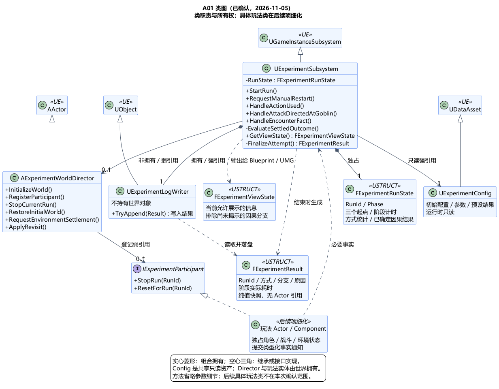

# A01 类图：整体骨架与对象生命周期

状态：**已确认**；A01 总体方案与类图两步均完成。草案日期：2026-10-31；确认日期：2026-11-05。确认依据见[用户原文](../../requirements/001-causal-prototype/sources/2026-11-05-a01-class-confirmation.md)。不代表已经实现或正式冻结。

依据：[A01 总体方案](A01-runtime-and-state.md)、[用户确认及新增流程](../../requirements/001-causal-prototype/sources/2026-10-31-a01-confirmation-and-class-review.md)。

> 2026-11-05 后续变更：[独立核心方向](A03-core-boundary.md)及[类图修订](A03-core-class-design.md)均已确认。本文及配图保留此前确认基线；核心 RunState 已改为标准 C++ 值，由 Session 唯一拥有/写入，Subsystem 负责适配。涉及这些职责时以修订图为准。

## 已确认类设计

采用四个核心类、一个窄接口和三个值类型作为 A01 骨架。具体战斗、AI、树木和表现类在对应项继续设计，不建立所有玩法共用的万能基类或通用事件总线。

| 类或类型 | 基类 / 种类 | 职责和归属 |
| --- | --- | --- |
| UExperimentSubsystem | UGameInstanceSubsystem | 实验协调器；唯一写入当前阶段、救助统计与计时，受理人工重启，判定实验流程并提交结果 |
| AExperimentWorldDirector | AActor | 当前实验世界的装配与生命周期协调入口；初始化实体、停止旧运行、恢复初态、组织环境结算和回访布置 |
| UExperimentConfig | UDataAsset | 只读初始配置、调参值与预设结果；配置结构按后续玩法项细化 |
| UExperimentLogWriter | UObject | 把独立结果快照写入 JSON Lines，并返回写入结果；不引用当前世界对象，不修改玩法状态 |
| IExperimentParticipant | UE 接口 | 参与本轮的领域模块提供停止当前运行、恢复本轮初态的窄接口；接口本身无状态 |
| FExperimentRunState | USTRUCT 值类型 | 协调器独占的本轮编号、阶段、方式统计、计时和已确定因果结果；不复制生命值、树木燃烧等领域状态 |
| FExperimentResult | USTRUCT 值类型 | 日志用结果快照，含本轮编号、方式、分支、结束原因和阶段耗时；不携带 Actor/UObject 指针 |
| FExperimentViewState | USTRUCT 值类型 | 仅向界面提供当前允许展示的内容；不暴露尚未揭示的教师方向和因果映射 |

图中的“玩法 Actor / Component”是后续设计边界，不是新建的通用基类。Blueprint/UMG 消费表现快照和委托，并通过玩家控制层提交操作；输入、视角、对话等具体类留 A05/A10 确认。

## 关键接口与数据流

UExperimentSubsystem 提供三类分开的语义入口：

- `HandleActionUsed`：收到已发生的招式使用事实，在合法统计期更新救助方式。事件表示使用事实，不是原始按键或未执行的输入请求。
- `HandleAttackDirectedAtGoblin`：收到朝哥布林发起攻击的事实，记录首次攻击时间。哥布林行为模块也接收同类通知处理全体转向；协调器不实现敌人 AI。
- `HandleEncounterFact`：发现现场、角色死亡等必要通知，按流程判定结果；具体事件结构与字段留 A02/A06/A07 细化。此命名表示一组类型化入口，不允许演变成无类型字符串消息。

实际接触/命中由战斗与环境模块判定并修改所属状态；协调器只消费流程需要的结果，例如小孩死亡，不接管每次碰撞或重复计算伤害。同一火球可能同时杀死最后一只哥布林与小孩，因此协调器先收集通知，在该次玩法结算完成后通过 `EvaluateSettledOutcome` 判定，不能因第一条哥布林死亡通知就锁定成功；结算批次与优先级在 A02/A06 细化。

协调器通过世界 Director 请求环境结算；只有确认需要保留的环境后果已经处理后，才要求布置回访。`RequestEnvironmentSettlement`、`ApplyRevisit` 是编排接口，计算算法仍由后续环境模块负责。提前成功后的预设降雨仍必须结算。

救援成功只确定救助结果并进入后续阶段。成功路线的最终 `FExperimentResult` 要等需求中的回访完成条件满足后再生成，才能包含完整回访耗时；失败路线在规定的失败结束时点生成。某些阶段未发生时需显式表达，不能伪填零时长。阶段增量记录、写入异常和重复写入处理在 A11 细化。

## 所有权与生命周期

1. GameInstance 管理协调器的引擎生命周期。协调器拥有 RunState 值、LogWriter 对象，并强引用只读 Config。LogWriter / Config 使用反射可见的 `UPROPERTY() TObjectPtr` 持有，不能仅依赖 Outer 维持对象存活。
2. 世界拥有 Director 和实体 Actor；Actor 拥有自身 Component。协调器只弱引用当前 Director；Director 通过弱引用登记参与者，调用前检查有效性。销毁或离开世界时解除委托和登记关系，不能保留悬空对象。
3. 每轮使用新的 RunId；需要跨时间执行的通知带上 RunId，协调器丢弃旧轮通知。新轮开始前先停止旧轮任务和输入接收，再恢复状态；等世界与必需参与者就绪后，由协调器统一启动世界计时，不以 Subsystem 初始化或某个 Actor 的 BeginPlay 代替就绪。暂停、调试加速与实际耗时口径留 A02。
4. `IExperimentParticipant` 只让仍存活的模块清理定时器、临时状态并复位。每个对象确定一个复位入口，避免 Actor 和所属 Component 被重复复位。UE 实现时使用 UINTERFACE 包装类与 I 接口配对，类图省略无业务状态的包装类；弱登记保存实现接口的 UObject，不使用指向纯 I 接口的 UObject 弱指针。Director 同时负责协调清理本轮新增对象、按初始配置恢复已销毁的初始实体；不能把“遍历存活 Actor 调 Reset”当作完整复位。具体对象复用/重建策略留 A11，始终复用同一实验地图，不生成永久世界副本。
5. 游戏关闭后对象会销毁，持久性来自已写入的文件；跨轮留存不等于只把日志留在 GameInstance 内存中。日志写入结果须返回协调器，不能把失败当作写入成功；恢复流程留 A11。

UE 引用类型与生命周期依据：[Object Pointers](https://dev.epicgames.com/documentation/en-us/unreal-engine/object-pointers-in-unreal-engine)、[Subsystems](https://dev.epicgames.com/documentation/en-us/unreal-engine/programming-subsystems-in-unreal-engine)。本机 UE 5.6 的 GameInstanceSubsystem 头文件已核对；未据此确认最终引擎版本。

## 原因与取舍

- 将跨轮流程协调与当前世界实体分开，重置、销毁或重新装配时有明确边界。
- Director 作为地图内 Actor 可直接配置灰盒场景引用；限制为装配和生命周期协调，不能承包 AI、碰撞、雨火和切树算法。
- 独立 LogWriter 与纯值结果便于核对记录，减少日志对场景对象的依赖。
- 表现快照限制可见内容，避免界面在救援时提前显示未来分支。
- 代价是增加一个世界装配入口和一个复位协议；换来可检查的生命周期与职责边界，仍保持少量类。

## 图与待确认内容

[PUML 源文件](A01-class-design.puml)。图中方法为职责级签名，省略参数字段，不是可直接编译的代码。类型化事件结构和具体玩法类待对应项确认。

上述类职责、继承、组合/依赖、状态所有权和生命周期边界已确认。后续按 [A02 总体方案](A02-experiment-flow.md)及其类图逐步细化。
