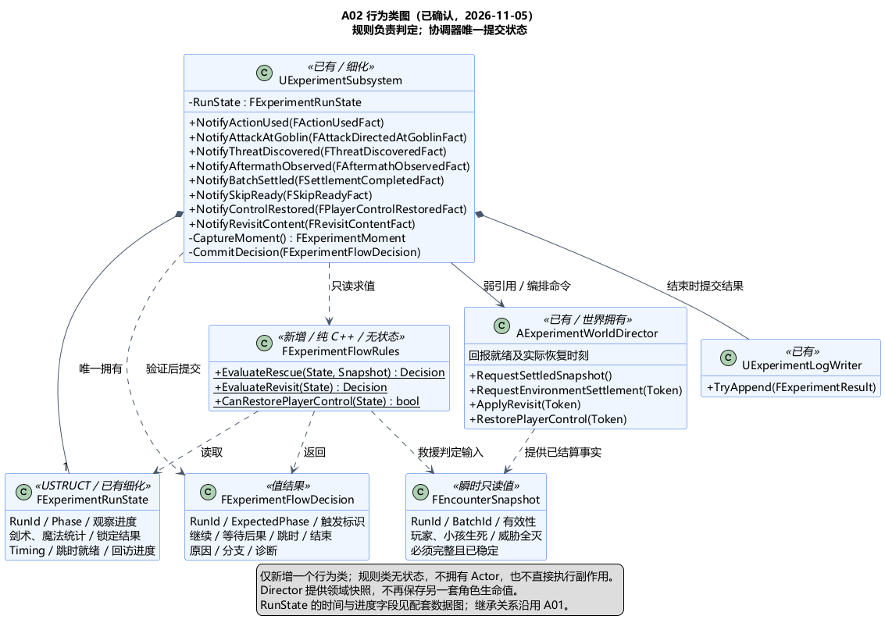

# A02 类图：阶段、计时与结算规则

状态：**类图已确认**。日期：2026-11-05，依据见[类图确认原文](../../requirements/001-causal-prototype/sources/2026-11-05-a02-class-confirmation.md)。[A02 总体方案及计时口径](A02-experiment-flow.md)也已确认。本图细化已确认的 [A01 骨架](A01-class-design.md)，不代表已经实现。

> 2026-11-05 后续变更：[独立核心方向](A03-core-boundary.md)及[类图修订](A03-core-class-design.md)均已确认。本文及配图是此前确认基线；核心值类型迁出 UE，事实处理/状态提交归 ExperimentSession，Subsystem 转为适配器。涉及这些职责时以修订图为准；原阶段、计时、结算和回调语义继续生效。

## 已确认的类职责

本项只新增一个行为类 FExperimentFlowRules，保持无状态的纯 C++ 规则判定；UExperimentSubsystem 仍是运行状态的唯一写入方。其余新增类型是事实、时间点、快照和判定结果等值数据。

| 类 / 类型 | 职责 |
| --- | --- |
| UExperimentSubsystem（已有，细化） | 接收类型化事实、验证归属、取样时钟、更新统计与计时；调用规则并提交阶段转换；向 Director / 日志模块发命令 |
| FExperimentFlowRules（新增纯 C++ 类） | 读取只读运行状态与稳定遭遇快照，计算救援判定；检查跳时就绪和回访完成。无可变状态，不读引擎时钟、不修改 Actor、不写日志 |
| FExperimentRunState（已有，细化） | 保存阶段、观察进度、方式统计、已锁定分支、计时、跳时就绪和回访进度；不存第二套角色生命值 |
| FExperimentTiming（值类型） | 存储独立起点与共享阶段边界，计算实际耗时；不自行取样时钟 |
| FEncounterSnapshot（瞬时只读值） | 保存本轮、本批次的稳定遭遇事实；用于救援判定，不用于回访判定，不长期缓存为可写世界状态 |
| FExperimentFlowDecision（值类型） | 规则输出的最小判定：继续、等待发现后果、进入跳时或结束，以及相应原因、分支或诊断 |
| AExperimentWorldDirector（已有，细化接口） | 协调世界就绪、获取已结算遭遇快照、委托环境结算与回访布置、回报玩家实际恢复控制 |
| UExperimentLogWriter / FExperimentResult（已有） | 接收结束时的纯值结果；记录格式、重试与存储实现仍在 A11 细化 |

FExperimentFlowRules 可用静态纯函数，不需要 UObject、GC 所有权或独立生命周期。它只计算判定，所有副作用由 Subsystem 在提交时统一执行。

## 状态及时间数据

FExperimentRunState 的逻辑字段如下，详细名称为本次提案：

| 字段 | 含义与限制 |
| --- | --- |
| RunId、Phase | 当前轮次和 Preparing / Rescue / TimeSkip / Revisit / Ended |
| ThreatObserved、AftermathObserved、AwaitingAftermath | 活体遇险发现、死亡后果发现、等待发现的流程进度；发现事实一旦成立不因离开区域而清除 |
| SwordUsed、MagicUsed | 统计窗内发生过的两类使用；岩炮弹计入魔法；按使用时事实判断，不按命中时补计 |
| RescueOutcome、LockedBranch、EndReasons | 已提交的救援结果、锁定的教师方向、实际结束原因；方式与原因独立，多原因可同时保留 |
| Timing | 一份 FExperimentTiming；ThreatObserved 可由其发现起点是否存在派生，避免另存一份可矛盾的发现标志 |
| TransitionToken、SkipReady、ControlRestoreRequested | 当前跳时请求标识、环境结算 / 回访布置 / 过渡表现三项就绪，以及是否已发出恢复控制请求 |
| CrowdContentDelivered、TeacherRecallDelivered | 回访两类关键内容确已播放的事实；不以开始对话或进入区域替代 |

FExperimentTiming 只存以下边界：WorldStartedAt、ThreatDiscoveredAt、FirstAttackAt、RescueClosedAt、RevisitStartedAt、AttemptEndedAt，以及是否实际进入过跳时。所有时间点使用 FOptionalExperimentMoment，包含 bIsSet 和 FExperimentMoment；未设置不是 0 秒。

FExperimentMoment 含 EngineWorldSeconds、RealSeconds，均由协调器在事实发生时采样。世界运行秒按该时间点与 WorldStartedAt 的 EngineWorldSeconds 差计算；真实耗时按 RealSeconds 差计算。时间点不直接当日历时间保存到对外日志。

- 救援：FirstAttackAt → RescueClosedAt；未攻击为“未开始”。
- 跳时：实际进入过跳时时，RescueClosedAt → RevisitStartedAt；与救援共享成功边界，不再维护另一份独立的跳时起点。
- 回访：RevisitStartedAt → AttemptEndedAt；与跳时共享恢复控制边界。
- 没进入的阶段为“未发生”；进行中的阶段不能伪装成已完成耗时。

确认过的暂停/等待口径继续生效。补结算旧时代第 180/300 秒属于环境计划的推进位置，不替换事件发生时刻，也不伪造 RealSeconds。剧情 +30 年保持独立。

## 类型化事实入口

每个事实含 FExperimentFactContext：RunId、统一发生序号 Sequence、OccurredAt。Sequence 兼作本轮事件标识，由统一的游戏线程入口分配；重复投递保留原序号，延迟回调保留调度时绑定的归属标识，不在完成时读取当前 RunId 冒充新轮。

| 事实 / 建议入口 | 专属字段或语义 |
| --- | --- |
| FThreatDiscoveredFact / NotifyThreatDiscovered | 确认玩家发现活体遇险；设置发现起点 |
| FAftermathObservedFact / NotifyAftermathObserved | 确认发现死亡后果；只记录该事实，不打开活体救助统计窗 |
| FActionUsedFact / NotifyActionUsed | ActionId、Sword / Magic；已执行的招式，不是单纯按键 |
| FAttackDirectedAtGoblinFact / NotifyAttackAtGoblin | ActionId；首次设置攻击起点；AI 独立消费该事实处理转向 |
| FSettlementCompletedFact / NotifyBatchSettled | BatchId；仅在本批次已开始的伤害处理完后触发判定 |
| FSkipReadyFact / NotifySkipReady | TransitionToken、完成事项；环境完成事实可附带已消费的计划标识，环境内部结构留 A09 |
| FPlayerControlRestoredFact / NotifyControlRestored | TransitionToken；Director 确认镇上玩家确已恢复控制的时刻，才提交 Revisit 边界 |
| FRevisitContentFact / NotifyRevisitContent | CrowdLearning 或 TeacherRecall；关键内容播放完成，非整段对话完成 |

事实不是一个按字符串分派的万能消息。公共 Context 复用元数据，各事实保持自己的类型和字段。

使用招式与朝哥布林攻击是同一 ActionId 的两种合法事实，不能以 ActionId 单独跨类型去重。重复投递按原 RunId + Sequence 识别，动作来源若重发同一使用还应保持“类型 + ActionId”身份。只在有效阶段/待提交批次保留必要的处理标记，具体容器按实现确定；不引入完整事件历史库，也不采用“Sequence 小于最大已见值全部丢弃”的策略。Sequence 用来保留发生顺序，不能掩盖迟到但有效的独立事实。

## 判定及提交

1. Subsystem 验证 RunId、阶段与请求 Token，接收事实并更新自己拥有的最小进度。动作和观察事实保留发生时刻与先后，不用处理时刻重写起点。
2. 当需要判定时，Director 在本轮玩法提交点提供完整且稳定的 FEncounterSnapshot。批次完成要求其必需的使用、指向、观察和命中事实都已登记，不能先提交阶段转换再补发该批次应有事实。该快照包含 RunId、BatchId、快照有效标记、玩家/小孩生死、初始五只威胁是否全部明确消灭；只能依据完整领域记录构造。弱引用失效、注册表为空、读取失败都不能当作死亡或清怪成功。
3. FExperimentFlowRules.EvaluateRescue(State, Snapshot) 执行已确认的优先级；EvaluateRevisit(State) 只看回访进度；CanRestorePlayerControl(State) 检查跳时三项就绪。后两者不依赖救援生死快照。
4. FExperimentFlowDecision 带 RunId、ExpectedPhase、触发批次/事件标识和判定内容。Subsystem 提交前再检查归属与预期阶段；即使同一结果被重复请求，也只提交一次转换。纯规则单元不返回或替换整份 RunState。
5. 提交终止/离开救援时，先关闭旧阶段的接收资格，再停止旧任务，避免取消过程中的回调重入。环境状态和尚需结算的雨计划继续由相应模块负责。完成整轮后才生成 FExperimentResult，日志写入返回结果交由 A11 处理。

**观察也能触发判定。** 发现死亡后果的事实，即使在同批次死亡快照到达前收到，也必须保留；不能只在已进入 AwaitingAftermath 时受理。观察事件请求下一个可用的稳定判定点，不依赖将来再发生一次伤害。正在结算时先等待该批完成；没有待结算伤害时即可取得稳定快照。实际感知如何识别死亡后果由后续感知/表现设计细化。

完整稳定的快照若出现“救援成功但方式为空”，规则返回既有设计缺口的诊断，保留真实事实，不生成虚构教师分支或把它冒充正常失败。该风险仍待 A04/A06 验证与必要修正，本类图不宣称已解决场景可达性。

## 准备、跳时与生命周期

- 准备时先为待启动一轮预留 RunId，发给 Director 和参与者，用于匹配世界就绪回调；只有它们就绪才激活本轮并记录 WorldStartedAt。预留标识不提前启动世界计时。
- 每次跳时请求生成 TransitionToken。环境、布置、表现三个完成通知可以先后到达，也可重复；仅匹配本轮、当前阶段、当前 Token 的通知置位。
- 三项就绪后向 Director 发一次恢复控制请求，仍处于 TimeSkip；收到实际恢复控制的匹配确认，才用同一时刻结束跳时、开始回访。不能把发送恢复请求当作已恢复。
- 结束、人工重置或世界卸载先使旧阶段/请求失效，再解绑/取消回调。旧轮通知、同轮旧阶段通知和旧 Token 通知均不能更新新状态。去重缓存和请求就绪标志随生命周期清理，日志文件继续保留。

## 类图与确认边界

[行为类图 PUML](A02-class-design.puml) · [状态与时间数据图](A02-state-data.png) · [数据图 PUML](A02-state-data.puml)。方法为职责级签名，省略 UE 反射声明与完整参数；技术栈沿用已确认的 C++ / USTRUCT / Delegate / UE 时间源。

本项选择的原因：纯规则只读取数据，方便以“同批次小孩与哥布林同时死亡”等输入直接核对；协调器唯一提交，避免出现两个状态机；时间点和值快照让计时与领域对象生命周期分开。代价是多一个很小的规则类和明确的事实类型。

上述职责分配、数据结构、判定/提交边界及回调生命周期已确认。后续进入 [A03 技术栈与工具链方案](A03-toolchain-and-dependencies.md)确认。没有游戏实现，也没有宣称测试已通过。
