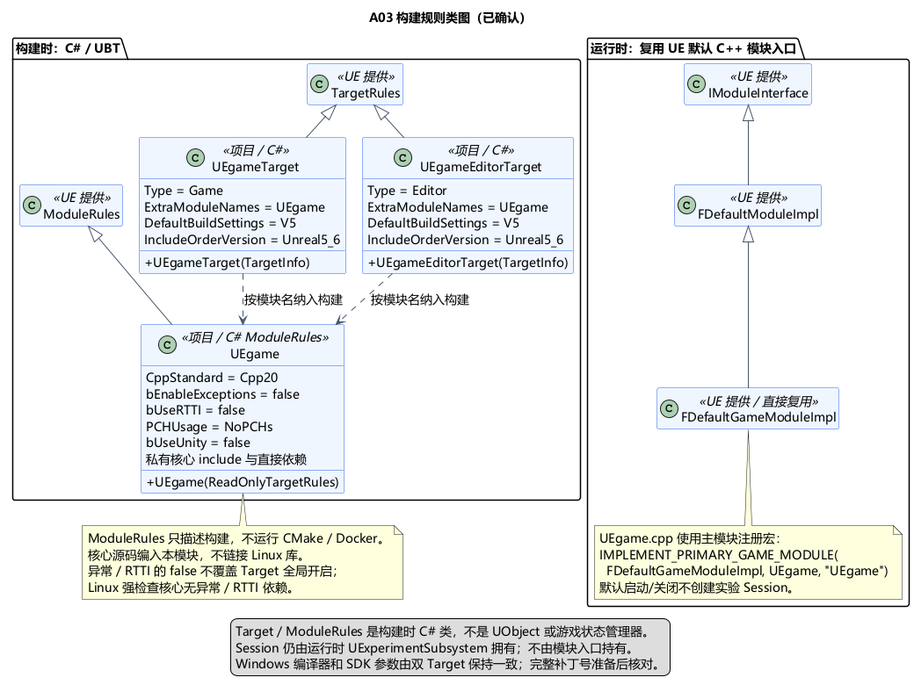

# A03 构建规则类图与独立构建目标

状态：**构建规则类图已确认**。日期：2026-11-05。依据：[用户确认](../../requirements/001-causal-prototype/sources/2026-11-05-build-class-confirmation.md)。[Windows 总体](A03-toolchain-and-dependencies.md)、[Linux/GCC 补充](A03-linux-core-build.md)与[核心类图](A03-core-class-design.md)均已确认。本文确定构建类、入口、目标依赖、具体目录和编译参数；所有工程路径是未来布局，当前不创建工程或实现。

## UE 构建类及模块入口

| 类 / 入口 | 类型与继承 | 已确认职责 |
| --- | --- | --- |
| `UEgameTarget` | C#，继承 UBT `TargetRules` | Game 目标；选择 UEgame 主模块；固定 UE5.6 的构建默认值及 Win64 工具链参数 |
| `UEgameEditorTarget` | C#，继承 UBT `TargetRules` | Editor 目标；包含同一个 UEgame 模块，使用相同的已确认工具链约束 |
| `UEgame` | C#，继承 UBT `ModuleRules` | 描述游戏模块的 C++ 标准、依赖、核心私有 include 路径及编译选项；它不是运行时游戏类 |
| `FDefaultGameModuleImpl` | UE 现有 C++ 类，继承 `FDefaultModuleImpl`，后者实现 `IModuleInterface` | 作为游戏模块的默认加载入口，不保存 Session 或世界状态 |
| `UEgame.cpp` 中的主模块注册 | C++ 宏，非类 | 使用 `IMPLEMENT_PRIMARY_GAME_MODULE(FDefaultGameModuleImpl, UEgame, "UEgame")` 注册主模块；无需新增自定义模块管理类 |

两个 Target 都只声明主模块名 UEgame。`.uproject` 的模块项为 Runtime、默认加载阶段；Editor Target 不新增自定义 Editor 模块。本次也不建立 Server Target。

`TargetRules` 接收 `TargetInfo`；`ModuleRules` 接收 `ReadOnlyTargetRules`。二者由 UBT 在构建时使用，不能持有运行中的 Session、UObject 或 Actor。运行时模块注册和 Subsystem 生命周期是两个边界，核心会话仍由已确认的 UExperimentSubsystem 拥有。

## 具体编译规则

### UEgame ModuleRules

- 模块级 `CppStandard = CppStandardVersion.Cpp20`、`bEnableExceptions = false`、`bUseRTTI = false`，表达模块不主动请求异常/RTTI，细化已确认的核心语言策略。
- **模块 false 不等于最终编译参数关闭。** 本机 UE5.6 的普通 Editor 目标会全局启用异常，模块设置以逻辑或合并，不能用 false 覆盖全局 true。核心“不依赖异常/RTTI”由 Linux GCC 的强检查验证；UE Game/Editor 实际参数分别核对，不为强求参数相同修改引擎或绕过共享环境限制。
- 原型阶段对 UEgame 使用 `PCHUsage = PCHUsageMode.NoPCHs`、`bUseUnity = false`。让各翻译单元明确包含所需头文件，代价是项目模块编译可能较慢；这些选项仅作用于项目模块，不修改引擎模块的构建环境。
- `PrivateIncludePaths` 增加模块下 `Private/ExperimentCore/include` 的相对派生路径。核心源码仍不包含 UE 头或导出宏。
- 当前游戏代码对模块外没有 C++ 公共 API，项目类头文件可以放 Private。Core、CoreUObject、Engine 等实际直接依赖声明为 Private；UMG、Json 在开始直接使用时加入。仅实际对外公开头所需要的依赖才提升为 Public，且公开头不得依赖 Private 中的核心定义。
- UBT 编译该模块内的纯核心源码；不把 Linux `.a/.so` 或另一份核心库加入 `PublicAdditionalLibraries`，防止二进制不兼容或重复定义。
- Build.cs 构造期间只声明构建规则，不启动 Docker、不运行 CMake、不安装工具、不进行网络操作。双路径验证由后续验证入口顺序编排。

### Game / Editor TargetRules

- 分别设置 `Type = TargetType.Game` / `TargetType.Editor`，`ExtraModuleNames` 包含 UEgame。
- 两者使用 `DefaultBuildSettings = BuildSettingsVersion.V5` 和 `IncludeOrderVersion = EngineIncludeOrderVersion.Unreal5_6`，保持固定 UE 版本的含义，不使用随引擎升级变化的 Latest。
- Windows 平台选择 `WindowsCompiler.VisualStudio2022`、`WindowsSdkVersion = "10.0.22621.0"`。`CompilerVersion` 使用环境准备后核对的 **14.38 实际完整版本**，不能把范围、Latest 或当前 14.44 冒充已固定版本；当前未发现 14.38，故不虚构补丁值。
- 固定版本缺失时报告缺项，构建日志核对实际工具目录与版本。两种 Target 应一致，不写入个人安装绝对路径；用户级覆盖不得被当成项目的唯一版本依据。
- 不为消除配置差异而启用 `BuildEnvironment.Unique` 或忽略引擎共享环境检查。模块策略放 ModuleRules，不全局改动安装版引擎的编译设置。

上述类型和属性已对照本机 UE5.6 源码核对，尚未实际编译工程。异常全局设置见 `Engine/Source/Programs/UnrealBuildTool/Configuration/UEBuildTarget.cs:5474`，合并见同目录 `UEBuildModuleCPP.cs:2310、2316`；安装版 Unique 限制见 `System/RulesAssembly.cs:677`。均相对已记录的本机 UE 安装。模块规则参考：[UE Module Properties](https://dev.epicgames.com/documentation/en-us/unreal-engine/module-properties-in-unreal-engine?application_version=5.6)、[UE Modules](https://dev.epicgames.com/documentation/en-us/unreal-engine/unreal-engine-modules?application_version=5.6)。

## CMake 目标关系

CMake 目标与 Docker 阶段是构建关系，不建成虚构的业务类。独立构建入口使用项目根 `CMakeLists.txt`，只描述核心侧，不发现或调用 Unreal Engine。

| 构建项 | 种类 | 依赖与边界 |
| --- | --- | --- |
| `experiment_core` | CMake STATIC library | 显式列出同一份 ExperimentCore 源码；只包含核心头和标准库；Linux 输出本平台静态库 |
| `experiment_core_checks` | CMake executable | 从模块之外的 Tests 目录编译 main/检查场景，链接 experiment_core；按已确认入口驱动 Session，不直接写状态 |
| CTest 场景 | 测试注册，非 C++ 类 | 使用 `add_test(NAME … COMMAND experiment_core_checks …)` 注册场景；只有明确执行检查且结果符合预期才成功 |
| 头文件自包含检查 | 独立编译检查步骤 | 每个公开核心头在独立翻译单元中单独包含；生成源文件及输出放构建目录，不放 UE Source 中；具体脚本归 A12 |

核心库和检查程序均指定 C++20、标准必须满足、关闭扩展；GCC 目标显式使用 `-fno-exceptions -fno-rtti -pedantic-errors`。不启用 CMake 预编译头、Unity Build、全局强制包含或 UE include。配置验证 GCC13 的 Linux x86_64 目标，不以 Windows MinGW/TDM-GCC 替代。

验证配置应启用 `BUILD_TESTING`，显式注册场景并执行 CTest；测试数量为零或程序未运行不能视为验证通过。检查程序用显式失败结果和非零退出码报告错误，不依赖可能在 Release 中被移除的 `assert`。最低场景沿用已确认的同批死亡、观察触发判定、旧轮回调/效果、雨计划及实际恢复控制边界。

CMake 显式源清单与 UBT 纳入的核心 `.cpp` 集合要保持一致。后续验证需检查遗漏或重复，不能出现 Linux 未编译某个核心文件而 Windows 已编译的假一致。标准库函数可能具备抛异常行为，核心应使用先校验/显式结果的安全前置条件，不将禁止异常编译误称为所有资源耗尽均可恢复。

目标类型依据：[CMake add_library](https://cmake.org/cmake/help/v3.28/command/add_library.html)；测试注册与退出码依据：[CMake add_test](https://cmake.org/cmake/help/v3.28/command/add_test.html)。

## 已确认目录边界

以下为设计布局，不代表文件已创建：

```text
UEgame.uproject
CMakeLists.txt                       # 仅核心的独立构建入口
Source/
  UEgame.Target.cs
  UEgameEditor.Target.cs
  UEgame/
    UEgame.Build.cs
    Private/
      UEgame.cpp                    # 默认主模块注册
      ExperimentCore/
        include/experiment/         # 无 UE 类型、宏和 OS API
        src/                        # 两条路径编译的同一份核心源码
      ExperimentAdapter/            # UObject / DTO / 时钟与效果适配
      World/ Combat/ Environment/ Revisit/ UI/
Tests/
  ExperimentCore/                   # 检查程序 main 与场景；不在 UE 模块内
.build/
  core-linux-gcc13/                  # CMake 输出，不在 Source 内
```

以上目录均按项目根相对定位，不把 G:、用户目录或 Linux 机器的绝对路径写入构建规则。运行数据、测试输入和构建产物彼此分离；具体验证脚本和产物忽略规则在 A12 / 后续工程初始化处理。

## 数据流、理由与未来 Docker

UE 路径：`.uproject` / TargetRules 选目标 → ModuleRules 配依赖和编译策略 → UBT/UHT/MSVC 构建 → 默认入口注册模块 → Subsystem 在运行时创建 Session。模块加载不启动实验计时，仍等待 A02 世界就绪条件。

Linux 路径：CMake 读取核心源码清单 → GCC 编译静态库与检查程序 → CTest 输入场景并核对结果。二者复用源码和规则，不共享跨平台二进制。这样的分工使版本约束、依赖、模块加载和业务状态各有明确位置。

未来 Docker 仍按已确认 Ubuntu 多阶段方向推进：builder 编译并验证，runtime 携带之后选定的正式宿主及必要运行库。正式宿主尚未设计，因此本图不新增宿主 C++ 类、网络服务或可部署 Dockerfile。规则检查程序可验证核心，但不承担 UE 世界模拟。

## PUML 与本次确认范围



[类图 PUML](A03-build-class-design.puml) · [核心构建目标图](A03-build-targets.png) · [目标图 PUML](A03-build-targets.puml)。

已确认：两个 TargetRules 类、一个 ModuleRules 类、复用默认模块入口；项目模块编译与依赖边界；CMake 库/检查程序/CTest 关系及目录隔离。后续空间与地图方案见 [A04：球体世界、局部活动区域与球体小地图](A04-spherical-world.md)，确认顺序继续先总体后类图。
