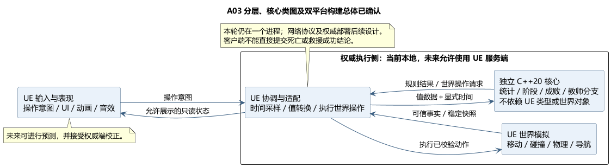

# A03 补充：独立核心规则与 UE 分层

状态：**分层方向及受影响类图均已确认**。日期：2026-11-05。依据：[分层确认原文](../../requirements/001-causal-prototype/sources/2026-11-05-core-separation-confirmation.md)和[类图确认原文](../../requirements/001-causal-prototype/sources/2026-11-05-core-class-confirmation.md)。后续 A03 总体、[Linux/GCC 具体选型](A03-linux-core-build.md)及[构建规则类图](A03-build-class-design.md)也已确认；后续空间与地图方案见 [A04](A04-spherical-world.md)，未正式冻结。

## 已确认边界

| 层 | 技术与职责 | 运行位置 |
| --- | --- | --- |
| 独立核心规则 | 标准 C++20；不使用 UObject、Actor、USTRUCT、UE 容器或 UE 时钟。负责统计、阶段、成败、教师分支等规则，接收值数据与显式时间 | 本轮本地；未来可由权威服务端复用 |
| UE 世界模拟与适配 | UE C++、Actor/Component；移动、碰撞、物理、导航和实体生命周期；提供可信事实并执行规则结果 | 本轮本地；未来允许使用 UE 服务端 |
| UE 输入与表现 | Blueprint、UMG、动画、音效等；提交操作意图并呈现允许显示的状态 | 本轮本地；未来主要在客户端 |

UE 5.6.1、Windows 工具链及源码库集成已由 [A03 总体方案](A03-toolchain-and-dependencies.md)确认，[Linux/GCC 构建具体选型](A03-linux-core-build.md)也已确认。三层是职责边界，不自动等于三个进程、三个插件或三个 UE Runtime 模块。

## 数据流

1. 玩家提交操作意图，由拥有最终决定权的一侧检查并执行。
2. UE 世界模拟计算移动、碰撞及所属实体变化；在已确认结算边界提供可信事实和稳定快照。
3. 独立核心规则读取事实与显式时间，计算并推进实验规则；世界操作仍交给 UE 执行。
4. 表现层接收必要的只读状态；尚未揭示的未来教师分支不进入界面数据。

本轮仍是本地单进程。未来联网需要专门确认服务端状态归属、RPC、复制对象、预测与校正、玩家/世界/会话关系和服务端构建部署。源码可移植不等于这些机制已经完成；进程内 Delegate 和 GameInstanceSubsystem 本身也不构成跨机器权威。

## 原因与取舍

核心可脱离场景验证，后续能复用规则；UE 继续承担世界模拟，减少重新建设物理和导航的工作。代价是显式的数据边界、输入时间和效果返回，以及必要的类型转换。没有要求当前原型实现完整联网，也没有承诺非 UE 服务端或物理跨平台确定性。

UE 的服务器权威和独立服务器能力参见 [Epic 网络概述](https://dev.epicgames.com/documentation/en-us/unreal-engine/networking-overview-for-unreal-engine?application_version=5.6)；客户端可能同时运行预测，参见 [Epic 角色移动网络流程](https://dev.epicgames.com/documentation/en-us/unreal-engine/understanding-networked-movement-in-the-character-movement-component-for-unreal-engine?application_version=5.6)。以上职责分配是本项目的设计决定。

## 受影响的历史设计

- A01/A02 的阶段、结算优先级、三起点、时钟口径、回访条件、实体状态归属继续成立。
- 旧类图中以 USTRUCT 表示核心状态、由 Subsystem 承担规则提交的边界已被本次修订替代。旧图保留为历史确认基线，当前类职责以修订图为准。
- [受影响类图修订](A03-core-class-design.md)已确认核心会话、纯规则及 UE 适配职责，包括状态所有权迁移和效果协议。
- A03 已确认独立规则源码库编入单个 Runtime 模块，Linux/GCC 路径从同一源码独立构建；具体构建规则类与目标细化见已确认的构建规则类图。

## PUML

[PUML 源文件](A03-core-boundary.puml)。图中“权威执行侧”表示职责归属，本轮不创建服务器进程。
