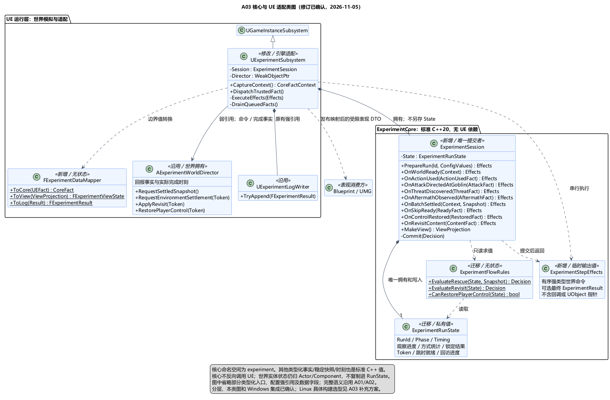

# A03 补充类图：独立核心与 UE 适配

状态：**类图修订已确认**。日期：2026-11-05。依据：[类图确认原文](../../requirements/001-causal-prototype/sources/2026-11-05-core-class-confirmation.md)。[三层方向](A03-core-boundary.md)及本文类职责、状态所有权迁移、数据和效果边界已确认；随后 A03 总体也获确认，并新增 [Linux/GCC 与 Docker 方向](A03-linux-core-build.md)。核心类职责不因此改变。

## 本次设计目标

让统计、事实归属校验、阶段提交与成败规则能够脱离 UE 执行。已确认新增纯 C++ `experiment::ExperimentSession`，接替 UE Subsystem 内的实验规则处理。原 Subsystem 转为引擎适配器，拥有 Session，且不再另存或直接写 RunState。这里只有一个状态机、一份实验状态和一个提交者。

A01/A02 中角色生命值、树木状态仍由所属 Actor/Component 维护；核心只接收瞬时快照，不复制另一套可写世界。

## 类职责与技术栈

| 类 / 类型 | 所属层 | 已确认职责 |
| --- | --- | --- |
| `experiment::ExperimentSession` | 独立 C++20，新增 | 独占 RunState；接收类型化事实；验证轮次、阶段、请求和重复投递；更新统计及计时；调用 FlowRules；唯一提交阶段并返回待执行效果 |
| `experiment::ExperimentFlowRules` | 独立 C++20，迁移 | 延续原 FExperimentFlowRules：无状态，只读求值救援、回访与恢复控制条件；不执行副作用 |
| `experiment::ExperimentRunState` 及其时间/事实/快照/判定类型 | 标准 C++ 值类型，迁移 | 移除 UE 反射与 UE 类型依赖，保留原有字段含义和缺省值语义；由 Session 私有持有 |
| `experiment::ExperimentStepEffects` | 标准 C++ 值类型，新增 | 本次核心处理返回的有序、强类型世界操作请求，以及可选的最终结果；不携带函数回调或 UObject 指针，不替换整份世界状态 |
| `experiment::ExperimentViewProjection` / `ExperimentResult` | 标准 C++ 输出值 | 分别提供允许显示的数据和完整最终日志结果；不是可反写的 RunState 副本 |
| `UExperimentSubsystem` | UE C++，职责缩减 | 拥有 Session；采样 UE/真实时间，分配事实序号并保留原发生上下文，绑定世界回调；把可信事实交给核心，串行执行返回效果 |
| `FExperimentDataMapper` | UE C++，新增无状态辅助类 | 必要时在 UE 反射 DTO 和核心值之间无损转换；把受限投影转为 FExperimentViewState，把最终结果转为日志 DTO；不判定成败、不存状态 |
| `AExperimentWorldDirector` | UE Actor，沿用 | 组织世界就绪与实体生命周期，提供稳定快照，执行环境结算/回访布置/恢复控制；回报实际完成事实 |
| `UExperimentConfig` / `UExperimentLogWriter` | UE 对象，沿用 | 只读资源配置与 JSON Lines 输出；需要的配置值由适配层传入核心，核心不访问资源或文件 |

类图中的短名 `Session`、`State` 等仅用于签名可读性；类型位于 `experiment` 命名空间。接口均为职责级设计，并非可编译实现。

## 所有权与数据边界

1. Subsystem 拥有一个 Session；Session 私有拥有唯一 RunState。Subsystem 不再保留旧的 `FExperimentRunState` 成员，也不获得可写 State 引用。核心不持有 UObject，原生 C++ 成员按所属对象的 C++ 生命周期管理，不使用 UPROPERTY 管理核心值。
2. FlowRules 保持无状态；只有 Session 调用其判定并提交。映射器无状态。没有另设客户端规则状态副本或第二协调器。
3. 核心时刻保留 `EngineWorldSeconds`、`RealSeconds` 两个显式数值；可选起点使用标准 C++ 可选值表达“未发生”，不能把 0 秒当未设置。世界时间/真实耗时/剧情年数的三种语义沿用 A02。
4. RunId、ActionId、BatchId、TransitionToken 使用稳定值标识；UE 映射必须无损，不能使用 Actor 地址或有损字符串散列替代身份。Sequence 继续表示统一发生序号，重复投递保留原序号；不采用“比最大已见序号小就丢弃”的规则。
5. 原 A02 事实、快照、FlowDecision 和 Timing 的领域字段迁入标准 C++ 类型。只在实际 Blueprint/UE 反射边界建立必要 DTO，不为全部核心类型机械复制 USTRUCT。Director 可在 C++ 中直接构造核心 EncounterSnapshot。核心类型不直接用于 UPROPERTY、UFUNCTION 或动态委托的反射签名；纯 C++ 入口无需绕行 USTRUCT。
6. `FExperimentViewState`、日志用 `FExperimentResult` 可保留为 UE 边界 DTO。核心先生成受限 ViewProjection，映射器不接受完整 RunState 来拼 UI，避免提前泄露教师分支。最终日志结果仍须等规定结束时点才产生。
7. Config / LogWriter 继续用反射可见的强引用持有，Director 继续弱引用。映射器不承担 GC 引用，纯核心对象不认识这些 UE 对象。

## 处理数据流

1. UE 玩家控制/玩法模块处理操作意图并产生可信的使用、指向、观察或结算事实。战斗伤害与命中算法仍留 A06；本次不把 Director 或 Session 改成万能战斗管理器。
2. 适配层在事实发生时采样时钟、分配上下文；延迟和重投通知保留原 RunId、Sequence、OccurredAt、Token，不在交给核心时重新盖章。将纯值事实传入 Session 的对应类型化入口。
3. Session 校验事实并更新自身状态；需要救援判定时等待本批次完整稳定快照。观察死亡后果可请求新的稳定快照，不依赖未来伤害。所有使用/指向/观察事实先登记，再受理该批结算快照。
4. Session 调用 FlowRules，重新检查判定归属和预期阶段，先提交状态及请求标识，再返回 StepEffects。效果采用封闭的强类型命令，例如请求稳定快照、环境结算、回访布置、过渡表现、恢复控制或停止当前运行；不使用字符串万能消息。具体载荷仍按对应玩法项细化。
5. Subsystem 在游戏线程按序执行效果，将完成情况作为新的值事实回送。核心不调用 UE 或执行网络/磁盘操作。同步产生的回调先排队，在当前核心调用和效果批处理结束后再受理，避免重入；队列保持实际发生顺序和原上下文。
6. 世界操作及其完成事实携带 RunId、适用阶段和必要的 Token。Session 验证完成事实；Subsystem 执行每个待执行效果前也校验该请求仍有资格，旧轮或已取消的推进命令不执行，避免重置后执行上轮残留效果。终止后的停止/清理命令按其专门的生命周期资格执行，不因阶段已结束而一律丢弃。三项跳时就绪后仅发一次恢复控制请求；收到真实恢复确认才提交 Revisit 起点。停止、失效或旧轮回调不允许修改新轮。
7. 失败的世界操作不能伪造成功完成；适配层报告失败并保持所需就绪条件未满足。具体重试/错误提示按后续项细化，不新增成功路径。日志写入成功与否仍返回适配层，重试/去重/失败呈现留 A11。

世界命令和最终结果是本次处理的临时输出，由适配层消费；不建立新的持久事件库或通用可靠消息系统。执行效果还需验证当前绑定世界；世界卸载使其未执行效果失效。Rescue 离开时停止的是旧救援任务、输入和在途攻击，环境状态及未消费的雨计划仍须保留，不能把停止命令解释成销毁整个实验。后续联网时所有权与效果协议仍需专门验证，不能直接把这些本地 C++ 对象当网络序列化格式。

## 保持的 A01/A02 规则

- 准备世界就绪后才启动时钟；RunId 可以提前预留。
- 世界启动、发现活体遇险、首次朝哥布林攻击三个起点独立。
- 同批次全部结算后判断，死亡条件优先；缺失/无效引用不等于死亡。
- 发现前遇难等待后果发现；观察本身能触发判定。
- 提前救援仍完成旧时代雨计划；时间跳跃仍待三项就绪和实际恢复控制。
- 回访双条件均完成后生成完整成功结果；各阶段未开始/未发生的含义不变。
- 人工重置先使旧轮和请求失效，再由 UE 停止与复位世界；日志跨轮保留。Session 的轮次重建/复位不启动新世界时钟，仍等待就绪。

“无使用方式却成功清怪”的已知场景风险继续留 A04/A06 验证；迁移类型不能通过补造事实掩盖它。

## 构建边界与验证计划

核心源码库名为 ExperimentCore。已确认规则源文件形成独立子树，本轮编译链接进 UEgame Runtime 模块，同进程直接调用；同一份源码在 Linux/GCC 下独立构建。Windows 集成不增加独立 DLL 或额外 UE 生命周期模块。CMake/CTest、Linux 版本和未来容器构建边界已由 [A03 补充方案](A03-linux-core-build.md)另行确认；正式容器宿主协议后续设计。

核心头文件/源码不得包含 UE 头、反射/模块导出宏，不以 PCH、Unity Build 或被其他文件间接包含的头作为隐藏依赖。实施时需要无 UE include 路径、无 PCH/强制包含、逐翻译单元编译并验证头文件自包含，再用既有关键场景验证行为不变：同批死亡、发现后果触发判定、旧轮回调与旧效果、提前救援后的雨计划和实际恢复控制边界。当前仅设计，未编译或执行这些验证。

## 原因与确认范围

新增 Session 使状态处理本身能够独立运行；Subsystem 只负责引擎适配。保留 FlowRules 便于直接验证规则优先级。代价是一个核心会话类、一个转换辅助类和显式效果返回，换取规则与 UE 的单向依赖。

[类图 PUML](A03-core-class-design.puml)。已确认：Session 唯一拥有/提交状态；FlowRules 纯求值；Subsystem 只适配；值类型与反射 DTO 分离；显式效果和串行回调边界。[A03 构建规则类图](A03-build-class-design.md)也已确认，后续空间与地图方案见 [A04](A04-spherical-world.md)。尚未创建游戏实现或执行编译验证。
