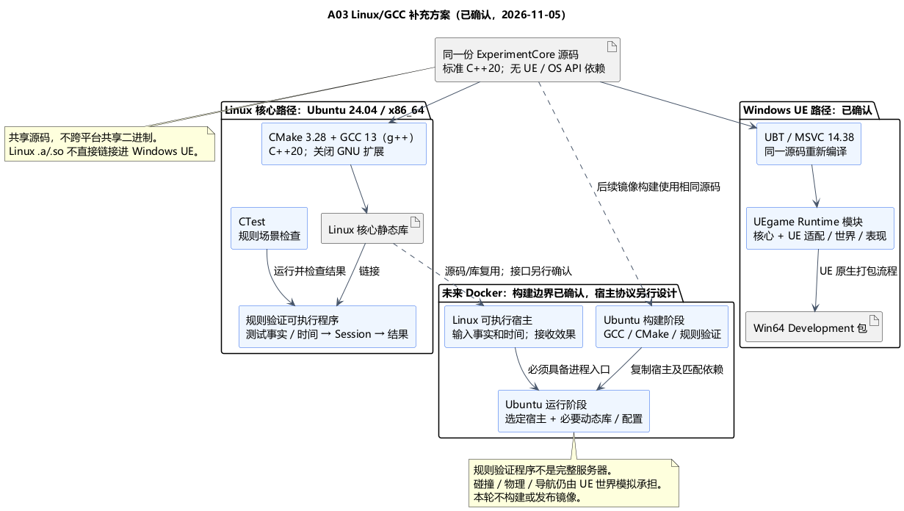

# A03 补充：Linux/GCC 核心与未来 Docker 运行

状态：**Linux/GCC 具体构建选型与未来 Docker 边界已确认**。日期：2026-11-05。依据：[方向确认](../../requirements/001-causal-prototype/sources/2026-11-05-a03-confirmation-linux-gcc.md)和[补充方案确认](../../requirements/001-causal-prototype/sources/2026-11-05-linux-build-confirmation.md)。[构建规则类图](A03-build-class-design.md)也已确认，后续空间与地图方案见 [A04](A04-spherical-world.md)，尚未实现或正式冻结。

## 已确认要求的解释

核心以 Linux/GCC 作为主要独立构建与验证环境，代码保持标准 C++20、无 UE 依赖。同一份源码在 Windows UE 工程中由已选 MSVC 重新编译。两条路径共享源码和规则语义，分别生成各自平台的二进制；Linux GCC 生成的 .a/.so 不直接链接到 Windows UE。

Linux 平台细节放在运行宿主或适配层。纯规则中不调用 POSIX/Win32、操作系统时钟、文件、网络或进程 API；时间和事实继续由宿主显式传入。Linux/GCC 目标不等于采用 GNU 专有语法或另写一份 Linux 规则。

## 已确认技术栈

| 项目 | 已确认选择 | 原因与边界 |
| --- | --- | --- |
| 核心参考 Linux | Ubuntu 24.04 LTS，x86_64 | 作为独立核心验证基线；与 Windows x64 目标对应，不同时扩展 ARM 构建 |
| C++ 编译器 | GCC 13 系列，使用 g++ 驱动编译/链接 | 使用该发行版可提供的 GCC 系列；具体补丁在准备环境时记录并锁定，不宣称已安装 |
| 语言模式 | C++20，显式关闭编译器扩展 | 使用 GCC 与已选 MSVC 共同支持的标准能力；新语言/标准库特性按双路径验证，不在此引入 C++20 modules |
| 独立构建 | CMake 3.28 系列＋CTest | 描述标准 C++ 目标、统一构建与检查入口；只负责核心侧，不替换 UBT/UHT/UAT |
| Linux 产物 | ExperimentCore 核心静态库＋规则验证可执行程序 | 静态库供 Linux 宿主链接；验证入口提供可执行的语义检查，不当作正式服务器 |
| 未来 Docker | 多阶段构建；构建和运行阶段均以 Ubuntu 24.04 系列为参考 | 构建阶段使用 GCC/CMake，运行阶段只携带选定宿主、必要动态库和配置；正式运行宿主另行设计 |

Ubuntu 官方包索引提供 [G++13](https://packages.ubuntu.com/en/g%2B%2B-13)。GCC 标准模式参见 [C++ 标准支持](https://gcc.gnu.org/projects/cxx-status.html)。CMake 的 [CXX_EXTENSIONS](https://cmake.org/cmake/help/v3.28/prop_tgt/CXX_EXTENSIONS.html) 默认允许扩展，因此方案显式关闭；同时启用 [CXX_STANDARD_REQUIRED](https://cmake.org/cmake/help/v3.28/prop_tgt/CXX_STANDARD_REQUIRED.html)，不允许静默降级标准。

这些版本是已确认基线，不代表最新版本，也不代表所有 C++20 特性均已验证。构建时记录完整编译器、标准库、CMake 和镜像版本；镜像实施时固定摘要并建立更新记录，不将浮动标签当作可重复构建证明。

## 同一份源码、两条构建路径

1. UEgame 模块内的 ExperimentCore 保持独立 include/src 子树。CMake 从这份源文件建立纯核心目标，UBT 在 Windows 中编译同一份源文件；不复制源码，不同时链接另一份核心实现。
2. Linux 路径：CMake → g++ → 核心静态库 → 规则验证可执行程序 → CTest。检查构建不得使用 UE include、UE 预编译头、Unity Build 或隐式强制包含；公开头须能自包含。
3. Windows 路径：UBT/MSVC 将核心和 UE 适配/世界代码编入游戏模块；反射只作用于 UE 边界。Linux 主验证不能替代 Windows 集成构建及独立打包启动验证。
4. Linux 验证程序的 main 与验证源文件放在 UE 模块源码树之外；Linux 构建输出也放在 Source 之外，防止 UBT 将检查入口或生成的编译探测源码误编进游戏。CMake 使用明确的核心源码清单，构建目录按平台/编译器分开。
5. 双路径使用相同的规则场景：同批次死亡优先、观察死亡后果触发判定、旧轮事实与旧命令、提前救援后的雨计划、实际恢复控制才开始回访等。检查程序只通过 Session 的既有入口提供合成事实/显式时间、回报效果完成，不直接写 RunState，不添加第二状态机。目标是验证规则输出语义一致，不承诺物理模拟或浮点位级确定性。
6. 已确认核心不依赖 C++ 异常控制流或 RTTI，错误以显式结果表示。Linux GCC 强检查这一源码约束，UEgame 不主动请求启用；Editor 全局可能启用异常，不能要求两条路径最终 flags 完全相同。具体参数与核对方式见已确认构建规则。关闭扩展和双编译检查只能提供证据，不能单独证明完全可移植。

## Docker 运行边界

规则库本身没有进程入口。Docker 中要运行规则，需由一个 Linux 可执行宿主创建 ExperimentSession、传入事实和时间、接收效果，并决定由谁执行世界操作。

已确认先用规则验证程序检查核心可在 Linux 中构建和执行。未来正式宿主、输入协议、日志/退出行为、网络连接与世界事实来源另行设计；不能把验证程序、静态库或仅执行规则的容器当作完整游戏服务器。

未来多阶段镜像可在构建阶段运行验证，再将选定宿主及其实际依赖放入运行阶段。动态链接的 libstdc++、libgcc、glibc 等按产物检查，保留与构建环境兼容的版本；本方案不默认全静态链接，也不使用 scratch 或不同 libc 的基础镜像。参见 [Docker 多阶段构建](https://docs.docker.com/build/building/multi-stage/)。

当前世界模拟仍在 UE。若未来需要把 UE 世界模拟部署到 Linux 服务端，应使用对应 UE 的 Linux 工具链重新构建同一份核心源码及 UE 代码；GCC 核心检查产物不能默认与 UE Linux 二进制兼容。本机 UE5.6 配置 `Engine/Config/Linux/Linux_SDK.json` 指定 `v25_clang-18.1.0-rockylinux8`，与独立核心的 GCC 路径分开。

## 原因与代价

Linux/GCC 可尽早暴露对 Windows、UE 和编译器扩展的依赖；保持源码级兼容让当前 Windows 原型继续使用成熟的 UE 构建链。CMake/CTest 提供独立入口，多阶段 Docker 让编译环境与最终运行内容分开。

代价是维护两条编译验证路径、明确宿主边界和记录运行库版本。规则与核心类图不增加第二状态机，现有 Session / FlowRules / UE 适配关系不变。

## 当前证据与下一步

[本机核对](A03-environment-evidence.md)仅发现 Windows Docker CLI 与 WSL 入口；WSL 发行版查询失败、Docker 配置读取受限。当前 PATH 中的 TDM-GCC 目标是 Windows，不能充当 Linux/GCC 验证。未安装环境、运行 Linux 编译或构建镜像。

[PUML 源文件](A03-linux-core-build.puml)。Ubuntu24.04/x86_64、GCC13、CMake3.28/CTest、同一源码双构建、Linux 规则验证入口及未来 Docker 边界均已确认。[A03 构建规则类图](A03-build-class-design.md)也已确认；CMake 目标以构建关系展示，正式容器宿主仍另行设计。
