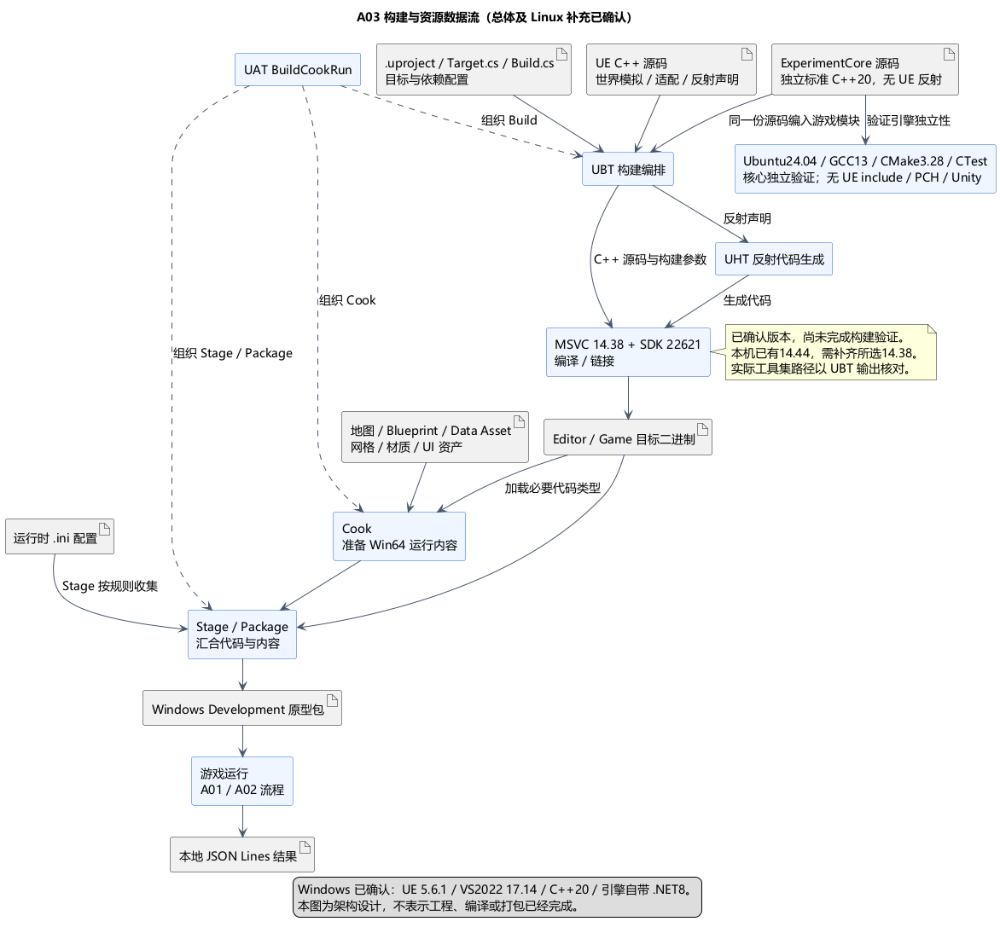

# A03：UE 版本、C++ 工具链、灰盒资源与依赖边界

状态：**A03 总体、Linux/GCC 补充方案与构建规则类图均已确认**。日期：2026-11-05。依据：[总体确认](../../requirements/001-causal-prototype/sources/2026-11-05-a03-confirmation-linux-gcc.md)、[Linux 补充确认](../../requirements/001-causal-prototype/sources/2026-11-05-linux-build-confirmation.md)和[构建类图确认](../../requirements/001-causal-prototype/sources/2026-11-05-build-class-confirmation.md)。后续方案见 [A04](A04-spherical-world.md)。原 A01/A02 行为规则继续适用。

依据：[001 终版需求](../../requirements/001-causal-prototype/REQUIREMENTS.md)第 1、2、8–10 节、A01/A02 已接受设计，以及[本机只读核对](A03-environment-evidence.md)。当前仍为架构讨论，选型、安装配置和成功执行是不同状态。

## 已确认的 Windows UE 技术栈

已确认本轮固定 **UE 5.6.1 预编译安装版、VS2022 17.14、MSVC 14.38 推荐族、Windows SDK 10.0.22621.0、C++20，沿用 UE 原生 UBT/UHT/UAT 构建链**。独立核心另以 Linux/GCC 为主要验证目标；同一源码在 Windows UE 中仍由 MSVC 重新编译。

| 项目 | 已确认选择 | 本机状态 | 选择原因 |
| --- | --- | --- | --- |
| 引擎 | UE 5.6.1，沿用现有安装 | 已发现 | 减少引擎迁移成本，让原型围绕固定版本验证 |
| IDE | Visual Studio 2022 17.14；当前补丁 17.14.37 | 已发现 | 属于 Epic 的 UE5.6 推荐 IDE 系列，便于 C++ 调试 |
| Windows C++ 编译器 | MSVC v143 的 14.38.33130–14.38.99999 工具集族；补齐后记录并固定实际补丁号 | 未发现，当前 VS2022 为 14.44.35207 | 与本机 UE5.6.1 的推荐配置一致；IDE 版本和工具集版本分别选择 |
| Windows SDK | 10.0.22621.0，Win64/x64 | 关键头文件、库和工具已发现 | 与本机引擎主 SDK 配置一致 |
| C++ 标准 | C++20 | 本机 UBT 默认即此标准 | 核心使用 GCC/MSVC 共同支持的标准能力 |
| 构建工具宿主 | 引擎自带 .NET SDK 8.0.300 | 已发现 | 构建入口使用随引擎提供的工具环境 |
| 编译及反射 | UnrealBuildTool + UnrealHeaderTool | 已发现 | 使用引擎的依赖、反射代码生成与编译流程 |
| 资源加工与打包 | Unreal Automation Tool / BuildCookRun | 入口已发现 | 产出本机可独立启动的 Windows 原型包 |

Epic 的 [UE5.6 VS 配置页](https://dev.epicgames.com/documentation/en-us/unreal-engine/setting-up-visual-studio-development-environment-for-cplusplus-projects-in-unreal-engine?application_version=5.6)列出 VS2022 17.14、MSVC14.38、Windows SDK22621 和 .NET8 的推荐组合；本机引擎配置也支持这一方向。现有 14.44 不是本机引擎列明的禁止版本，但不把它默认当作已验证替代选型。

工具集安装是后续准备事项，不为此卸载 14.44、回退 VS IDE 或修改其他项目。本机还装有 VS2026；只指定“VS2022”标签不足以确保选中了所需工具集，后续应显式选择 CompilerVersion 与 WindowsSdkVersion，并核对 UBT 实际输出目录。

**当前验证结论只到“已发现安装文件/确认缺项”**。用户级 UBT 覆盖配置有一处未能读取；实际版本解析、编译、打包与启动均未验证。该局限不阻止审阅本项选型，实施时要通过真实构建输出核对。

## 工程与依赖边界

[已确认的分层方向](A03-core-boundary.md)要求独立 C++20 核心与 UE 世界模拟/表现分离。已确认项目名与主 Runtime 模块名为 UEgame，采用空白 C++ 工程及 Game / Editor 两个 Target。

规则源码库名为 ExperimentCore，在 UEgame 私有源码区设置独立的 include/src 子树，只包含标准 C++20，单向供 UE 适配层调用。本轮由 UBT 将同一份规则源码编译链接进 UEgame；Linux/GCC 独立编译入口直接使用该源码树，禁止拷贝出另一份实现。Windows 路径不要求独立静态库、DLL 或第二个 UE Runtime 模块；Linux 静态库/验证入口已由[补充方案](A03-linux-core-build.md)确认，Linux 二进制不直接链接进 Windows UE。

已确认保留一个 Runtime 模块集成，同时将原先仅按功能目录组织的规则改为显式独立的源码边界。UE 侧按 ExperimentAdapter、World、Combat、Environment、Revisit、UI 等职责组织；不为每项职责创建独立模块。最终目录在构建规则类图中细化，当前不创建工程或源码。

Editor Target 表示该游戏在编辑器环境中构建，不等于需要新建一个自定义 Editor 模块。若后续出现确实需要自编的编辑器工具，再独立建立 Editor 模块；运行模块不能依赖 UnrealEd 等编辑器专用模块。

| 依赖层次 | 本项边界 |
| --- | --- |
| 独立规则源码库 | C++20 标准库及自身头文件；不依赖 UE 头、USTRUCT、UE 容器、模块导出宏或时钟 |
| UE 运行模块 | Core、CoreUObject、Engine；仅 UE 侧允许使用这些能力 |
| 与 A01 已选能力对应 | UMG 用于界面，Json 用于 JSON Lines 的序列化；在代码开始直接使用时声明 |
| 便利/底层 API 模块 | JsonUtilities、Slate、SlateCore 按实际直接使用的 C++ 接口加入；不一并默认列为必需 |
| 后续玩法选型 | 输入、AI、导航、运行时几何/切树等插件和模块，分别由 A05–A09 确认；不由本项提前决定具体框架 |
| 外部依赖 | 当前基础方案只需 UE 自带能力；额外第三方运行库或资产包有明确用途时再提出 |

依赖在 Build.cs 中声明：对外头文件确实暴露的依赖才作为 Public，其余尽量 Private。Target.cs 描述构建目标，.uproject 记录模块/插件启用；IDE 工程文件不作为独立的依赖真源。依据：[UE 模块文档](https://dev.epicgames.com/documentation/en-us/unreal-engine/unreal-engine-modules?application_version=5.6)。

版本约束属于项目配置和构建记录：记录 UE 补丁/Changelist、MSVC 实际目录族及编译器文件版本、SDK、目标和构建配置，不写死每个人的绝对安装路径。仅 .uproject 的引擎关联标识不足以证明补丁版本相同，应同时核对 Build.version。A03 类图会说明 ModuleRules、TargetRules 与模块入口的职责。

## 灰盒资源

- 地面、小镇建筑、树干、武器占位优先使用简单网格和自制材质；碰撞、遮挡与视觉轮廓按玩法需要核对。
- 本机有 UE5.6 第一/第三人称模板资源，角色骨骼、动画可以在对应项确认后按需迁入；模板只提供素材，不替项目决定输入、战斗或移动规则。
- Blueprint、Data Asset 与简单 UI 内容随项目保存。运行时所需资源必须进入 Cook 引用或显式打包清单，不能依赖只在编辑器中存在的对象。
- 切面、倒木分段、火雨反馈的具体网格与插件留 A08/A09；本项不宣称简单圆柱本身已经满足切树需求。

## 数据流与构建流

1. .uproject、Target.cs、Build.cs 和配置描述项目、构建目标与依赖；ExperimentCore 的纯 C++ 源码实现独立规则，UE C++ 负责适配与世界模拟，Blueprint/Data Asset/地图承载场景及内容。
2. UBT 读取构建规则，仅 UE 反射声明由 UHT 生成需要的代码；规则源码不做 UE 反射。UBT 驱动选定 MSVC 与 SDK 编译、链接两侧源码，形成编辑器目标或游戏目标二进制。
3. UAT 的 BuildCookRun 组织构建与打包流程：调用代码构建；Cook 将地图、蓝图、材质和 Data Asset 等资产转换为目标平台可用的数据；Stage 按规则收集二进制、烘焙资产和运行时 .ini 配置，Package 产出 Windows Development 原型包。Data Asset 配置属于资产，运行时 .ini 不作为同类资产交给 Cook 转换。
4. 打包后的游戏加载代码与烘焙内容，执行 A01/A02 的输入→规则→世界变化→回访流程，另向本地结果目录写 JSON Lines；运行日志不作为灰盒资源被一起重置。

UHT 的职责是反射代码生成，实际 C++ 编译由 UBT 调用编译器完成，见 [UHT 文档](https://dev.epicgames.com/documentation/en-us/unreal-engine/unreal-header-tool-for-unreal-engine?application_version=5.6)。Build、Cook、Stage、Package 的分工见 [打包文档](https://dev.epicgames.com/documentation/en-us/unreal-engine/packaging-your-project?application_version=5.6)。

## 验证安排与取舍

采用已确认的 UE 原生构建链、一个 Runtime 集成模块和独立规则源码库，兼顾灰盒启动与规则可移植性；逻辑分层无需立即引入多个 UE 加载模块。代价是显式适配和独立性验证。固定引擎和工具集减少多版本混用带来的不确定性，代价是先补齐14.38工具集，并在未来引擎升级时复核依赖。

进入实现并具备必要工程后，最早完成以下核对：

1. 从构建输出确认实际 UE、CompilerVersion、工具集目录、SDK 和 .NET 宿主。
2. 编译 Development Editor，加载最小实验地图并核对 Blueprint / Data Asset 引用。
3. 构建、Cook、打包 Win64 Development，独立启动一次，确认所需资源与日志路径可用；编辑器内运行或 Live Coding 通过不能替代这一步。
4. 同一份 ExperimentCore 源码在已确认 Ubuntu24.04/GCC13/CMake3.28/CTest、无 UE include 路径、无 PCH/强制包含、逐翻译单元的独立入口下构建，并检查头文件自包含；UBT 编译成功不能代替该验证。检查命令及代表性规则场景在 A12 汇总。

具体检查入口与交付验收在 A12 汇总；此处仅确认工具链与最早验证方向，不创建 CI 或运行构建。当前目录没有已有游戏 DevOps 流程需要迁移，技能自身的脚本不视作游戏构建流程。

## PUML 与下一步

[构建流 PUML](A03-build-flow.puml) · [模块依赖图](A03-dependencies.png) · [依赖图 PUML](A03-dependencies.puml)。

已确认：分层与核心类图、本文 Windows 工具链/源码集成/资源依赖/验证方向、[Linux/GCC 补充方案](A03-linux-core-build.md)及 [ModuleRules / TargetRules / 模块入口类图和独立构建目标关系](A03-build-class-design.md)。后续空间与地图方案见 [A04](A04-spherical-world.md)，当前确认进度以[讨论索引](../README.md)为准。
