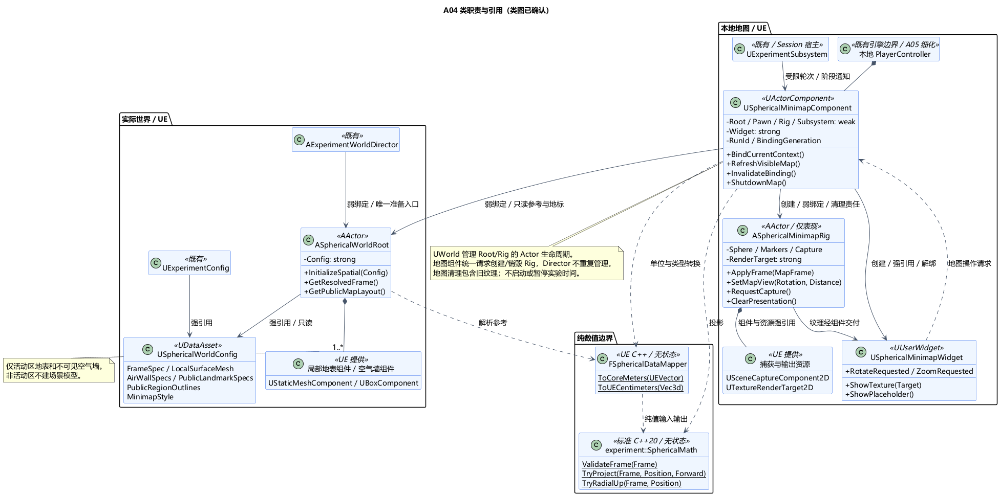

# A04 类图：球面空间与只读球体小地图

状态：**类图已确认**。日期：2026-11-05。依据：[类图确认](../../requirements/001-causal-prototype/sources/2026-11-05-a04-class-confirmation.md)。[A04 总体](A04-spherical-world.md)也已确认，包含空气墙及非活动区不建模。本项确定类职责、接口、引用关系和生命周期；方法签名为职责级设计，不是已经实现的代码。

## 1. 技术栈与类职责

沿用 UE5.6.1 C++ / UMG 与 Linux GCC13 / 标准 C++20。新增 7 个职责类和少量值类型；不新增 Runtime 模块、世界管理 Subsystem 或外部依赖。

| 类 | 基类 / 层 | 已确认职责 |
| --- | --- | --- |
| `USphericalWorldConfig` | UDataAsset / UE | 同源的球面参数、活动区局部地表资源、空气墙规格、公开地标及地图表现参数；运行期间只读 |
| `ASphericalWorldRoot` | AActor / UE 世界 | 装配局部地表 StaticMeshComponent、空气墙 UBoxComponent 和普通地标锚点；发布经过校验的只读球面参考；不组织实验阶段 |
| `experiment::SphericalMath` | 无状态工具类 / 纯 C++20 | 校验球面参考、计算径向上下方向、位置和切向朝向投影；无 Session、Actor、时间或文件访问 |
| `FSphericalDataMapper` | 无状态工具类 / UE C++ | 集中进行 FVector 等 UE 类型与纯数值、厘米与米的转换；不保存参考系或动态世界状态 |
| `USphericalMinimapComponent` | UActorComponent / 本地玩家控制层 | 绑定当前世界/玩家，采样受限数据，调用投影；管理地图显示对象与刷新调度，唯一负责创建、重绑和清理地图 |
| `ASphericalMinimapRig` | AActor / UE 表现 | 持有示意球、标记组件、SceneCapture2D、RenderTarget；按显示帧绘制，应用地图旋转和相机距离；无玩法模拟 |
| `USphericalMinimapWidget` | UUserWidget / UE UI | 显示纹理或空白占位；发出地图旋转/缩放请求，不采样世界、不处理实验规则 |

既有 `UExperimentConfig` 增加对 USphericalWorldConfig 的资源引用；`AExperimentWorldDirector` 仍唯一组织实际世界准备，显式绑定 Root 并检查其准备结果。既有 `UExperimentSubsystem` 仍是 Session 的唯一宿主，只向地图提供所需的轮次、阶段和当前世界绑定通知。此处不新增 A05 的 PlayerController 子类，只约定地图组件由本地 PlayerController 持有；具体输入映射留 A05。

## 2. 关键数据与接口

### 球面与空气墙

配置中的球心、半径、空气墙尺寸和地标位置以明确标注的米为单位；资源网格仍遵守 UE 的厘米约定。配置位置相对 Root，Root 解析一次世界变换，Mapper 转换单位后形成唯一有效参考。Root 要求单位缩放，旋转/平移在解析中统一处理；运行中不得只移动 Root 或改半径而不重建绑定。地图直接使用 Root 发布的参考，不另读一套默认球心和半径。

- `USphericalWorldConfig`：FrameSpec、LocalSurfaceMesh、AirWallSpecs、PublicLandmarkSpecs、PublicRegionOutlines、MinimapStyle。PublicRegionOutlines 保存小镇/森林的静态地区轮廓点，MinimapStyle 提供其配色；不把地区显示缩减为点标记。规格使用 UE 可编辑值；不包含孩子/哥布林/教师身份或实验结果。
- `ASphericalWorldRoot::InitializeSpatial(Config)`：在 Preparing 中装配/核对资源及参数；配置无效、局部地表/空气墙不完整时报告准备失败，不伪报就绪。Director 在其他必需模块也完成后按 A02 启动世界，Root 不启动计时。
- `GetResolvedFrame()`、`GetPublicMapLayout()`：返回只读值或临时副本，后者包含允许的地标锚点与地区轮廓。锚点来自实际活动区布置，与场景同源；普通地标采用固定允许清单，不接收任意 Actor 列表。Root 不拥有小镇 NPC、树木状态或第二份世界快照。
- 地表组件仅覆盖活动区；空气墙为相连的不可见 UBoxComponent，位置、厚度和高度随布局调整，不建立山脊/岩壁模型。空气墙对玩家及 A05 合法移动必须有效；弹体、AI 及倒木/掉落物的边缘行为分别交 A06/A07/A08 验证，不预设回收、传送或伤害规则。

`experiment` 中三个纯值类型：`Vec3d {x,y,z}`；`SphericalFrame {centerMeters,radiusMeters,east,north,up}`；`SurfaceProjection {unitNormal,heightMeters,optional tangentHeading}`。均使用 double / 标准库，不使用 USTRUCT 或 UE 数学类型。SphericalFrame 校验半径为正、参数有限、局部基正交及轴向约定一致；同一参考用于实际地表和地图。

`SphericalMath::TryProject(Frame, PositionMeters, Forward)` 返回显式可选结果。球心重合、非有限输入等不生成假坐标；朝向在切平面退化时保留有效位置但不给假朝向。Rig 可沿用同一绑定内的上一有效朝向，初始回退到参考基的有效切向；重绑后不继承旧轮朝向。纯数学不保存该显示缓存。

### 地图显示帧

`FMinimapBindingKey`、`FSphericalMapFrame` 为普通 UE C++ 值，不机械建立反射副本；内部可包含纯核心值，不能直接放入 UPROPERTY/UFUNCTION 的反射签名。

| 数据 | 内容与约束 |
| --- | --- |
| FMinimapBindingKey | RunId＋BindingGeneration。Generation 由地图组件分配，World/Root/玩家绑定或配置变化均递增；同时持有并校验对应的弱绑定，不能仅靠 RunId 判断当前世界 |
| FSphericalMapFrame | BindingKey、玩家球面投影、允许的普通地标及小镇/森林轮廓点投影。帧内不含 Actor 指针、RunState、生命值、遇险对象或教师分支 |
| 地图视图参数 | 旋转 Q、受限相机距离、可见/待刷新状态；仅 Rig/组件的表现状态，不写回 WorldRoot 或 ExperimentSession |

地图组件只从当前受控 Pawn 采样位置和朝向，从 Root 取允许的静态地标，从已有受限视图通知取 RunId/阶段。绑定 Pawn 必须来自当前本地控制器与同一 UWorld；Pawn 销毁或切换先失效旧绑定，等待有效新绑定。采样、投影、提交均在游戏线程执行，不引入异步投影队列。

## 3. 所有权与生命周期

1. 世界拥有 Root、Rig；Actor 拥有自己的组件。UExperimentConfig、Root 的 Config、Rig 的 RenderTarget/材质以及地图组件的 Widget 用 `UPROPERTY() TObjectPtr` 强引用。Director → Root、地图组件 → Root/Pawn/Rig/Subsystem 使用可验证的弱引用；Widget 不反向强持有地图组件。Actor 的世界生命周期和“由谁请求创建/销毁”在图中分开表示。
2. 本地 PlayerController 持有地图组件。组件在世界与受限运行上下文有效后，以幂等入口创建至多一个 Rig、一个 Widget；Rig 创建在当前 UWorld。Widget 事件绑定组件，组件保留解绑句柄。Director 不再创建或清理第二套地图对象，也不将它们登记成实验玩法参与者。
3. Root 按 Director 的唯一空间初始化入口装配或复用静态组件；同一轮 Root/配置不变。人工重启复用实验地图，不逐帧重建地表，也不生成外围世界。Root 的实际地表和空气墙准备属于世界就绪条件；Rig/Widget 的准备与纹理刷新不属于实验就绪条件。
4. 旧轮停止、世界解绑、Pawn/Root 或配置改变时：组件先增加 Generation，停止调度并解除相关委托，使旧回调失效；Widget 立即清纹理显示占位，Rig 清标记/朝向缓存并停止捕获。新绑定使用清空的新 RenderTarget，旧目标不重新绑定 UI；取得有效的新帧并请求首次捕获后才呈现新目标，避免复用旧纹理。纹理准备不能回报实验阶段完成。
5. 同一世界可复用已创建的 Rig/Widget；World 切换或组件 EndPlay 时，组件先解绑 Widget/通知，移除 Widget、停止捕获并请求销毁自建 Rig，再清弱引用和强引用。失效或已销毁对象按幂等清理处理。Widget 的 NativeDestruct 只解除自身 UI 绑定，不替代组件的整体清理，也不能假定只调用一次。
6. 地图隐藏、Preparing、TimeSkip 或绑定无效时停止采样/捕获，实际世界继续按既定时钟运行。恢复可见时重新采样，不能直接展示陈旧帧；RunId＋Generation 校验覆盖调度回调和 Rig 提交入口。Ended 不再持续刷新运行中的位置。隐藏地图不暂停世界、不改变发现逻辑或雨计划。

UE 对象引用依据：[Object Pointers](https://dev.epicgames.com/documentation/en-us/unreal-engine/object-pointers-in-unreal-engine)。本机 UE5.6.1 已核对 UDataAsset、UActorComponent、UBoxComponent 与 UUserWidget 声明及清理入口；当前仅 API/设计核对，未运行游戏。

## 4. 数据流与显示隔离

配置 → Director 初始化 Root → 局部球面/空气墙与只读参考 → 各必需模块完成 → 既有 A02 世界启动流程。小地图不插入启动门槛。

当前受限轮次/阶段＋Root 公共地标＋当前 Pawn 变换 → MinimapComponent 校验归属 → DataMapper 转换 → SphericalMath 投影 → FSphericalMapFrame → Rig → SceneCapture2D → RenderTarget → Widget。

Widget 的旋转/缩放请求 → MinimapComponent → Rig，只修改球及标记的共同根旋转 Q 或捕获相机距离。投影输出是不带 Q 的单位球坐标，Q 只在 Rig 根变换应用一次，避免标记被双重旋转。地图本体遮挡背面标记。

Rig 的球和标记均 NoCollision、禁用导航贡献、不注册玩法事件；捕获使用 ShowOnly 表现组件，表示组件仅在 Scene Capture 可见并关闭对主场景的阴影/反射等贡献。`bCaptureEveryFrame` 和 `bCaptureOnMovement` 均关闭，由组件在可见且数据/视角变动时限频请求捕获；相机缩放不能绕过调度自行重复捕获。具体材质及渲染标志仍须实际验证。

## 5. 设计原因与验证范围

- 把空间参考集中在 Root，避免地图和角色各自计算不同球心；纯数学可在 GCC 下检查，Session 不承担空间模拟。
- 地图组件统一采样与生命周期，Rig 只渲染传入数据，Widget 只显示/交互，避免 UI 直接遍历世界或成为第二个实验协调器。
- 本地地图显示对象不注册成玩法参与者，不因创建、隐藏或销毁而产生救援/回访完成事实。未来联网仍需单独设计，这些本地快照不是已定义的网络协议。
- 新增空间数学源码仍遵守 A03 同源双编译、无 UE 依赖、头文件自包含约束；不新增服务端或容器宿主。

后续验证包含：单位/基向量投影与非法输入；地图与地表一致；Pawn 重绑/旧轮回调/隐藏恢复不留旧标记和纹理；地图旋转只应用一次；配置缺失不伪报世界就绪；地图故障不改变成败计时；空气墙、局部导航与边缘物体行为。R-A02-EMPTY-METHOD 继续留 A04/A05/A06 联合验证，不因类图完成而关闭。

## 6. PUML 与本次确认

[类图 PUML](A04-class-design.puml) · [球面值与显示帧图](A04-spatial-values.png) · [值类型 PUML](A04-spatial-values.puml)。类名上方的 «AActor»、«UDataAsset» 等标注表示继承的 UE 基类；关联箭头表示引用或调用，实心菱形表示组成关系。

已确认：7 个类的职责、既有 Director/Subsystem/本地 PlayerController 的接入方式、纯数学/UE 数据边界、引用与清理责任，以及旧轮地图失效策略。后续输入与角色方案见 [A05](A05-input-camera-locomotion.md)，当前确认进度以[讨论索引](../README.md)为准；不创建游戏代码或执行构建。
