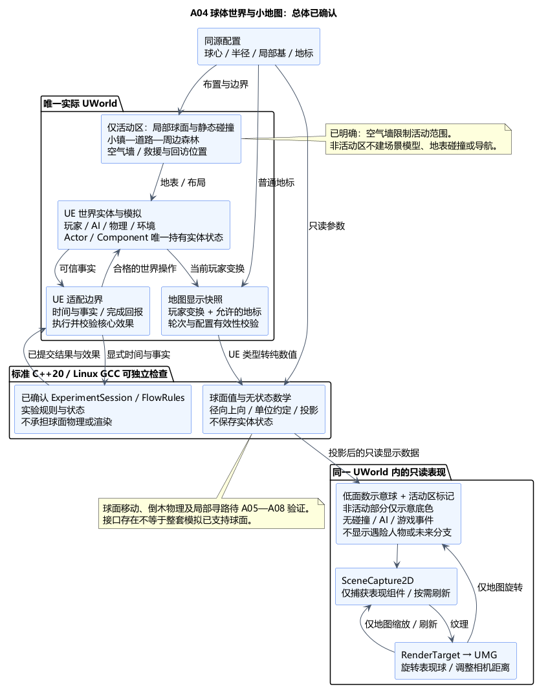

# A04 球体世界、局部活动区域与球体小地图

状态：**总体方案及类图已确认**。日期：2026-11-05。依据：[总体确认](../../requirements/001-causal-prototype/sources/2026-11-05-a04-confirmation.md)及[类图确认](../../requirements/001-causal-prototype/sources/2026-11-05-a04-class-confirmation.md)。后续方案见 [A05](A05-input-camera-locomotion.md)。仅设计，无游戏实现或运行验证。

已明确的修订：[空气墙与非活动区不建模](../../requirements/001-causal-prototype/sources/2026-11-05-a04-air-wall-scope.md)。这两项按用户批注执行，修订后的总体方案和单独提交的类图均已确认。

依据：[需求 §1、§4、§6.1、§7、§10](../../requirements/001-causal-prototype/REQUIREMENTS.md)、[球体范围](../../requirements/001-causal-prototype/sources/2026-10-30-spherical-world-scope.md)、[活动范围](../../requirements/001-causal-prototype/sources/2026-10-30-experiment-traversal-scope.md)、[森林地点](../../requirements/001-causal-prototype/sources/2026-10-30-forest-rescue-location.md)。核心/UE 责任继续遵守[已确认分层](A03-core-boundary.md)。

## 1. 已确认结构与技术栈

采用**球面参考系＋仅建模局部球冠活动区＋只读的球体小地图**。实际活动区的地表、放置和碰撞服从同一个球面参考系。场景只制作小镇、道路及周边森林；非活动区不制作地表网格、布景、地表碰撞或导航，不建立外围光滑球面场景。本轮不要求环球行走。小地图的低面数整球仅用于展示球体形态与活动区位置，不代表非活动区已有场景模型。

| 部分 | 技术栈及职责 | 选择原因和代价 |
| --- | --- | --- |
| 实际世界 | UE5.6.1 C++、活动区局部球面 Static Mesh、Actor/Component、静态碰撞；一个 UWorld/实验关卡 | 只构建实验所需区域，复用灰盒与实体状态归属；局部球面碰撞仍需检验 |
| 空间约定 | 标准 C++20 的只读球面参数与无状态数学，UE 边界转换 FVector 等类型 | 可由 GCC 独立检查；不让纯核心包含 Actor、物理、导航或渲染依赖 |
| 活动区 | 小镇—道路—周边森林/遇险点；空气墙使用不可见碰撞体限制范围 | 无需制作边界山脊或岩壁，保留救援和回访通路；具体尺寸、墙体高度随角色能力调参 |
| 地图表现 | 低面数表现球、地区色块、玩家标记；SceneCapture2D → TextureRenderTarget2D → UMG | 支持真实立体旋转/缩放；多一次捕获开销，通过显示状态和按需刷新控制 |
| 配置 | UE 配置资产保存球体、活动区、地标和地图显示参数；加载后转换为只读值 | 同源配置防止实际世界与地图分别手填后漂移；本项不新增外部插件 |

本项只规定径向上/下与参考系，**不提前确定 A05 的移动框架或 A07 的导航实现**。UE 的物理、碰撞、导航继续承担空间模拟；Linux 纯核心承担独立规则及适用的纯数学，不复制一个游戏世界。

## 2. 球面与活动区

建议球体半径相对于活动区足够大，使局部坡度与曲率温和；半径和活动区大小均为待调参数，不固定为真实地球尺寸。“主视图近似平地”是选择理由，不能把背景愿景升级成本轮新增验收要求。

- 球心为 C，基准半径为 R，活动区中心方向为 U，局部正交基为 E、N、U，采用与宿主转换一致的定向约定；不得分别维护互相矛盾的轴向。世界原点可靠近小镇，球心位于其下方，减少活动区坐标量级。
- 角色脚下上向为 `(P-C)/|P-C|`，下向相反。布景沿球面放置，不一律以全局 Z 为上。朝向投影到当前位置切平面；退化方向须有稳定回退。
- 共享纯数值长度统一为米，UE 边界统一换算厘米；半径、位置、偏移与地图转换不得混用单位。纯数学使用 double、显式有效性检查，不读取引擎时间或状态。
- 地表只制作活动区内的局部球面网格，碰撞贴合可见地表，接缝无孔洞、不重复叠置可行走地面；非活动区无需生成完整球体网格或地表碰撞。具体网格分辨率在灰盒阶段检验。
- **活动边界按用户要求使用空气墙**，以不可见碰撞体限制玩家，正常走、跑、跳、闪避不能越界；不为边界另做山脊、岩壁或可见墙体。边界不新增死亡、传送、计时暂停或实验失败规则。范围需允许离开遇险中心触发脱战并再次返回；树木倒下后仍有可达路线。空气墙对弹体/AI 的碰撞通道在 A06/A07 细化，不在此推定。
- 布局保留回访的镇内恢复控制位置、群众与教师区域、返回原森林的道路；原森林的位置标识稳定，便于 A09/A10 显示树桩、枯木、新芽等后果。

球面距离度量必须在使用处明确：布局长度采用米；战斗射线/碰撞依实际 UE 几何；脱战、AI 等阈值由 A06/A07 明确采用的空间度量。本项不把所有距离强制替换成球面弧长。

## 3. 球体小地图的数据流

1. 读取同一份球面/地标配置；从当前世界取玩家位置、朝向，生成仅供显示的瞬时快照。Actor/Component 仍唯一维护实际变换和实体状态。
2. 在 UE 边界转成纯数值，再用球面投影得到法向和切向朝向。位置 P 对应 `n=(P-C)/|P-C|`，高度 `h=|P-C|-R`；地图位置为 `M + r × Q(n)`，其中 M/r 为表现球球心/半径，Q 为用户旋转。高度不按真实比例突出显示，玩家图标使用小的表面偏移。
3. 过滤后生成地图显示数据：**本轮只显示玩家位置/朝向、小镇与森林地区轮廓和普通地标**。不显示孩子、哥布林、未发现的遇难现场、教师身份或未来分支；不以地图浏览触发“发现”。地图不是所有 Actor 的全量镜像，也不把整个 RunState 交给 UI。
4. 同一 UWorld 内的独立表现装置绘制低面数球和标记，非活动部分仅保留无地物的示意底色，不读取或生成对应场景模型。表现装置无碰撞、导航、游戏事件注册和业务状态。捕获仅允许列出的表现组件；这些组件仅在 Scene Capture 中可见，并禁用对主场景的阴影、反射等贡献，防止穿入实际游戏画面。具体渲染标志在实现时验证。
5. SceneCapture2D 将表现球写入 RenderTarget，UMG 显示纹理。地球本体遮挡背面标记；图标不能透球泄露另一面位置。
6. 拖动旋转表现球及其全部标记，缩放调整捕获相机距离并限制范围；二者不改变实际世界、玩家位置或世界时间。初始朝向活动区，交互后不强制抢回朝向。支持从全球概览放大到活动区，缩放上限和标记可读性须实测。输入映射在 A05 细化。

捕获采用按需刷新：地图旋转/缩放或玩家位置改变时更新，移动时限频；关闭每帧自动捕获，避免手动与自动重复。隐藏、准备和跳时期间不捕获，不暴露世界重建中间态；回访恢复时以实际就绪世界刷新。分辨率和刷新频率不在此虚构性能指标。

重启先清除旧轮快照/标记并重新绑定当前世界和玩家；快照携带轮次与配置归属，失效引用或无效坐标不绘制。地图不发阶段完成事实、不阻塞实验计时，不把纹理刷新成功当世界准备完成。

## 4. 与核心及后续项的边界

| 边界 | 本项规定 | 后续验证 |
| --- | --- | --- |
| 核心 | 可复用的球面值与投影为无状态纯数学；ExperimentSession 继续唯一管理实验状态 | GCC 检查投影、单位转换边界及非法输入；不会因此让 Session 保存位置列表 |
| 角色/物理 | 提供位置对应径向下向；实际模拟在 UE | A05 验证双视角、移动/跳跃/闪避与相机；A06/A08 验证投射物、倒木等具体运动。角色自定义重力接口不代表全部物理自动适配 |
| 导航 | 只要求局部活动球冠可导航 | A07 验证坡度、倒木阻挡后的绕路、脱战回程；不能假定普通导航网格支持整颗行星 |
| 环境/回访 | 同一世界与稳定空间位置；地图无第二份森林状态 | A08/A09/A10 承接燃烧、砍树、雨、跳时和回访布置 |

**发现前方式为空仍是未解决的验证项 R-A02-EMPTY-METHOD。** A04 布置道路入口、视野遮挡、发现区域与可介入位置，使正常成功路线在发现后至少能发生一次有效统计的招式使用，并留足观察与选择时间。联合 A05/A06 检查所有可达射击位置、跳跃/高处视线、最大射程、火球范围，以及“发现前发射、发现后命中”。当前没有运行证据，不能声称几块遮挡物已解决该问题。

即使未发现，遇险事件和降雨也从世界启动时运行；玩家远离或地图隐藏不能暂停它们。发现前攻击仍按 A02 独立触发攻击计时/仇恨，不自动视作发现、不追溯补记方式、不新设成功条件或第四种教师。若仍可成功但方式统计为空，应报告开发诊断并修正布局或重新确认必要取舍。发现前孩子死亡按既定规则保留现场，等待后果发现。

## 5. 技术依据与验证状态

本机 UE5.6.1 头文件已只读核对：`CharacterMovementComponent.h:1658` 存在 `SetGravityDirection`；`SceneCaptureComponent2D.h:80、299` 存在 TextureTarget/CaptureScene；`SceneCaptureComponent.h:67、85、217` 提供 ShowOnly 列表、自动捕获开关及组件加入入口；`PrimitiveComponent.h:666、2028` 提供仅在 Scene Capture 中可见的设置。路径均相对 `G:/Epic Games/UE_5.6/Engine/Source/Runtime/Engine/Classes/`。

官方参考：[自定义角色重力接口](https://dev.epicgames.com/documentation/en-us/unreal-engine/API/Runtime/Engine/UCharacterMovementComponent/SetGravityDirection)、[SceneCapture2D](https://dev.epicgames.com/documentation/en-us/unreal-engine/API/Runtime/Engine/USceneCaptureComponent2D)。在线页面默认版本可能变化，本轮 API 存在性的依据是本机 5.6.1 源码；这些证据不代表游戏移动、导航、捕获性能或打包效果已验证。

后续最小验证：活动区内部及球面接缝可行走，走跑跳跃闪避不能穿越空气墙；边界视角和相机约束不依赖补建非活动区；脱战与回访路径可达；地图与实际位置同源一致；旋转/缩放不改游戏状态；未发现信息不会出现；旧轮标记不残留；地图关闭时捕获停止。视野/射程组合另与 A05/A06 验证，不在本轮实现测试。

## 6. PUML 与本次确认范围

[结构 PUML](A04-spherical-world.puml) · [小地图数据流图](A04-minimap-flow.png) · [数据流 PUML](A04-minimap-flow.puml)。

已确认：空气墙、非活动区不建模、球面参考系与局部活动区建模方案、共享空间约定、只读球体小地图的技术路线与显示范围，以及后续验证责任。半径、尺寸和捕获参数仍待调试；具体类名、接口、引用及生命周期见已确认的 [A04 类图](A04-class-design.md)。后续方案见 [A05](A05-input-camera-locomotion.md)，当前不开始游戏实现。
