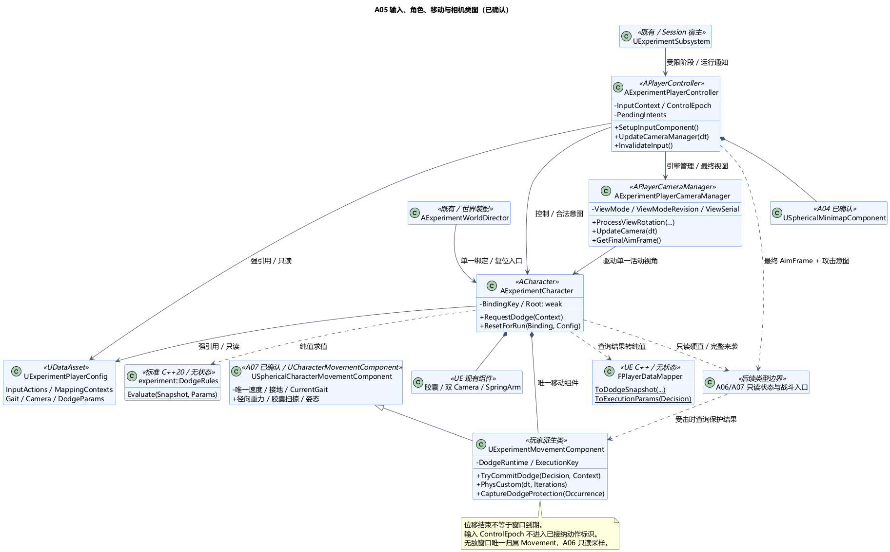

# A05 类图：玩家输入、球面移动、相机与闪避

状态：**类图已确认**。设计日期：2026-11-05；[类图确认](../../requirements/001-causal-prototype/sources/2026-11-06-a05-class-confirmation.md)：2026-11-06。[A05 总体及行为取舍](A05-input-camera-locomotion.md)已经[用户确认](../../requirements/001-causal-prototype/sources/2026-11-05-a05-confirmation.md)。具体类、数据归属、接入和清理契约已确认；签名用于描述职责，并非已经实现的代码。

## 1. 技术栈与类职责

后续结构扩展已随 [A07 类图](A07-class-design.md#2-a05-共用移动基类与-a06-徒手扩展)确认：提取 `USphericalCharacterMovementComponent` 通用基类，现有玩家移动类继承它并保留闪避状态。下表与本项类图已同步继承关系；玩家仍只有一个移动组件，默认子对象替换入口不变。

沿用 UE5.6.1 C++ / Enhanced Input / Camera / CharacterMovement；无状态规则为标准 C++20，可用 Linux/GCC13 独立检查。本次新增 7 个职责类；引擎组件、值类型及已有 A04 类不重复造类。

| 类 | 继承 / 层 | 建议职责与接口 |
| --- | --- | --- |
| `UExperimentPlayerConfig` | UDataAsset / UE | 输入动作与上下文资源、走/小跑/奔跑参数、镜头与闪避参数；运行期间只读 |
| `AExperimentPlayerController` | APlayerController / UE | `SetupInputComponent` 绑定唯一输入入口；持有本地控制上下文、输入代次与尚未消费意图；绑定 Pawn，拥有既有 MinimapComponent；`UpdateCameraManager` 后交付当前瞄准帧和攻击意图 |
| `AExperimentCharacter` | ACharacter / UE | 装配一个胶囊、一个定制移动组件、两个相机和第三视角 SpringArm；接入 Root 与 A06/A07 只读数据；组织闪避快照/计划调用及统一角色复位，不拥有第二套速度、伤害或阶段状态 |
| `UExperimentMovementComponent` | USphericalCharacterMovementComponent / UE（A07 确认扩展） | 继承通用基类的唯一速度、接地、档位与径向移动；本类唯一维护 DodgeRuntime；`TryCommitDodge`、`PhysCustom`、`CaptureDodgeProtection`；不存在第二个移动组件或状态副本 |
| `AExperimentPlayerCameraManager` | APlayerCameraManager / UE | `ProcessViewRotation` 在局部重力空间处理输入；维护唯一视角模式/版本；`UpdateCamera` 记录真实更新序号，输出最终 POV/AimFrame |
| `experiment::DodgeRules` | 无状态工具类 / 纯 C++20 | `Evaluate(Snapshot, Params)`：校验接地/硬直资格，按完整来袭集合选择快步/翻滚与自动方向，返回拒绝或计划；不移动角色、不保存窗口 |
| `FPlayerDataMapper` | 无状态工具类 / UE C++ | 将威胁/候选/参数转换为核心纯值，将计划转为 UE 执行参数；空间类型与米/厘米换算复用 A04 的 FSphericalDataMapper |

既有 UExperimentConfig 增加 PlayerConfig 资源引用。Director 仍负责世界装配与角色复位，Subsystem/Session 仍唯一决定实验阶段。A06/A07 的战斗/威胁供应端在图中是后续边界，不在本项虚构实现类；只读契约要求给出当前硬直/存活状态、完整已开始攻击集合及其归属，不能读取未来 AI 计划。

## 2. 组件、配置与唯一入口

1. UE 的 GameMode 配置指向本项 Controller 和 Character；Controller 指定本项 CameraManager。初始 Pawn 由引擎默认出生入口创建，Director 绑定该角色，后续缺失重建由 Director 协调同一出生入口，不能再并行 Spawn 一份玩家。开始实验仍等待 Director 的实际就绪条件，不能由角色 BeginPlay 触发。
2. Character 在构造初始化列表用 `SetDefaultSubobjectClass<UExperimentMovementComponent>(ACharacter::CharacterMovementComponentName)` 替换默认移动组件，保留胶囊作为 UpdatedComponent；不另加第二个移动组件。默认相机/臂是 Character 的组件，CameraManager 由 Controller 的引擎生命周期管理。
3. Controller 是语义输入的唯一绑定位置，确保 SetupInputComponent 使用 UEnhancedInputComponent；Character 不再绑定同名动作。只添加/移除本模块登记的 MappingContext，不调用 ClearAllMappings 清除其他模块的上下文。
4. InputAction、MappingContext、PlayerConfig 等资源用 `UPROPERTY() TObjectPtr` 持有；Character 的组件是默认子对象。对当前 Root、Director、Subsystem、跨对象观察使用有效性检查的弱绑定；核心类及值不持 UObject。引擎已有 Controller/Pawn/CameraManager 关系不另复制成一套可写所有权表。
5. 阶段只来自 Session 的受限投影。Controller 的 `Gameplay / MapInspect / Blocked` 是本地输入模式，不是第二个实验状态机。地图组件仍独占 Rig/Widget 生命周期，Controller 只通知地图模式与绑定变化，不直接销毁其 Rig。

## 3. 数据与状态归属

### 无状态核心值

`experiment::DodgeSnapshot` 包含接地、硬直、完整来袭类型集合及候选方向；每个来袭条目携带由 A06/A07 提供的稳定攻击标识。`DodgeCandidate` 包含纯 Vec3d 方向、路径是否可行、是否穿过已知来袭扫掠、与来袭的分离量及固定排序索引。UE 负责空间查询并冻结此次快照；核心不调用碰撞或导航。

`DodgeParams` 保存可调比较阈值与动作参数；`DodgeDecision` 返回显式拒绝原因，或动作类型、可选方向与执行参数。只有横挥选翻滚；竖挥、混合、无来袭均快步。路径全受阻仍返回成立的零位移计划，不把它混成“资格拒绝”。无来袭按固定优先序选方向；规则不读取移动键作为方向。非法数值/不完整快照返回错误，不当成“无来袭”；方向排序不承诺跨平台浮点位级一致。

### UE 运行值

以下为普通 C++ 值，核心成员不直接放入 UPROPERTY/UFUNCTION 反射签名。需要 UI 的少量字段另用受限反射视图。

| 数据 | 唯一归属及含义 |
| --- | --- |
| `FPlayerBindingKey` | Director 装配时确定 RunId＋PawnGeneration，对应当前 World/Pawn/Root；角色、输入和相机只持该身份值，实际对象仍校验弱绑定 |
| `FPlayerInputContext` | Controller：BindingKey＋ControlEpoch＋输入序号；只识别尚未消费的意图。切模式/失焦也增加 ControlEpoch |
| `FDodgeExecutionKey` | BindingKey＋DodgeSerial；Movement 接纳新闪避时递增。只标识闪避实例，不冒用 A06 招式 ActionId，也不包含 ControlEpoch |
| `FDodgeRuntime` | Movement 私有：ExecutionKey、动作类型/方向、位移进度、MovementActive、起始事件时刻/顺序、WindowEnd；不向外返回可写引用 |
| `FDodgeProtectionSample` | 受击发生时从 Movement 取得的不可变结果：事件归属、当前闪避标识、是否位于窗口；不是第二份可写窗口 |
| `FPlayerAimFrame` | CameraManager 的一次最终输出：BindingKey、ViewModeRevision、ViewSerial、帧标识、采样时刻、最终相机位置/方向和 AimRay；攻击使用这一整体快照 |

ViewSerial 就是 CameraManager 每次真实 UpdateCamera 完成后推进的更新序号，Controller 前后比较与 AimFrame 使用同一个值；不另维护一套互不关联的“更新序号”。值图中 Decision → Runtime 的箭头仅表示 UE 读取计划后提交的数据流，不表示纯核心依赖 UE。

位置/速度/接地/当前档位只在 Movement；地图与动画读表现投影。硬直和生命值由 A06 所属对象唯一维护，Character 只读，不另保存长期 Staggered/Health 镜像。Movement 在闪避提交点要求最新的有效资格快照；同一游戏线程连续完成采样、规则求值与提交，绑定或状态已改变则重新校验/拒绝，不提交旧计划。

## 4. 输入、视角与攻击数据流

1. Controller 将 Enhanced Input 回调变成语义意图，记录当前输入上下文。切地图/失焦时立即清自有连续轴、按下状态和未消费意图，更新输入代次；即使 MappingContext 的重建延后，也由门控拒绝旧回调。按住至释放前忽略的引擎选项只覆盖 Boolean 动作，因此轴和离散状态仍由本入口显式清理。A06 的魔法手势修订要求先取消再 flush/换上下文，保留独立 AwaitRelease 重武装门控；Completed/Canceled 不能单独识别取消来源，具体新增接口已在 [A06 类图](A06-class-design.md)确认。
2. 移动/跳跃交当前 Character/Movement；闪避交 Character 的 `RequestDodge(Context)`。Character 向 A06/A07 取得有效只读状态/威胁，并调用 Movement 采样候选路径，经 Mapper → DodgeRules → Movement 提交，不在 Controller 内计算伤害或闪避方向。
3. 观察输入沿基类 UpdateRotation 链交给定制 CameraManager 的 ProcessViewRotation；该覆写只累加一次输入，在径向参考中限制俯仰，再输出世界旋转，不能随后再次执行默认世界 Euler 加法/裁剪。Character 关闭以 Controller Pitch/Yaw/Roll 直接旋转身体的路径，由 Movement 控制胶囊姿态。
4. CameraManager 唯一保存第一/第三视角模式，Character 的两个相机激活状态按其决定同步，始终只激活一个。第一视角头部碰撞与第三视角 SpringArm 碰撞分别处理。切视角只更新 ViewModeRevision，不换 Pawn、不碰 DodgeRuntime。
5. 攻击执行请求先保存为本次更新内的待消费意图，不在输入回调里取上一帧 GetCameraCachePOV。按 [A06 输入修订](../../requirements/001-causal-prototype/sources/2026-11-06-a06-confirmation-hold-aim.md)，横斩/竖斩在按下时产生请求；仅火球/岩炮弹按住瞄准、松开产生一次请求，短按也在松开时发射。持有瞄准手势不等于缓存一个待发攻击；强制取消不能转成发射。Controller 覆写 UpdateCameraManager，先调用 Super；确认 CameraManager 的真实更新序号已推进、当前绑定及所请求视角仍匹配，再取得本帧最终 AimFrame，按本批已确定顺序交 A06 并消费一次。入口/相机未就绪或上下文已变时显式失效，不保留到后续自动攻击。新增手势字段及取消/并发接口在 A06 类图中单独确认。
6. 同批切视角后发起攻击时，必须等对应版本的相机解算完成；视角版本已被后续输入覆盖的旧待处理意图不套用另一个视角射线。CameraManager 初始化的 UpdateCamera(0) 不触发任何攻击。世界秒数相同不是“最终相机已经更新”的证明，要同时校验更新序号、帧和绑定。
7. A06 依据当前 AimFrame 与武器位置做命中/遮挡，并且仅在实际执行招式后发出使用及指向事实；输入请求、闪避和切视角都不是剑术/魔法使用。未来联网需另行核验，这些本地 C++ 值不是已定义的网络协议。

本机正常帧中，相机更新位于角色/物理和 SpringArm 的 PostPhysics 更新之后；后续攻击轨迹开始生效的模拟点、同帧多动作优先级及命中批次在 A06 固定。本项给出相机就绪后的交付入口，不声称所有世界碰撞都在此处执行，也不把新输入造成的未来命中回填到此前的批次。

## 5. 闪避位移与短窗口的独立寿命

`TryCommitDodge` 只在当前运行绑定和已确认资格有效时接纳。空中/硬直不启动、不缓存、不开窗口；接地且未硬直时可以替换已有闪避。新执行标识和新短窗口一次提交，起点为被接纳的按下事件时刻；不延长累加旧窗口，不因动画未结束而增加冷却。

Movement 在 UpdateCharacterStateBeforeMovement 更新基本重力及档位；PhysCustom 执行闪避，每个所需子步重新求径向上下、地面接触和扫掠。该 BeforeMovement 钩子并不是每个物理子步入口；Walking/Falling 的球面误差和必要扩展点也由此移动组件验证。自定义模式明确维护径向胶囊姿态，不能假设默认 ShouldRemainVertical 已覆盖它。

**MovementActive 与无敌窗口是独立字段。** 遇阻、零位移或位移曲线结束只结束位移，并按实际接地转回行走/下落；已接纳窗口按原 `[start,end)` 到期，不能被“退出闪避移动模式”顺手清空。动画回调只读表现状态，不能成为结束窗口的权威；旧动作回调必须匹配完整 ExecutionKey，不能结束替换后的新动作。

A06 在每次受击实际发生的有序处理点调用 `CaptureDodgeProtection(Occurrence)`，记录只读保护结果，再进行相应伤害结算。不能等延迟队列出队后拿“当前新闪避窗口”重解释旧命中，也不能在 A06 再维护一个无敌计时器。只读结果有事件归属，不等同可修改或无限复用的免伤标志。

发生时刻使用与 A06 一致的世界时间，另保留同时间事件的明确顺序；不能仅比较相等的世界秒数推断先闪避还是先受击。统一顺序及防反/受击提交优先级由 A06 细化，适配层保留原时刻/顺序，禁止追溯盖章使已经发生的伤害被后来闪避免除。历史事件不允许重新查询仅保存当前窗口的 Movement；若缺少发生时的保护采样，应报告开发诊断，不伪造结论。

打开地图或失焦导致 ControlEpoch 改变，只丢弃未执行输入；已经接纳的闪避继续，窗口不刷新、不清除。离开允许运行阶段、死亡停止、重启或 World/Pawn 解绑则由明确生命周期停止入口清位移与窗口。切视角既不改变 ControlEpoch，也不使闪避实例失效；A04 地图组件的 BindingGeneration 仍由它自己维护。

## 6. 准备、恢复与清理责任

- Director 为角色绑定本轮身份、Root 和只读配置，调用唯一 `ResetForRun` 入口；Character 内部依次复位 Movement、相机安装点及所属玩法模块。Controller 只失效输入/重绑，不再次复位 Movement；不把 Character 与其移动组件分别登记为两个复位参与者。
- Controller/Character/Movement 在 EndPlay、失效绑定或卸载时解除各自委托并清临时引用；地图仍由其既定组件清理。Config 与相机/动作资源的强引用遵守 UE GC；pure DodgeRules/Mapper 无对象生命周期状态。
- 恢复控制完成以当前 Pawn 已占有、空间/移动绑定有效、输入/视角入口实际可用为依据，由既定 Director→Subsystem 路径回报 A02；按住键的重武装限制不等于控制未恢复，不能等待用户释放按键、首次移动或地图捕获才开始 Revisit。
- 地图模式、空中、硬直等局部状态不自行更改实验阶段。缺少必需配置或真实世界绑定时不伪报世界/控制就绪；表现资源故障与规则成败分开，故障处理在 A11/A12 细化。

## 7. 原因、证据与验证范围

Controller 管输入，Character 做装配和调用衔接，Movement 管实际动作状态，CameraManager 管最终视图；这样的分工使输入失效、动作替换和镜头变化不会互相误清理。无状态 DodgeRules 保留 Linux 可验证边界，既有 Session 不扩展为角色运动状态机。

本机 UE5.6.1 已核对：Character.h:403 与 Character.cpp:110 的默认移动组件替换点；CharacterMovementComponent.h:1588、对应 cpp:2775/2932/6097/6449 的扩展入口和顺序；PlayerController.cpp:996/2630 的旋转/输入设置；PlayerController.h:2080 与 LevelTick.cpp:1605 的 UpdateCameraManager；PlayerCameraManager.cpp:965/1005/698 的缓存更新；EnhancedInputSubsystemInterface.h:48/256 的上下文选项。路径相对已记录引擎目录。这是接口/源码核对，不是实际运行验证。

官方参考：[PlayerController](https://dev.epicgames.com/documentation/en-us/unreal-engine/API/Runtime/Engine/APlayerController)、[输入上下文接口](https://dev.epicgames.com/documentation/en-us/unreal-engine/API/Plugins/EnhancedInput/IEnhancedInputSubsystemInterface)。在线默认版本可能变化，本轮具体顺序以上述本机 5.6.1 源码为依据。

后续检查重点：三档移动/球面姿态；四种来袭与无路可走；硬直/空中拒绝和同动作再按；位移提前结束但窗口按时到期；旧执行回调不能清新动作；地图/失焦不取消旧闪避；切视角与攻击同帧只用对应最终 POV；重启不串轮；模拟键值与动作注入分层记录。真实手柄与球面运行验证仍未完成，R-A02-EMPTY-METHOD 仍需布局/视角/射程联合验证。

## 8. PUML 与本次确认

[类图 PUML](A05-class-design.puml) · [输入、动作与视图值图](A05-action-state.png) · [值图 PUML](A05-action-state.puml)。类名上方的 UE 类型标注表示基类；菱形表示组成，箭头表示引用/调用，虚线后续边界不是已经实现的类。

已确认：7 个类的职责与接入、核心/UE 值边界、输入代次和闪避实例分离、位移与窗口独立寿命、最终相机帧交付点及唯一复位责任。后续战斗方案见 [A06](A06-combat-and-damage.md)，当前进度以架构索引为准；当前不创建游戏代码或执行构建。
