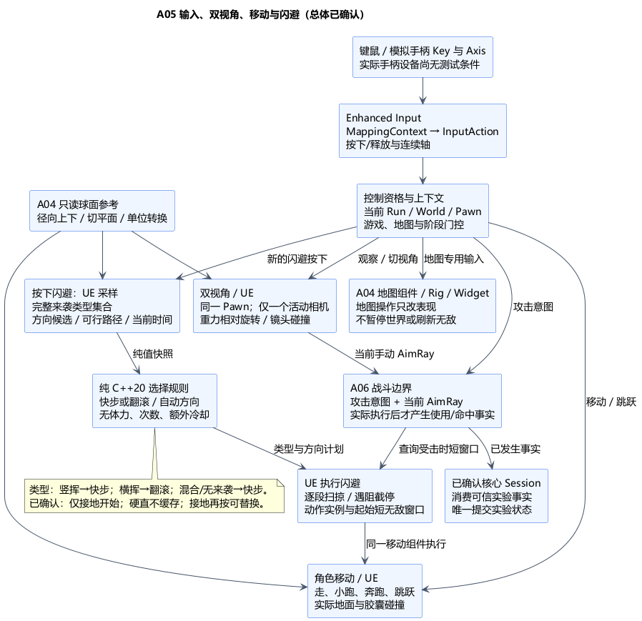

# A05 输入、双视角、移动与闪避

状态：**总体方案已确认**。日期：2026-11-05。依据：[总体及边缘规则确认](../../requirements/001-causal-prototype/sources/2026-11-05-a05-confirmation.md)。[A05 类图](A05-class-design.md)亦已确认；无工程实现或游戏运行验证。

依据：[需求 §2、§5、§6、§10](../../requirements/001-causal-prototype/REQUIREMENTS.md)、[输入设备](../../requirements/001-causal-prototype/sources/2026-10-30-input-devices.md)、[双视角](../../requirements/001-causal-prototype/sources/2026-10-30-switchable-perspective.md)、[移动与防反](../../requirements/001-causal-prototype/sources/2026-10-30-movement-and-attack-defense.md)、[闪避类型](../../requirements/001-causal-prototype/sources/2026-10-30-dodge-defaults-rain-and-tree-cut.md)、[自动方向与无限制](../../requirements/001-causal-prototype/sources/2026-10-30-environment-continuity-and-action-limits.md)。沿用 [A03 核心边界](A03-core-boundary.md)与 [A04 空间类图](A04-class-design.md)。

## 1. 技术栈与原因

| 部分 | 已确认技术栈 | 原因及边界 |
| --- | --- | --- |
| 输入 | UE5.6.1 内置 Enhanced Input 插件：InputAction、MappingContext、Modifier/Trigger | 键鼠和手柄映射为同一组语义动作；上下文分离地图与游戏操作；项目模块按实际使用声明 EnhancedInput 依赖 |
| 移动 | UE Character / CharacterMovement，胶囊碰撞；扩展局部重力与闪避移动模式 | 复用行走、地面检测、加减速和扫掠；实际位置、速度与动作实例只由 UE 维护 |
| 球面 | 已确认的 Root 参考＋SphericalMath / Mapper | 同源径向上下方向和单位换算，移动/相机/地图不各算一套球心 |
| 相机 | 同一 Pawn 的第一/第三视角，CameraComponent / SpringArm；重力相对的视角处理 | 切视角不换角色、不重置生命或动作；局部俯仰/偏航避免默认世界轴限制失配 |
| 闪避选择 | 标准 C++20 的无状态规则，Linux GCC13 可独立检查 | 根据显式威胁和可行方向快照选择类型/方向；UE 做空间查询和实际移动，不把物理搬进核心 |
| 动画 | Animation Blueprint / 轻量动作表现，位移由移动组件驱动 | 快步/翻滚动画不作为碰撞位移或无敌窗口的权威时钟；不增加本轮不需要的能力系统插件 |

类名、继承扩展和具体接口见已确认的类图。增强输入、移动扩展及纯规则均编入已确认的 UEgame / ExperimentCore 源码边界，不新增 Runtime 模块；不引入联网实现。

## 2. 输入语义与上下文

物理按键/摇杆 → MappingContext → InputAction → 当前绑定/控制资格校验 → 移动、视角、闪避或 A06 攻击意图。输入本身不是“已使用招式”事实；只有 A06 确实执行后，才按 A02 生成使用、指向哥布林与命中等不同事实。

连续轴为 Move、Look；Jump、Dodge、ToggleView、ToggleMap 和横斩/竖斩按新的按下沿触发。按 [A06 用户修订](../../requirements/001-causal-prototype/sources/2026-11-06-a06-confirmation-hold-aim.md)，仅发射物类魔法（火球、岩炮弹）按住施法键进入瞄准，松开时请求发射一次，短按也在松开时发射；取消不是发射。地图使用独立 RotateMap、ZoomMap。长按与系统键盘重复消息不自动连发或重复闪避；瞄准本身不产生使用/攻击指向事实。鼠标位移与摇杆转向速率采用不同调节方式，不能统一乘或不乘帧时间；摇杆使用可调死区，斜向输入归一化，防止斜走加速。

已确认以下初始映射方向，作为可调配置，不是固定设备兼容性承诺：

| 操作 | 键鼠 | 手柄模拟映射 |
| --- | --- | --- |
| 移动/观察 | WASD / 鼠标 | 左摇杆 / 右摇杆 |
| 走、小跑、奔跑 | 默认小跑；按住 Alt 走、Shift 跑；同时按时走优先 | 左摇杆幅度分走/小跑，按住左摇杆按键请求奔跑；幅度阈值加滞回 |
| 跳跃 / 闪避 | Space / Ctrl | 南侧键 / 东侧键 |
| 切第一/第三视角 | V | 右摇杆按键 |
| 进入/退出地图操作 | M | View 键 |
| 地图旋转 / 缩放 | 拖动 / 滚轮 | 右摇杆 / 左右扳机 |

地图操作上下文占用对应输入，并清空游戏移动轴；此时不接收新的移动、跳跃、闪避和攻击请求，但已有动作按原规则结算、重力和世界仍运行。退出后清理地图输入，防止一次点击同时触发攻击或切视角。地图模式不产生暂停、无敌或阶段完成事实。

Preparing、TimeSkip、Ended 或旧世界绑定不接受新的角色玩法输入；Rescue/Revisit 按当前合法能力开放。回访对话不因此新增强制锁移动规则。攻击能力和动作冲突细节与 A06/A10 对接，A05 不把所有输入都当成实验状态修改。

失焦、解绑、重启、切换上下文时清连续轴、按下状态与待消费意图；恢复后离散按键必须经历释放再按下，不能把按住的闪避/攻击变成新动作。每次执行校验 RunId、当前 Pawn/World 和控制绑定代次；旧回调丢弃，不缓存至新轮。恢复控制完成按 A02 实际绑定/入口重新可用的时点回报，不等玩家首次移动、释放按键或地图捕获完成。

## 3. 三档移动与球面适配

走、小跑、奔跑是三个明确的玩法档位，各有速度配置；可以共用 CharacterMovement 的 Walking 物理模式，但不能把三个档位合并。摇杆幅度可以在所选档位内调速，不能仅把 MinAnalogWalkSpeed 当作步行档位。加速度、减速度、跳高、坡度与越阶高度留灰盒调试，须能验证倒木跳越和空气墙边界。

每次移动模拟更新，从当前位置和同一球面参考求径向 Up/Down。将相机前向投影到局部切平面作为移动前向，构造一致的左右方向；看向极端俯仰导致投影退化时使用上一有效切向/参考基回退。起跳沿径向 Up，落地检测沿 Down，不能把世界 Z 当固定竖直方向。

采用移动朝向路径驱动胶囊朝向，并利用 CMC 的重力相对旋转处理；静止时保留有效切向。SetGravityDirection 只更新重力缓存，不保证调用后立即对齐胶囊；初始化和每次重力变化都须检查胶囊/地面检测/速度方向一致，不能只设置一个向量就宣称支持球面。闪避的自定义移动模式也要维持胶囊的径向姿态，不能依赖仅 Walking/Falling 执行的默认逻辑。

## 4. 双视角与手动瞄准

同一 Pawn 使用两个相机安装位置，任何时刻只激活一个视角。第三人称通过 SpringArm 的碰撞探测收缩镜头；第一人称使用受约束的头部位置并单独做防穿墙检查，不能把臂长设为零就声称具备 SpringArm 碰撞保护。

视角输入在当前径向 Up 的参考空间计算 yaw/pitch，再转换为世界旋转。俯仰限制在局部空间应用，避免直接沿用默认相机管理器对世界 Euler 轴的裁剪。第一人称不随翻滚动画强制翻转镜头；可隐藏遮挡眼睛的本地头部/网格，但武器碰撞和角色状态仍只有一套。

切换视角保留玩家位置、速度、动作、已有无敌窗口和瞄准方向，不重新触发招式。当前活动相机输出手动 AimRay，交 A06 结合武器实际位置和碰撞求解；第三视角看得到不代表武器能穿墙发射。不加入目标锁定或辅助瞄准。切换期间相机位置/朝向/射线必须同帧一致，不能用上一视角射线处理当前攻击。

空气墙须覆盖角色合法移动范围，并对相机探测提供合适阻挡；边界视角不能依赖补建非活动区。相机扫掠、胶囊扫掠、剑刃/投射物命中是三种不同查询，不能混用一个“碰撞通过”结论。

## 5. 闪避类型、方向和实际执行

### 已确认的动作规则

| 按下时的来袭快照 | 闪避动作 |
| --- | --- |
| 只有竖挥 | 短距离快步 |
| 只有横挥 | 翻滚 |
| 横挥与竖挥同时来袭 | 快步 |
| 没有来袭攻击 | 快步 |

玩家按下才启动；自动选择动作和方向。不得先只挑最近的一只哥布林，再把“横竖同时”误判成单一类型。来袭集合来自本轮附近已开始/已承诺的攻击及其当前轨迹范围，不读取尚未执行的 AI 未来计划；A06/A07 提供明确的攻击类型、攻击标识和阶段，威胁距离/时间窗留调参。

已确认的方向选择流程：在局部切平面生成少量候选方向 → UE 用胶囊查询检查空气墙、地表与阻挡，并采样来袭轨迹关系 → 将纯值候选和完整威胁类型集合交无状态规则 → 排除不可行路径，优先避开来袭扫掠、增加安全距离 → 同分按固定顺序选择。无来袭时优先角色切向前方，再按固定顺序找可行方向；不把移动键直接当闪避方向。全部方向受阻则动作成立、位移截停，不穿墙或强行传送；自动选择不保证成功避伤。

UE 移动组件执行计划，用胶囊逐段扫掠实际路径；动态阻挡出现时缩短/停止位移，不能直接 SetActorLocation 到终点。自定义闪避模式按当前球面分小步更新切向与地面约束，结束后根据实际地面接触返回行走或下落；重力不能因闪避悬停。扫掠只覆盖实际碰撞组件，动画翻滚姿态和旋转不等于完整连续碰撞检测。

短无敌窗口从本次**被接纳的按下时刻**起算，使用与 A06 伤害结算相同的世界时间；按半开区间 `[start, end)` 判断，不依赖蒙太奇通知或“闪避动画正在播放”。伤害发生时查询窗口，动作其余过程照常受伤；世界暂停/倍率沿用 A02，不加入新的计时口径。窗口长度、位移和速度曲线是调参值，不能写死为某个显示帧数。

### 已确认的闪避边缘规则

原需求未确定的下列组合已由本次总体确认补齐，采用以下原型取舍：

| 情形 | 已确认处理 |
| --- | --- |
| 空中按闪避 | 仅接地时开始快步/翻滚；空中不启动、不缓存，也不生成无敌窗口。仍支持正常跳跃越过倒木 |
| 已有闪避中再次按下 | 接地且未硬直时允许新按下重新规划并替换旧动作；不增加次数/冷却限制，旧动作回调不能结束新动作 |
| 硬直期间按闪避 | 不取消硬直、不缓存；恢复后重新按下。硬直来自 A06 的真实动作状态，不伪造一个闪避冷却 |

新闪避从自己的按下时刻建立短窗口，不把剩余时间累加为更长窗口；每次新的合法按下仍按同一规则处理。长按不重复触发，动画未结束本身不是禁止再闪的条件。闪避中是否接地依据实际地面接触，不能简单用 MovementMode==Walking 判断，否则会把自定义闪避模式中的再次按下全部误拒绝。没有体力、次数或额外冷却；“地面/硬直”资格已经本次明确确认。

无敌窗口和动作实例保存在所属 UE 玩法对象，不放入 ExperimentRunState；纯核心只处理显式快照的选择规则。重启/离开运行阶段时清理旧动作和窗口，切地图/切视角不能刷新窗口。闪避不是剑术或魔法使用，不计入救助方式统计；防反仍是 A06 中本次挥砍与棒子实际相击，不新增防反按键。

## 6. 验证计划与技术证据

| 验证层 | 后续检查及可声称范围 |
| --- | --- |
| Linux/GCC 纯规则 | 四种威胁组合、自动方向稳定排序/无路可走、已确认的资格规则；输入使用显式值，不依赖 UE |
| UE 键鼠与模拟键值 | 实际 MappingContext、按下/释放/取消、轴死区、三档移动、地图消费、失焦/重启/恢复控制；模拟手柄 Key/Axis 必须走映射链 |
| 动作级注入 | Enhanced Input InjectInputForAction 可检验动作处理及玩法下游；它绕过硬件 Key→Mapping 链，不能单独证明手柄映射、死区或上下文正确 |
| 世界模拟与相机 | 局部球面接缝/边缘、各档位/跳跃/闪避、动态倒木与空气墙、极端俯仰、双相机切换、第一人称穿墙和第三人称武器遮挡 |
| 时序与旧轮 | 同批次按下/受击的确定顺序、窗口起止、连续新按下、旧回调、地图输入切换、重启/恢复后不复用旧意图；精确伤害顺序与 A06 一起固定 |

**没有实物手柄，不能声称真实设备兼容性或手感通过。** 模拟键值路径与动作注入分层记录；如果只能执行动作注入，就明确映射层仍未验证。当前连工程实现也未开始，上表均为计划。

本机 UE5.6.1 已只读核对：CharacterMovementComponent.cpp:4749 的重力 setter、6449–6504 的条件旋转路径及 6584 的实际旋转；CharacterMovementComponent.h:262–316 的速度参数；PlayerController.cpp:996 与 PlayerCameraManager.cpp:1039 的默认视角处理；Actor.cpp:3638 的活动相机选择；SpringArmComponent.cpp:189 的非零臂长碰撞查询。Engine/Plugins/EnhancedInput 的 EnhancedPlayerInput.cpp:232、444–493 以及 EnhancedInputSubsystemInterface.cpp:204 证实动作注入与物理按键映射分支不同；MovementComponent.h:307/350 提供安全移动/沿面滑动。以上路径相对本机引擎目录，接口存在不是运行验证通过。

官方参考：[Enhanced Input](https://dev.epicgames.com/documentation/unreal-engine/enhanced-input-in-unreal-engine?lang=en-US)、[SpringArm](https://dev.epicgames.com/documentation/en-us/unreal-engine/API/Runtime/Engine/USpringArmComponent)。在线页面默认版本可能更新，本轮具体行为以上述本机 5.6.1 源码为依据。

R-A02-EMPTY-METHOD 继续开放：本项新增可达高处、跳跃和双视角须联合 A04/A06 检查发现前射击路径，不通过补记方式、自动发现或取消合法攻击掩盖问题。球面移动/相机与空气墙运行验证也仍未完成。

## 7. PUML 与本次确认范围

[总体 PUML](A05-input-camera-locomotion.puml) · [闪避流程图](A05-dodge-flow.png) · [闪避 PUML](A05-dodge-flow.puml)。

已确认：Enhanced Input 与初始映射/上下文方案、三档移动和局部重力相机路线、同 Pawn 双视角、闪避无状态选择与 UE 扫掠执行、输入/事实边界，以及“仅接地开始、硬直不缓存、接地闪避中可重新按下替换”。半径、速度、距离、窗口和按键细节可在原型中调整；[A05 类图](A05-class-design.md)亦已确认，后续见 [A06](A06-combat-and-damage.md)。当前不开始游戏实现。
