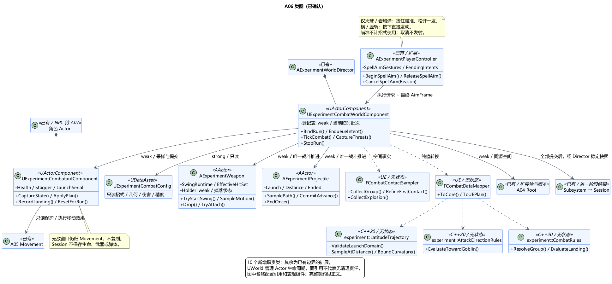
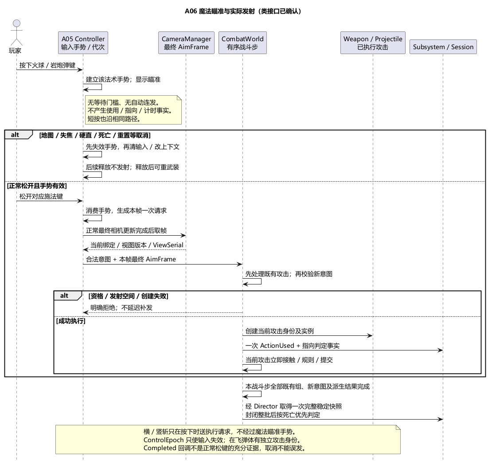

# A06 类图：魔法瞄准、攻击实例与有序战斗结算

状态：**类图已确认**。日期：2026-11-06。[类图确认](../../requirements/001-causal-prototype/sources/2026-11-06-a06-class-confirmation.md)包括具体类、接口、所有权、并发手势与掉棒推进约定。[总体与输入行为](../../requirements/001-causal-prototype/sources/2026-11-06-a06-confirmation-hold-aim.md)此前已确认：横/竖斩按下发动；仅发射物类魔法按住瞄准、松开发射一次，短按同样松开发射。签名描述设计职责，不代表游戏实现或运行验证。

## 1. 技术栈、类职责与原因

沿用 UE5.6.1 C++ / Enhanced Input / UDataAsset；ExperimentCore 为标准 C++20、double 纯值计算，面向 Linux/GCC13。保持既有单一 Runtime 模块与核心源码边界，不增加 GAS、联网或第二套世界状态。

| 类 | 层与职责 | 主要接口（职责签名，尚未实现） |
| --- | --- | --- |
| `UExperimentCombatConfig` | UE UDataAsset；只读招式、武器几何、伤害、防反/摔落、轨迹与误差参数 | `ValidateValues()`；不保存玩家当前血量或攻击 |
| `UExperimentCombatWorldComponent` | Director 的一个 UActorComponent；唯一战斗步、弱引用登记、批次临时数据 | `BindRun()`、`EnqueueIntent()`、`TickCombat()`、`CaptureThreats()`、`StopRun()` |
| `UExperimentCombatantComponent` | 每名玩家/小孩/哥布林所属的 UActorComponent；唯一生命、硬直、击飞/首次落地状态 | `CaptureState()`、`ApplyPlan()`、`RecordLanding()`、`ResetForRun()` |
| `AExperimentWeapon` | UE AActor；剑/棒的可见几何、当前挥动、有效伤害集合，以及持有/掉落状态 | `TryStartSwing()`、`SampleMotion()`、`CommitContact()`、`Drop()`、`TryAttach()` |
| `AExperimentProjectile` | UE AActor；火球/岩炮弹共用；唯一发射参数、累计路程及结束状态 | `InitializeLaunch()`、`SamplePath()`、`CommitAdvance()`、`EndOnce()` |
| `FCombatContactSampler` | UE 无状态工具；扫掠/重叠候选、同时间运动轨迹复核、范围去重 | `CollectGroup()`、`RefineFirstContact()`、`CollectExplosion()` |
| `FCombatDataMapper` | UE 无状态工具；UE 类型、厘米与核心米制值转换 | `ToCore()`、`ToUEPlan()`；复用 A04 空间 Mapper |
| `experiment::LatitudeTrajectory` | 纯 C++20；已确认纬度路径及合法域计算 | `ValidateLaunchDomain()`、`SampleAtDistance()`、`BoundCurvature()` |
| `experiment::AttackDirectionRules` | 纯 C++20；剑的起始方向、弹道等效方向与角度阈值比较 | `EvaluateTowardGoblin()`；不改瞄准、不制造命中 |
| `experiment::CombatRules` | 纯 C++20；接触组防反、保护样本、伤害与摔落求值 | `ResolveGroup()`、`EvaluateLanding()`；返回计划，不写实体 |

选择这些边界的原因：输入失效不能撤销已发弹体；伤害规则不能依赖 UE 对象；碰撞查询不能直接决定实验成败。世界组件集中顺序，实体各自提交状态，Session 仍唯一维护实验阶段、方式统计与结果。

## 2. 已有类的最小扩展

- **A05 Controller** 增加 `BeginSpellAim(Action, Context)`、`ReleaseSpellAim()`、`CancelSpellAim(Reason)` 和只读瞄准表现投影。横/竖斩沿既有按下请求；不把两者接入魔法瞄准状态。CameraManager 继续提供本帧最终 AimFrame，不因长按新增自动变焦、减速、锁定或蓄力。
- **A05 Character** 装配一个 CombatantComponent；已有 `ResetForRun` 向其分派一次，Director 不再重复复位该子组件。Movement 只读硬直资格，执行 `StopVoluntaryMotionForStagger()`：停止自主水平/闪避位移，保留重力与已有无敌窗口；死亡/整轮停止仍走原清理契约。落地入口须在速度归零前冻结入射速度并交 Combatant，不由动画通知补造。
- **A04 Config / Root** 增加 `NorthAxisLocal`、`PrimeMeridianLocal`；Root 解析为同源世界基及 `SpatialRevision`。不把原局部切向 North 当作全球北轴。CombatWorld 在 Preparing 联合 Root 空间、全部合法发射口包络、允许角度、射程、弹体体积和误差校验完整覆盖；准备凭据绑定 RunId、SpatialRevision 与 CombatConfigRevision。任一相关配置改变即失效，重新准备。
- **Director / UExperimentConfig** 分别装配 CombatWorld、引用 CombatConfig。Director 登记本轮完整必需实体集合并协调稳定快照；Subsystem 只接收可信事实/稳定批次，不复制生命、弹体或武器状态。NPC/AI 类见已确认的 A07 类图；A08/A09 环境类留后续确认。

这些扩展由本次类图确认；原 A04/A05 类的其他职责不重开设计。

## 3. 魔法输入手势：按住与执行分离

`FSpellAimGesture` 归 Controller：`InputContext`、`ActionKind`、`GestureSerial`、按下顺序和有效状态。`FCombatIntent` 是松开后形成的本帧一次性执行请求，带释放顺序及所请求视图版本；它与尚未释放的手势不同。`FCombatActionKey` 只在真正攻击执行后存在，不包含 ControlEpoch。

1. 新的有效火球/岩炮弹按下立即进入瞄准；不等待 Hold 时长门槛，不生成弹体，不记 ActionUsed/AttackTowardGoblin。只读瞄准指示不保存目标、不承诺命中；本轮不额外设计完整预测落点 UI。
2. 正常松开仅把匹配手势转成一个意图，并立即消费手势。短按走相同路径；重复释放、系统按键重复或持续 Triggered 不重复产生意图。两次采样之间的快速按下/松开须保留源输入边沿，不能仅用帧末“键已抬起”丢失短按。
3. 意图在释放被输入系统观察到的更新中，经最终相机解算后封装 AimFrame，再交 CombatWorld。UE 对同次输入评估内的极短按下/松开可能先保留按下值、下次评估才报告结束；不承诺物理松键的渲染帧必定发射。观察到释放后若本帧相机未真实更新、绑定/视图版本失效或资格被更早接触改变则拒绝；不会将该已拒绝请求留到后续自动补发。按住期间可转视角，实际取释放被观察时的最终方向，不冻结按下时方向。
4. 地图、失焦、解绑、阶段停止、死亡、重置或防反硬直先取消手势和未消费请求，再更换上下文/清输入；取消事件不发射。每个动作保留 `AwaitRelease`，不能与普通按下状态一起清空。恢复后要看到真实释放再允许新的按下；丢失释放时保守保持未重武装，不把恢复/重建映射当按下。Controller 在 `FlushPressedKeys` 覆写入口先失效手势再调用 Super；flush 生成的释放与恢复焦点时引擎合成的按下都不能越过此门控。
5. **已确认的并发约定：**火球与岩炮弹各持一个独立手势；同时按住时，释放哪个就请求哪个，一次释放至多一发，按输入序号处理。挥砍不进入、也不隐式取消魔法瞄准；若实际防反产生硬直，再由硬直统一取消。这样不额外加入“先按法术使另一招不可用”的限制。

实现约束：Boolean 语义动作不配置会改变短按语义的 Hold/Pressed/Released 复合触发器；Started 用来开始手势，持续 Triggered 只代表保持。Completed 只是动作状态结束，不能单独证明真实松键；须同时验证正常释放来源、当前映射/手势/代次与控制资格。Controller 输入接入记录实际参与映射的来源键及边沿序号；同一法术有多来源时按合并后的激活状态管理，最后一个有效来源正常释放才结束该次手势，避免键盘与模拟手柄同时输入产生双发。映射重建/flush 使来源记录失效。Canceled 和所有显式取消入口均只取消。模拟按键验证需走 Key/Axis 映射链，直接 Action 注入须提供测试释放语境，只验证后端语义，不能代替真实键盘/手柄释放来源测试。

## 4. 数据流与身份

**挥砍按下 / 魔法松开 → Controller 最终 AimFrame → CombatWorld 校验 → 武器/弹体实际创建 → 使用与指向事实 → 接触采样 → 核心规则 → 实体提交 → 完整稳定批次 → Session。**

| 值 | 归属与用途 |
| --- | --- |
| `FCombatEntityKey` | RunId＋EntityId＋Generation；由 Director 本轮装配确定，跨对象同时校验弱绑定；不能用地址排序 |
| `FCombatActionKey` | SourceEntityKey＋单调 ActionSerial；CombatWorld 按来源统一分配序号，剑与两种法术不能各自从零分配造成碰撞。武器或弹体保存执行身份；预留失败可跳号，未实际创建不能发布使用事实 |
| `FCombatStepKey / FContactOccurrence` | CombatWorld 的步序号及当前有序接触序号；保留实际世界采样时刻、共同子段/分组位置、稳定组件键。Sweep.Time 只几何排序，不倒造历史时间 |
| `FWeaponSwingRuntime` | Weapon 私有；轨迹种类/进度、前后姿态、有效阶段和已造成有效伤害的目标集合；无敌拒伤不加入该集合 |
| `FProjectileRuntime` | Projectile 私有；已冻结的空间基/配置版本/发射参数、源身份、累计实际路程、一次结束状态；无第二个位置积分器 |
| `FCombatantRuntime` | Combatant 私有；生命、硬直截止时刻、状态版本、LaunchSerial 与首次有效落地是否消费；不复制 Movement 的速度/接地/无敌窗口 |
| `CombatGroupSnapshot / CombatPlan` | 核心纯值；完整同组接触、当前实体版本、发生时 FDodgeProtectionSample 的映射、计划及显式拒绝/错误；不含 UObject 或可调用引擎函数 |

Director 唯一分配实体身份并登记玩家 FPlayerBindingKey 与 SourceEntityKey 的对应关系；动态弹体通过该同一分配入口取得实体键，失败的预留身份不复用。CombatWorld 保存的序号/登记表只是调度身份，不是第二套生命、挥动或弹体状态。

所有核心几何用米和标准向量；UE 几何用厘米，角度内部统一弧度，误差配置注明单位。Config 校验有限数、正速度/射程、合法伤害/时长、曲线误差/接触分组容差关系。调参值未固定，不增加冷却或把失败发射算成招式使用。CombatWorld 组织 Mapper 转换、核心求值和计划提交；Mapper 只转换值，不替代规则决策。

## 5. 唯一战斗步与提交

已确认接口扩展：[A08 类图](A08-class-design.md)由 Weapon 的现有 SwingRuntime 唯一保存单刀切削进深，以材料谱系/CutId 跨木段继承预算；CombatWorld 在共同子段调用树木准备/提交与运动接口，整组几何碰撞成功后才确认实际剑前缀。A08 总体及具体类接口与预算归属均已确认，不另开剑或树木自由推进 Tick。

已确认接口扩展：[A09 类图](A09-class-design.md)将环境天气/火焰接触与 A06 事件合成共同最早前缀；木体先预演、后随材料/火湿同次提交，同刻引燃保存发生时覆盖并按最终材料映射。具体接口及新年代恢复握手已获 A09 类图确认；环境不得重放火球直接伤害或改写使用统计。

CombatWorld 在游戏线程 `TG_PostUpdateWork` 按明确依赖运行；Weapon、Projectile、Combatant 不另开推进 Tick。角色运动/物理与最终相机完成后，先处理既有攻击的共享子段，再接纳本帧新意图。Sampler 同时读取双方同一子段前后轨迹并复核相对运动；只扫对方帧末姿态不满足契约。原始回调只作为带来源的输入，不直接扣血。

每组先固定完整成员并统一求值，计划按稳定身份提交；同组防反例外及其他目标在此计划中明确。玩家硬直/死亡产生的取消对后续组和新意图生效，不在逐个回调中删掉本组本应结算的其他目标。提交前校验绑定与状态版本；重入请求排队至当前组提交完成，不允许半组求值/半组旧状态。发生点立即采样 Movement 保护，旧样本不被后来闪避替换。

Weapon 的事件去重与有效伤害去重分开；窗口后持续/再次接触必须生成新的 Occurrence。树木切面以连续几何归并交 A08，不能复用“每目标一血量命中”去重。Projectile 的 `EndOnce` 独立于拒伤：首碰撞免伤也结束弹体；火球只派生一次范围，不叠加直击伤害。同一最早接触组空气墙优先，其他候选稳定排序；扩张查询只找候选，精细复核后才伤害。

[A10 总体](A10-revisit-and-narrative.md)与[类图](A10-class-design.md)已确认教师/群众不可受伤但保留真实接触，新增 StoryParticipant 几何登记：没有 Combatant 仍进入弹体首接触候选，剑只拒伤且不截断其他目标。该接口设计已确认，尚未实现或运行验证。

玩家实际成功建立攻击后恰好发出一次 ActionUsed，并按同一时点完整哥布林快照求指向；发射失败/按住/取消均无使用事实。NPC 攻击仍分配自己的 ActionKey，但不发布玩家 ActionUsed、AttackTowardGoblin 或首次攻击计时事实。已发弹体保留来源事实，其继续飞行不要求施法者仍有输入焦点或未硬直；来源与目标的合法性各自校验，不把每帧“源还可攻击”当弹体生存条件。发现前发出的弹体后命中也不补统计。

一个 CombatStep/Batch 的全部既有攻击接触组、全部本帧新意图、各自立即接触和派生爆炸/落地都处理完成，才能封闭批次并经 Director 请求一次完整稳定遭遇快照；不能在单组或单个新攻击结束时提前判成败。必需对象弱引用失效属于错误，不可删出名单当作死亡/清怪。Subsystem 先登记带原时间/顺序的事实，再按 A02 稳定快照判定。火球同时杀最后哥布林与小孩仍判失败。Tree/Fire 的结果也依既有批次契约交接，Session 不接管实体状态。

## 6. 武器、落地与清理

- Weapon 是世界 Actor，UWorld 管理生命周期，CombatWorld 负责本轮攻击对象登记及唯一清理请求。持有者只有弱绑定；同一武器要么持有/挥动，要么掉落，不同时由附着轨迹与物理模拟驱动。**本轮已确认**掉棒通过 CombatWorld 调用武器的径向重力扫掠推进，落地后保留实际位置；不并行启用 Chaos 模拟，不增加掉棒伤人。A07 发出 `TryAttach` 请求并经当前拾取资格校验，不直接改持有者或凭空回手。
- 防反计划先撤销被挡棒的攻击效力，再交 Movement 执行击飞。Combatant 分配 LaunchSerial；实际落地回调按当前径向 Down 的碰撞前速度冻结事实，仅首次有效落地求值。A07 只收到存活/掉棒状态，不在本项引入其完整 AI 类。
- Config 用 `UPROPERTY() TObjectPtr` 强引用，Actor 的可见网格/碰撞代理为所属组件；跨实体/Root/Director/Subsystem 用弱绑定。核心类无 UObject 生命周期。原型不引入对象池，避免旧弹体回调跨实例复用。
- 地图/失焦取消手势与待执行请求，不取消已开始挥砍、闪避或已发弹体。硬直按总体只取消未执行攻击和后续玩家剑刃/自主位移，不删除在飞弹体，不清短窗口。
- 停止/重启顺序为先关输入与战斗接纳、失效旧 Run 身份，再清待处理组/旧攻击并解绑观察；已发生环境变化按 A02 保留或由明确新轮复位恢复。Director 只调用角色唯一 ResetForRun，再调用 CombatWorld 的登记/准备入口；两者不各自复位同一 Combatant。缺配置/覆盖验证失败不报告 WorldReady。

## 7. 验证边界

当前仅文档、类关系及本机接口核对。UE5.6.1 的 `EnhancedPlayerInput.cpp:436–440` 保留同评估按下/释放，`InputTriggers.h` 的 Completed/Canceled 定义基于动作状态转换；`PlayerInput.cpp:390–413` 有恢复焦点的重复键合成按下路径；`PlayerController.h:1758` 提供 `FlushPressedKeys` 覆写入口。这些事实要求区分正常松键与强制清理，并保留 AwaitRelease，而不是只绑定 Completed 就发射。

后续 Linux 检查应覆盖路径/反解、防反同组、有效伤害去重、摔落与无效值；UE 检查须覆盖互相运动接触、低帧率曲线首碰撞、短按/长按/取消/两法术并发、多来源按键、同评估按下释放、失焦恢复重复消息、相机切换、发射口遮挡和同批死亡优先。键值模拟与直接动作注入分开记录，尚未做真实手柄、UE 或 GCC 构建测试。原有空间、工具链及 R-A02-EMPTY-METHOD 风险仍开放。

## 8. PUML 与确认范围

[类图 PUML](A06-class-design.puml) · [输入流程 PUML](A06-spell-aim-flow.puml) · [已确认总体](A06-combat-and-damage.md)。

已确认：10 个职责类及已有类扩展；手势、攻击、无敌窗口各自所有权；两法术手势独立与挥砍并存的并发约定；同组计划及整步稳定批次；武器掉落的单一推进入口和唯一复位责任。[A07 总体](A07-goblin-behavior.md)及 [类图](A07-class-design.md)现均已确认，增加由 CombatWorld 推进的徒手组件与同步共享目标接入。仍不开始游戏实现。
