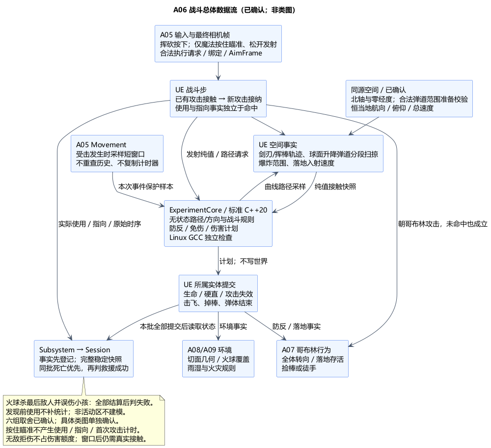

# A06：挥砍、投射物、命中、防反、误伤与伤害

状态：**总体方案及类图均已确认**。日期：2026-11-06。[用户确认及输入修订](../../requirements/001-causal-prototype/sources/2026-11-06-a06-confirmation-hold-aim.md)接受总体六组取舍，并明确仅发射物类魔法按住瞄准、松开发射一次，短按同样松开发射。具体类职责及接口见已确认的 [A06 类图](A06-class-design.md)。没有游戏实现、编译或运行验证。

依据：[001 需求 §3–6](../../requirements/001-causal-prototype/REQUIREMENTS.md)、[A02 批次结算](A02-experiment-flow.md)、[核心分层](A03-core-class-design.md)、[球面与空气墙](A04-class-design.md)、[A05 动作身份和相机时序](A05-class-design.md)。下文总体设计及第 6 节行为已确认；保留的技术建议措辞描述实现路线，不代表已经完成或验证，具体类图不随总体自动确认。

## 1. 技术栈与分工原因

| 部分 | 建议技术栈 | 原因与边界 |
| --- | --- | --- |
| 世界接触与轨迹 | UE5.6.1 C++，显式 Shape Sweep / Overlap，专用查询通道；游戏线程集中战斗步 | UE 提供碰撞事实；OnHit/Overlap 回调不直接扣血，避免回调先后决定胜负 |
| 剑刃与棍棒 | 配置化挥动轨迹、可见武器及贴合刃/棒形状的碰撞代理，分段扫掠 | 灰盒即可验证真实武器接触；渲染读取同一轨迹，不能以面前扇形代替剑刃接触 |
| 火球与岩炮弹 | 标准 C++20 纯函数采样路径，UE 可见 Actor 分段扫掠并提交；任意方向保持当地航向/俯仰/总速度；不并行启用另一套 ProjectileMovement/Chaos 刚体推进 | 复用已确认公式，保留南北与斜向手动瞄准；明确首碰撞、实际路程射程和唯一结束 |
| 伤害与防反规则 | ExperimentCore 内标准 C++20 无状态规则，Linux/GCC13 独立检查 | 输入纯值快照，输出免伤/伤害/防反计划；不访问 UObject、碰撞、引擎时钟，不复制世界生命值 |
| 实体状态与落地 | UE 所属 Actor/Component 唯一提交生命、硬直、攻击实例；CharacterMovement 执行击飞/落地 | Session 只接收事实及完整遭遇快照；核心不会变成第二个世界模拟器 |
| 配置与反馈 | UDataAsset；Blueprint / 动画 / 简单特效与声音 | 参数与表现分离；动画通知不决定伤害、无敌窗口或成败，不引入本轮不需要的 GAS/联网模块 |

仍在既有 UEgame Runtime 模块及 ExperimentCore 源码树内。后续可把相同规则用于 UE 权威服务端；本地意图和结果值还不是网络协议，也不声称独立 Linux 核心能模拟完整世界。

## 2. 数据流与状态归属

**输入意图＋本帧最终 AimFrame → 校验并实际执行 → 招式使用/指向事实 → UE 接触候选 → 发生时保护采样 → 纯规则 → 所属实体提交 → 稳定批次 → Session 判定。**

1. 横斩/竖斩按下产生执行请求；仅火球/岩炮弹按住瞄准、松开产生一次请求，短按同样松开发射。瞄准不产生 ActionUsed、AttackTowardGoblin 或首次攻击计时。A05 在执行请求所在帧最终相机实际更新后交付意图，保留 RunId、PawnGeneration、输入序号及视图版本；A06 校验当前绑定、阶段、生命和硬直。被拒绝的输入不计招式使用，不能跨帧缓存成迟发攻击。
2. 玩家成功建立挥砍实例或真正生成投射物才分配/提交 ActionId，并产生一次 ActionUsed；横劈和竖劈均为剑术，火球和岩炮弹均为魔法。NPC 攻击有独立动作身份，不产生玩家使用或攻击指向统计。命中不是使用的前提，生成失败不能伪报使用。动作身份与 A05 闪避执行身份不同。
3. 使用时同时冻结手动瞄准方向、武器起点及指向快照，独立判断 AttackTowardGoblin。它通知 A07 全体转向玩家，并通知 A02 开始首次攻击计时；它不制造命中或伤害。
4. UE 汇集剑/棒接触、投射物首接触、爆炸范围与落地事实。每个候选保留攻击来源、目标稳定身份、轮次、战斗步/事件顺序、位置/法线、接触类别；UE 类型和单位经适配转为标准 C++ 值。
5. 在本次受击事件的有序求值点，立即向 A05 Movement 取得 FDodgeProtectionSample。纯规则读取此样本及当前只读状态，输出明确结果；UE 所属实体提交一次，随后产生伤害/死亡/防反事实。延迟传递样本时保留原上下文，不能出队后查询新闪避窗口替换它。
6. 树木收到的是切面几何或火球覆盖事实，进入 A08/A09；不是角色伤害，也不是树的统一血量。实验协调器等待本战斗步所有目标及关联提交完成，读取完整稳定快照，再按 A02 判断死亡优先或救援成功。

| 状态 | 唯一所有者 |
| --- | --- |
| 角色生命与硬直 | 该角色的 UE 战斗实体；A05/A07 只读 |
| 当前挥砍、已命中对象集合、招式时段 | 攻击所属 UE 对象 |
| 投射物位置、剩余射程、是否已结束 | 该投射物；战斗步调用它的唯一推进入口 |
| 当前战斗步候选与结果 | UE 战斗调度的临时数据，处理后释放；不是长期事件库 |
| 无敌窗口 | A05 Movement；A06 只保存本次事件的不可变采样 |
| 阶段、救助方式与结果 | 已有 ExperimentSession |

## 3. 手动瞄准、使用与指向

用户已[确认纬度圆及东西向俯仰公式](../../requirements/001-causal-prototype/sources/2026-11-06-latitude-trajectory-confirmation.md)。纬圈半径 r cosφ，圆心在球轴上；俯仰改变高度，射程按真实路程计。旧固定过球心平面模型不再作为基线。本次总体进一步确认按[专题 §6](A06-latitude-trajectory-derivation.md#6-任意航向的统一推导总体已确认)保持当地航向/俯仰/总速度：东西向沿纬圈，南北与斜向改变纬度，垂直沿径向。

### 已确认：同源坐标与极点范围

在 A04 的只读空间配置中增加明确的北轴方向和零经度方向，均相对 Root 定义，校验正交归一后随 Root 解析到世界。当地北/东从同一轴生成，不直接将世界 Z 或相机 Up 当成北轴；具体成员/接口留类图。空间配置仅在 Preparing 中更换并重建绑定，运行中的弹体不能中途换坐标系。

本轮建议将局部小镇/森林布置在远离两极的纬带；在世界就绪前联合全部合法发射口包络（包括跳跃/空中）、所有允许俯仰/航向、最大射程和最低有效半径，并计入弹体体积与数值/曲线误差余量，验证全部合法弹道不会进入极点奇异域。纬带边界与留量为配置，不新增跨极玩法。只有移动范围或地面空气墙通过不够，还要覆盖高空弹道；不足时调整布局/边界配置，不能偷偷缩短已配置射程或拒绝本来合法的朝向。会影响该覆盖的配置变化必须重新校验，不能沿用旧准备结果。

验证失败则不报告世界准备就绪。运行中若出现配置/绑定异常越过已验证数值边界，记录开发诊断并停止受影响的攻击实例，不夹紧纬度后续飞、不传送、不伪造地面命中/爆炸。此异常路径不作为正常游戏中的极点处理；如以后需要合法跨极飞行，另行设计。

建议直接以最终相机方向作为实际发射口的初始方向，保留径向与切向分量，不在相机射线上选目标自动收敛；第三视角存在视差，这一交互取舍随本总体确认。相机看见目标但发射口被挡时，以实际曲线碰撞为准；初始化必须检查发射口及角色到发射口间的遮挡，不能把弹体出生在墙后。无合法发射空间时拒绝生成，不偷偷平移穿墙。固定几何收敛并不必然属于辅助瞄准，本提案选择直接方向是原型的明确取舍。

建议“朝哥布林攻击”采用**动作开始时，手动攻击方向与任一存活哥布林相对方向的可调夹角阈值**；只在对应遭遇的有效绑定内判断。该方向判断不要求实际射程内、无障碍视线或近身擦过，不反馈为瞄准辅助。阈值只容纳方向意图，不扩大武器命中体积；新发现、攻击使用、攻击指向仍是独立事实。角度/同位置退化处理在纯规则中显式定义并测试。

对投射物，建议以目标当前参考点求“能沿该纬度模型到达它的等效初始方向”，与玩家真实方向比较夹角；这一反解只判断指向，绝不用于修改弹道。令目标与发射点的纬差为 Δφ、最短有符号经差为 Δλ，ψ(φ)=asinh(tanφ)，q=Δφ/Δψ，同纬时 q=cosφ0。令 m=hypot(Δφ,qΔλ)，则等效航向 βt=atan2(qΔλ,Δφ)，等效俯仰 αt=atan2(log(rt/r0),m)。在发射口当地北/东/上基中重建目标方向再比较，不能复用旧过球心平面的反解。

近等纬采用稳定差商，经差取 (-π,π]，精确半周固定为正分支。这只是本次仇恨方向识别约定，不是穷举所有可到达目标的弹道；较长绕行仍可能实际命中，不能因此修改或取消弹体。m=0 且半径不同时使用纯径向目标方向；合法目标与发射点完全重合时建议视为指向该目标。源/目标需满足正半径和非极点有效域；纯径向特例可直接用径向向量。无效坐标、极点退化、缺少完整目标快照不等于“没有目标”，应报告诊断。挥砍没有该远程曲线路径，使用生成实际挥动轨迹的起始攻击瞄准轴，与每个存活目标的相对方向比较，不能用横放的剑身长轴或瞬时剑速替代；两者都不增加射程/视线条件，也不能让夹角判定制造伤害。退化容差、方向阈值及稳定排序键在类图/配置中细化。

发现前使用仍能触发计时和全体仇恨，却不能追溯计入发现后的方式统计。发现前发射、发现后命中的弹体也按原使用时间归属；命中时不再补发 ActionUsed。R-A02-EMPTY-METHOD 仍开放：必须联合场景、发现区域、跳跃视线、射程及火球范围验证，不补造教师方向或禁止本来合法的攻击。

## 4. 三种招式与接触

### 挥砍

支持横劈/竖劈两种轨迹，均属于既定“挥砍”招式，竖劈同时服务倒木分段。初始映射：鼠标左/右键横/竖劈，1/2 火球/岩炮弹；模拟手柄 RT/LT 横/竖劈，LB/RB 两种法术。映射可调，服从 A05 地图上下文消费。横/竖劈按下直接发动，不进入长按瞄准；火球/岩炮弹按住瞄准、松开发射一次，按住多久不改变伤害或形成蓄力门槛。

剑刃代理覆盖实际可见剑刃，剑柄不当作刀刃。记录前后姿态，按平移距离与旋转角度细分轨迹；可用刃上多个球体的平移扫掠与姿态重叠复核，不能只用剑尖一条线，也不能以一次固定旋转的胶囊 Sweep 声称完整旋转碰撞。

剑与棒都在运动时，必须在同一子段取得双方前后轨迹并作相对运动判交；分别扫掠对方的帧末静态位置会漏掉中途交叉。此约束同样适用于快速移动的受击体；候选查询与精确度复核分开，不能仅靠共同排序宣称连续碰撞正确。

角色/武器作为可查询接触候选，不让首个角色的 blocking 响应截断全部后续角色。地面/空气墙等硬障碍单独裁定遮挡；每条刃段真实路径才有资格接触后方对象。一挥可命中多个不同对象，同一 ActionId 对同一角色至多提交一次有效伤害；无敌拒伤与伤害去重分开，见 §5。树木先汇总该次连续切削的几何接触，再按树/切口归属提交；不能用每帧一次重复加面积，也不能因角色去重而丢掉切面形状。树木接触与局部阻挡的几何约定留 A08，不能承诺剑穿过未切断的完整树干。

### 投射物

每步推进实际三维路程为速度乘世界步长，并裁到剩余最大射程；最大射程按累计实际路程，不能只扣水平圆弧或起终点直线距离。纯函数从冻结的发射参数和路程采样路径，UE 细分曲线并扫掠首接触。具体纬度/经度/高度公式、水平与垂直极限、正半径及极点有效域和修订曲率见[纬度圆推导](A06-latitude-trajectory-derivation.md)。

初始重叠、零距离接触、同路程多对象均须有显式处理，不依赖未排序的数组顺序。到期与碰撞同点时先处理有效末段碰撞，再处理无碰撞的射程到期。每段结果映射回累计路程排序；弦扫掠与曲线间的误差需后续验证并收紧，不能当作精确连续曲线碰撞。弹体按轨迹约束更新，不再叠加另一套径向重力积分。

建议同一最早接触组内空气墙优先于可引爆对象，以落实边界吸收且不爆炸；其他相同路程候选按稳定实体/组件标识选择唯一首接触，不按阵营避开小孩。确实更早的接触仍先处理，不能把后来空气墙回溯到先前角色命中之前。分组容差按曲线误差约束配置，不能使用未排序回调顺序。

水平东西向可用纬度圆的弦高约束；一般方向按随半径和纬度变化的曲率界，不能复用旧固定球心平面的曲率。建议误差扩张查询仅作候选，再细分复核，扩张接触不直接判命中；最终接触点与弹体停止位置沿同一近似规则确定。高速/薄障碍、互相运动与低帧率仍需实测。

| 招式 | 实际碰撞与结算 |
| --- | --- |
| 火球 | 第一次碰角色/树木/地面，在接触处产生一次范围攻击并结束弹体；没有额外的一次直击伤害。范围中的哥布林与小孩均致死，树木全部交环境端判定点燃/雨湿例外；不碰撞则最大距离燃尽 |
| 岩炮弹 | 第一个角色/树木/地面阻止弹体并消失；命中哥布林或小孩致死，不穿透；物理伤害标签与魔法方式标签分开；不因物理标签获得砍树切面或自动点火 |
| 空气墙 | 建议作为实验边界吸收投射物，熄灭/消失且不爆炸、不生成外围环境变化；不补建非活动区 |

火球范围查询按角色/树木实际碰撞体与球形范围相交收集，去掉同一实体多个组件的重复条目；不能用“敌对阵营”过滤小孩。本轮采用单一球形覆盖，不增加爆炸遮挡衰减；保留小孩误伤，自伤暂不纳入原型。该范围/自伤取舍已随总体确认。直接火球范围伤害与后续森林燃烧分开：火灾始终不伤害角色。

发射者自身的碰撞代理不阻止自己的投射物，火球范围也不扣施法者生命；小孩与哥布林仍按既定误伤/致死规则处理。剑棒防反使用专用接触查询，不因此自动增加“棍棒可挡火球/岩弹”的未确认机制。

## 5. 有序战斗步、防反及无敌

建议使用游戏线程 `TG_PostUpdateWork` 战斗入口，在移动、物理与本帧最终相机之后执行；明确相关对象的 tick 依赖，不能只调整随机 Tick 顺序。灰盒武器由这一入口的轨迹状态驱动，不依赖可见性决定是否刷新骨骼。未来改为骨骼驱动时必须另行保证姿态刷新与查询顺序，不能用屏幕外旧 socket 位置结算。

每帧的有限战斗批次按以下顺序完成：

1. 推进上次已存在的挥砍、挥棒、弹体；收集必要的落地事实，在共享子段序列中处理接触。世界时间暂停时不推进。大步长采用距离/角度约束的子段，不能到达上限后静默跳过余下路径。
2. 处理这些既有动作的接触，重新检查动作/目标身份与当前状态。候选因之前死亡、防反或取消而失效则丢弃；新输入不能倒填到之前的轨迹，回溯防反已经发生的受伤。
3. 消费 A05 本帧交来的攻击意图，重新检查资格，成功后发布使用/指向事实。新动作从当前提交点开始，不补走整帧 dt；出生处的合法立即接触进入当前批次。多个意图按已记录的输入序号处理，尚未执行的意图若因前项产生硬直等而失去资格则明确拒绝。
4. 处理当前产生的有限关联结果后封闭批次，先提交全部事实，再请求稳定遭遇快照。不能在“最后一只哥布林死亡”的单个回调中提前成功，也不能把未执行的下一帧攻击加入当前批次。

**时间口径：**角色运动由 UE 先模拟；本方案的战斗命中发生点是上述有序求值点，保留实际世界采样时间及 StepId/事件序号。Sweep 的 `Time` 只用于同一采样区间内的几何排序；不同 sweep 必须先映射到共同子段坐标，不能把各自的 0–1 值直接比较，更不能用它倒造旧世界时间，向只存当前窗口的 Movement 查询“历史无敌”。A05 闪避提交与本次求值点沿游戏线程的实际顺序处理；已提交伤害不会被后来闪避撤销。低帧率下的离散误差需要实际验证，本方案不承诺连续物理精确或跨平台位级确定性。

防反成立要求剑刃与**仍处于有效挥动阶段的棒子**相交；靠近武器、棍棒已掉地、按下攻击键均不成立。建议接触处理规则：

- 不同接触时点先到先算。身体已先受伤，不因之后碰棒子追溯免伤。
- “同组”采用明确几何容差和稳定身份排序，不能依赖浮点完全相等或引擎回调顺序；具体字段/容差约束在类图中细化。
- 同一接触组里，剑—活动棍棒防反先于该棒对玩家的伤害；防反成功后该棒攻击失效，玩家此次不受该棒伤害，但产生硬直，哥布林被击飞且棒子脱手，不再追加一个伤害招式。
- 同组剑同时碰到该哥布林身体时，建议本次剑与该哥布林采用防反结果，取消该配对的直接必死伤害，避免“防反即死亡”绕过摔落/捡棒。其他目标同组已有接触仍分别结算；玩家硬直终止后续挥砍轨迹，不能抹掉已发生接触。
- 上一条是对“挥砍命中身体必死”新增的特定防反例外，已随本次总体明确确认，需求正文同步记录。
- 防反免伤仅覆盖被挡住的棒子，其他哥布林的同组命中仍独立检查闪避保护。处于闪避短窗口而又发生真实防反时，仍执行防反与硬直；无敌不是把所有武器接触删除。
- 非防反伤害读取发生时 FDodgeProtectionSample，受保护则本次不扣血；未受保护按伤害类型结算。没有新增“受伤后无敌”。同一棒的同一次挥动对同一目标至多提交一次有效伤害，不逐帧叠伤。
- 无敌拒伤不等于该攻击已对目标造成伤害。建议分别记录事件去重与已生效伤害集合；武器仍在有效攻击阶段、短窗口结束后仍有持续或重新发生的真实接触时，在新的有序发生点重新采样并允许提交那一次伤害。必须重新检测接触，不能把先前被免除的事件延迟重放。爆炸只有一个瞬间，已结束的火球/岩弹不因窗口到期再生成一次命中。
- 投射物的首接触结束与目标是否受伤分开：目标免伤也不会让岩弹穿透继续飞行，火球仍在该处爆炸并结束；本轮不增加反弹或穿透机制。

已确认防反硬直的执行效果：终止后续剑刃挥动和玩家自主水平移动/闪避位移，期间不接收新的移动、跳跃、闪避或攻击，不缓存离散动作；重力和世界继续。Movement 仍是移动状态的唯一提交者；停止闪避位移不清除或刷新已经接纳的短无敌窗口，窗口按 A05 原定时间到期。已发射的弹体继续。硬直结束后离散动作重新按下，连续移动轴按当前输入恢复。普通棍棒伤害本轮只扣血，不额外增加受击硬直。

击飞按接触位置的径向 Up 与离开玩家的切向计算可调速度，通过既有运动系统执行；不额外设置哥布林硬直。棒子由独立世界对象保持落地位置，不随哥布林凭空回手。落地沿当前径向 Down 取碰撞前入射速度，纯规则计算可调摔落伤害；去重到该次击飞的首次有效落地，不能因多次地面回调重复扣血，也不能用落地后已归零的速度。存活后向 A07 发布可捡棒事实，A07 处理绕路、受阻与徒手攻击；本项不预设死亡或救援完成。

## 6. 已确认的行为取舍

以下六组已获总体确认，其中施法输入按用户后续范围限定及发射方式答复修订：

| 行为取舍 | 已确认行为 |
| --- | --- |
| 攻击操作与重入 | 横/竖劈分别按下直接发动，新挥砍替换未完成挥砍，已发生命中保留；仅火球/岩炮弹按住施法键瞄准、松开发射一次，短按同样松开发射；无蓄力/冷却，不因动画尚未结束新增等待条件 |
| 攻击与移动/硬直 | 空中、移动和闪避中允许攻击；防反硬直终止后续剑刃与自主水平/闪避位移，禁新移动/跳/闪/攻但保留重力，不缓存离散动作；已有短窗口按原时间到期，已发弹体继续。普通棍棒伤害仅扣血，不增硬直 |
| 防反同点冲突 | 同组先判防反，取消对应棒的伤害及对应剑对该哥布林的直接致死；这是已确认的“身体命中必死”防反例外。其他目标独立结算，不同时间不倒改历史 |
| 火球范围与边界 | 球形覆盖不增加遮挡衰减；保留小孩误伤，本轮暂不做施法者自伤；空气墙吸收弹体而不触发范围爆炸 |
| 朝哥布林攻击 | 投射物按纬度模型的等效初始方向、挥砍按实际起始朝向比较夹角；独立于命中、距离和视线，只影响仇恨/首次攻击计时；直接相机方向发射有视差，不自动向目标收敛 |
| 任意航向、坐标与极点 | 保持当地航向/俯仰/总速；Root 同源定义北轴与零经度；局部布局与最大射程保证合法弹道远离极点，未通过验证不就绪，不新增跨极或静默改射程 |

伤害数值、棍棒可承受次数、防反硬直/击飞/摔落参数、攻击轨迹时长、角度阈值、子步误差、投射物速度/射程和火球半径仍为调参。任何后续数值不能变相取消一击致死、无限制使用、真实接触或小孩误伤要求。回访能力开放与内容表现留 A10，不在本项新增杀死教师等未确认支线。

## 7. 生命周期、失败与验证

地图/失焦只清未执行输入，尚未松开施法的瞄准也属于未执行输入；取消不能转成发射，已发射弹体与已开始挥砍继续。明确离开救援阶段、结束或重置时，按 A02/A05 的停止契约清旧攻击、碰撞候选、去重集和观察绑定，已发生树木后果及雨计划保留。世界/轮次/Pawn 变更均验证身份，旧 OnHit、动画或落地回调不能影响新轮。缺实体/配置不是死亡、无威胁或准备完成；错误报告与表现降级留 A11/A12，不伪报命中/成功。

| 后续验证层 | 必查场景 |
| --- | --- |
| Linux/GCC 规则 | 剑/火球/岩弹方式分类、未命中使用、前后发现边界；新纬度方向反解/近等纬/径向/完全重合；防反同点与先后接触；同棒有效伤害去重、多棒独立；短窗口结束后仍接触；摔落非必死；无效快照明确报错 |
| UE 空间 | 刃中段/快速旋转/互相运动的剑棒接触；一挥多对象；第三视角发射口遮挡/方向视差、初始重叠、薄物体、高速曲线弹道、真实路程射程、水平半径保持与俯仰升降 |
| 批次及生命周期 | 火球同时杀最后敌人与小孩；同时间使用/发现/死亡；闪避替换不改变旧命中；地图/失焦继续旧动作，停止/重启清旧动作 |
| 环境及 AI 对接 | 多棵树范围覆盖、雨湿拒燃、森林火不伤人；切面几何不变血量；击飞落地存活后捡棒/受阻徒手；倒木不砸伤角色 |

当前仅完成方案和接口核对，以上运行验证尚未执行。R-A02-EMPTY-METHOD 与球面空间风险不关闭；新增 R-A06-CONTACT-ORDER 跟踪运动物体接触精度、时序与帧率差异。

官方依据：[SweepMultiByChannel](https://dev.epicgames.com/documentation/unreal-engine/API/Runtime/Engine/Engine/UWorld/SweepMultiByChannel?application_version=5.5)说明多重查询仍在最近 blocking hit 后停止，所以不能默认拿到所有角色；[Actor Ticking](https://dev.epicgames.com/documentation/en-us/unreal-engine/actor-ticking-in-unreal-engine)说明 tick 组与依赖。在线页面版本与本机 5.6.1 可能不同，具体扩展点以本机源码核对及后续运行验证为准。上述战斗顺序、代理轨迹及行为取舍是项目设计建议，不是引擎默认保证。

本机 5.6.1 只读核对：`Engine/Source/Runtime/Engine/Private/LevelTick.cpp:1605/1635` 先相机更新、后 PostUpdateWork；`Classes/Engine/World.h:2165/2175` 说明首 blocking 截断及单个 Rot 参数；`Private/Collision/WorldCollision.cpp:162–170` 将起终点/旋转传给几何扫掠，不自动提供圆弧或双方连续运动判交。接口/源码核对不代表实际效果已经验证。

## 8. PUML 与确认范围

[总体 PUML](A06-combat-and-damage.puml) · [结算顺序图](A06-contact-resolution.png) · [顺序 PUML](A06-contact-resolution.puml) · [当前弹道公式、图示及 PUML](A06-latitude-trajectory-derivation.md)。

已确认技术栈、职责边界、数据流、接触与稳定批次方案、第 6 节六组取舍及发射物魔法瞄准修订；[A06 类图](A06-class-design.md)也已单独确认。当前进入 [A07 总体](A07-goblin-behavior.md)，尚未开始游戏实现。
