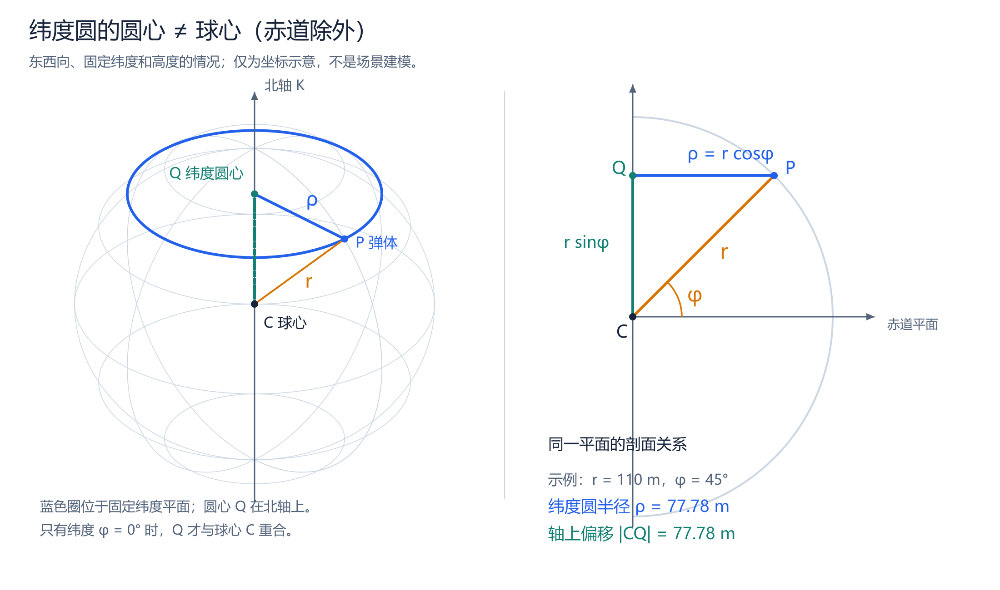
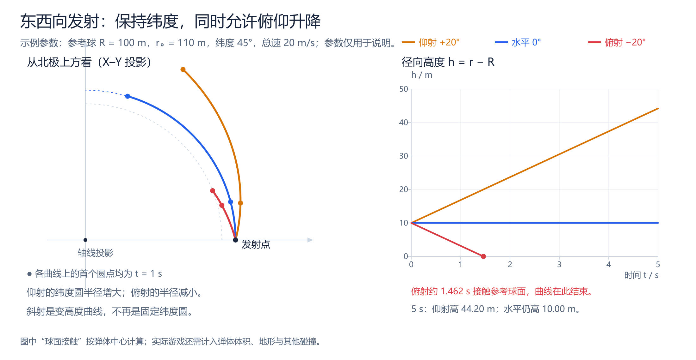
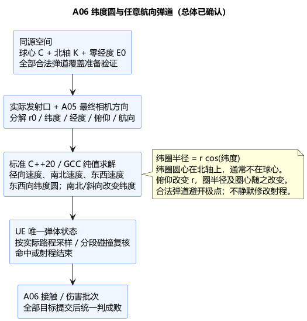

# A06：纬度圆弹道的公式与图示

状态：**纬度圆、任意航向、坐标配置与极点范围方案已确认**。日期：2026-11-06。确认依据：[东西向公式确认](../../requirements/001-causal-prototype/sources/2026-11-06-latitude-trajectory-confirmation.md)及后续 [A06 总体确认](../../requirements/001-causal-prototype/sources/2026-11-06-a06-confirmation-hold-aim.md)。此前依据：[公式图示请求及纬度圆纠正](../../requirements/001-causal-prototype/sources/2026-11-06-projectile-latitude-correction.md)、[俯仰必须影响高度](../../requirements/001-causal-prototype/sources/2026-11-06-projectile-pitch-requirement.md)。本文件替代[此前固定过球心平面的候选](A06-spherical-projectile-pitch.md)；具体类图仍单独确认，没有游戏实现。

## 1. 先分清两种圆

**固定纬度、固定高度、沿东西向运动，走的是纬度圆。除赤道外，它的圆心不在球心。** 此前模型把路径放在过球心的平面中，得到的是大圆方向，与非赤道纬度圆不同，不能只改图名而保留原公式。

南北向会改变纬度；任意方向都强行留在同一纬度圈，会丢掉南北瞄准。因此已确认采用：发射后保持相对于当地北/东/上的航向与俯仰，水平东西向沿纬度圆、南北向跨纬度、其他斜向同时变化经纬度。**任意方向推广由后续 A06 总体确认，不能仅由最初一句“纬度圆”推定。**

## 2. 坐标和参数

球心记为 \(C\)，参考球半径 \(R\)。定义固定北轴单位向量 \(K\)，再选赤道面上的零经度单位向量 \(E_0\)，令 \(E_{90}=K\times E_0\)。三者正交归一。仅有球心不能定义“纬度”；北轴/零经度是已确认加入同源空间配置的参数，不默认把 UE 世界 Z 当北轴，也不把任意位置的当地北向当作北轴。

| 符号 | 含义 |
| --- | --- |
| \(r\) | 弹体到球心距离，\(r=R+h\) |
| \(h\) | 径向高度；不是世界 Z 高度，也不是离实际凹凸地形的净空 |
| \(\varphi\) | 纬度，赤道为 0，北纬为正 |
| \(\lambda\) | 经度，向东为正，可连续累计 |
| \(\alpha\) | 当地俯仰角，水平 0，仰射正、俯射负 |
| \(\beta\) | 当地航向角，从北向东量：北 0°、东 90°、南 180°、西 −90° |
| \(v\) | 恒定总速度；\(t\) 为发射后世界时间，\(s=vt\) 为实际路程 |

参数范围：\(\alpha\in[-\pi/2,\pi/2]\)、\(v>0\)、\(t\ge0\)，角度计算统一使用弧度；具体相机允许的俯仰范围仍由 A05 配置决定。

世界位置为：

\[
P=C+r\bigl(\cos\varphi\cos\lambda\,E_0+
\cos\varphi\sin\lambda\,E_{90}+\sin\varphi\,K\bigr).
\]

实际发射口确定 \(r_0,\varphi_0,\lambda_0\)，A05 最终相机方向分解出 \(\alpha,\beta\)。不从相机安装点生成弹体，不用目标位置反向修改方向。直接方向方案仍有第三视角视差，未因此确认任何瞄准辅助或自动收敛。

## 3. 固定纬度圆的几何关系

对某一时刻的 \(r,\varphi\)，沿北轴投影得到圆心 \(Q\)，垂直北轴的距离为纬度圆半径 \(\rho\)：

\[
\boxed{Q=C+r\sin\varphi\,K},\qquad
\boxed{\rho=r\cos\varphi}.
\]

于是位置也可写成：

\[
P=Q+\rho(\cos\lambda\,E_0+\sin\lambda\,E_{90}).
\]

固定 \(r,\varphi\) 时，\(Q,\rho\) 都不变，这才是一条固定纬度圆。赤道 \(\varphi=0\) 时 \(Q=C\)；两极 \(\rho=0\)，纬度圆退化成点，不能除以其半径继续绕行。

## 4. 水平沿纬度圆飞行：直接解

水平意味着 \(\alpha=0\)，沿东西向意味着 \(\beta=\pm90°\)。因此半径和纬度不变：

\[
r(t)=r_0,\qquad \varphi(t)=\varphi_0.
\]

走过路程等于纬度圆弧长 \(s=\rho_0|\Delta\lambda|\)，令 \(\varepsilon=+1\) 表示东、\(-1\) 表示西：

\[
\boxed{\lambda(t)=\lambda_0+\varepsilon\frac{vt}{r_0\cos\varphi_0}}.
\]

代入第 2 节位置公式即可求任意时刻的位置。必须除以纬度圆半径 \(r_0\cos\varphi_0\)，而不是一律除以球心距离 \(r_0\)。同样线速度下，高纬度经度变化更快，实际速度仍然是 \(v\)。

示例仅作演算，不是游戏调参：\(R=100\rm m\)、\(h_0=10\rm m\)、\(\varphi_0=45°\)、\(v=20\rm m/s\)，向东飞 5 秒，初始经度 0。

\[
r_0=110\rm m,\quad \rho_0=110\cos45°=77.78175\rm m,
\]
\[
\Delta\lambda=\frac{20\times5}{77.78175}
=1.28564869\rm\ rad=73.66224°.
\]

在以 \(C\) 为原点、\(E_0,E_{90},K\) 为坐标轴的坐标中：

\[
P_0=(77.78175,0,77.78175)\rm m,
\quad P_5=(21.87994,74.64093,77.78175)\rm m.
\]

## 5. 东西向加俯仰：半径变化的解

仍保持纬度 \(\varphi_0\)，并保持当地俯仰 \(\alpha\)。将速度分为径向与当地水平分量：

\[
\frac{dr}{dt}=v\sin\alpha,
\qquad r\cos\varphi_0\frac{d\lambda}{dt}=\varepsilon v\cos\alpha.
\]

第一式积分：

\[
\boxed{r(t)=r_0+vt\sin\alpha},\qquad
\boxed{h(t)=h_0+vt\sin\alpha}.
\]

将它代入第二式，若 \(\sin\alpha\ne0\)：

\[
\lambda(t)-\lambda_0
=\int_0^t\frac{\varepsilon v\cos\alpha}
{(r_0+v\tau\sin\alpha)\cos\varphi_0}\,d\tau,
\]
\[
\boxed{\lambda(t)=\lambda_0+
\frac{\varepsilon\cot\alpha}{\cos\varphi_0}
\ln\!\left(1+\frac{vt\sin\alpha}{r_0}\right)}.
\]

水平极限回到第 4 节。严格垂直时水平速度为零，直接采用径向公式，不需要经度或航向。

此时 \(Q(t)=C+r(t)\sin\varphi_0K\) 和 \(\rho(t)=r(t)\cos\varphi_0\) 都会变化。**斜射不再绕一个固定圆心画同一个圆，而是在同一纬度锥面上升降。** 其俯视投影角也不等于真实俯仰角，不应在俯视图直接量出 \(\alpha\)。

同样示例下：仰射 \(+20°\) 到 5 秒时 \(h=44.202\rm m\)；水平始终 \(h=10\rm m\)。俯射 \(-20°\) 的弹体中心约在
\[
t_{\rm ground}=\frac{10}{20\sin20°}=1.461902\rm s
\]
触及参考球面，因此图在此终止，未把穿地部分画成有效飞行。实际游戏还需计入弹体体积、真实地形和其他对象碰撞。

## 6. 任意航向的统一推导（总体已确认）

定义当地单位向量 \(e_r,e_N,e_E\) 分别表示径向上、北、东。采用保持当地 \(\alpha,\beta\) 的已确认规则，速度为：

\[
\dot P=v\sin\alpha\,e_r+
v\cos\alpha\cos\beta\,e_N+
v\cos\alpha\sin\beta\,e_E.
\]

对球坐标位置求导又得到：

\[
\dot P=\dot r\,e_r+r\dot\varphi\,e_N+
r\cos\varphi\dot\lambda\,e_E.
\]

比较分量，得到可直接用于计算的微分方程组：

\[
\boxed{\dot r=v\sin\alpha},\qquad
\boxed{\dot\varphi=\frac{v\cos\alpha\cos\beta}{r}},\qquad
\boxed{\dot\lambda=\frac{v\cos\alpha\sin\beta}{r\cos\varphi}}.
\]

令 \(a=\sin\alpha,b=\cos\alpha,s=vt\)，引入累计量 \(\eta\)：

\[
\eta(s)=\begin{cases}
\dfrac{b}{a}\ln(1+as/r_0),&a\ne0,\\
s/r_0,&a=0.
\end{cases}
\]

\(\eta\) 是累计切向路程除以瞬时半径的积分，**不是所有方向的统一球心转角**。积分得到：

\[
\boxed{r=r_0+as},\qquad
\boxed{\varphi=\varphi_0+\cos\beta\,\eta}.
\]

当 \(\cos\beta\ne0\)，由 \(d\lambda/d\varphi=\tan\beta/\cos\varphi\) 积分：

\[
\boxed{\lambda=\lambda_0+\tan\beta
\left[\operatorname{asinh}(\tan\varphi)-
\operatorname{asinh}(\tan\varphi_0)\right]}.
\]

正东西向 \(\cos\beta=0\) 则使用稳定的独立分支：

\[
\boxed{\varphi=\varphi_0,\qquad
\lambda=\lambda_0+\frac{\sin\beta}{\cos\varphi_0}\eta}.
\]

南北向 \(\sin\beta=0\) 时经度固定、纬度改变；其他斜向一般不是圆。速度验证：
\[
|\dot P|^2=v^2\sin^2\alpha+
v^2\cos^2\alpha(\cos^2\beta+\sin^2\beta)=v^2.
\]
这里水平两个正交分量的平方和使用 \(\cos^2\beta+\sin^2\beta=1\)。因此射程按 \(s=vt\) 的真实三维路程计算，不能只累加经度弧长。

## 7. 计算稳定性与有效域

- 输入必须有限，\(r_0>0\)。先把本步路程裁到最大射程/合法半径区间，再求对数；向下时不能越过 \(r=0\) 或夹紧半径后继续。数值下界不当成地面碰撞。
- 近水平用 \(\eta=b(s/r_0)L(as/r_0)\)，其中 \(L(x)=\log1p(x)/x,L(0)=1\)，避免数值消减，不制造俯仰死区。
- 近东西向时通式的差商可能消减；实现需稳定差商或受误差控制的积分，不把一段航向角强行吸附到东西向。
- 非垂直公式要求 \(|\varphi|<\pi/2\)。极点处当地东/北及经度失去唯一性，一般斜向可能在有限路程内无限绕近极点；不能夹紧纬度、随意选经度继续。[A06 总体 §3](A06-combat-and-damage.md#3-手动瞄准使用与指向)已提出本轮通过局部布局/全部合法发射口与最大射程验证避免极点，并规定验证失败不就绪、异常越界诊断停止而不伪造命中；该具体口径随总体确认。未来合法穿极规则不由此自动确定。
- 严格垂直直接使用 \(P=C+(r_0\pm s)e_{r0}\)，保持原径向，极点也可计算；不反推无意义的航向，也不扩大 A05 相机俯仰限制。
- 经度可连续累计，绘制和位置计算使用 sin/cos；跨 ±180° 不应当作世界跳跃或旧绑定失效。
- 世界北轴/零经度需要由 A04 同源空间提供；不能由地图 UI、相机或各弹体自行设另一份。配置变更需重建绑定，不能让在飞弹体突然换坐标系。

原固定平面候选的曲率 \(b/r\) 也不再通用。新恒航向模型在有效域内的曲率为：
\[
\kappa=\frac{b}{r}\sqrt{1+b^2\sin^2\beta\tan^2\varphi}.
\]
水平东西向退化为 \(1/(r\cos\varphi)\)，与纬度圆半径一致。用子段最小半径、最大绝对纬度构造曲率上界后，仍可按 \(\delta\le\kappa_{\max}(\Delta s)^2/8\) 控制中心曲线与弦段偏离。旧方案的具体误差常数必须替换；移动目标、非球形姿态及精细接触复核仍由 UE 验证，不能直接把扩张查询候选当伤害命中。

## 8. 技术栈、数据流与确认边界

仍使用标准 C++20/double/标准数学库计算纯值路径，面向 Linux/GCC；UE5.6.1 唯一维护弹体和已走路程，执行分段碰撞与状态提交。此次数学解释没有创建游戏代码、执行 GCC/UE 构建或验证游戏效果。

数据流：同源球心＋北轴＋零经度＋实际发射口＋最终相机方向 → 发射参数 \(r_0,\varphi_0,\lambda_0,\alpha,\beta\) → 按累计路程求解 → UE 曲线分段扫掠 → 首接触/射程结束 → A06 批次结算。

新增方向解释的原因是：纬度圆要求一个明确北轴，且必须区分东西与南北方向。保持当地航向能给任意手动方向提供一致的扩展，但它不是惯性直线或“大圆最短路”的同义词。

[PUML 源文件](A06-latitude-trajectory.puml) · [圆心关系矢量图](A06-latitude-circle.svg) · [轨迹与高度矢量图](A06-latitude-pitch.svg)。图中完整参考球仅解释数学坐标，不增加非活动区模型。

数学独立检查覆盖东西/南北/斜向、正负俯仰与垂直方向，位置导数与分量方程一致。任意航向推广、北轴/零经度、极点范围规则及仇恨方向算法已随 [A06 总体](A06-combat-and-damage.md)确认，[A06 类图](A06-class-design.md)也已单独确认。数学核对不表示实际游戏验证；当前进度见架构索引。
