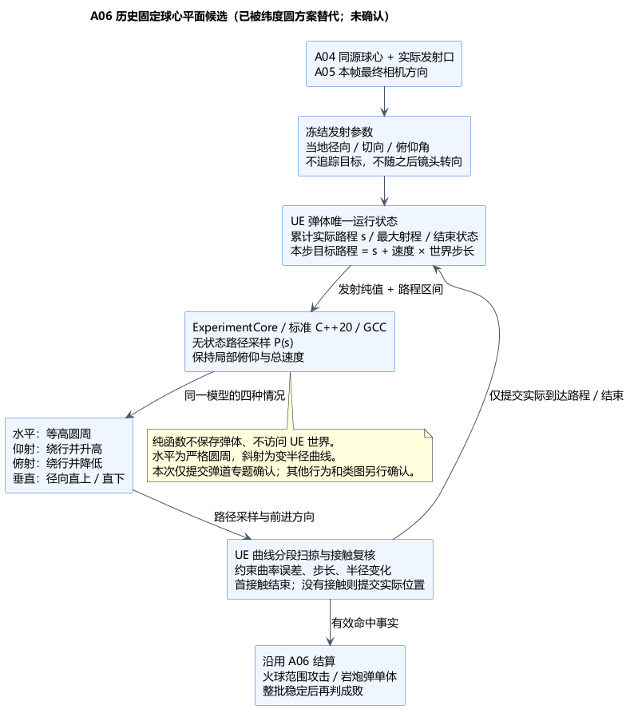

# A06 弹道专题：球面前进与俯仰升降

状态：**历史候选，已被纬度圆修订替代，未获确认**。日期：2026-11-06。用户随后指出圆周运动与纬度有关，圆心不一定在球心；当前方案与推导见[纬度圆弹道](A06-latitude-trajectory-derivation.md)。以下保留原候选作为差异依据：它的固定过球心平面、曲率及目标方向反解不适用于新的普遍纬度圈要求，不应继续作为实现基线。用户对俯仰必须改变高度的要求仍有效。

## 1. 建议行为与原因

**发射时确定相对当地切平面的俯仰角，飞行期间保持这个局部俯仰角和总速度。** 沿球面前进的方向随着球面弯曲，抬头/低头分别增加/减少弹体到球心的距离。这里“高度”是到统一参考球面的径向高度，并非与每一块凹凸地形保持同样距离；实际地形仍由碰撞检测处理。

| 发射方向 | 建议轨迹 |
| --- | --- |
| 水平 | 保持发射半径，在过球心的平面内做圆周运动 |
| 斜向上 | 围绕球心向前，同时逐渐升高；与当地切平面的上仰角保持不变 |
| 斜向下 | 围绕球心向前，同时逐渐降低；碰地/树木/角色按既定招式效果结束 |
| 正上 / 正下 | 沿当地径向直上/直下，无切向运动，不选一个任意绕行方向 |

只有水平轨迹是严格固定半径圆周；斜射是同一平面内半径变化的曲线。这是为满足俯仰升降而提出的拓展，待本次确认。保持局部俯仰意味着不追踪目标、不追随之后的镜头转动，也不叠加重力形成抛物线。总速度恒定，因此俯仰越大，绕球前进的速度越小；垂直时全部速度用于升降。

仰射在没有碰撞时持续升高，直至最大射程结束，不自行抛落。正上/正下是数学模型的边缘情形，不自动扩大 A05 已有相机俯仰限制；实际允许角度仍由相机配置决定。

采用此规则的原因：水平时保留用户要求的圆周运动，斜向时保留手动瞄准的上下分量；可用同一公式处理各方向，路径不依赖显示帧数。发射后的半径变化也使角速度相应改变，不能固定角速度而同时声称总速度恒定。

## 2. 技术栈与数据流

| 部分 | 技术及职责 |
| --- | --- |
| 路径数学 | 标准 C++20 / double / 标准数学库；ExperimentCore 内无状态函数，根据发射参数和累计路程返回位置、切向、径向及误差界，Linux/GCC13 可独立检查；类名下一阶段再定 |
| 同源空间与瞄准 | A04 Root 的已解析球心/空间绑定，复用 FSphericalDataMapper 的米/厘米转换；A05 本帧最终 AimFrame；实际武器发射口决定起点 |
| 运行与接触 | UE5.6.1 C++ 战斗步维护弹体及累计路程，调用纯函数采样曲线，小段 Sweep/Overlap 检测接触；不叠加另一套投射物运动或刚体积分 |
| 命中后果 | 沿用 A06：火球首接触产生一次范围攻击，岩炮弹首接触停止；核心只判规则，UE 所属实体提交状态 |

数据流：**最终相机方向＋实际发射口＋同源球心 → 冻结发射参数 → 按世界步长计算目标路程 → 纯函数采样曲线 → UE 分段碰撞 → 提交实际位置/已走路程或命中结束。**

弹体唯一持有不可变发射参数和可变累计路程/结束状态。核心不保留弹体实例、位置缓存或计时器，Session 不增加空间状态。每次从同一发射参数和累计路程采样，避免不断重投影当前位置造成轨迹漂移；碰撞后只提交实际到达的路程，不把未走完的部分计入射程。

## 3. 手动瞄准与发射点

使用最终 AimFrame 的归一化世界方向，在**发射口当地径向/切平面**中分解俯仰和前进方向；不丢弃径向分量。相机、武器位置必须来自同一当前绑定，不能把相机安装点当成弹体出生点。

这里“水平”按发射口径向定义；相机安装点与发射口有偏移时，它不必严格等于相机参数中的零俯仰，两者不能混用。

建议本轮直接用相机方向决定发射初始方向，不先沿相机直线挑选目标再自动弯向它。第三视角相机与发射口存在视差，准星表示手动方向，不保证相机射线上的物体必定被这条曲线击中；此取舍需要连同本专题确认，并在两种视角中实际验证。发射后转镜头不改变弹道，不新增目标吸附、锁定、引导或路径预览 UI。

发射口及角色到发射口之间的遮挡仍检查；被墙挡住时不把弹体挪到墙后。沿曲线遇到地形、树或角色仍正常命中。空气墙吸收方式仍是 A06 总体候选，本专题不提前确认；非活动区不建模。

仰射新增了越过有限墙高的可能，必须联合 A04 验证全部允许射程/俯仰下的边界覆盖，不能把地面空气墙检查通过当成弹道边界通过。若需补充查询边界，应来自同源活动区规格；边缘结束效果随 A06 总体确认，不靠补建非活动区解决。

## 4. 轨迹定义与边缘情况

以下是方案定义，尚非游戏实现。距离统一为米，角度为弧度。

给定球心 `C`、发射口 `P0`、归一化初始方向 `D`：

```text
r0 = |P0 - C|                 u0 = (P0 - C) / r0
a  = dot(D, u0)               b  = |D - a*u0|
a = sin(俯仰角)               b = cos(俯仰角)，b >= 0
t0 = (D - a*u0) / b           （仅 b 非零时需要）
s  = 自发射起累计实际路程
r(s) = r0 + a*s
θ(s) = b*s/r0 * L(a*s/r0)
L(x) = log1p(x)/x             L(0) = 1
u(s) = cos(θ)*u0 + sin(θ)*t0
t(s) = -sin(θ)*u0 + cos(θ)*t0
P(s) = C + r(s)*u(s)
前进方向 = a*u(s) + b*t(s)
```

- 水平 `a=0,b=1`：半径不变，`θ=s/r0`。垂直 `b=0`：直接 `P=C+(r0+a*s)*u0`，不求 t0。
- `L(x)` 近零时用数值稳定的极限/级数计算，避免除零和消减误差；近垂直容差仅用于数值稳定，不设玩法上的“俯仰死区”。输入方向校验并正规化，保证 `a²+b²=1`。
- 数值计算可避免近垂直时直接除以 b：令 `q=D-a*u0`、`F=(s/r0)*L(a*s/r0)`，用 `u=cos(θ)*u0+F*sinc(θ)*q`，其中 `sinc(θ)=sin(θ)/θ`、`sinc(0)=1`。上面的 t0 形式用于解释，稳定求值不需要虚构一个水平朝向。
- 该曲线的每单位路程导数模长为 1，所以 `s` 是真实三维路程。无碰撞时 `s += speed * 世界步长`，两种弹体均按该累计路程扣最大射程；不能只扣水平圆弧或起终点距离。
- 必须校验有限数值、正速度/射程、正有效半径和当前空间绑定。向下飞行应先撞活动区地表；数值上仍设置严格正的半径下界，并在采样跨过该下界之前截段。若地形缺失导致进入无效域，报告开发诊断并停止该弹体，不穿过球心/传送到对侧或伪造命中。
- 对 `a<0`，先将可采样路程裁至 `min(最大射程, (r0-r_min)/(-a))` 再求对数；`r_min>0` 是数值保护下界，不能当作地表或火球爆炸位置，也不能夹紧半径后继续飞行。
- 发射参数在弹体寿命内冻结。Root 的球心/配置发生变化意味着旧绑定失效，按 A04/A06 清理规则处理，不中途把旧曲线搬到新球心。

## 5. 曲线碰撞与顺序

按目标路程分段取样，以弦段扫掠收集候选并细分复核；每段同时限制路程长度、径向变化和转角。**斜射半径在变，不能直接套整段固定半径圆弧的弦高公式。**

本模型的曲率为 `κ=b/r`。在有效子段内取 `r_min`，可用 `δ <= (b/r_min) * (Δs)² / 8` 约束曲线与参数弦段的最大偏离。水平圆周也可使用准确弦高复核。用误差扩张碰撞形状只能得到候选；扩张命中不能直接造成伤害，应继续细分到约定接触容差，使用同一确定规则选择曲线停止位置和接触点。没有新命中半径或穿透能力。

此处子段 `r_min` 指两端实际半径的较小值，不是上一节固定的数值保护下界；向内飞行时不能只取起点半径。误差界仅约束中心轨迹；球形碰撞代理无需另算形状旋转，若选非球形代理则还需限制姿态旋转误差，不能只验证中心路径。

所有接触映射回同一累计路程/子段顺序，先处理最早有效接触；到最大射程的最后一段也检测。按 A06 既定草案在实际有序求值点采样无敌，不用曲线参数回填历史时间。移动目标仍需同子段的相对运动检查，轨迹细分不能替代双方运动判交。大步长不静默跳过路径，精度/性能尚待 UE 灰盒验证。

## 6. “朝哥布林攻击”的方向口径

A06 的仇恨方向判断必须和此手动弹道使用同一初始方向口径，但仍独立于实际命中、遮挡和最大射程。建议把目标当前瞄准参考点换算为**此曲线可到达该点的等效初始方向**，再与手动方向作夹角比较；该方向只用于判断是否朝哥布林攻击，绝不拿来调整弹道。

对非退化目标，令目标半径为 `rt`、与发射径向的较短球心夹角为 `γ`，目标的等效俯仰为 `atan2(log(rt/r0), γ)`，切向朝目标的球面方向。同径向不同高度按上下方向处理，同位置视为方向退化并显式定义判断策略；对跖点没有唯一切向，不能任取一个方向触发，原型局部遭遇布局应排除此情形。阈值和退化策略随 A06 总体/类图细化，本专题不提前确认仇恨规则。

## 7. PUML、验证与确认范围



[PUML 源图](A06-spherical-projectile-pitch.puml)。本图是技术与数据流，不是类图。

当前完成数学定义核对及独立审查。临时数值检查覆盖 11 个俯仰角与 5 个路程点（55 组），核对速率/俯仰/半径、解析路径拆步一致性、平移旋转等变与子段偏离界；结果通过。这只验证公式性质，不能声称 Linux/GCC 构建、UE 碰撞或游戏体验已通过。解析位置的拆步一致也不等于不同碰撞细分会得到完全一样的首接触。后续仍需检查最大射程、第三视角视差、高空边界以及薄障碍/低帧率碰撞。

本次待确认范围仅为：**保持局部俯仰和总速度、四种方向行为、实际发射口＋最终相机方向的映射、真实路程射程、纯数学与 UE 分段碰撞分工**。确认本专题后回到 A06 整体方案，再按既定流程单独确认 A06 类图；其他五组战斗行为仍为候选。本次不生成游戏代码或执行构建。
