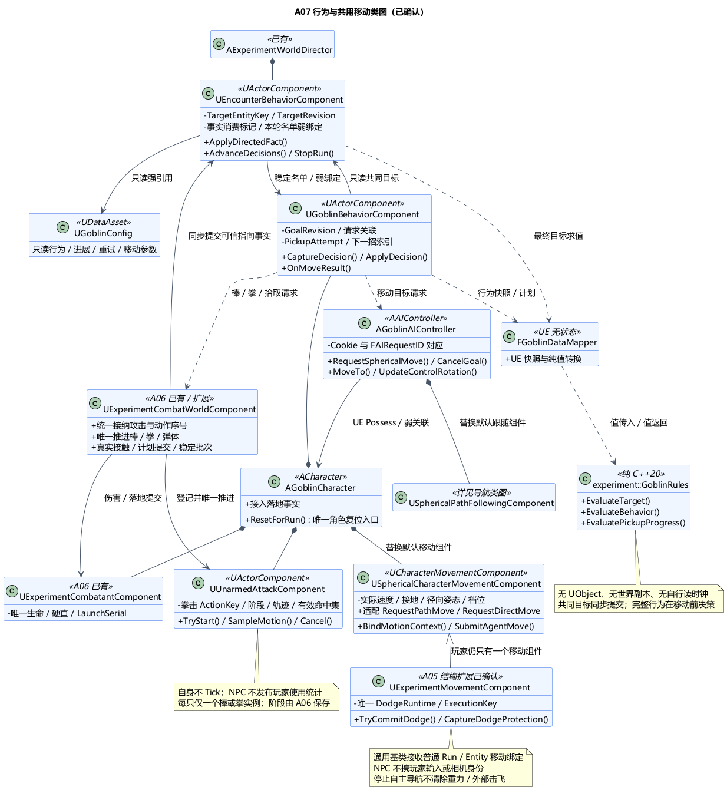
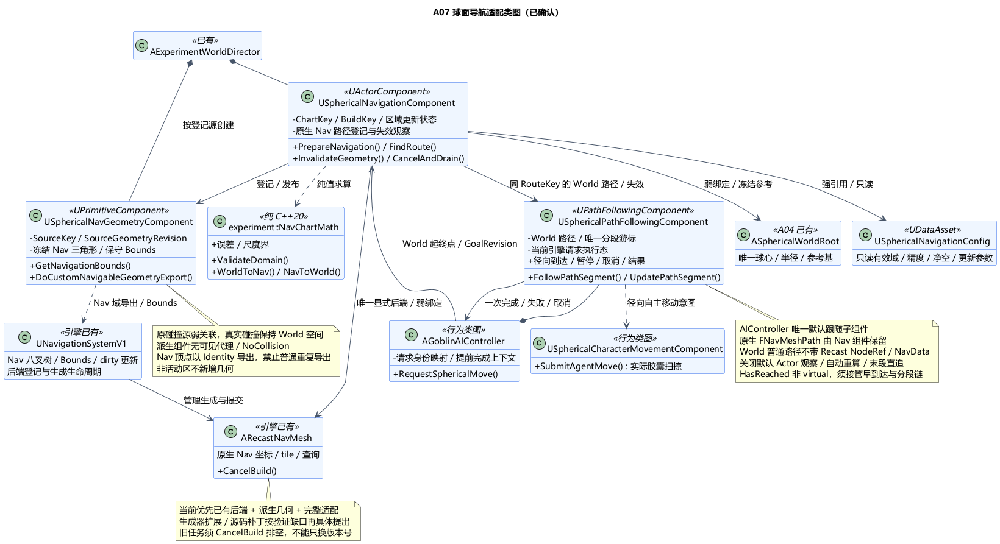

# A07 类图：哥布林行为与球面导航适配

状态：**类图已确认**。日期：2026-11-06。[类图确认](../../requirements/001-causal-prototype/sources/2026-11-06-a07-class-confirmation.md)包括具体类、接口、状态归属及 A05/A06 接入扩展；[总体及六组取舍](../../requirements/001-causal-prototype/sources/2026-11-06-a07-confirmation.md)此前已确认。签名只描述职责，没有游戏代码、编译或运行验证。

## 1. 技术栈、类职责与原因

沿用 UE5.6.1 C++、NavigationSystem/Recast、AIController/PathFollowing、CharacterMovement、UDataAsset；核心是标准 C++20 无状态规则与坐标数学，可按 Linux/GCC13 独立构建路线检查。共提出 **14 个职责类**；引擎自带 Recast/NavSystem、已有 A04/A06 类和普通值类型不计为新类。

| 类 | 基类 / 层 | 唯一职责与主要接口 |
| --- | --- | --- |
| `UGoblinConfig` | UDataAsset | 行为、攻击选择、原棒对应、移动参数、拾取无进展/重试参数；运行中只读 |
| `UEncounterBehaviorComponent` | UActorComponent，归 Director | 共同目标/版本、指向事实消费；`BindRun`、`ApplyDirectedFact`、`AdvanceDecisions`、`StopRun` |
| `AGoblinCharacter` | ACharacter | 装配、落地事实衔接与角色唯一 `ResetForRun`；不继承带玩家相机/输入的 Character |
| `UGoblinBehaviorComponent` | UActorComponent，归 Goblin | 本只行为、当前目标请求、拾取尝试/进展与重试资格；`CaptureDecision`、`ApplyDecision`、`OnMoveResult` |
| `AGoblinAIController` | AAIController | 占有/解绑、移动请求入口及身份桥接；`MoveTo` 适配、`RequestSphericalMove`、`CancelGoal`、径向 `UpdateControlRotation` |
| `USphericalCharacterMovementComponent` | UCharacterMovementComponent | 通用球面移动基类，唯一实际速度/接地/径向姿态/档位；`BindMotionContext`、`SubmitAgentMove`、径向路径输入适配 |
| `UUnarmedAttackComponent` | UActorComponent，归 Goblin | 唯一拳击实例/阶段/轨迹/有效伤害集合；`TryStart`、`SampleMotion`、`Cancel`，由 A06 唯一推进 |
| `FGoblinDataMapper` | UE 无状态工具 | 实体/行为快照与纯规则值转换；不求路、不提交生命或攻击 |
| `experiment::GoblinRules` | 纯 C++20 | `EvaluateTarget`、`EvaluateBehavior`、`EvaluatePickupProgress`；输入快照，返回计划/拒绝/错误 |
| `USphericalNavigationConfig` | UDataAsset | 导航域有效范围、分辨率、误差/净空余量与更新参数；球心和参考基仍来自 Root |
| `USphericalNavigationComponent` | UActorComponent，归 Director | 导航域/后端绑定、几何构建协调、显式查询、原生 Nav 路径及失效观察；`PrepareNavigation`、`FindRoute`、`InvalidateGeometry`、`CancelAndDrain` |
| `USphericalNavGeometryComponent` | UPrimitiveComponent | 每个登记源的导航派生几何快照与 Nav Bounds；覆写导航相关性/自定义导出，NoCollision、无可见场景代理 |
| `USphericalPathFollowingComponent` | UPathFollowingComponent，归 AIController | 唯一 World 跟随路径/分段游标/移动请求执行态；径向分段推进、到达检查、暂停/取消与结果 |
| `experiment::NavChartMath` | 纯 C++20 | `ValidateDomain`、`WorldToNav`、`NavToWorld`、误差/尺度界计算；不访问碰撞或 NavData |

这一分工让行为只表达“去哪里、做什么”，导航负责路径表示，Movement 负责实际移动，A06 负责攻击及伤害；纯核心不复制任何一套世界状态。导航适配继续复用引擎现有能力，默认实现的坐标假设按需求改造。

## 2. A05 共用移动基类与 A06 徒手扩展

### 共同移动基类（本次明确的结构扩展）

把 A05 `UExperimentMovementComponent` 的通用径向重力、接地/速度/档位、胶囊姿态和扫掠移动部分提取到 `USphericalCharacterMovementComponent`。现有玩家移动类改为继承该基类，保留唯一 `FDodgeRuntime`、`FDodgeExecutionKey` 和保护采样；不是为玩家添加第二个组件。原玩家 Character 的 `SetDefaultSubobjectClass<UExperimentMovementComponent>` 装配入口不变。

Goblin 则用 `SetDefaultSubobjectClass<USphericalCharacterMovementComponent>` 替换自己的默认移动组件，仍以胶囊为 UpdatedComponent。共同基类只接受 Run/Entity/World/Root 的普通移动绑定和 `FLocomotionProfile`，不持玩家相机、输入代次或 FPlayerBindingKey；玩家派生类把自己的闪避绑定与共同移动绑定关联，NPC 不伪造玩家身份。

PathFollowing 只调用有当前运行/实体资格校验的 `SubmitAgentMove` 或径向适配后的导航移动入口。该入口检查接地、存活、当前动作是否允许自主位移；击飞、攻击阶段和等待落地结算时拒绝主动导航移动，重力及已有外部击飞继续。不能绕回未适配的世界 XY `RequestPathMove`，也不能借默认 Falling 空中控制继续追击。位置/速度不由 AI 或纯核心积分。

### 徒手仍由 A06 统一结算

`UUnarmedAttackComponent` 是 Goblin 默认子对象，保存拳击 ActionKey、前摇/有效/收招阶段、几何代理和去重；自身无推进 Tick，动画只读取它。CombatWorld 登记并推进拳击，与棒共用真实接触采样、规则求值、Combatant 提交和整步稳定快照；同一来源不能同时启动一棒和一拳。拾取成功也不能在仍有效的拳击中切换武器，执行时重新检查资格。

拳击在前摇实际建立后进入完整来袭快照；只在有效阶段产生伤害接触。它没有可触发剑棒防反的棒代理，按 A07 已确认直拳/混合来袭选快步。NPC 的 ActionKey 仍由 CombatWorld 统一分配，**不发布玩家 ActionUsed、AttackTowardGoblin 或首次攻击计时事实**；NPC 请求使用源实体/目标版本，不伪造玩家 AimFrame 或输入上下文。

## 3. 目标提交与行为状态

Encounter 由 Director 装配，持完整本轮五只名单和弱绑定，唯一保存共同目标、TargetRevision 与事实消费标记。各 Goblin 只引用该受限目标视图；不能各自独立决定全体仇恨或在 Behavior 再保存一份可写共同目标。

有两种调用时点：

1. **同步目标提交：**A06 在玩家攻击指向事实的有序提交点调用 Encounter，冻结当前位置/阶段，Mapper→GoblinRules 计算最终目标，Encounter 当场提交。已确认的外圈距离优先在同一次求值中完成；比较提交前后最终目标，不把“指向玩家后立刻脱战”的中间值当作两次真实切换，避免外圈重复攻击不断重置前摇。
2. **移动前行为决策：**Encounter 在移动前更新距离资格，并按稳定实体顺序调用各 Behavior，分别冻结快照→纯规则→提交移动/攻击/拾取请求。共同目标不要求五只同时开招，也不使用轮流出手令牌。决策不重复推进 A06 的攻击时钟。

只有实际目标变化才增加 TargetRevision；同步使旧目标路径/待执行 AI 请求失效，并向攻击所有者取消尚处前摇的旧实例。此时已经进入有效阶段或收招的实例按已确认规则继续，已提交伤害不回滚；重复 Player→Player 或最终仍为 Child 不重启节奏。同步入口只做目标/取消提交，不在 A06 批次里重新寻路、推进运动或重入新攻击循环。

各 Behavior 只保存行为选择、下一横/竖选择索引、GoalRevision、请求关联及拾取尝试。下一招序列只在实际攻击被接纳后推进，不能因请求被拒逐帧换招；阶段/剩余时长只读 A06，Grounded/速度只读 Movement，生命与 LaunchSerial/落地结算完成只读 Combatant。

`PickupAttemptId` 独立于 RouteSerial。Behavior 保留有效进展时刻/位置样本和下次重试条件，路径重算或 TryAttach 被拒都不自动重置它。必须先读到对应 LaunchSerial 的首次落地已结算且仍存活；实际持有成功才结束拾取尝试。路线 PendingBuild、配置错误与真实 NoPath 分开处理，不把导航正在更新冒充棒子消失；等待时仍观察真实无进展，按总体规则决定受阻后徒手。

## 4. 导航表示、几何来源与最小后端

NavigationComponent 是 UE 显式查询入口，绑定 Root、NavigationConfig 和唯一选定的现有 `ARecastNavMesh`。后端 Actor/生成器的生命周期由 UE NavigationSystem 管理；Director/组件协调登记与清理，不另造第二个 Recast 后端。查询显式指定该后端和代理配置，不按角色未转换的 World 位置自动选择 NavData。

本次优先提出**已有 ARecastNavMesh＋导航派生几何＋保守建图配置＋定制查询/跟随**，不预先添加空的生成器子类。展开后的坡度/净空采用 NavChartMath 的域尺度界和真实径向资格共同约束，不能仅靠最后碰墙来掩盖错误的建图。若最小验证发现固定 Recast 参数无法同时满足安全和必需通路覆盖，再具体提出 ARecastNavMesh/Generator/TileGenerator 的扩展或受控源码修改；这是明确的后续适配缺口，不声称已有接口已完成全部可行性验证，也不静默切换备用导航。

### 导航派生几何

Director 按登记源建立并拥有 GeometryComponent，NavigationComponent 管理这些组件的登记与发布；原碰撞源只用弱引用关联。源销毁时使原范围脏化并撤销未来快照，已冻结的构建缓冲按建图屏障释放，不能让后台读取已销毁组件。

每个参与阻挡的源由 GeometryComponent 导出同一 Nav 域的不可变三角形/Bounds 快照：地表、树干/倒木、空气墙。导出输入来自实际碰撞形状或已验证且版本匹配的保守表示，不能用仅可见网格代替实际碰撞。静态数据可在内容准备期生成并随配置保存；动态树木由 A08 后续接口提供真实碰撞变更快照，不能假设打包后仍可随意读取 CPU 网格或运行时导出所有 BodySetup 形状。

源真实组件保留物理碰撞，其普通导航贡献由受控登记禁用，避免 World 几何与 Nav 几何重复进入后端；退出登记时恢复本组件实际接管的原设置，不全局清空其他导航数据。派生组件只设置导航相关性与自定义导出，`CreateSceneProxy` 不产生可见代理，使用 EvenIfNotCollidable 导出能力；将已转换顶点以 Identity 变换导出并禁止继续普通几何导出，不渲染、不碰撞，不成为非活动区场景。Navigation Bounds Volume、八叉树 Bounds、修改区/脏区均在 Nav 坐标域，不能只有顶点完成转换。

本轮使用明确的完整局部 Nav bounds，关闭未经适配的 invoker/active-tile 裁剪、NavWalking、默认 RVO/Crowd 及 World 自动贡献/观察链。角色以径向 Walking/Falling 和显式跟随执行；真实胶囊尺寸与 Nav 保守代理参数分开，不为建图膨胀而改角色碰撞体。若沿用默认按玩家 World XY 排序的建图种子，它只能影响优先级，不能改变覆盖；涉及裁剪/覆盖时必须转换或覆写该入口。

GeometryComponent 发布带 SourceKey、SourceGeometryRevision、ChartKey 的快照；生成器采集只读已冻结快照，后台工作不得访问已销毁的源 UObject 或正在修改的数组。World Bounds 非线性变换须保守包住完整几何，不能仅映射原 AABB 八角。图域或参数更换只在 Preparing 重建，不让在飞/移动中的角色突然切坐标系。

### 两条路径表示与唯一进度

- **原生 Nav 路径**由 NavigationComponent 持有及观察，保留 `FNavMeshPath` 的 Nav points、corridor、NodeRef 和原导航引用，不原地改写成 World 坐标。
- **World 跟随表示**由同一 RouteKey 派生，经细分与真实通路检查后交 PathFollowing。若复用基类 RequestMove，使用独立的普通 `FNavigationPath` 世界点表示，不携带 Recast NodeRef、底层 NavData 或默认目标 Actor 自动观察，不让基类把 Nav 点当世界点。
- PathFollowing 唯一保存当前分段游标、剩余跟随状态与引擎请求执行态；Behavior 只收只读状态/进展事实。原 Nav 路径失效时同时使 World 表示失效，再按当前 GoalRevision 重新生成。

动态目标通过 Controller/NavigationComponent 显式重采样 World→Nav。禁止默认 Actor 位置观察、自动重算、末段直追或 raycast 把 World 点漏送底层 Nav 查询；原路径失效后由适配入口发起新查询。终点投影后的接近点与真实目标分开；最终攻击/拾取还要检查实际三维距离和遮挡，部分路径走完不等于到达目标。初版采用游戏线程同步求路，后台任务仅用于引擎建图；不把 AbortAsyncFindPathRequest 当作已排空全部运行查询的保证。

## 5. 路径请求与到达接口

Controller 在构造阶段用 `SetDefaultSubobjectClass<USphericalPathFollowingComponent>(TEXT("PathFollowingComponent"))` 替换 AAIController 的默认跟随组件，不能并挂两个组件；子对象名已核对本机 `AIModule/Private/AIController.cpp:44`。覆写 `MoveTo` 或收口为其项目适配入口，先做自己的径向早期到达检查和 World/Nav 查询，再创建跟随请求。

默认公开 `HasReached` / `HasReachedInternal` 不是 virtual，因此不能靠声明一个同名方法完成修复。PathFollowing 明确接管 `FollowPathSegment`、`UpdatePathSegment`、`HasReachedCurrentTarget`、`HasReachedDestination` 等可扩展点，并核对剩余转向/focus/制动/路径更新辅助是否仍有世界 XY/Z 假设；未改造的分支不得成为备用执行路径。

Controller 的朝向更新使用当前径向上下与世界切向方向，不直接沿默认世界 Euler/FaceRotation 链旋转胶囊；实际姿态仍由共同 Movement 提交。A06 有效挥动锁向优先于导航 focus。完成/取消路径只撤销导航自主意图，禁止无条件 StopMovementImmediately 清掉重力或外部击飞速度，也不触碰玩家派生类的无敌窗口。

发起之前先建立本地 MoveRequestCookie/RouteKey 及完成接收上下文；Controller 区分失败、已在真实目标处、正常请求建立。提前完成按当前 Cookie 回报，不能等返回后才登记上下文。正常请求保存与 FAIRequestID 的对应；替换请求可能同步结束旧请求，旧 ID 记录保留到对应终止处理。对同一目标重规划时新旧路线可共享 GoalRevision，必须以旧 Cookie/完整 RouteKey（含 RouteSerial）只结算旧请求；不得取消替换后的新路线、结束目标或重置仍在进行的拾取尝试。完成/取消发布一次，Behavior 不因“请求发出”就转入已到达或已捡棒。

| 值 | 归属与含义 |
| --- | --- |
| `FEncounterTargetView` | Encounter 的 TargetEntityKey/TargetRevision/有效性只读输出；非第二实验阶段 |
| `FActorMotionBinding` | RunId＋EntityKey、World/Root 弱绑定及 SpatialRevision；共同移动基类的普通身份，不含玩家输入 |
| `FNavChartKey` | RunId、WorldGeneration、SpatialRevision、NavConfigRevision；根参考/单位与已确认映射的版本 |
| `FSphericalRouteKey` | EntityKey、GoalRevision、RouteSerial、ChartKey、BuildGeneration/NavRevision；Controller 发起，导航/跟随/行为只保留对应身份 |
| `FNavBuildKey` | RunId、ChartKey、NavDataIdentity、GeometryEpoch、BuildEpoch；GeometryEpoch 标源快照变化，BuildEpoch 标构建尝试，NavRevision 只在通过发布检查后增加 |
| `FNavGeometrySnapshot` | SourceKey、源几何修订、冻结的 Nav 三角形/Bounds/误差元数据；只有 UE 导航层持有 |
| `FPickupAttempt` | Behavior 的独立尝试号、原棒身份、有效进展和下次重试；重规划不重置 |
| `GoblinSnapshot / GoblinDecision` | 纯 C++20 类型，包含显式状态、当前世界时间样本与目标/资格，不含 UObject、引擎路径或回调 |

错误至少区分 InvalidBinding、InvalidGeometry、PendingBuild、NoPath、Blocked、Canceled、Reached；“底层路径完成”不自动变成 Reached。纯规则不读引擎时钟；UE 与 A06/A02 共用世界运行时刻，保留原发生顺序。

## 6. 动态建图、停止与重启

建图版本不能只靠丢弃晚到的应用回调解决：旧 tile 任务可能已经向原 Recast 数据提交。重启/换域采用真实屏障：**关闭查询和移动接纳 → 失效所有 RouteKey → 取消路径 → 调用后端 CancelBuild 并等待已运行生成工作退出 → 替换几何快照/清旧构建数据 → 请求新建图 → 验证完成后发布新版本**。在屏障完成前不能把同一后端当作新轮可用，不能仅给它换 RunId。

普通动态障碍更新与整轮屏障分开：实际碰撞先变更，立即把相关旧/新范围标记为待更新并使相交路径失效；生成器按稳定快照批量更新，期间后到变化排入下一批，不每帧取消所有构建导致永不完成。完成结果只有在对应范围没有更新版本待处理时才供新查询使用；受影响区域返回 PendingBuild，未受影响区域可继续，实际胶囊扫掠始终有效。构建完成事件不是无需检查的全世界就绪证明。

初版以明确版本和构建屏障换取可解释性，不承诺连续倒木变化下的帧预算。NavSystem/生成器仍是网格唯一提交者；是否能按所需粒度判定区域完成、保守参数覆盖和打包后的几何获取必须后续验证，不满足时明确补齐扩展，不能伪报 WorldReady。

Director 的停止顺序：先关闭 Encounter/CombatWorld/Navigation 接纳并使旧身份失效；Controllers 取消各自路径/解绑，不复位 Movement；完成导航屏障后，Director 只调用每个 Goblin 的 `ResetForRun`，由角色一次分派 Movement、Behavior、Combatant、Unarmed。CombatWorld 清自己的武器/弹体并重新登记，不重复复位角色子组件。玩家原入口同理，派生 Movement 调基类复位一次，不清第二份状态。

Config/默认子组件用 UE 反射强引用；跨对象 Director/Root/实体/源组件用弱绑定。原生路径按 UE 共享路径类型持有，World 路径的所有权在跟随端，解绑解除委托与观察；只保留需要的当次请求元数据，不增完整事件历史库。地图/失焦不暂停 NPC，离开 Rescue/死亡/重启按既定停止契约执行。

## 7. 验证与本次确认边界

当前只有文档和本机接口核对，未进行 UE/GCC 编译、打包或游戏运行验证。最小验证仍先做一块球冠、一道空气墙、一根动态倒木和一个角色的完整导航链；再覆盖五敌互堵/围攻、追击返场、全部合法掉棒点、拾取拒绝与旧轮回调。共同基类提取还须验证玩家原有三档移动、闪避身份/短窗口及双视角没有退化。

类图中可直接依赖的本机 5.6.1 扩展点和非虚边界沿用 [A07 总体 §7](A07-goblin-behavior.md#7-时序停止与验证)。补充：`NavigationSystem/Public/NavigationData.h:694` 的公开 CancelBuild 与 `Private/NavMesh/RecastNavMeshGenerator.cpp:6327` 的等待/丢弃运行任务用于旧生成屏障；单独 SetRebuildingSuspended 不停止已运行任务。`Engine/Private/Components/CharacterMovementComponent.cpp:3949–3961` 仍有默认世界 XY 路径输入，需共同基类接管。不能把派生生成器当作所有 tile 提交内部步骤均可覆写。确认类图不关闭 R-A07-NAV-BEHAVIOR、A04/A05/A06 运行风险或 Linux/Windows 工具链风险。

[行为类图 PUML](A07-class-design.puml) · [导航类图 PUML](A07-navigation-class-design.puml) · [路径与重建时序 PUML](A07-navigation-lifecycle.puml) · [时序图](A07-navigation-lifecycle.png)。

已确认：14 个职责类、共同球面移动基类的 A05 结构扩展、A06 徒手接入、共享目标同步提交、Nav/World 两种路径的归属、Controller/PathFollowing 适配和真正取消旧建图的生命周期。当前进入 [A08 砍树切面、倒木与分段阻挡总体](A08-tree-cutting-and-fallen-logs.md)；不开始游戏实现，也不提前确认需要源码引擎。
