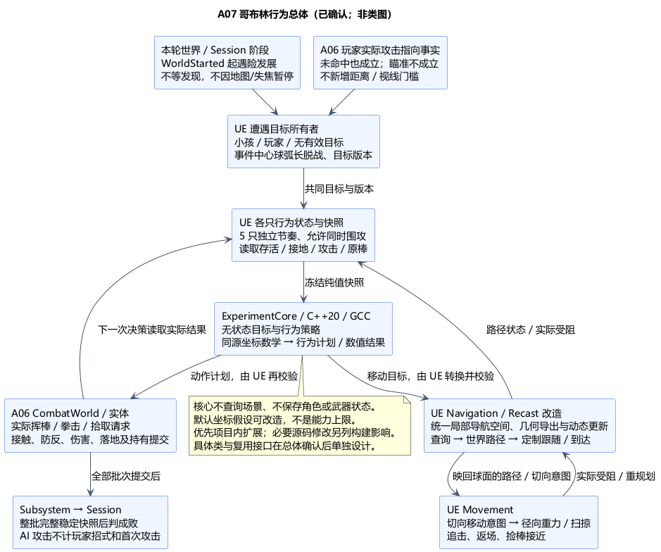
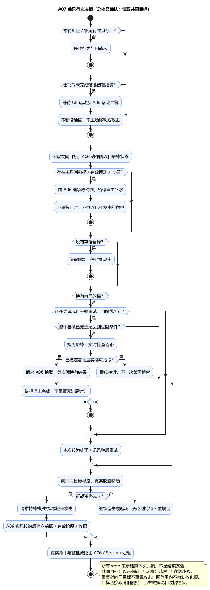

# A07：哥布林行为、仇恨、脱战、捡棒与倒木绕行

状态：**总体方案及类图已确认**。日期：2026-11-06。[总体确认](../../requirements/001-causal-prototype/sources/2026-11-06-a07-confirmation.md)接受修订的导航路线、数据流及六组行为取舍；具体类职责与接口见单独通过的 [A07 类图](A07-class-design.md)。下文“建议/推荐”描述已确认的设计路线及待验证实现，不代表游戏实现、构建或运行验证。

按[用户对导航改造边界的纠正](../../requirements/001-causal-prototype/sources/2026-11-06-a07-navigation-extension-correction.md)修订：默认导航的世界 Z 假设不是能力上限。本次优先提出复用并改造 UE 导航/Recast 的路线；此前独立球面采样图保留为备选，不能因为默认行为就排除现有导航的扩展。

依据：[需求 §3–5](../../requirements/001-causal-prototype/REQUIREMENTS.md)、[五只哥布林与捡棒受阻](../../requirements/001-causal-prototype/sources/2026-10-30-rescue-encounter-behavior.md)、[全体转向与脱战](../../requirements/001-causal-prototype/sources/2026-10-30-goblin-targeting-and-friendly-fire.md)、[事件中心距离](../../requirements/001-causal-prototype/sources/2026-10-30-encounter-start-and-rescue-timing.md)、[围攻与同样节奏](../../requirements/001-causal-prototype/sources/2026-10-30-combat-tolerance-dodge-and-projectiles.md)。旧来源中的未定项以最新需求及 A06 确认为准，不能重新给攻击指向加射程或视线门槛。

## 1. 技术栈与原因

| 职责 | 本次建议 | 原因与边界 |
| --- | --- | --- |
| AI 行为 | UE5.6.1 C++ 显式有限状态流程；标准 C++20 无状态策略求值 | 本轮固定 5 只、行为种类少，便于核对转换；不引入 Behavior Tree、Blackboard、StateTree 或感知插件的第二套权威状态 |
| 目标切换 | 一个 UE 遭遇行为所有者，读取 A06 可信指向事实、当前阶段及实体快照 | 保证全体使用同一目标版本；不是 Session 的第二个实验阶段机 |
| 寻路 | 优先在项目内扩展 UE Navigation/Recast：统一局部导航空间、派生几何导出、查询与路径跟随适配；必要时评估引擎源码修改 | 复用已有建网、搜索与动态更新能力，把球面坐标差异显式收口；默认假设可改，不把“开箱即用”当能力边界 |
| 实际移动 | UE Character/CharacterMovement 的径向重力与胶囊扫掠基础，AI 仅提交当地切向移动意图 | 与 A05/A04 同源；不由 AI 直接 SetActorLocation 或另存位置/速度；具体复用方式留类图 |
| 近战与捡棒 | A06 CombatWorld、Combatant、Weapon 的实际执行入口 | AI 只请求攻击/拾取；真实接触、防反、伤害、落地与持有关系仍由原所有者提交 |
| 配置与表现 | UDataAsset；简单动画/蓝图读取状态 | 初始站位、节奏、导航分辨率/展开误差和阻挡重试可调；动画通知不决定命中或成败 |

推荐扩展 AAIController / PathFollowing 的相关入口，并复用 Recast 导航数据；不把原样调用 MoveTo 当成适配已完成。沿用 UEgame 单 Runtime 模块及 ExperimentCore，按实际接口声明 AIModule、NavigationSystem 等依赖；具体模块头和链接范围在类图/最小验证中核对。核心保留标准 C++20 的无状态策略与坐标数学，世界建图、导航数据与路径跟随归 UE，未来服务端仍需 UE 世界模拟。

## 2. 数据流与状态归属

**世界启动／A06 攻击指向事实 → 共享目标 → 各哥布林的纯策略 → 世界与导航空间转换 → 改造后的 Recast 查询/路径跟随或动作请求 → UE 实际移动与 A06 接触结算 → 下一次策略；整批成败仍交 Session。**

1. Preparing 中由 Director 登记玩家、小孩、5 只哥布林及各自原棒的稳定身份，校验初始路径与必要配置。WorldStarted 后各只开始对付小孩，不等发现、玩家攻击或相机看见。
2. A06 实际执行的玩家攻击产生 AttackTowardGoblin，A07 按原事实身份去重、保留时间/顺序并交共享目标逻辑。长按瞄准、失败发射、输入请求与命中回调不能替代此事实；A07 不自行补发 ThreatDiscovered。
3. 每个 AI 决策更新冻结阶段、共享目标版本、本体生死/接地、A06 当前攻击阶段、武器状态、路径有效性等只读值。纯策略返回继续、移动、请求攻击、捡棒、徒手或等待；非法/不完整快照返回错误，不当作目标死亡。
4. UE 验证计划的当前轮次、实体代次、目标/路径版本并提交；已过时的计划或路径回报丢弃。实际武器接触/拳部接触仍进入 A06 整步批次，AI 不在动画或距离条件成立时扣血。
5. 五只分别决策和推进，可同时攻击；不设全局“只有一只允许出手”的令牌。共同目标不表示共同攻击时钟；小孩与玩家使用同一攻击节奏规则。

| 状态 | 唯一所有者 |
| --- | --- |
| 共同当前目标、目标版本、指向事实消费状态 | UE 遭遇行为所有者；只决定意图，不保存生命和实验结果 |
| 各只当前行为、路径请求身份/行为级进展观察、拾取重试资格 | 该哥布林的 UE 行为端；不维护第二个路径分段游标 |
| 生命、击飞/首次落地结果 | A06 Combatant；AI 不另设 GoblinStaggered 或第二份生命 |
| 挥动阶段/朝向、动作序号、接触与有效伤害去重 | A06 攻击所有者；AI 不另跑一套攻击计时器 |
| 棒的实际位置、掉落/持有关系 | A06 Weapon；原棒对应关系只是配置引用 |
| 位置、速度、接地及胶囊姿态 | UE Movement |
| 导航几何/网格、路径与通路版本 | UE 导航及适配；路径实际分段游标由定制跟随端唯一保存，派生数据不成为第二份真实地形或物理状态 |
| 发现、计时、统计、成败及阶段 | 既有 Session |

## 3. 全体转向、脱战与重返

已有规则：攻击朝向任一存活哥布林即可令全体转向玩家，未命中也成立；跑离事件中心一定距离后，全体回攻小孩。以下补齐细节已随总体确认。

**脱战距离采用参考球面上的最短弧长。** 事件中心固定在本轮配置位置 E，球心 C、参考半径 R 来自 Root。令 u=(P−C)/|P−C|，e=(E−C)/|E−C|：

`d = R * atan2(|u × e|, u · e)`。

当 d > LeaveRadius 时脱战，等于阈值仍在范围内；跳跃只增加高度不会因此脱战。该度量仅用于脱战，武器射程、碰撞距离与拾取可达性仍用各自真实几何。中心不随哥布林、棒子或玩家移动，阈值保留调参；活动区必须留出能越过阈值并返回的道路。

- 只要当前仍处于救援运行阶段，A06 可信指向事实就令所有存活哥布林共享 Player 目标；重复攻击同一目标不重复重启挥动/前摇，防止每次施法都把全体动作重置。
- **远处攻击与脱战同时成立时，脱战检查优先于持续追击。** 指向事实仍被接收，首次攻击计时及合法使用照常登记；目标求值紧接着检查距离，仍越界则最终共同目标为存活小孩，无存活小孩则无目标。攻击指向事实不等于必须先发布一个瞬时 Player 目标再撤回；是否真实切目标按最终提交值判断，具体原子提交列入类图。没有新增射程/视线门槛，也没有保证越界后继续追逐的宽限期。
- 脱战不恢复生命、不补发武器、不清已产生的环境后果。玩家仅走回范围内不自动再次吸引仇恨；再次朝哥布林执行攻击才重新转向。
- 看不见玩家或路径暂时受阻不等于脱战；仍以事件中心距离判定。读取玩家位置用于本原型明确的目标规则，不加入潜行、听觉或搜敌系统。
- 未发现前小孩已死时，Session 继续等待玩家发现后果。若没有合法玩家仇恨目标，哥布林在当前位置停止新的攻击，保留现场；不自动寻找新受害者、不宣告成功。后续玩家攻击仍可按既定规则触发转向，实际阶段结束则统一停止。

## 4. 围攻、挥棒与目标切换

每只哥布林使用 **前摇 → 有效挥动 → 收招 → 下一次决策** 的动作阶段，由 A06 攻击实例唯一保存和推进。初始站位与每只起始节奏偏移可配置，玩家/小孩不使用两套不同攻击频率。建议横挥、竖挥按各自序列交替，初始项按稳定配置错开；不读取玩家下一次输入或未来闪避计划来选招。

开始攻击需要存活、接地、持有相应武器或具备徒手动作、目标仍存活，且当前真实距离/朝向和可用挥动空间适合近战。资格距离只决定能否请求出招，不直接造成伤害。五只可以同时接近、挥动；胶囊真实阻挡时侧移/重规划，不允许为形成围攻关闭相互碰撞或穿过树木/空气墙。

本次建议：前摇、有效挥动与收招期间停止该哥布林自主平移，重力/外部击飞继续；前摇可按有限转向速度面向当前目标，有效挥动开始后锁定此次攻击的局部起始方向与轨迹，不瞬间追踪闪到背后的玩家。共同目标切换时取消尚未进入有效阶段的旧前摇；已生效挥动按原轨迹结束，收招不被重置，之后再朝新目标行动。已发生的伤害不回滚；重复 Player→Player 的事实不触发这类取消。未取消的前摇也已占有攻击实例，不能在下一 AI 更新重复建立攻击。

哥布林攻击具有 A06 的 ActionKey 和近战阶段，供接触与 A05 来袭快照使用；**不发布玩家 ActionUsed、不计剑术/魔法统计、不启动玩家首次攻击计时**。前摇已实际建立的攻击可作为“已开始/已承诺”威胁，未来 AI 打算不进入快照；取消/掉棒后立即从有效威胁中移除。

建议本轮棒/拳对玩家与小孩都按实际接触受伤，不仅按当前 AI 目标过滤；哥布林之间不互相扣血。棒碰树或硬障碍不能穿过继续命中后方目标，不获得玩家剑的砍树能力。伤害与范围由 A06 处理，不能把“到达攻击距离”或“攻击动画结束”视为命中。

## 5. 防反后捡棒与徒手

防反时 A06 先撤销该棒攻击并执行掉棒/击飞。AI 在空中停止主动寻路和新攻击，读真实运动状态；这不是新增哥布林硬直。只有该次 LaunchSerial 的首次落地伤害已经由 A06 结算且角色仍存活，才进入捡棒决策；不能仅凭 Grounded 在摔落伤害之前开始拾取。

建议优先尝试捡回自己的原棒。棒在运动时跟踪其真实位置；只有落地稳定、处于真实拾取距离、接近走廊无阻挡且仍可拾取时，才请求 A06 TryAttach。成功后以实际持有事实转为持棒攻击，不能把发出请求当作已经拿到棒子。

- 找不到有效捡棒路线，或整个拾取尝试在配置时间内没有有效进展，视为本次捡棒受阻，转为朝当前共享目标尝试徒手攻击。正在进行的拾取尝试逐次更新继续执行，不因“下一重试时刻尚未到”而中断；重规划不无条件重置无进展计时。TryAttach 在执行时被拒仍属未完成尝试，不能因再次发请求而重置计时；只有真实接近进展及最终实际持有构成有效进展，反复“预判可捡、提交被拒”也必须走受阻出口。不会永久等棒，不会传送棒或直接改持有者。
- 徒手模式保持追击/返场及真实碰撞约束。建议用短程直拳的拳部扫掠，伤害为可调、可承受多次的普通近战；不套用玩家招式的一击致死。它不满足“剑碰正在挥动的棒子”条件，因此不触发该防反击飞掉棒规则；玩家剑真实接触哥布林仍沿 A06 致死规则。实际开始的直拳以明确的非横挥类型进入 A05 完整威胁快照；单独直拳或与其他类型混合均选快步，只有纯横棒来袭选翻滚。本项扩展真实近战接触类型，具体 A06 类接口在 A07 类图中细化。
- 受阻后在阻挡版本变化或有间隔的重试点重查捡棒，重试放在当前攻击收招后；可达才重新尝试，不逐帧在捡棒/徒手之间抖动，不中断已生效拳击去拾取。若当前目标也不可达，则等待/重规划，不隔着倒木扣血。

## 6. 改造现有导航以适配局部球面

**推荐路线是复用 UE Navigation/Recast，并改造完整坐标链。** 先使用项目内可扩展入口；发现确实无法通过已导出接口实现的环节，再列出最小引擎源码修改。不预先断言必须换源码引擎，也不声称只改一个重力向量就已完成导航适配。

### 统一导航空间

真实角色、森林、空气墙、武器和碰撞始终留在原来的球面世界。导航只读取活动区实际几何，生成另一坐标域内的派生数据，不创建可见或可碰撞的第二份场景，更不建模非活动区。

以 Root 的活动区局部正交基 E、N、U 建立一块固定参数域。令真实点到球心的半径为 r，方向为 n；取 c=n·U，并要求活动区全部合法导航几何满足 c≥c_min>0。已确认映射（米制）为：

`Nav(P) = (R*(n·E)/c, R*(n·N)/c, r−R)`。

逆变换为：`P = C + (R+z) * normalize(U + (x/R)*E + (y/R)*N)`。

这是本轮局部球冠的可逆展开，不是全星球单张平面，也不是所有距离的等距映射；它与 A06 弹道公式各司其职，同源引用 Root。输入须有限且 r>0，逆变换要求 R+z>0，Preparing 验证全部合法几何的半径/角域及数值余量。导航域基/原点/版本在 Preparing 固定；UE 边界统一米厘米转换。若现有合法活动范围不满足单域条件，应采用多域连接或重新提交方案，不能为了方便建图擅自缩小活动区。

### 必须一起改造的环节

| 环节 | 改造内容与正确性约束 |
| --- | --- |
| 几何导出与空间索引 | 从真实地表、树干、倒木及空气墙导出展开后的导航几何和一致的导航 Bounds；使用自定义导航几何导出入口或必要的生成器扩展。原几何不能再按原坐标混入同一导航数据造成重复/错位 |
| 建图尺度与可走性 | 导航展开改变距离、坡度和胶囊形状。按真实径向坡度、台阶、角色体积与映射失真界确定可走性、保守净空和细分误差；不能照搬一个固定导航半径就声称所有位置都可通行 |
| 查询与路径输出 | 起终点、最近可走面、投射方向、搜索范围、局部射线/代价和路径失效重查使用同一导航域。原 Recast 路径、corridor 与 NodeRef 保持 Nav 坐标；另生成同一请求的 World 跟随表示，不把原 PathPoints 改成 World 后继续混用 Nav 引用。映回后沿曲线路段复核支撑/净空/动态阻挡；最近多边形可达不等于实际目标可达 |
| 路径跟随与到达 | 扩展 Controller/PathFollowing 的发起、跟随、分段推进及到达检查，使用当前径向参考和真实几何距离；避开未适配的世界 XY 输入与世界 Z 高度判断，不跨球体内部沿弦直走 |
| 动态更新 | 倒木、分段移动、树干变化先更新实际碰撞，再重导相关导航几何、更新 Bounds/覆盖旧新位置的脏区/网格版本，并同时失效 Nav 路径及 World 跟随表示。非线性变换后的包围盒须保守覆盖全部几何，不能只变换原盒八角或等网格刷新后才阻挡角色 |

使用 `DoCustomNavigableGeometryExport` / `GetNavigationBounds` 等入口导出导航派生几何，可以在项目内实现一部分改造；生成器也存在扩展入口。各入口是否足以覆盖全部流程、是否能在当前安装版完整编译链接，须小范围验证，不凭源码里出现 virtual 就宣布整条路线已经打通。

优先由显式查询适配入口绑定底层 Recast，集中进行坐标转换与版本校验，不让其他模块直接拿真实世界点查询 Nav 域。移动目标重新采样后先转 Nav；不得让默认目标 Actor 观察或最后一段直追把 World 位置直接送进底层查询。非线性展开在顶点级执行并按误差细分，不能用单个刚性 Transform 冒充；源组件普通导航贡献须关闭或按同域规则替换，真实碰撞保持开启。

特别注意：默认 PathFollowing 的 `HasReached` / `HasReachedInternal` 不是可直接覆写的虚函数；需同时调整 Controller 发起移动时的早期到达分支，以及后续可覆写的分段/终点检查。不能仅替换跟随 Tick，却仍在请求开始时被旧世界轴判断提前返回“已到达”。

### 真实通行、目标接近与备选

捡棒路径以真实可站立的接近位置为终点，最后仍检查实际距离、遮挡和 A06 拾取资格；不把障碍内的棒投影成墙外可捡。玩家在空中或高处时选择实际可站立接近点，够不到不能隔空命中。五只角色临时互堵采用径向切平面内的让行/侧移与无进展检测；不原样启用未经适配的世界 XY 避让，也不通过关闭角色碰撞形成围攻。

执行中每段仍以真实胶囊扫掠为约束，导航路径不授权穿越倒木/空气墙。发现路径在真实空间不可走时，记录失败走廊并重新选择可行路径；动态角色阻挡不永久删除静态通路。只有全部候选确实不可用时才保持受阻/等待，不移除活着的威胁、不自动判成败或传送。

建议哥布林地面走跑绕路，不新增主动跳跃、攀爬、砍开倒木；玩家跳跃不受影响。Preparing 验证初始追击/返场及合法掉棒位置接入，A08 继续验证倒木后的代表性绕行。导航展开的保守净空可能漏掉真实可走窄路，因此需联合验证覆盖，不能把近似导致的漏路永久当成玩法限制。

原“局部球面采样图＋纯 A*”保留为备选，其优点是坐标链较直接，代价是自行维护图覆盖和动态通路。本次不同时实现两套导航权威。优先改造现有导航的成本是维护上述适配链及升级兼容性；若需要修改引擎源码，将具体文件、补丁维护和源码引擎构建影响另列为 A03 的变更，不静默替换已确认安装版基线。

## 7. 时序、停止与验证

行为决策在游戏线程移动更新之前运行，并建立明确 tick 依赖；A06 仍在 PostUpdateWork 处理战斗。上一稳定批次的事实用于下一次完整行为决策；共享目标变化须在可信指向事实提交时同步可见，防止同帧旧目标请求误执行，具体同步入口与所有者见已确认类图。A06 中新接纳的攻击意图从当前提交点开始，不补走此前 dt。AI 在移动前生成的攻击请求带源状态/目标版本，A06 实际消费前再次校验；同一帧较早死亡、掉棒或目标切换会令未执行请求失效，不能回填攻击或延迟补发。AI 与玩家请求在 CombatWorld 的同一接入口取得统一接收顺序；各自原始输入/AI 序号作为来源保留，不能直接比较五只 NPC 各自从零开始的序号。已提交事实仍保留原发生时间与顺序。

共享目标事实按原发生上下文消费；缺少实体/配置是诊断错误，不是“已杀完”。本轮共享目标和每只行为端遵守唯一所有者，核心只返回计划。路径工作带 RunId、EntityGeneration、GoalRevision、RouteSerial、NavRevision，并映射引擎请求身份；旧轮/旧目标回报不能改变新角色。移动发起须区分失败、已经到达、请求已建立，并覆盖调用过程中立即完成/取消回调，不只在返回后才登记请求。部分路径完成不等于到达真实目标，目标移动及网格更新引发重算时也要保持导航域一致。

死亡、离开 Rescue、手动重启及 World 解绑时，先关闭接纳并使旧行为/路径失效，再取消所属未执行请求及观察绑定。角色走唯一 ResetForRun，A06 仍清理武器/弹体/生命相关状态，AI 不第二次复位它们；雨与已发生环境后果按 A02 保留/交接。地图和失焦不暂停哥布林或遇险事件。

正常抵达后应有观察余地，靠初始站位、接近路程、共同节奏参数与小孩可承受次数联合调试；不能等待发现才让哥布林开始攻击，也不能用约五分钟硬倒计时杀死小孩。

| 后续验证 | 必查内容 |
| --- | --- |
| Linux/GCC 纯规则 | 全体目标、弧长阈值/高度变化、导航坐标正逆与有效域、外圈攻击优先级、重复事实不重置攻击、落地未结算禁止拾取、受阻转徒手/重试、旧版本拒绝 |
| UE 灰盒 | 五只真实围攻、玩家/小孩同节奏；球面移动/相互避让；前摇/有效挥动目标切换；落地先伤害后拾取；拳部真实命中 |
| 导航及动态场景 | 展开误差/径向坡度/净空，几何与 Bounds 同域，早期到达/部分路径/请求重入，动态目标/脏区/倒木更新；任意合法掉棒与狭口覆盖，真实移动不穿透，非活动区无导航几何 |
| 流程 | 发现前世界照常推进；远程指向不自动发现；未发现前孩子死亡保留现场；AI 攻击不计玩家招式；整批死亡优先及旧轮清理 |

当前未运行上述验证。R-A02-EMPTY-METHOD、A04 球面空间、A06 接触及工具链风险均保留；新增 A07 导航/行为风险，不以文档通过替代实际测试。

本机 5.6.1 只读证据（路径相对 `Engine/Source/Runtime`）：`NavigationSystem/Private/NavMesh/RecastHelpers.cpp:5–12` 固定 UE→Recast 坐标映射，`Navmesh/Private/Recast/Recast.cpp:368–380` 以固定高度轴法线判断可走坡度；`AIModule/Private/Navigation/PathFollowingComponent.cpp:1311–1340` 默认到达检查使用世界 XY/Z；`Engine/Private/Components/CharacterMovementComponent.cpp:3949–3961` 的 RequestPathMove 仍有世界 XY 去 Z 路径。它们标明需要改造/绕过的默认代码，不构成能力上限。自定义导航几何导出、生成器、Controller 和 PathFollowing 扩展是实现候选；本次未完成编译链接及球面效果验证。

可改造入口的具体证据：`Engine/Classes/Components/PrimitiveComponent.h:3093–3105` 自定义导航 Bounds/几何导出；`Engine/Public/AI/NavigationSystemHelpers.h:24–33` 自定义三角形导出；`NavigationSystem/Public/NavMesh/RecastNavMesh.h:1484–1486` 创建自定义生成器；`NavigationSystem/Public/NavMesh/RecastNavMeshGenerator.h:442–488,1054–1061` 的采集/tile 扩展；`AIModule/Classes/AIController.h:195–211` 的移动入口；`AIModule/Classes/Navigation/PathFollowingComponent.h:620–654` 的跟随扩展与非虚到达辅助。查询 FindPath 也不是简单 virtual 覆写，具体分派/适配接口留类图核对。

后续最小验证先覆盖一块球冠、一道空气墙、一个可移动倒木和一名角色的“导出—建网—查询—映回—真实跟随—动态更新”，并验证安装版编译链接/打包，再扩展到五只围攻及捡棒。该验证尚未执行；本次确认不等于已取得可行性运行结果。

## 8. 已确认的取舍与 PUML

| 行为与技术取舍 | 已确认结论 |
| --- | --- |
| 技术路线 | 显式小型行为流程＋纯 C++20 策略/坐标数学＋优先项目内扩展 UE Navigation/Recast；局部导航空间统一导出/建图/查询/跟随/动态更新，真实世界扫掠；必要源码修改另列构建影响 |
| 脱战与再入场 | 事件中心参考球弧长，忽略跳跃高度；越界检查优先于持续追击；回来不自动拉仇恨，再攻击才转向；不回血/补棒 |
| 攻击节奏与转向 | 各自节奏、横竖交替，可同时围攻；攻击各阶段停止自主平移，前摇有限转向，有效挥动锁定；切目标取消旧前摇，已生效挥动/收招继续；重复同目标攻击不重置节奏 |
| 伤害对象与徒手 | 棒/拳可真实误中玩家或小孩，哥布林间不互伤；短程直拳为可承受多次的普通近战，不触发剑棒防反，直拳/混合来袭选快步 |
| 捡棒受阻 | 落地伤害结算存活后优先捡原棒；无路/无进展转徒手；阻挡变化或间隔重查，收招后重试，不传送回手 |
| 通行及无目标 | 哥布林地面绕路，不主动跳/攀/砍倒木；无路等待重规划；小孩已死且无玩家目标时保留现场，不自动寻找新目标 |

伤害、距离、转向速度、节奏、导航分辨率/误差、无进展与重试间隔仍为调参，不在本轮逐个追问具体数值。

[总体 PUML](A07-goblin-behavior.puml) · [行为流程 PUML](A07-goblin-flow.puml)。总体、六组取舍及 [类图](A07-class-design.md)均已确认；当前进入 [A08 总体](A08-tree-cutting-and-fallen-logs.md)，仍不开始游戏实现。
