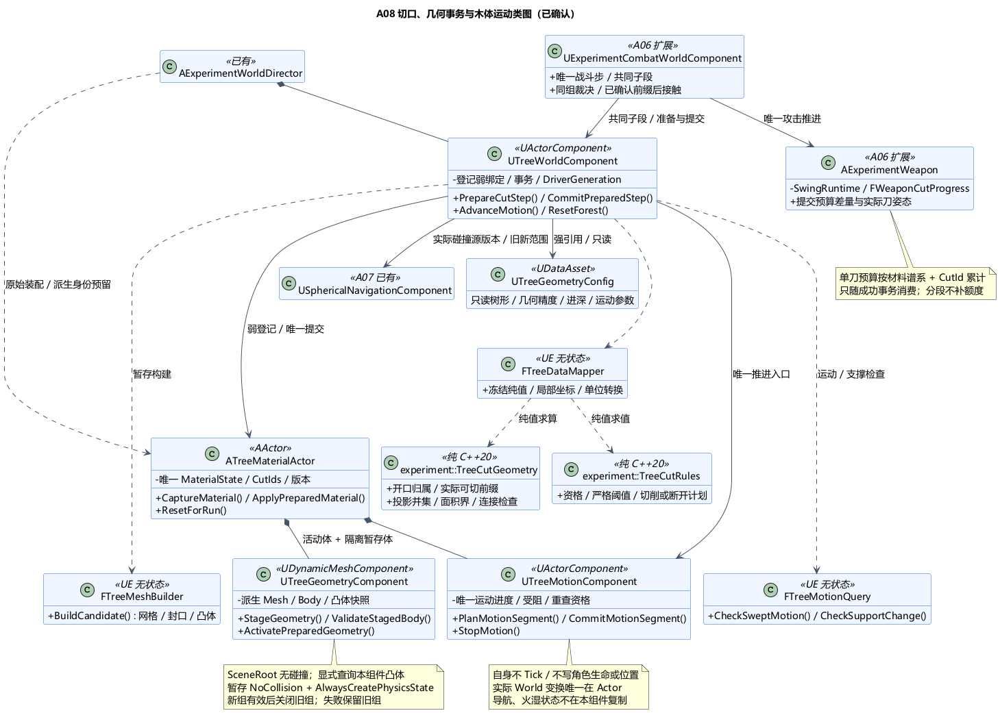
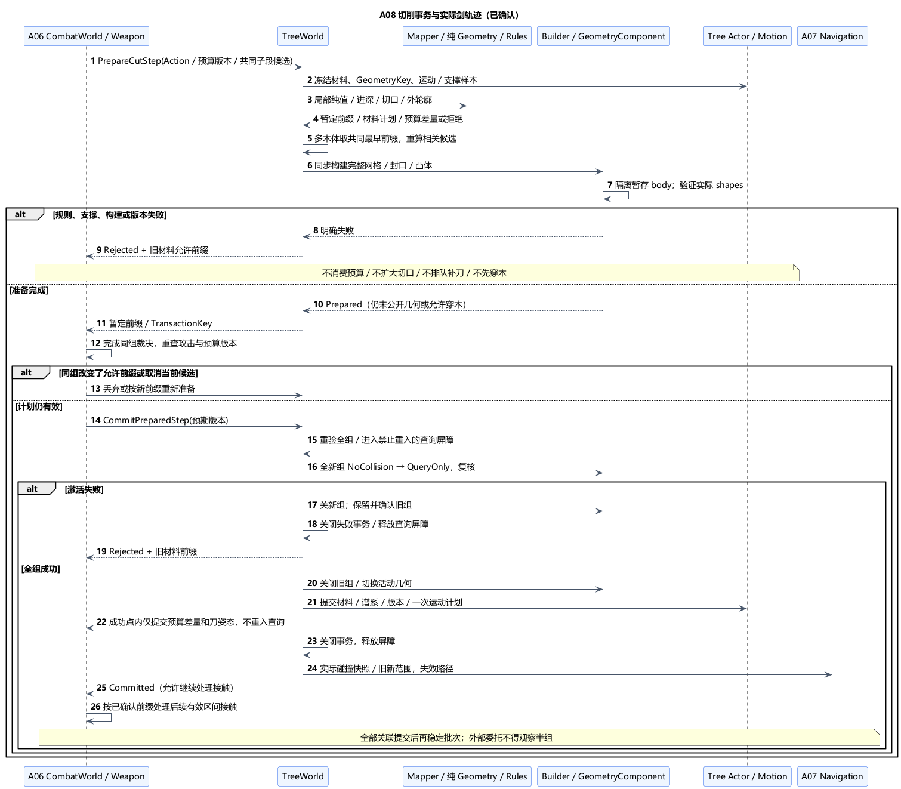

# A08 类图：切口、几何事务与木体运动

状态：**类图已确认**。日期：2026-11-06。[总体方案](A08-tree-cutting-and-fallen-logs.md)已获[总体确认](../../requirements/001-causal-prototype/sources/2026-11-06-a08-confirmation.md)，具体职责、接口和 A06/A07 扩展已获[本次类图确认](../../requirements/001-causal-prototype/sources/2026-11-06-a08-class-confirmation.md)。当前仅文档与本机接口核对，未进行 UE/GCC 编译或运行验证。

## 1. 技术栈与十个职责类

沿用 UE5.6.1 C++、GeometryFramework/GeometryCore、所需 Runtime DynamicMesh、复合凸碰撞与 UDataAsset。纯几何/规则使用标准 C++20，可按 Linux/GCC13 路线独立检查。下列接口是项目设计签名，不是声称 UE 已存在同名 API。

| 类 | 层 / 基类 | 唯一职责与接口 |
| --- | --- | --- |
| `UTreeGeometryConfig` | UDataAsset | 只读树形、切削/连接精度、单刀进深与受控运动参数；`ValidateConfig` |
| `UTreeWorldComponent` | UActorComponent，Director 默认子对象 | 本轮木体登记、事务协调、切口身份预留、唯一运动调度入口；`PrepareCutStep`、`CommitPreparedStep`、`AdvanceMotion`、`ResetForest` |
| `ATreeMaterialActor` | AActor | 每棵立木/树桩/木段唯一材料状态与当前版本；`CaptureMaterial`、`ApplyPreparedMaterial`、`ResetForRun` |
| `UTreeGeometryComponent` | UDynamicMeshComponent | 带版本的派生网格/简单碰撞及待发布组件；`StageGeometry`、`ValidateStagedBody`、`ActivatePreparedGeometry` |
| `UTreeMotionComponent` | UActorComponent，归木体 | 唯一倒落/分离进度、受阻原因与重查资格；`PlanMotionSegment`、`CommitMotionSegment`、`StopMotion`；自身不 Tick |
| `FTreeMeshBuilder` | UE 无状态工具 | 根据候选材料构造缺口、封口、复合凸体与验证结果；`BuildCandidate`，不修改已登记世界 |
| `FTreeMotionQuery` | UE 无状态工具 | 旋转运动包络、真实凸体扫掠及角色支撑检查；`CheckSweptMotion`、`CheckSupportChange`；不移动实体 |
| `FTreeDataMapper` | UE 无状态工具 | 当前材料/接触快照转纯值、单位与坐标转换；不拥有切口或预算 |
| `experiment::TreeCutGeometry` | 纯 C++20 无状态 | 局部开口归属、实际可切前缀、投影并集/面积界与连接检查；只处理标准几何值 |
| `experiment::TreeCutRules` | 纯 C++20 无状态 | 校验切削资格、严格阈值与烧细不倒规则，返回切削/一次断开计划或明确拒绝 |

一个木体 Actor 同时用于立木、树桩和木段，以角色枚举区分，不建立三套重复切口系统。暂存网格和碰撞是输出缓存，不是第二份材料状态；Rules 不保存树列表，Session 不保存树的百分比。

## 2. 装配与数据归属

Actor 拥有一个无碰撞的 USceneComponent 根、一个 Motion 默认子组件及一套当前有效 GeometryComponent；准备修改时可创建隐藏的暂存 GeometryComponent。暂存组件不参加导航、火球候选登记、可见渲染或自动事件，不给角色提供支撑。提交后新旧组件互换角色，旧组件在引用解绑后销毁；不会让两套实体碰撞同时对外有效。

根组件无碰撞，因此不能依赖 SetActorLocation 的 root sweep 代表完整树体。MotionQuery 显式查询已安装凸体，合法后才更新根变换；GeometryComponent 随根运动。初版不用自由物理模拟，不并行让动画或其他 Tick 写变换。

| 数据 | 唯一所有者 / 规则 |
| --- | --- |
| `FTreeMaterialState` | Actor：材料局部轴/范围、当前未扣剑切口的外轮廓、各 CutId 的切除集合、立木/树桩/木段角色及断开状态；不含第二份变换 |
| `FTreeMotionState` | Motion：受控角度/位移进度、计划方向、受阻与重查；实际 World 变换仍以 Actor 为准，不重新积分第二份位置 |
| `FWeaponCutProgress`（A06 扩展） | Weapon 的现有 SwingRuntime：按 ActionKey＋MaterialLineage＋CutId 保存本刀已用进深和连续采样游标；不能按每帧或新木段 EntityId 重置 |
| `FPreparedTreeTransaction` | TreeWorld 短期拥有：参与实体预期版本、候选材料、暂存组件、预留派生身份及预算差量；完成或拒绝即释放，不成为长期事件库 |
| `FTreeGeometrySnapshot` | GeometryComponent 发布的不可变真实碰撞顶点/拓扑、变换与版本；A07 持只读派生输入，不直接改 Actor |
| `TreeCutSnapshot / TreeCutPlan` | 核心纯值，包含显式世界时间/接触顺序与普通几何；无 UObject、FDynamicMesh3、委托或自动读时钟 |

身份沿用 Director 的实体分配入口：RunId、EntityId、Generation，不用地址排序。TreeWorld 只预留本轮树材料谱系和 CutId，不另造一套全局实体编号。`FGeometryKey` 包括实体身份、GeometryRevision、PoseRevision；姿态变化使发生时接触样本过期，不能只比网格版本。

切口拆到两个木段后保留原 CutId/MaterialLineage 和局部裁分映射；面积按各自实际材料重算，单刀预算仍归同一来源键，不因分段获得额外进深。新 CutId 只为实际另处开口预留，失败预留可跳号，不把失败动作写成新切口。当前刀结束/被替换时，A06 清自己的进深账本；树上已提交的切口继续保留。

## 3. A06 切削事务：先准备，再确认实际剑轨迹

CombatWorld 仍唯一拥有战斗步和攻击接纳顺序。扩展 `FWeaponSwingRuntime` 的切削进展与 `FCombatContactSampler` 的木体几何查询，不增加另一个剑 Tick。TreeWorld 不发布 ActionUsed、不分配新的攻击序号，也不决定角色伤害。

每个共享接触子段执行：

1. A06 冻结当前刀的身份/预算版本、完整候选路径和实际木体运动样本，调用 TreeWorld `PrepareCutStep`。Mapper→Geometry/Rules 得到暂定允许前缀、预算差量与材料计划；此时没有消费预算、扩大切口或移动可见剑。
2. 同一把刚性剑同时接触多个木体时，求所有相关约束中的最早限制，再按统一前缀重算每个受影响木体。一次事务覆盖该前缀实际涉及的木体集合，不能分别让不同树接受互相矛盾的剑姿态。
3. Builder 构造并验证所有候选，MotionQuery 检查角色支撑。未超阈值的多口联合移除须保有有效连接；阈值不确定须细化或返回 UnresolvedGeometry。支撑拒绝、构建失败与版本失效均返回明确原因，同时给 A06 旧材料允许的安全前缀；未成立的切削不排队补做。
4. 准备成功仍不是提交。A06 完成现有同组裁决并重查刀的身份、阶段、预算游标以及所有木体版本，才调用 `CommitPreparedStep`。同组防反与死亡优先仍按 A06，不把一条暂定轨迹提前用于后方角色伤害。
5. 在游戏线程禁止重入的短提交区内完成整组物理/几何切换，提交 Actor 材料和谱系，再消费 Weapon 的相应预算差量并提交实际刀姿态/游标。两方版本检查在修改前完成，预算写入只允许一次；新几何真正有效后，才公开已确认前缀并继续后续有效区间的接触处理。
6. 导航失效与环境分区通知在成功提交后按序交付。A06 整步相关提交全部处理完才形成稳定快照；历史已经提交的子段不因后来失败回滚，本次失败不能扩大回滚到整把刀此前的成功切口。

`Prepared → Committed / Rejected` 单向终止，由 TransactionSerial、ActionKey、子段游标和预期版本共同去重；重复 Commit 返回已记录结果，不再次切削。事务生命周期不跨世界步挂起等待角色离开。若同组裁决改变允许路径，原准备结果作废或按新前缀重新准备，不能沿用较长路径的材料移除。

这份类设计明确一个实现验证点：A06 接触组形成、树木约束求解和既有防反规则需按共同子段收敛，不能让“准备全部切口”越过更早已发生的硬障碍/攻击取消。缺少稳定可行前缀时保守按旧材料阻挡并报告，不伪造后方命中。

## 4. 同步网格与碰撞发布

Builder 只在独立数据上运行 GeometryCore/Runtime DynamicMesh 操作，输出完整网格、端面材质及同源凸体。每个准备结果必须检查有限值、封闭/有效几何、有效连接、凸体不跨新缺口和允差。不可用网格不能因布尔函数返回就被提交。

GeometryComponent 封装引擎 `SetMesh` / `SetSimpleCollisionShapes` / `UpdateCollision` 等实际入口，初版关闭异步 cooking，批量设置时延迟重复更新，最后同步构建一次。不启用复杂三角碰撞，查询使用已安装的简单凸体；精细剑切几何仍由明确的材料查询提供。每个组件只有一个 body，其中包含复合凸体。

暂存组件注册、隐藏、NoCollision、`bAlwaysCreatePhysicsState=true`、`SimulatePhysics=false`，禁普通导航贡献/重叠事件且不登记到玩法源集合；这样先建立 body，同时退出场景碰撞查询。不能用 IgnoreAll 通道设置推定所有对象类型查询都会排除它，也不能把完全未建立物理状态当作就绪。

`ValidateStagedBody` 检查合法非空凸体、BodySetup 已构建且未失败、每个 cooked convex 有效、组件与 BodyInstance 有效，并在物理读锁内核对实际 shape 的数量/类型。UpdateCollision 返回 void；bCreatedPhysicsMeshes 在失败时也可为 true，任何单一标记都不足以证明成功。导航快照复制实际 cooked hull 的顶点、面和变换，不能把输入凸体顶点直接当成一定与安装后形状相同。

提交时保留完整旧组：先把全部新组件从 NoCollision 切为 QueryOnly 并复核查询状态，全部通过才关闭旧组、提交活动登记/材料/表现。失败先关闭整个新组、确认旧组仍有效，再开放查询；旧组件不提前销毁。初版 QueryOnly 配合受控运动和角色胶囊查询实现阻挡，不依赖自由刚体接触求解。

新旧查询过滤的短暂切换区不允许 A06、角色移动、导航或其他玩法查询进入，禁自动重入事件；其后才发布预算消费、已确认剑前缀和外部委托。同步并不意味着 UE 自动提供跨多个 Actor 的事务，屏障和恢复责任由 TreeWorld 明确承担。后台 A07 构建只读已冻结缓冲，不访问该区间的组件。

初次立木断开：原初始 Actor 转为原位树桩，上部是经 Director 预留新身份的 Actor；旧木段分裂：父段退役，两段取得新实体身份。新 Actor 的 BeginPlay 不自注册、不 Tick、不触发环境事件，待整个事务成功才纳入本轮集合；失败销毁暂存者，旧木体保持有效。原父段和旧组件在成功通知/观察解除后清理，旧接触不能直接广播给所有子段。

CoreGeometryRevision 与派生网格/碰撞版本必须一致；缓存不匹配不得参与正式查询。A07 使用已安装的冻结碰撞形状，不从渲染网格反读来猜真实障碍。暂存数据与新组件只用于当前小事务，不预建整个森林的双份模拟世界。

## 5. 木体运动及 A07/A09 接口

Motion 不自行 Tick。救援期间，由 A06 CombatWorld 在其共同世界子段中调用 TreeWorld 的唯一 `AdvanceMotion` 入口，取得木体的有序运动样本并参与接触处理；TopologyCommit 前后划分有效区间，后续子段使用新木段，不回填此前时间。角色/胶囊已经执行的轨迹由既有 Movement/接触采样提供，MotionQuery 覆盖该区间的角色运动与支撑，不能只扫帧末静止胶囊，也不能倒改角色已经发生的位移。

MotionQuery 对每个安装凸体做角位移界约束的包络筛选与首次接触细化；常规只含单一旋转的 sweep 不作为旋转碰撞证明。不能确定可行性就停，状态为 `Blocked/Unresolved` 而不是假 `Settled`。已站在木体上的角色使它暂停运动，不设置会携带角色的移动基座、不施加冲量；只有障碍改变或重查时刻到达才重试。

支撑身份由 A07 已确认共同 Movement 提供只读采样，TreeWorld 不复制角色接地状态；缺失必要运动/支撑样本返回错误或保守停止，不把未知当成无角色。

离开 Rescue 后，Director 撤销 CombatWorld 的运动步驱动资格，再显式把环境推进资格交给旧时代结算宿主。`RunId＋EnvironmentEpoch＋DriverGeneration＋StepSerial` 防止双方同时推进；具体 A09/A10 宿主类尚未确定，不为此新增类。地图与失焦不撤销这份世界推进资格。成功切换阶段保留已经提交的材料和运动计划；未提交刀候选直接释放，不能成为未来补刀。

- **A07：**成功的拓扑/姿态变更以源身份、几何/姿态版本、旧/新范围通知 NavigationComponent，使相关路线立即失效。TreeWorld 提供不可变快照，NavGeometryComponent 仍由 Director 按 A07 拥有；TreeWorld 不直接写 Recast 或宣布建图完成。
- **A09：**提供类型化 `PrepareShapeChange`/`CommitShapeChange` 入口供烧细请求，复用同一几何事务；原因标为 Burn 时不能走剑击断开判定。返回实际成功的形状版本，不接受只缩放可见网格。材质分区描述带父子谱系和局部空间映射，供 A09 转移既有火湿状态；A08 不维护第二套燃烧计时，不把派生木段重新点燃或重置雨水时间。A09 必须在使用这些接口时明确其状态转移原子性，不能先默认该模块已实现。
- **Session：**只接收既有阶段所需的完成/错误事实，不接收每刀可写几何或树百分比。无伤木体碰撞不产生 Combatant 伤害或 LaunchSerial。

已确认扩展：[A09 总体](A09-fire-rain-and-environment.md)确定环境作为材料事务参与者，而非事后才迁移权威火湿状态。[A09 类图](A09-class-design.md)进一步确认 PrepareMotionSpan/PrepareMotionPrefix 与环境准备/发布接口，将运动前缀、材料、火湿和刀预算纳入已有 TreeWorld 提交屏障；这些具体接口仍待实现与运行验证，本项历史图与 A09 扩展图共同阅读。

## 6. 复位与验证边界

停止/重启先关闭新事务与运动入口、使旧 Run/Driver 身份失效，丢弃全部 Prepared 数据并由 A06 清旧刀账本；协调 A07 排空旧建图后，TreeWorld 通过环境唯一 ResetForest 入口清理本轮派生体并调用初始木体的 ResetForRun。Actor 一次分派材料、Geometry、Motion 复位，不由 Director/TreeWorld/组件各清一遍。重新绑定与碰撞/导航覆盖全部完成才 WorldReady；原日志仍保留。

Config/默认子组件用反射强引用，TreeWorld 暂存组件/Actor 需要显式强持有；跨 Director/Root/CombatWorld/实体使用弱绑定加身份校验。UWorld 管理 Actor 生命周期，TreeWorld 负责本轮登记及唯一清理请求。纯函数不保留 UObject，解绑解除所有回调；初版同步任务不存在后台 cook 回调，后续异步改造必须另提设计。

当前仅文档与本机接口核对，未进行 UE/GCC 编译或运行验证。后续验证重点：多木体共同前缀与失败回退、同刀跨帧/短暂离开/分裂后预算不重置、严格阈值与联合断桥、角色支撑拒绝不补刀、碰撞切换失败不穿木、同组防反/中途取消、旋转木端与运动角色、导航源更换/旧接触、环境驱动交接不重复推进。类图确认不关闭 A06/A07/A08 的运行风险。

本机 5.6.1 只读补充（相对 `G:/Epic Games/UE_5.6/Engine/`）：`Source/Runtime/GeometryFramework/Public/Components/DynamicMeshComponent.h:210、734、746、764` 提供上述网格/碰撞入口；对应 cpp:1677–1687 同步构建并重建物理状态。`Source/Runtime/Engine/Private/Components/PrimitiveComponent.cpp:2009` 的 ShouldCreatePhysicsState 支持 AlwaysCreate 的暂存方式；`Classes/PhysicsEngine/BodySetup.h:190–194` 说明构建标志不能独自表示成功。`Private/PhysicsEngine/BodyInstance.cpp:740–764` 支持本次 NoCollision↔QueryOnly 的过滤切换路线。`Source/Runtime/Experimental/Chaos/Public/Chaos/Convex.h:438、448、501、515、539` 可读取实际凸体的面/顶点；`FKConvexElem::GetChaosConvexIndices` 从输入 VertexData 重建索引，不作为实际 cooked hull 的独立证明。完整安装、回退及帧预算仍未实测。

[类图 PUML](A08-class-design.puml) · [事务 PUML](A08-cut-transaction.puml)。十职责类、A06 刀预算扩展、多木体统一前缀、整组几何/碰撞提交、唯一运动调度及导航/环境接口已确认；继续 [A09 火灾、降雨、潮湿与跨阶段环境总体设计](A09-fire-rain-and-environment.md)。
