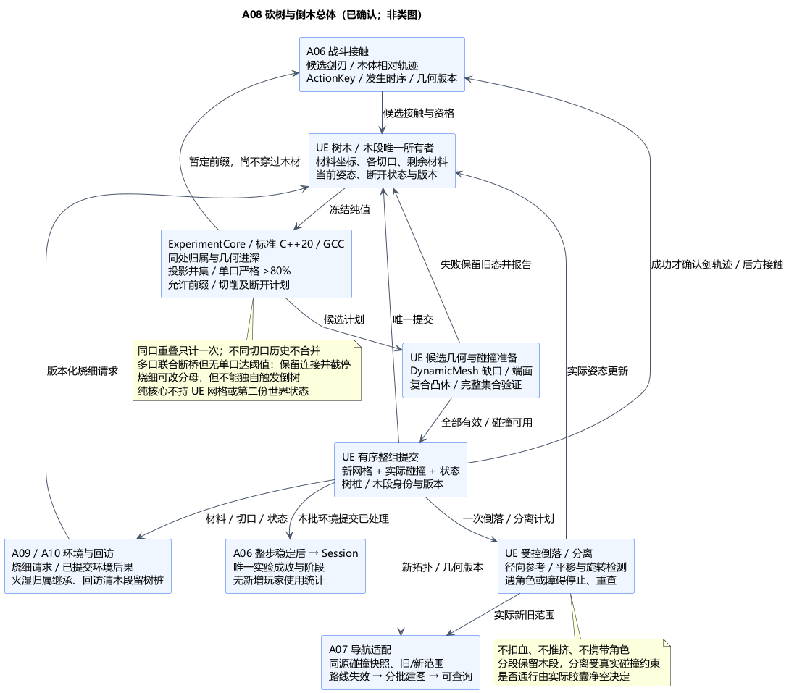
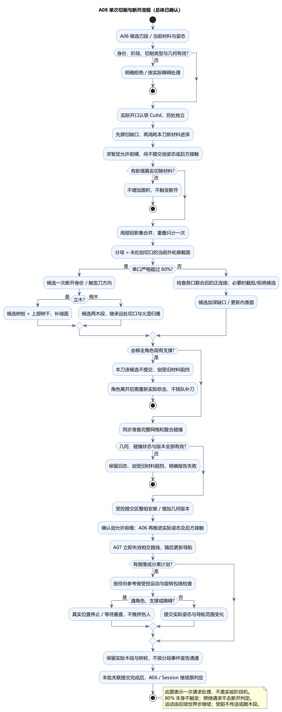

# A08：砍树切面、80% 阈值、倒木与分段阻挡

状态：**总体方案及类图已确认**。日期：2026-11-06。[总体确认](../../requirements/001-causal-prototype/sources/2026-11-06-a08-confirmation.md)包含技术栈、数据流、原因、PUML 与第 8 节取舍，具体类设计见已获[类图确认](../../requirements/001-causal-prototype/sources/2026-11-06-a08-class-confirmation.md)的 [A08 类图](A08-class-design.md)。下文“建议”描述已确认的设计路线及待验证实现。当前只有文档与本机源码接口核对，没有游戏实现或运行验证。

依据：[需求 §6.3](../../requirements/001-causal-prototype/REQUIREMENTS.md#63-砍树与倒木)、[投影口径、各处分判与倒向](../../requirements/001-causal-prototype/sources/2026-10-30-tree-cut-projection-and-rain-schedule.md)、[逐次加深、分段、烧细](../../requirements/001-causal-prototype/sources/2026-10-30-environment-continuity-and-action-limits.md)、[无伤阻挡](../../requirements/001-causal-prototype/sources/2026-10-30-fallen-tree-blocking.md)、[回访清理](../../requirements/001-causal-prototype/sources/2026-10-30-rain-and-fallen-tree-behavior.md)。本项承接 [A06 接触链](A06-combat-and-damage.md)与 [A07 导航类图](A07-class-design.md)，不增加采集、搬运、木材库存或地面挖掘。

## 1. 技术栈与选择原因

建议采用 **参数化简化树干＋运行时真实缺口＋复合凸体碰撞＋受控倒落/分段运动**。树干按有局部轴的低面数圆柱/截锥制作，支持不同接触位置的切口；不以预制几刀必倒、统一血量或单纯贴花代替切面。

| 部分 | 技术栈与职责 | 原因与代价 |
| --- | --- | --- |
| 规则与数学 | 标准 C++20、Linux/GCC13；纯值投影、面积并集/比较、切削资格、一次断开计划 | 可独立检查；不依赖 UE 网格类型、时钟或实体状态 |
| 运行时几何 | UE5.6.1 C++，GeometryFramework 的 UDynamicMeshComponent / UDynamicMesh，GeometryCore；需要平面切分/封口时使用 GeometryProcessing 的 Runtime DynamicMesh 能力 | 能生成真实缺口、内表面和切断端面；必须验证退化、封口与打包，不把一次平面切分当作逐次砍缺口 |
| 实体与碰撞 | UE Actor/Component；根据同一剩余材料生成复合简单凸体，真实碰撞及导航导出共享版本 | 不让整根旧凸包封住新切口或分段间隙；凸体分解/近似误差需验证 |
| 倒落与分离 | UE C++ 保存唯一运动状态，调用 UE 场景碰撞查询；初版 SimulatePhysics=false，受控平移/转动、接触停止 | 直接落实不砸伤、不推挤角色且阻挡；增加旋转运动检测与受阻恢复工作，不保证每刀立即清通 |
| 配置与表现 | UDataAsset 保存树形、几何精度、单刀进深、倒落/分离参数；材质及 Blueprint 表现读已提交状态 | 数值可调，动画和特效不决定缺口比例或碰撞 |

仍集成在 A03 已确认的一个 UEgame Runtime 模块。纯核心使用自身标准向量/多边形值；UE 边界换算米/厘米。新增模块仅在实际使用时声明 Private 依赖，GeometryProcessing 所需 Runtime 插件按接口启用；不依赖 UnrealEd、Modeling Editor 工具或编辑器专用 Geometry Script 节点。

自由 Chaos 刚体模拟也能按需求改造径向重力；本次不选它的原因是无伤阻挡与分离控制的成本，并非引擎能力上限。ProceduralMeshComponent 的平面切片也可用，但不能独自完成逐次缺口与整组碰撞提交；本项优先统一到 DynamicMesh。

## 2. 数据流与唯一状态

1. A06 对候选剑刃轨迹和运动树体作相对运动判交，交付 ActionKey、发生时序、树/木段身份、几何版本及局部接触轨迹；候选不代表剑已穿过。A08 返回的轨迹前缀先保持暂定，必须等第 3 步几何/碰撞提交成功后，A06 才用对应实际姿态更新可见剑与后续接触。树后角色不能按未获接受的候选轨迹先受伤。不能仅交“砍中一次”。岩炮弹没有切削资格，火球覆盖交 A09。
2. UE 树木所有者冻结当前外轮廓、各切口、实际姿态与剩余材料；适配为纯值，核心计算可接受切削进深、投影集合、面积与是否首次断开。
3. UE 根据计划生成候选缺口网格、内壁/封口及复合碰撞；检查有效性与版本。只有候选全部可用，才在 A06 有序环境提交点一起安装并确认对应剑轨迹；随后才处理该轨迹支持的后方接触。失败或支撑检查拒绝时保留旧状态，剑只接受旧材料所允许的前缀并明确报告，不伪报切面扩大或先穿木再回滚。
4. 超阈值只产生一次树桩/上部树干或两个木段的转换。受控运动使用当地径向下向与真实碰撞，位置仍由 UE 唯一提交。
5. 实际拓扑或姿态提交后发布同版本碰撞快照、旧/新范围；A07 立即失效受影响路径并标记待建，完成相应更新后再供查询。实际胶囊阻挡不等待导航。
6. A06 完成本步所有相关提交后，Session 仍只判实验成败；A08 不改变玩家招式统计。环境状态与后果进入 A09/A10，回访清理木段、保留树桩，重启由初态配置恢复。

树/木段的 UE 所有者唯一保存当前几何、切口集合、状态与运动；核心只读快照并返回计划。渲染网格、碰撞形状、导航派生数据是带版本的输出，不分别维护第二套“已砍百分比”。保留当前累计几何和必要身份即可，不增加完整每刀事件历史。

## 3. 切口归属、逐刀深入与面积公式

### 同一处与不同位置

建议使用树干的**材料局部坐标**识别切口：本刀实际进入已有缺口开口并接触其后续材料，才归属原切口；另处开始的切削建立新 CutId。容差只消除接触采样抖动，锚点不逐刀漂移；不能仅按高度分桶，也不能因两处投影重合而合并。

已有不同 CutId 不合并历史面积，即使后续几何接近或相连仍独立判定。一刀涉及多处时按真实接触顺序把新增材料分属对应切口，重叠材料不重复移除；无唯一归属的交界须细分/稳定裁分，不能整刀的总面积同时记给多个切口。

**已确认的显式取舍：**若多个独立切口联合贯通、但没有单口超过 80%，该候选不得移除最后的有效连接；截短本次可接受切削前缀，必要时拒绝本次新增，保留可解析的正宽度/正面积连接，同时限制真实剑姿态。用户接受某些交错切口无法继续切入、可能无法靠原切点砍倒的边界；不能当成数值误差藏起来，也不能以合并历史面积或自动碎裂绕过独立阈值。几何最小连接尺度仅用于可靠表示，不替换 80% 条件。

### 为什么反复同轨迹也能深入

直接重复同一个完整扫掠并集不会增加面积。本次建议每刀具有可调的**新材料进深预算**：先穿过旧缺口，在当前剩余材料前沿开始消耗；达到本刀预算就截断该剑的后续实际姿态，显示的剑刃也在同处停止/收回。下一刀重新取得预算，从更深的前沿继续。

预算按 ActionKey 与该处连续切削累计，不能每帧、每子步或短暂离开后重置。对整把刚性剑统一限制姿态，不让刃上各采样点分别穿透；切削轨迹经过地面、空气墙或不可切硬障碍时仍按 A06 停止。几何新增量始终满足：

`新增切除材料 = 实际接受的剑刃扫掠体 ∩ 当前剩余木材`。

削入预算是长度约束，不是血量。不能向刀刃没有到过的位置扩口，也不能继续伤害未穿过木材后方的角色。正常树径、剑长、轨迹必须验证能通过重复砍达到阈值；名义轨迹已到极限时不凭空增加深度。横斩/竖斩仍按 A06 的有效挥动执行，树木阻挡只细化此前保留的局部接触边界。

### 严格超过 80%

对切口 j，树干/木段局部轴单位向量为 a，固定轴向锚点为 c_j，参考平面垂直于 a。令 C_j 为该切口累计实际切除材料的集合，D_j 为锚点处**尚未扣除剑切缺口的当前完整外轮廓横截面**：

```text
π_j(x) = x − a [a · (x − c_j)]
A_cut = Area(D_j ∩ π_j(C_j))
A_section = Area(D_j)
断开条件：5 × A_cut > 4 × A_section
```

投影按集合并求面积，重叠只计一次，不能累加正反面、三角片或每帧投影。例：两次投影各占 50%、重叠 30%，合并为 70%，不会倒树。恰好 80% 不断；不得用正容差把严格大于改成大于等于。接近阈值时细化几何或求面积误差界，无法确定就报告未解析几何，不能按帧率随机决定。

倒下后 a 随木段姿态旋转，横截面仍垂直木段轴；不改用世界 XY 面，也不改用所在球面切平面。树干轴/切口锚点是材料坐标，World 姿态变化不改变历史切口比例。

## 4. 烧细、倒树与分段

### 烧细接口（与 A09 衔接的本项建议）

分母采用当前烧细后的外轮廓截面，分子也裁到同一轮廓；不能用“扣完切口后的剩余木材面积”当分母。**只有该处提交新增真实剑切材料后才执行断开判定**，燃烧更新本身不触发倒树。因此烧细可能使下一次真实砍击更容易达到阈值，该取舍已随总体确认。

烧细不能把旧缺口处剩余连接全部烧没而让树悬空；A09 提交的外轮廓必须仍保有可解析的正宽度/正面积连接材料，具体缩细程度留 A09。火焰、潮湿和树形由各自唯一所有者按类型化请求衔接，不直接缩放可见树干却保留旧碰撞，也不由 A08自行改变火雨时间表。

### 立木倒下

首次成功提交满足某一切口严格阈值的切削时，冻结触发刀、切断位置与倒向；剩余连接按断裂规则断开，形成留在原位的树桩和上部树干，端面封口。准备期间只是候选，不能提前发布倒树事实。不会按每次 Tick 重复生成树桩，也不会删除整棵树表示倒下。

倒向取**触发阈值那一刀的实际切向运动方向**在切断点当地球面切平面上的投影；若近乎竖直而投影退化，使用该刀开始时已锁定的切向前向，不临时读取下一帧相机。树先向该方向倾倒，随后受地表、空气墙和其他实体阻挡；“随砍击方向”不表示必须穿过障碍抵达固定角度。

### 倒木分段与通行

竖劈对倒木沿用逐刀深入及单口严格阈值。达到条件后在该口截面切为两个有封口的木段；已有远处切口和燃烧/湿润空间归属随材料裁分继承，不清空另处进展，不因派生两个实体而重置火雨时间。立木的剩余根部不因上部变成木段而消失。

建议木段保留在现场，并沿原木轴两侧尝试有限分离，再按径向下向贴落；位移量/速度可调。地面、角色、树木、其他木段或空气墙阻挡时，在真实位置停止，不能传送到空地、穿墙或删除未砍部分。被挡住不保证一次分段就有通路；玩家可再选择切点或跳过。必须用典型布局验证竖劈最终确实能清出可走空间，不能把分段只做成外观变化。

本次不新增横斩对已倒木的分段效果：它仍按真实障碍处理；倒木清理使用已确认的竖劈。运动中的倒木可被检测，采用 A06 的相对运动和发生时姿态；新拓扑从实际切换时点生效，不能拿帧末网格追溯改判此前接触。

## 5. 受控运动与无伤阻挡

初版立木固定，倒落/分段由 UE 侧保存并推进受控姿态；地表与空气墙仍是 A04 的真实球面场景。径向下向为 `Down(P)=−(P−C)/|P−C|`，不额外叠加世界 Z 重力。运动模式不能同时开启 Chaos 自由模拟或动画改同一实体变换。

每步按平移与角位移细分，对每个实际凸体构建保守运动包络，通过 UE 场景查询找候选，再细化首次接触；不只测几个终点。旋转造成的树端位移必须覆盖，普通 `SetWorldTransform(..., bSweep=true)` 不能独自解决该问题。遇不确定接触先停止，继续细化后再推进；允许误差不能封死本应可走的通路。

建议木体碰角色即停止/等待，不扣血、不产生击飞、不推挤或搬移角色；受阻后按间隔或障碍变化重查，重新可走才继续倒落/分离。有角色站在木体上时暂停该木体运动；若新切削/分段本身会移走现有支撑，本刀该候选不提交，保留上次整套状态并限制剑姿态，角色离开后需要重新实际砍击。只有已提交的倒落/分离计划可以等支撑解除后继续，不把未成立的切削排队成遥远的补刀。运动木体不作为默认会携带角色的移动基座。玩家自身跳跃/掉落仍遵守既有规则，不增加全局免伤。

稳定倒木保持真实阻挡，玩家可跳过，哥布林按 A07 绕路。暂停在半空或被另一木体托住属于当前真实姿态，不能为了看起来倒平而关闭碰撞。倒落无伤与武器直接伤害分开：角色若被同一把剑实际扫到，仍由 A06 判定。

## 6. 几何提交、导航与生命周期

### 初版同步准备、整组发布

初版使用有上限的简化几何，在游戏线程同步完成候选网格、封口与碰撞构建，暂不引入后台切割/异步 cook。候选输出保存于暂存数据/组件，旧体继续有效；碰撞构建成功并创建可用物理查询状态、整个树桩/木段集合验证完成后，才在受控提交区一起切换。不得把 UpdateCollision 返回、网格通知或“请求建图”当作实际完成。

立木→树桩和上部、旧木段→两段均是一个拓扑事务：成功才增加 GeometryRevision、登记新实体、关闭旧碰撞并发布新表现；失败保留完整旧状态且报告原因，不出现一帧无碰撞或只生成半组。改变前后的凸体不能横跨新间隙。未达单口阈值的候选还须保有有效连接；角色支撑检查与旧几何版本检查不通过时，本次未成立的切削不排队补做。已提交木体运动计划恢复时重查身份与障碍，不能延后补发剑伤害。

这会增加提交帧成本，必须灰盒测量；若同步构建不能满足原型流畅度，再提出异步方案。异步时需要独立暂存结果、Run/Entity/Geometry/Job 身份校验和整组提交，不能让默认 cook 完成回调先装入旧结果再检查轮次；本项不声称已有异步路径安全。

### A06、A07 与 A09 接口

- A06 以实际提交时点区分新旧拓扑。旧几何的晚接触不能自动转给新木段；需要从提交后的有效区间重新查询，不能复制一次剑击成两次新伤害。攻击使用事实仍只发布一次。
- A07 使用本次真实碰撞形状的冻结顶点/拓扑与变换，避免打包后反读不可用的渲染 CPU 网格。每次实际几何/姿态变化先标记旧/新范围及相交路径失效，导航分批更新；尚有更晚版本待处理的区域不宣称已就绪。
- A09 请求烧细或读取断开/位置变化；A08 返回实际提交状态与版本。燃烧归属的裁分保留空间覆盖和已有时间，不把新木段当作刚点燃或刚淋雨。具体火雨算法仍由 A09 提案。

### 停止、跳时与重启

离开救援后停止接纳新砍击，保留已提交切口、树桩、木段和已接纳的环境变化计划。A09/A10 结算旧时代因果再构造回访，不要求物理模拟 30 年；回访木段视为被人为清理，树桩按已确认规则保留。具体阶段收口接口随后确认，不能在成功当帧把森林状态复位。

手动重启先失效旧 Run/实体绑定、停切削和木体运动，再配合 A07 取消并排空旧导航构建；Director 通过环境唯一入口移除本轮派生木段/树桩并恢复初始树木，重新发布碰撞与导航，全部必需条件成立才 WorldReady。失败/旧回调不能使新轮出现残留切口。地图和失焦不暂停木体运动或环境时间。

## 7. 技术证据与后续验证

本机 UE5.6.1 已只读核对以下接口，路径相对 `G:/Epic Games/UE_5.6/Engine/`：

| 本机源码 | 核对结果与用途 |
| --- | --- |
| `Source/Runtime/GeometryCore/Public/Operations/MeshBoolean.h:39` | 有 Difference 操作；并不保证所有退化切割都成功 |
| `Plugins/Runtime/GeometryProcessing/Source/DynamicMesh/Public/Operations/MeshPlaneCut.h:147`、`:183` | 平面切割与补洞能力，用于阈值后的断面；不是切口深度算法 |
| `Source/Runtime/GeometryFramework/Public/Components/DynamicMeshComponent.h:746`、`:824` | 可设置简单碰撞形状，有受保护虚完成入口；具体适配仍待类图 |
| `Source/Runtime/Engine/Classes/Components/SceneComponent.h:549`、`Private/Collision/WorldCollision.cpp:509`、`:545` | 普通移动 API 不提供完整旋转扫掠，组件 sweep 采用单一旋转且跳过非凸复杂形状；必须补运动包络与复核 |
| `Source/Runtime/Engine/Classes/PhysicsEngine/BodySetup.h:296`、`:299` | cook 完成仍需建立物理状态；异步取消仅适用于尚未开始任务 |

官方参考：[DynamicMesh 组件](https://dev.epicgames.com/documentation/unreal-engine/API/Runtime/GeometryFramework/UDynamicMeshComponent)、[Geometry Scripting 使用范围](https://dev.epicgames.com/documentation/en-us/unreal-engine/geometry-scripting-users-guide-in-unreal-engine?application_version=5.6)。在线页默认版本可能变化，本轮接口存在性以本机 5.6.1 源码为准；采用 C++ Runtime 能力不等于需要整个蓝图工具层。

最小验证须覆盖：重复同处深入/不同处独立/相连切口归属、79.9%/80%/80.1%、斜切投影与多面重叠、烧细旧切口但不自动倒下；立木与转动倒木的实际剑轨迹、树后角色遮挡；断面封口、复合凸体间隙、失败事务；树端旋转扫过角色/空气墙、角色站在木体上、五敌围堵；连续分段形成实际通路与导航版本；成功跳时/手动重启无旧切口残留。GCC 数学检查不能替代 UE 实际碰撞/打包验证。

当前未运行上述验证。R-A08-CUT-GEOMETRY-MOTION 保留切口归属、几何稳健性、旋转查询、同步构建成本和真实通路风险，不以图文检查代替运行可行性证明。

## 8. 已确认的六组总体取舍

| 组 | 已确认方案 |
| --- | --- |
| 技术路线 | DynamicMesh 运行时缺口/封口，复合凸体碰撞；纯 C++20 规则；UE 受控倒落而非初版自由刚体模拟 |
| 切口与深入 | 实际进入已有开口才归同处，各口历史不合并；重叠只计一次；有限几何进深；多口联合贯通但各口未超阈值时保留连接并截停，承认交错切口可能无法继续切入 |
| 阈值与烧细 | 单口严格 >80%；分母为未扣剑切口的当前外轮廓截面；仅新增真实剑切材料触发断开，烧细本身不倒 |
| 倒向与无伤 | 触发阈值的最后一刀决定倒向，竖向退化用该刀锁定前向；遇角色/障碍停止等待；脚下木体暂停运动，会移走支撑的新切削须离开后重新砍 |
| 分段与清通 | 竖劈分成保留的木段，继承旧切口与火湿归属；沿原木轴有限分离，受阻保留位置；以实际净空判断通路 |
| 提交与衔接 | 初版同步准备、整组网格/碰撞提交，再发布导航变化；保留救援后果供火雨/回访，重启恢复初态 |

具体进深、几何容差、木段速度和分离距离留灰盒调参，不逐项追加数值采访。总体及 [A08 类图](A08-class-design.md)均已确认，继续 [A09 火灾、雨湿与跨阶段环境总体](A09-fire-rain-and-environment.md)；A09 算法不随本项提前确认。





[总体 PUML](A08-tree-cutting-and-fallen-logs.puml) · [切削流程 PUML](A08-cutting-flow.puml)。
