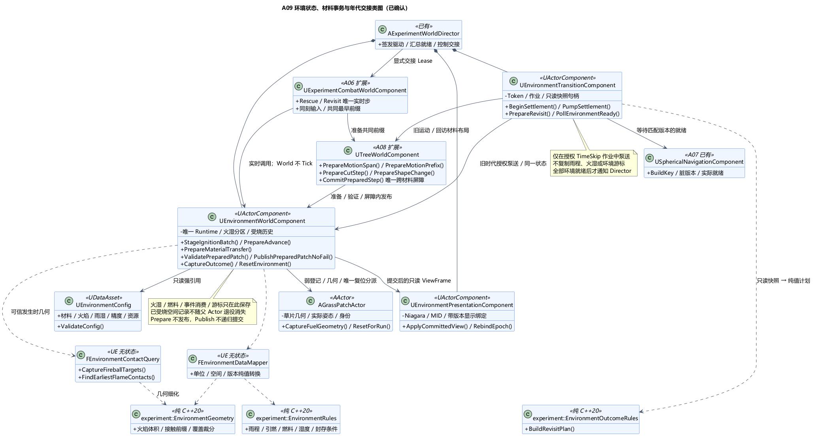
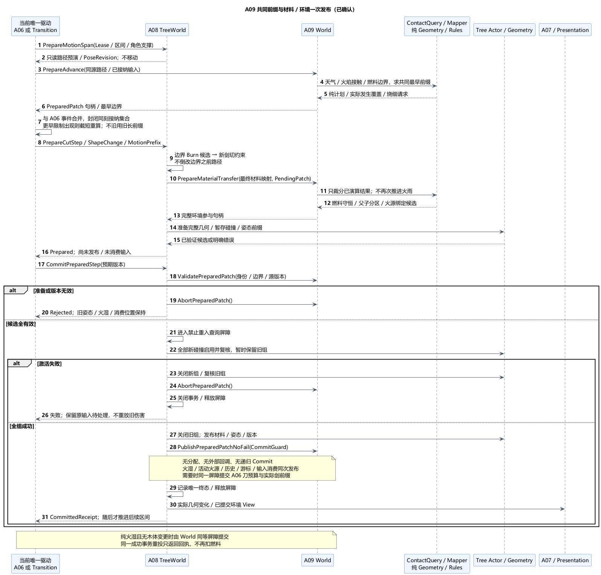
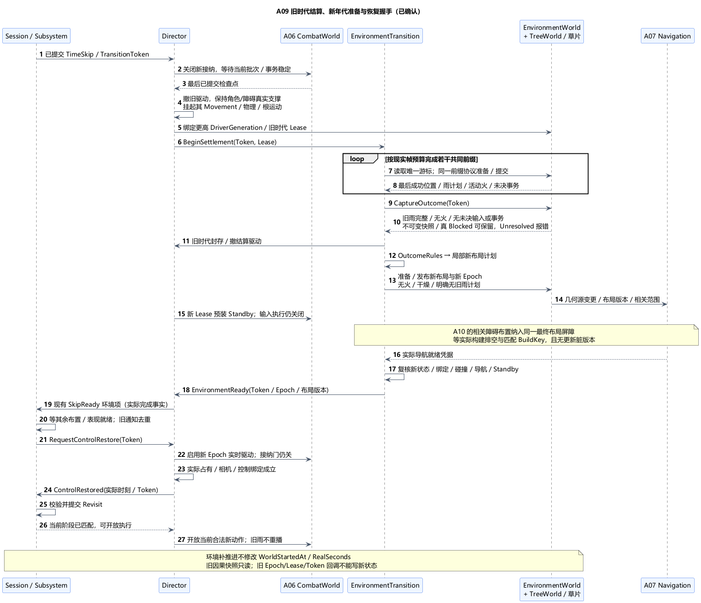

# A09 类图：环境状态、材料事务与年代交接

状态：**类图已确认**。日期：2026-11-06。[A09 总体](A09-fire-rain-and-environment.md)及六组取舍已获[总体确认](../../requirements/001-causal-prototype/sources/2026-11-06-a09-confirmation.md)，十职责类、值结构、A06/A08 接口扩展及生命周期已获[类图确认](../../requirements/001-causal-prototype/sources/2026-11-06-a09-class-confirmation.md)。下文所述接口为已确认设计，并非已有实现。当前仅文档与本机接口核对，未进行 UE/GCC 编译或运行验证。

## 1. 技术栈与十个职责类

沿用 UE5.6.1 C++、A08 DynamicMesh/实际凸碰撞、Niagara/动态材质、UDataAsset；纯规则/数学使用标准 C++20，与 Linux/GCC13 同源构建。以下是项目设计签名，不是 UE 已提供的同名 API。

| 类 | 所属层 / 基类 | 唯一职责与主要接口 |
| --- | --- | --- |
| `UEnvironmentConfig` | UDataAsset | 材料燃料/火强/干燥参数、火焰体积、草片精度、结算步限及表现/回访资产；`ValidateConfig` |
| `UEnvironmentWorldComponent` | UActorComponent，Director 默认子对象 | 唯一环境运行状态、游标、火湿分区、输入消费、已受烧空间记录；`BeginEpoch`、`StageIgnitionBatch`、`PrepareAdvance`、`PrepareMaterialTransfer`、`ValidatePreparedPatch`、`PublishPreparedPatchNoFail`、`CaptureOutcome`、`ResetEnvironment`；自身不 Tick |
| `AGrassPatchActor` | AActor | 小片草的实际局部覆盖几何/变换及实例身份；`CaptureFuelGeometry`、`ApplyLayout`、`ResetForRun`；不持燃烧计时/湿度，不单独 Tick |
| `UEnvironmentTransitionComponent` | UActorComponent，Director 默认子对象 | TimeSkip 环境结算与新布局的有限作业；`BeginSettlement`、`PumpSettlement`、`PrepareRevisit`、`PollEnvironmentReady`、`CancelJob`；不复制火湿状态或推进游标 |
| `UEnvironmentPresentationComponent` | UActorComponent，Director 默认子对象 | Niagara、材质实例及显示绑定；`ApplyCommittedView`、`RebindEpoch`、`ClearEffects`；不参与规则判定 |
| `FEnvironmentContactQuery` | UE 无状态工具 | 冻结可信世界几何/双方运动、完整候选筛选与发生时刻接触；`CaptureFireballTargets`、`FindEarliestFlameContacts`；不移动 Actor、不点火 |
| `FEnvironmentDataMapper` | UE 无状态工具 | 厘米/米、空间基准、版本化 UE 快照与纯值互转；不持运行状态 |
| `experiment::EnvironmentGeometry` | 纯 C++20 无状态 | 明确火焰体积、区间几何细化、材料分区裁分及空间覆盖映射；`BuildFlameVolumes`、`FindContactPrefix`、`PartitionCoverage` |
| `experiment::EnvironmentRules` | 纯 C++20 无状态 | 雨程边界、来源优先、燃料/火强/湿度、可终止性条件；`NextBoundary`、`EvaluateIgnitions`、`Integrate`、`CanSealOldEra` |
| `experiment::EnvironmentOutcomeRules` | 纯 C++20 无状态 | 从已提交受烧/砍伐快照生成局部回访计划；`BuildRevisitPlan`；不创建 Actor、不改 Session 分支 |

不另建每棵树的 BurnableComponent、WeatherManager 或第二套环境 Session。环境 World 集中管理一份状态，GrassActor/TreeActor 提供真实几何，纯函数求值，Presentation 显示结果。Transition 是世界操作作业，不是第二个实验阶段机。

## 2. 唯一所有权与值结构

Director 拥有 World、Transition、Presentation 默认子组件，通过 UExperimentConfig 引用只读 EnvironmentConfig；TreeWorld 和 Navigation 仍沿用 A08/A07 的 Director 装配。UWorld 管理 Tree/Grass Actor 生命周期，环境登记只保留弱绑定加完整身份。动态创建且未发布的 Actor/组件须由当前准备作业显式强持有；BeginPlay 不自动点燃、登记或发出完成事件。

| 值结构 | 唯一持有者 / 约束 |
| --- | --- |
| `FEnvironmentRuntime` | World：Epoch、模式资格、最后成功游标/StepSerial、雨计划、分区表和 EnvironmentRevision；不保存 A02 Phase 或真实耗时副本 |
| `FEnvironmentRegionState` | World：MaterialLineage＋RegionId＋实际局部覆盖、剩余燃料总量、火强/湿度/累计炭化、最近求值时间、材料/几何版本；不另存可写 Actor 位置 |
| `FEnvironmentIgnitionBatch` | World 的短期已接纳输入：Run/Epoch/ImpactKey、发生时刻/边界序、几何版本和命中覆盖；消费状态只在对应提交成功时前移 |
| `FPreparedEnvironmentPatch` | 准备句柄指向 World 暂存候选：源版本、完整目标分区/活动火源集合差量、燃料收支、事件消费及游标差量、历史覆盖增量；非第二份持续模拟世界 |
| `FEnvironmentStepContext` | 当前驱动传入只读值：Run/Epoch/DriverGeneration/StepSerial、区间、A06 接触组/边界序、角色运动/支撑与木体路径版本 |
| `FEnvironmentDriverLease` | Director 唯一签发；A06、Transition、TreeWorld、World 保存接收到的资格和最后消费序号用于检查，不各自生成新代次 |
| `FEnvironmentDamageFootprint` | World：按 A04 Root 局部空间与 SpatialRevision 记录已提交的实际受烧覆盖和严重度；木体退役后仍保留，不等同活动火源表 |
| `FEnvironmentOutcomeSnapshot` | 封存后的不可变值，World 持有，Transition 只持只读句柄；包含旧 Epoch/版本、受烧覆盖、材料剩余量、砍伐树桩和真实受阻状态 |
| `FEnvironmentTransitionJob` | Transition：Token、作业阶段/取消代次、快照句柄、布局计划、暂存对象和期望导航 BuildKey；不保存另一份环境时钟或可燃区表 |
| `FEnvironmentViewFrame` | 已提交只读表现投影，含 Epoch/ViewRevision/MaterialBinding；Presentation 可缓存显示，但不得据此求值或回写火湿 |

RegionId 是当前材料谱系内的分区身份，派生裁分保留 SourceRegionId 和明确交集映射；空间数值误差与最小有效材料量由配置约束。分区只是局部表示，不会生成完整球体体素场。GrassActor 的草片体积与可见草覆盖同源；它不阻挡角色/武器/投射物、不增加导航障碍，但仍由显式可燃几何登记参加火球范围及火焰接触查询。不能因它没有阻挡碰撞而漏出可燃集合。

无雨计划是一种显式值：新年代使用 `RainSchedule=None`，不是把旧 180/300 秒定时器重新启动。旧时代环境游标由 WorldStartedAt 对齐，补推进只改自身演算位置；新 Epoch 使用新的环境时间原点，不修改 A02 世界开始时刻或真实耗时。

## 3. 一条推进链与共同最早边界

实时由 A06 CombatWorld 驱动；TimeSkip 由授权的 Transition 驱动。两者调用同一 World / Rules / ContactQuery 协议，不能复制两份算法。World 不自行 Tick，Presentation 的粒子推进不代表世界规则推进。

### 候选运动不能提前成为实际姿态

本次提出 A08 接口细化：`PrepareMotionSpan(Context)` 返回只读木体路径预演和预期 PoseRevision；`PrepareMotionPrefix(Span, End)` 只准备选定前缀，不移动 Actor。仍保留原 `AdvanceMotion` 作为受驱动的入口，但其内部按准备/提交两段运行，不能在环境检查前把整段木体移动到末尾。

当前驱动取 A06 事件边界（实时）、天气 180/300 边界、燃料耗尽/火强边界、火焰首次接触以及最大误差步限中的最早者。查询使用源和目标双方同一候选区间的运动/尺寸变化；路径还未提交时，所有命中只是候选。若出现更早边界，就截短并重新准备所有受影响材料/火湿计划，不把较长路径结果混入较短前缀。

`PrepareAdvance(Context, MotionSpan, End)` 让 Mapper→Geometry/Rules 给出该前缀的纯计划，返回 World 拥有的准备句柄与可选 Burn 形状请求。当前驱动将它交给 TreeWorld；World 的 Prepare/Publish 不能反向调用 TreeWorld 的 Commit，以免形成递归提交。

### 边界顺序与输入消费

先积分到边界左侧，再消费恰在该点的天气转换；180 秒雨中政策先于同刻引燃，300 秒完成熄灭/停雨/保湿后再接纳新引燃。A06 原有同组防反、角色伤害及攻击接纳规则保持原职责，环境不另排角色伤害顺序。

火球事件只由 A06 在命中被接纳时交付，ContactQuery 在发生点冻结所有实际覆盖的树/草目标。以 A06 的组和边界序区分同一数值时间上的几何提交前后，不能在帧末重新查一次新世界代替旧命中。同边界火球与切削一起发生时，先收齐 A06 最终接纳的引燃批次；按原覆盖与本次材料裁分映射准备实际保留部分的引燃，随同一事务提交。旧父实体事实不能广播成每个子段全覆盖；不属于当前映射的过期目标必须明确诊断，不能无声点燃新对象。

既有火焰的同刻接触集合固定后按稳定身份求值，新火初始重叠按有限集合收敛；已燃不刷新强度/燃料/雨程。随后才能处理后续时间。`ImpactKey + TargetCoverage + BoundaryKey` 去重，同次多来源接触只使同一材料区发生一次状态转换；攻击使用统计仍只归 A06。

一个前缀没有完成环境/几何提交时，不能开始其后区间，不能把 EnvironmentRevision 或消费游标提前标为完成。重试沿用未消费事件和最后成功位置，已提交前缀不重复积分。技术失败交给 Director，停止相应推进；不伪报完成、不修改角色死亡或撤销此前已经提交的战斗事实。

同一边界需要烧细与剑切时，准备阶段先形成合法 Burn 收缩候选，再计算该边界新增剑切的材料/阈值约束；不能让调用先后偶然改变 >80% 的分母。边界之前的路径仍使用当时有效的旧形状，禁止拿刚烧出的空隙倒改此前剑轨迹。若最终材料改变共同允许前缀，重算相关候选直到一致，无法确定时明确拒绝/报告 Unresolved；不保留旧较长前缀的移除量。当前批次的必需环境输入未完成提交时，不向 Session 发布“全部已稳定”的遭遇快照。

## 4. A08 唯一整组事务，A09 作为参与者

不新增通用事务框架。复用 TreeWorld 的 `FPreparedTreeTransaction`，增加可选 `FPreparedMotionPrefix` 与 `FPreparedEnvironmentPatch` 句柄，原刀预算差量仍归 A06 Weapon。`CommitShapeChange`、`CommitMotionPrefix` 都转入同一 `CommitPreparedStep` 屏障，不各自先后发布。

参与者接口限于：

- `PrepareMaterialTransfer(TransactionKey, MaterialMap, PendingPatch)`：冻结源 EnvironmentRevision；只裁分已经求值到事务时刻的结果，准备所有剩余分区、父退役/子绑定和活动火源登记，不再次积分火雨或扣燃料。没有待推进 Patch 的纯切削也必须执行环境裁分。
- `ValidatePreparedPatch(Handle, ExpectedVersions)`：重查 Run/Epoch/Driver、边界、材料/姿态/环境版本和完整候选，不分配新数据、不执行外部回调。
- `PublishPreparedPatchNoFail(Handle)`：仅持有效内部提交屏障时交换已准备数据，提交输入消费/游标/历史增量，单次生效；跨材料由 TreeWorld 持屏障，纯环境由 World 持屏障。不得再次建图、分配 Actor 或调用 Commit。
- `AbortPreparedPatch(Handle)`：丢弃尚未提交的候选，不消耗事件，不把被拒绝的砍击留成以后补刀。句柄绑定事务终态，成功后不能再 Abort 成功结果。

TreeWorld 先完整准备并验证新几何/碰撞与所有参与数据，进入禁重入查询区；全部新碰撞可用才关闭旧组。随后在同一不可失败发布段提交材料、实际姿态/版本、环境分区和火源集合、所需刀预算/实际剑前缀。释放屏障后再发 A07 导航通知、只读表现更新及观察事件。纯火湿变化且没有木体姿态/形状变化时由 World 在同等版本与禁重入约束下发布，不为了下雨强造一棵树参与事务。

任何可失败工作都在发布前完成，包括内存容量、分区交集、源绑定和碰撞激活检查。新碰撞激活失败先关闭全新组、复核旧组，释放事务/屏障后返回失败；旧姿态、旧环境与未消费输入保持有效。若旧状态也无法验证，报告技术错误，不能称为安全回退。重复提交返回同一已完成结果，不再次修改燃料或预算。

燃料收支先在原区积分到边界，再按局部交集裁分剩余量；`剩余源量 = 子区总量 + 实际移除部分的剩余量`，数值允差显式核验。已作为燃烧消耗的量不能因烧细再次扣减。强度/湿度按空间覆盖继承，不能按子段数量平分；原树 Actor 转为树桩即使 EntityId 未变，也只留下树桩对应的分区。材质切除不抹去已经发生的受烧历史。

Burn 请求仍受 A08 连接/支撑规则限制，合法钳制可得到零形状变化并继续消耗燃料成为不燃残体；这不等于忽略 cook、版本或绑定错误。燃料耗尽即停止活动火源，保留的残体仍归 TreeActor 碰撞/材料体系。草只更新自己的覆盖/炭化显示，不强行走木材切削算法。

## 5. 受烧历史与回访布局

World 在成功提交时积累实际被烧材料的空间覆盖和严重度：根据当时姿态投影到 Root 的局部活动区域表示，携带空间版本、材料来源与发生区间。记录实际受烧覆盖，不把整个火焰包络、运动扫过范围或候选接触直接涂成地面烧伤；没有实际引燃/燃烧的地块不能变成灾区。移动倒木沿途只有真正引燃的草/树等材料贡献相应后果。

活动火源表可以因熄灭、砍断或旧对象清理改变；受烧历史在本 Epoch 内只按成功事实积累。原树退役、木段被清理或燃料耗尽不会删除旧记录。不会每帧保留整套世界录像；有限局部覆盖按并集/严重度归并，精度不足时报错或细化，不能无声截掉因果痕迹。

`CaptureOutcome` 仅在 Rules.CanSealOldEra、输入队列与事务排空、相关木体无技术 Unresolved 时成功，返回绑定 Run/Epoch/OutcomeRevision/TransitionToken 的不可变快照。正常 Blocked 可以如实封存，不将它改成 Settled。OutcomeRules.BuildRevisitPlan 输出普通值：按旧受烧位置安排枯木/新芽、保留砍伐树桩、清理倒木，并明确各新年代材料的剩余燃料和干燥初值；资源类别由配置映射，核心不持资产路径或 UObject。

Transition 负责按计划协调 TreeWorld 和 GrassActor 准备布局；TreeWorld 仍是木材 Actor/Geometry 的唯一写入口，World 仍是火湿唯一写入口。新生植物经 Director 预留新实体身份；旧炭化残体不返满燃料。新 Epoch 状态和旧 OutcomeSnapshot 是当前可写状态与历史只读值，不是并行两套模拟森林。实际场景只有一份，暂存仅覆盖当前替换事务需要的对象。

## 6. 单一驱动与就绪握手

Transition 的作业状态为 Idle → SettlingOldEra → PreparingLayout → WaitingReady → Ready，失败/取消进入对应终态；这些只是世界操作进度，不是 Preparing/Rescue 等实验 Phase。它只在获准 TimeSkip 作业时启用泵送 Tick（与现有游戏线程后置步协调），每次按工作量预算完成若干共同前缀，帧预算不改变模拟步长和数值结果。

交接协议：

1. Session/A02 决定进入 TimeSkip，Director 关闭新攻击/旧阶段接收门，等已接纳批次与当前环境事务稳定。未提交刀候选释放，已提交环境状态和木体运动计划保留。
2. Director 撤销 A06 旧驱动，签发更高 DriverGeneration 给 Transition，并同步 TreeWorld/World 的资格。两个驱动不能同时有效；旧 StepSerial 或旧代次不允许消费新游标。
3. 结算期间保持交接时角色/障碍真实姿态及支撑有效：Director 挂起这些旧阶段参与者的 Movement、重力/物理和动画根运动等实际变换写入口，保留真实查询几何并使用对应静止支持样本，不能只清空输入或只拍一次快照却允许其继续移动。木体仍按自己的受控计划推进。若绑定/支撑失效，停止并诊断，不把角色当作消失；新布局/恢复时按唯一装配入口解除对应限制。
4. Transition 每次从 World 读取最后成功位置，调用同一前缀协议；最少消费旧 180/300 秒雨程，晚成功继续到实际无火，燃料上界用于查错而非强制截火。没有活动火与未决输入/事务后封存旧时代，停止旧驱动。
5. 使用快照准备新布局及新的 Epoch 状态/材料绑定，显式无雨、无火、干燥；A06 新驱动预装为 Standby。新布局按 A07 发布源版本与旧/新范围失效，等待匹配 BuildKey 的实际构建排空和就绪，不能只等任意一次 OnBuildComplete。
6. **新状态、对象绑定、碰撞、所有必需导航区域及驱动 Standby 全部就绪**，且没有更晚脏版本，Transition 才向 Director 报 `EnvironmentReady(RunId, Token, Epoch, OutcomeRevision, LayoutRevision)`。Director 经 Subsystem 回报现有 SkipReady 环境项；重复通知只去重，不能重复生成年代。A10 角色/场景布置若还要改变相关障碍，须纳入同一最终布局屏障，在就绪报告前完成；报告后至恢复控制前不得再无声修改其覆盖，必要变更必须使当前准备凭据失效并重新验证。
7. A02 收齐其余就绪后请求恢复控制。Director 启用新 Epoch 的实时驱动，攻击执行门仍关闭；实际占有、输入/相机和世界绑定成立后回报 ControlRestored。Session 接受匹配事实、提交 Revisit 后，才开放可执行输入；同一游戏线程交接，无 TimeSkip 中提前接纳的新动作。

恢复实时后，环境游标以新年代实际世界时间差推进，不追赶旧时代补算到 300 秒的数值。回访的新合法攻击只改当前环境，不修改旧快照或教师方向。地图/失焦不会撤销环境驱动；Ended 则关闭推进并失效旧完成通知，失败不生成成功回访。

[A10 总体](A10-revisit-and-narrative.md)和[类图](A10-class-design.md)已确认先遮罩再改变世界、环境/回访布置共同就绪后淡入，再报告第三 Ready；联合 LayoutRevision/BuildKey、可撤销本地凭据及保留一次待完成 Restore 请求的具体接口也已确认。未遮住前不泵送可见环境变化，Ready 后必要变更须重新遮罩和验证；环境状态与驱动所有权保持本项已确认归属，尚未运行验证。

## 7. 表现、复位与验证边界

Presentation 按已提交 ViewFrame 设置 Niagara 火强、尺寸、当地径向与雨量，向动态材质提交湿度和炭化。状态变化和实际姿态可在同一后置表现更新组合，但不能从粒子反推是否接触/熄灭。资源中的 Niagara User 参数名、类型、当地坐标变换与 Cook 引用由 Config/准备期校验；只读核对接口存在不代表资源已经可用。

木材几何组件换代、材质槽变化时，Presentation 以完整 Entity/Geometry/MaterialBindingRevision 解绑旧材质实例并绑定新的有效组件，不能只按 EntityId 复用旧 MID。Niagara 结束事件最多回收对应显示实例，不能删除逻辑火源。清理效果按实例身份和代次执行，旧回调不能关掉新年代火焰。

手动重启/卸载先由 Director 失效 Run/Epoch/Lease/Token，取消 Transition 并禁止新事务，等待当前同步临界区退出，释放 Prepared 候选和旧效果；再按 A07 取消并实际排空旧构建。Director 只调用 World.ResetEnvironment 的环境复位入口一次，由它协调 TreeWorld.ResetForest、GrassActor.ResetForRun 及自身区域/历史/雨程重建；TreeActor 内仍自己复位 Geometry/Motion，不由各层重复清理。恢复全部材料登记、显示资源、碰撞/导航后才 WorldReady。日志不清除。

复位以预留 RunId 和请求身份幂等：同一请求重复到达返回当前进度或已完成结果，不重复生成草片/年代，也不对初始树再复位一次。新布局准备失败保留作业诊断，不消费旧 OutcomeSnapshot 或伪报新年代就绪；已发布子事务由当前布局版本跟踪，重试不得重建已经成功的对象。

Config、默认子组件及准备中的对象用显式反射强引用；跨实体/Director/Root/Navigation 使用弱绑定和身份检查。核心值不持 UE 对象，异步导航只用冻结快照；本方案不增加后台环境任务、异步几何 cook 或通用事件存储。

本机 5.6.1 已有接口依据沿用 [A09 总体 §7](A09-fire-rain-and-environment.md#7-生命周期验证与取舍)：Niagara 的 SetVariableVec3/Float/Bool、ResetSystem，以及 MID 标量/颜色参数。World/TreeWorld 的准备/发布接口均为待实现项目契约；不声称 UE 提供跨 Actor 原子提交。

当前仅文档与本机接口核对，未进行 UE/GCC 编译或运行验证。实现后重点验证：共同最早前缀与失败姿态不前移；同刻火球/切削覆盖与去重；分段燃料守恒/父转树桩；源/目标运动及火焰成长接触；180/300 同刻与湿度恢复；早晚成功结算、连续与分帧推进一致；材料退役不抹受烧历史；旧导航/旧 Token 不提前 Ready；TimeSkip 到 Revisit 输入握手；Niagara 关闭后结果一致和打包资源完整。

[类图 PUML](A09-class-design.puml) · [事务 PUML](A09-material-transaction.puml) · [交接 PUML](A09-epoch-handoff.puml)。十职责类、唯一状态/历史、共同前缀和 A08 参与者接口、草片与表现绑定、年代作业和恢复握手已确认；继续 [A10 三十年跳时、教师方向、群众闲聊、揭示与挽留总体方案](A10-revisit-and-narrative.md)。音效与语音按最新要求放到最后的 A13。
