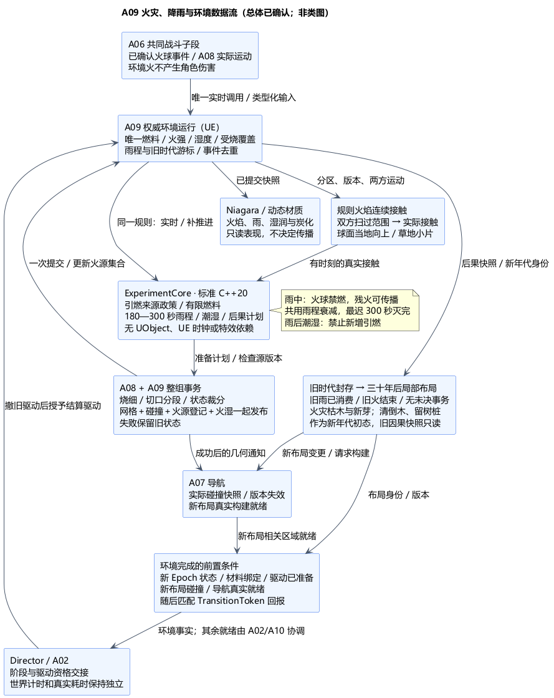
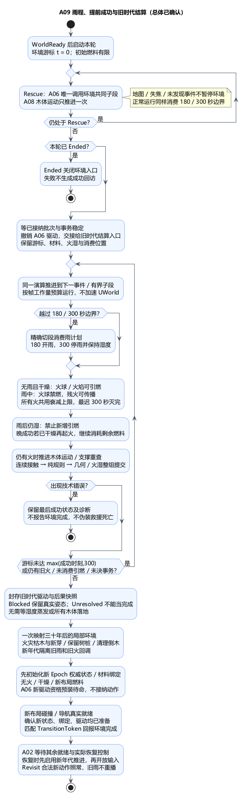

# A09：火灾、降雨、潮湿与跨阶段环境

状态：**总体方案及类图已确认**。日期：2026-11-06。承接已确认的 [A08 类图](A08-class-design.md)。技术栈、数据流、原因、两份 PUML 和六组取舍已获[总体确认](../../requirements/001-causal-prototype/sources/2026-11-06-a09-confirmation.md)，[A09 类图](A09-class-design.md)也已获[类图确认](../../requirements/001-causal-prototype/sources/2026-11-06-a09-class-confirmation.md)。下文建议描述已确认的路线及待验证实现，不表示已经实现游戏代码、冻结架构或完成 UE/GCC 编译及运行验证。

## 1. 依据与本次范围

既定要求见[需求 §6.2–6.4](../../requirements/001-causal-prototype/REQUIREMENTS.md#62-火灾与降雨)、[固定雨程](../../requirements/001-causal-prototype/sources/2026-10-30-tree-cut-projection-and-rain-schedule.md)、[跨阶段延续与雨中蔓延](../../requirements/001-causal-prototype/sources/2026-10-30-environment-continuity-and-action-limits.md)、[渐弱灭火及回访清理](../../requirements/001-causal-prototype/sources/2026-10-30-rain-and-fallen-tree-behavior.md)、[森林火不伤角色](../../requirements/001-causal-prototype/sources/2026-10-30-forest-fire-no-character-damage.md)。

固定规则：世界启动后第 180 秒开雨，第 300 秒停雨；火焰接触邻树即可传播；倒木和草可燃；雨中火球不能引燃树木，但残火可以继续传播；雨后保留潮湿。烧细不自行倒树，环境火不伤角色。提前成功仍须兑现当年的火雨后果，回访看到火灾区域枯木与新芽、砍伐树桩，倒木视为已被清理。

以下实现取舍原先由本项提出，现已获上述总体确认：树桩也沿用木材火湿规则；所有可燃对象统一雨湿政策；整场雨最迟在停雨时浇灭全部火；雨后完全干燥才重新可燃；火焰使用规则体积；草按小片处理；旧时代用同一演算补推进；回访新年代以无火、干燥及布局确定的燃料初始化，旧炭化残体不返满。本轮不增加风场、潜燃复燃、燃烧建筑、雨影遮蔽或流体求解。

## 2. 技术栈、职责与原因

| 层次 | 技术栈 / 职责 | 原因 |
| --- | --- | --- |
| 规则与数学 | ExperimentCore 标准 C++20；沿用 Linux/GCC13、CMake/CTest 路线。纯函数计算引燃资格、火强/燃料/湿度变化、雨程边界与回访计划 | 规则可独立核对，后续联网宿主仍可使用同一源码；不依赖 UE 时钟或 UObject |
| 权威环境运行 | UE5.6.1 C++，Director 下的环境职责持有本轮环境状态与推进游标；救援沿用 A06 共同子段 | 树体/角色真实运动与碰撞仍在 UE，不额外构造 Linux 世界模拟器，不开第二套火雨 Tick |
| 可燃几何与传播 | 沿用 A08 材料局部几何、已安装碰撞和运动区间；有限木材分区、草地小片；规则火焰体积的连续接触检查 | 火焰能跨过树干间的空隙，移动倒木也能传播；不用树中心距离或粒子偶然碰撞代替 |
| 烧细与砍断继承 | A08 DynamicMesh / 复合凸体事务；环境状态作为同一事务的参与数据 | 几何、剩余燃料、火焰与潮湿一起生效，砍成两段不能复制燃料或刷新燃烧时间 |
| 表现 | 提议启用 UE 内置 Niagara；火焰/烟/雨粒子、动态材质湿润/炭化，读取已经提交的状态 | 表现可调，关闭特效仍得到相同火灾结算；不以粒子数量决定伤害或传播 |
| 参数与资源 | UDataAsset 保存火焰尺寸曲线、燃料/燃烧速率、干燥时长、几何步长等；统一资源引用进入 Cook | 180/300 秒为固定规则，其余是受约束的灰盒参数，不逐个追加数值采访 |

仍保持一个 UEgame Runtime 模块；Niagara 仅在 UE 侧实际使用接口时声明依赖，不进入核心。火雨局部朝向取 A04 球面径向：火焰向当地外侧，雨向当地内侧；不直接使用世界 Z。倒木的燃烧覆盖随材料转动，火焰升起方向仍按当前位置的当地向上计算。

## 3. 唯一状态与来源区别

A09 的 UE 环境运行职责唯一持有 `RunId / EnvironmentEpoch`、雨计划消费情况、环境推进游标和火湿状态。逻辑状态按材料谱系与局部覆盖区关联，不按可见特效实例关联。每个分区记录有限剩余燃料、燃烧状态/强度、湿度、累计受烧程度与来源；草地使用有限小片，不逐根草模拟。A08 Actor 继续唯一持有实际材料形状、切口与世界姿态，Session 继续唯一持有实验阶段与计时。

其中剩余燃料是总量，切除时扣除，分段时按实际局部交集分配；火强/湿度等强度值按原覆盖继承，不能先对全树平均再分给子段。先消耗到事务边界，再对剩余量裁分，烧细已消耗的燃料不因几何移除再扣一次。已经炭化的不可燃残留仍可保留几何。有限材料分区是灰盒解析精度，不表示新增体素世界；分区尺寸和误差须能表达本轮火焰接触和烧细，不足时细化并保留谱系。

火源明确分为 `FireballImpact` 和 `ExistingFlameContact`。A06 已提交的火球命中，带 Run/Action/Impact 身份、发生时间与范围内全部实际重叠对象；A09 逐个执行雨湿资格判断。空气墙吸收火球仍不爆炸，岩炮弹不点燃，均沿用 A06。火球的角色直接伤害与使用统计留在 A06，环境拒绝引燃不能撤销它们。

**提议采用以下引燃表，统一用于立木、倒木、草与树桩：**

| 当前条件 | 火球引燃 | 现存火焰接触引燃 |
| --- | --- | --- |
| 无雨、已干燥、还有燃料 | 允许 | 允许 |
| 正在下雨，`180 ≤ t < 300` | 禁止 | 允许，但新火立即受当次雨程衰减约束 |
| 雨后仍潮湿 | 禁止 | 禁止新增引燃 |
| 无燃料 / 已经在燃烧 | 不新增火、不补燃料 | 不重复点火、不重置计时 |

树桩的可燃性已随本项确认：复用同一木材规则，保留烧黑与火湿继承，不把树桩烧没。这样砍断不会凭空熄灭原先火焰，也不需要增加一套树桩专用例外。有限燃料耗尽后可以保留无火的炭化骨架。

## 4. 火焰接触、雨程与潮湿

### 火焰接触

每个燃烧覆盖区依据已提交火强生成规则火焰体积，例如局部锥/胶囊的有限组合；体积随火强渐弱缩小。材质或粒子只显示这份结果。火焰与其他可燃材料真实相交就引燃，无额外蓄热门槛；不要求树干碰到树干。初始化重叠与持续重叠也要检查。

先用源火焰及目标材料在同一子段内**双方扫过范围**做保守筛选，再按实际相对运动、火焰尺寸曲线和材料几何细化首次接触。场景当前姿态的一次 Overlap 只能辅助筛选，不能证明过去整段没有接触；普通 Sweep 遇到第一个阻挡也不能替代“所有邻树”查询。规则不额外引入火焰视线遮挡测试，传播受明确火焰体积与可燃材料交集决定。

火焰碰到新对象时在发生时刻写入引燃事实，再演算剩余区间，不能推迟到下一渲染帧。相同时刻先固定完整来源/目标集合、按稳定身份处理；目标已燃则不重置，新增火源参加后续时间演算。新源的初始重叠按有限集合收敛，不能因遍历顺序无限重复点燃。数值误差无法判定时细分或报告错误，不把包络重叠直接当作实际点燃。

### 固定雨程与渐弱

`t` 是从本轮 WorldStartedAt 起算的旧时代环境秒。正常救援以世界运行秒推进；TimeSkip 使用继承同一位置的环境结算游标，绝不改写 A02 的真实耗时或世界时刻。

雨窗是 `[180, 300)`。共同子段必须在开雨/停雨边界切开；恰好 180 秒先开雨再判断引燃，恰好 300 秒先完成灭火与停雨、保留湿度，再判断新输入。不会依赖引擎 Timer 回调与火球回调谁先执行。

提议全场共享雨中火强上限：

`RainCap(t) = clamp((300 - t) / 120, 0, 1)`。

雨中每段已有火强更新可取 `I1 = min(I0 × exp(-kRain × Δt), RainCap(t1))`，仍同时受剩余燃料约束。新传播火初值不超过发生时的 RainCap，后续沿用同一衰减；重复接触不提高已有火强。180 秒不会突然归零，300 秒上限才归零。由此既保留雨中残火传播窗口，也保证新火、分段和重入不会不断重置“两分钟淋雨”。参数 kRain 为有限正数；实际火焰曲线可以调，但必须遵守这两个边界和单调减弱。

燃料在燃烧期间严格减少，无雨时可按配置成长/维持火强，有雨则服从上述衰减。不让“达到树干结构下限”变成永远燃烧：不可燃残留和燃料分开记录。无输入后有限燃料必然耗尽，后续章节说明晚成功的收口。

### 雨后潮湿

提议在降雨期间将可燃区湿度维持为 1；雨停后按正的干燥时长 `TDry` 递减，例如 `W(t) = max(0, 1 - (t - 300) / TDry)`，完全干燥才重新接受引燃。砍断或分段不重置这份时间，既有湿区裁分到各子体。不同材料可配不同 TDry，初版没有屋檐雨影与额外干燥风场。

三条政策独立：雨中火球禁燃、雨中火焰特许传播、雨后潮湿禁新增引燃。不能先用 `W > 0` 拒绝所有来源，再让雨中传播规则永远失效。

## 5. 数据流、步序与 A08 事务

1. A06 在共同战斗子段中交付已确认火球事件；A08 提供该段木体实际运动与材料版本；A04 提供球面参考。A09 不重复推进 A08 木体。
2. 环境边界先切分天气时刻，再查询所有火焰接触；Mapper 把版本化纯值交给核心，得到引燃、燃料/火湿变化、烧细及后果计划。旧 Geometry/Pose/EnvironmentRevision 的查询结果不能直接提交。
3. 只改变火湿数据的计划也在有版本检查的环境提交点生效。涉及烧细、砍断或分段时，环境成为 A08 整组事务的参与者，先准备状态与注册集合，再切换真实网格/碰撞。
4. 一个短提交屏障内，A08 材料/形状/身份、A09 局部分区/燃料/火湿/活动火源登记，以及需要时 A06 刀预算与实际剑前缀一起发布。所有分配和可失败验证在发布前完成；父退役、子绑定、原 Actor 转树桩均包括在内。成功后才发导航变化、环境观察通知和表现更新。
5. A06 整批稳定快照形成后，Session 才决定是否离开救援。已提交环境后果保留；未提交切削不能越过阶段边界补做。环境火没有 Combatant 扣血或伤害事件入口。

这是已确认的 A08 接口扩展方向，具体签名在 A09 类图单独确认：A08 的事后材料分区通知仍可给观察者使用，但**不能靠事后通知才创建权威火湿状态**。准备阶段就冻结源环境版本，按材料交集建立候选；提交屏障内的发布不能再触发可失败的分配或外部回调。失败整组保留旧状态、旧火源绑定与旧碰撞；不会先提交新木段，再补算继承。

烧细标记为 Burn 原因，复用 A08 的 PrepareShapeChange / CommitShapeChange，不能触发剑切 >80% 倒树判定。连接下限与角色支撑保护可将这次几何收缩合法钳制为部分或零变化，燃料仍可继续炭化为不燃残留；实际几何不伪造达到请求厚度。只有这种已知规则钳制允许两者不同步，构建失败、状态过期或碰撞校验失败不能冒充正常钳制。

真实失败返回诊断并停止该环境步骤的成功发布，Director 不宣布环境/回访就绪；已成功提交的历史不回滚，不把技术错误伪装成救援死亡。错误恢复和手动重启沿现有生命周期处理；重试从最后已提交游标及原身份开始，不吞掉未消费事件，不重复结算已消费事件。正常运行中烧细只在共同子段的提交边界改变形状，区间内使用其对应的有效版本；精度由最大子段/收缩量限制验证。

## 6. 提前成功、晚成功与回访

### 单一驱动交接

救援期间 A06 是共享世界步的唯一调度者，A09 是被调用的环境推进职责。进入 TimeSkip，Director 先关闭旧阶段新攻击接纳、等当前已接纳批次和环境事务稳定，再撤销 CombatWorld 驱动资格，把最后已提交游标、事件消费位置及 `RunId＋EnvironmentEpoch＋DriverGeneration＋StepSerial` 交给 A09 旧时代结算入口；具体宿主类在下一轮类图设计。

旧时代结算仍用同一规则、真实材料和 A08 运动查询，每个现实帧按工作量预算处理若干环境子段。推进途中仍按事件时刻切分，不把 20→300 秒一次粗算，也不拉高整个 UWorld TimeDilation。回访布局在旧时代结算完成后才替换相关对象；此前不得并发修改它们。现存角色支撑/障碍从交接时权威世界读取并在结算期间保持明确有效；不会先假定角色都消失，使木体穿过原有支撑约束。

地图打开、失焦、离开森林不改变世界推进资格。Preparing 不运行旧雨程；未发现小孩的 Rescue 仍正常运行。Ended 停止环境入口和旧就绪回调，等待手动重启；失败不会补造成功回访。

### 可结束的旧时代结算

环境完成须同时满足：

- 游标至少达到 `max(救援结束时旧时代位置, 300 秒)`，固定雨计划已经完整消费。
- 没有活动火焰，没有未消费的已接纳引燃事实，没有未完成几何/环境事务；最后一段传播与烧细已经提交。
- 旧时代推进资格已封存，生成只读后果快照；其版本匹配本次 TransitionToken。

若第 20 秒成功：继续模拟传播到 180 秒，雨中继续允许残火传播，最迟 300 秒熄灭，然后封存。若第 300 秒后玩家等到干燥又点火再成功：不能倒退时间或认为“雨已经下过所以没有火”，必须继续到实际旧火结束。

晚成功的终止依赖有限材料和不可再生燃料。进入结算后没有新攻击、没有长出新可燃植物，也没有潜燃自燃；每个燃烧区配置有限正消耗速率，重复引燃与分段不能补燃料。有限区集合持续有火时，总剩余燃料严格减少，可由总量及有效最小消耗速率给出结束上界；超过核验上界属于错误，不能强行截火报成功。无火区间可跳到下一个必需雨程边界，但不得跳过木体运动/事务可能影响仍在燃烧的区间。

旧火存在期间，仍推进已接纳的木体运动和支撑重查，因为移动会改变火焰接触。火已结束、最后事务处理完后，受阻木段可按真实 Blocked 状态封存，技术上的 Unresolved 则必须返回错误，不能冒充正常受阻或完成。封存不要求每根木头落地，也不等待残留湿度蒸发；回访本来就要清理倒木。没有必需环境事件后不再为“等三十年”运行模拟。

### 三十年后的环境映射

保存的是当年的实际受烧覆盖、累计严重度、砍伐树桩、最终材料/火湿状态及版本。由这份快照产生静态回访布局：火灾影响区域安排枯木与新芽，砍伐处保留树桩，倒木/分段视为人工清理；按实际受烧/砍伐位置生成，不能把全森林统一替换成灾后模板。原健康区域保持原方案，砍树只产生局部影响。

静态布局指一次生成新年代初态，不是冻结回访中的森林。A08 仍拥有实际木材/切口/姿态，A09 按新 Epoch 持有火湿与材料绑定，旧后果快照保持只读。新年代初始无火、干燥；新生植物按布局配置燃料，保留的旧炭化残体不返满燃料。Director 撤销旧结算驱动、用新 Generation 预装 A06 的唯一实时推进资格；TimeSkip 期间保持待命，不能接纳新动作或与旧结算同时推进。

**新 Epoch 的权威状态、材料绑定、布局碰撞、相关 A07 导航和实时驱动准备全部完成后**，才以匹配的 TransitionToken 回报 A02 的环境完成事实。不能先 NotifySkipReady 再初始化新年代，也不以发出构建请求代替完成。角色/NPC 布置、过渡表现和实际恢复控制仍按 A02，由 A10 继续细化；全部就绪后，Director 在恢复控制交接中启用新年代实时推进，再开放可执行输入。

按当前合法能力接纳的新火球/砍击继续走同一接触与事务链，不重播旧 180/300 秒雨，也不增加新的天气循环。这样承接 A05 的 Rescue/Revisit 输入边界，具体能力和剧情限制仍由 A06/A10 校验；回访新行为不能改写已锁定的救助分支或旧时代因果快照。旧雨计划和火源不能迁入回访年代，新的年代身份隔离旧回调。剧情 +30 年是一次布局映射，不伪造等待时间、不模拟三十年气候。

## 7. 生命周期、验证与取舍

手动重启先失效旧 Run/Epoch/驱动和 TransitionToken，停止事务入口，解除火源/粒子绑定，排空旧导航工作，再通过环境唯一复位入口协调 A08 恢复初始木体、草片与初始天气。状态重建、资源、碰撞和导航全部就绪才 WorldReady。每个对象只被自己的唯一复位职责处理一次，日志继续保留。

本机 UE5.6.1 只读核对，路径相对 `G:/Epic Games/UE_5.6/Engine/`：`Plugins/FX/Niagara/Source/Niagara/Public/NiagaraComponent.h:491、518、536、566` 提供向量/浮点/布尔参数与 ResetSystem；`Source/Runtime/Engine/Public/Materials/MaterialInstanceDynamic.h:24、109` 提供标量/颜色参数。存在这些接口不等于球面粒子资源、Cook 引用或性能已验证。

后续最小核对：179.99/180/300 秒边界；雨中火球拒绝但残火传播；晚点燃不刷新雨程；雨后湿度阻燃与恢复；移动/旋转倒木双方连续接触；同刀切开燃烧区后燃料守恒、火湿继承、父子登记原子切换；烧细连接与支撑钳制；早成功和雨后再次点火的晚成功；连续运行与分帧补推进在相同输入/事件序下结果一致；地图/失焦不停环境；重启无旧火雨回调；三十年后局部因果痕迹及导航可达。纯 C++ 检查不能替代 UE 真实几何/碰撞和打包运行。

当前仅文档与本机接口核对，未进行 UE/GCC 编译或运行验证。火焰连续接触、规则体积与画面一致性、同步几何成本、旧时代推进上界、状态转移原子性及打包均保留待验证风险。

| 本次确认组 | 建议方案 / 代价 |
| --- | --- |
| 技术路线 | C++20 纯规则＋UE 权威环境与几何＋Niagara/材质表现；需要维护显式适配与版本 |
| 可燃对象与接触 | 立木、倒木、草片，树桩也统一可燃但保留残体；用规则火焰接触传播，需要校准粒子和规则轮廓 |
| 雨中规则 | 火球不引燃、残火可传播；所有火共用雨程衰减，最迟 300 秒灭完，牺牲雨停后残火继续烧的表现 |
| 潮湿与燃料 | 所有可燃对象统一雨湿政策；雨后完全干燥才可再燃，有限燃料不因重复接触/分裂补充 |
| 几何一致性 | 火湿/燃料成为 A08 事务参与者；烧细保连接/支撑，不自动倒树；同步发布增加实现与性能验证成本 |
| 跨阶段结果 | 同一演算补完旧雨和旧火，再一次映射三十年后；受阻木体如实封存，回访清倒木、留树桩和火灾痕迹；新年代实时推进不重播旧雨 |

[总体 PUML](A09-fire-rain-and-environment.puml) · [结算 PUML](A09-environment-settlement.puml)。总体及 [A09 类图、接口及数据归属](A09-class-design.md)均已确认，继续 [A10 总体](A10-revisit-and-narrative.md)。
