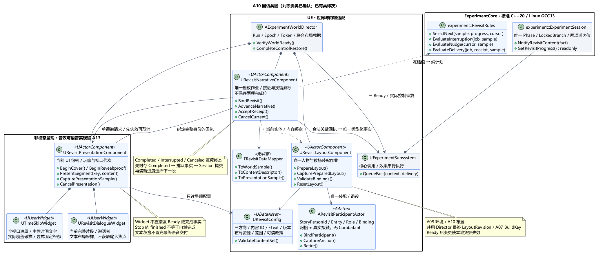
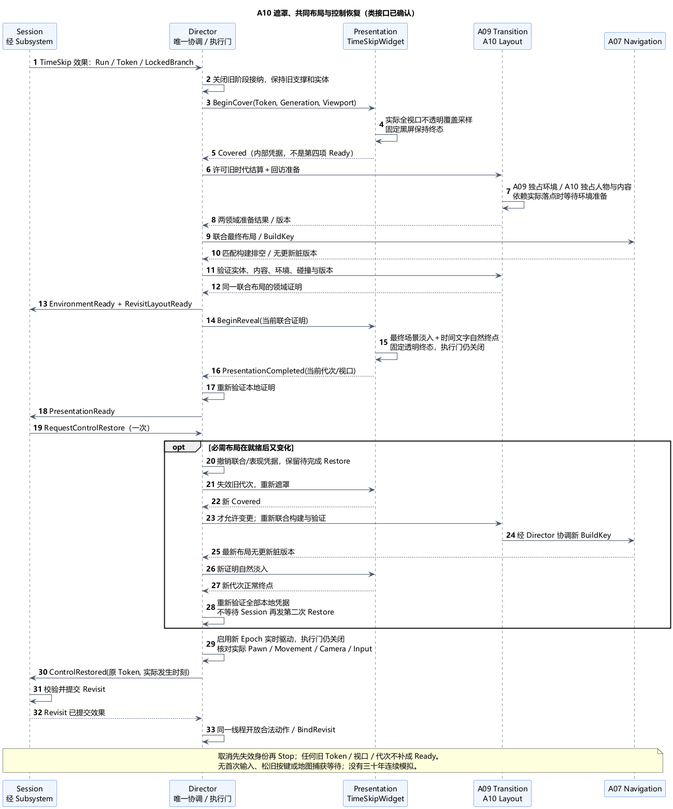
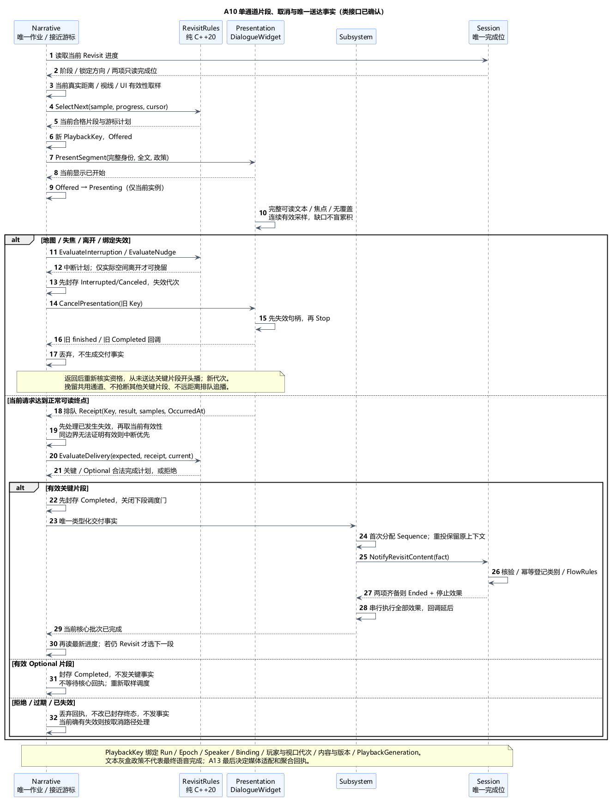

# A10 类图：回访装配、内容作业与呈现回执

后续维护：A11 总体与类图现已确认；依[最新用户调整](../../requirements/001-causal-prototype/sources/2026-11-06-audio-voice-order-change.md)，[A13 音效与语音](A13-audio-and-voice.md)提前至 A12 前。以下 A10 确认时的顺序描述保留为阶段语境；TextGraybox 是历史灰盒政策，A13 默认语音字幕/主动静音/故障降级总体及 [A13 类图](A13-class-design.md)的具体扩展接口均已确认。

状态：**类图已确认**。日期：2026-11-06。[类图确认原文](../../requirements/001-causal-prototype/sources/2026-11-06-a10-class-confirmation.md)确认具体类、值结构、调用顺序和三份 PUML；[A10 总体](A10-revisit-and-narrative.md)及六组取舍此前已获[总体确认](../../requirements/001-causal-prototype/sources/2026-11-06-a10-confirmation.md)。尚未实现或正式冻结。继续 A11 总体，音效与语音仍留最后的 A13。

## 1. 技术栈、类职责与原因

沿用标准 C++20 / Linux GCC13 的 ExperimentCore、UE5.6.1 C++、UDataAsset/FText 和非模态 UMG，一个 UEgame Runtime 模块。本项已确认 **9 个职责类**，另扩展既有 Director、Session 和适配器；普通值结构不计为行为类。

| 类 | 层 / 所属对象 | 职责与主要接口 |
| --- | --- | --- |
| `URevisitConfig` | UDataAsset | 三方向内容、关键片段标签、教场/人物资源、当地布局、范围迟滞和可读时长；`ValidateContentSet`，运行中只读 |
| `URevisitLayoutComponent` | Director 默认子组件 | 唯一装配回访人物/教场、实体与内容绑定；`PrepareLayout`、`CapturePreparedLayout`、`ValidateBindings`、`ResetLayout`；不装配 A09 森林 |
| `ARevisitParticipantActor` | AActor | 教师或群众的实体、网格/接触代理与剧情身份；`BindParticipant`、`CaptureAnchor`、`Retire`；没有 Combatant、生命、攻击或玩家输入 |
| `URevisitNarrativeComponent` | Director 默认子组件 | 唯一接近/相见会话、单通道内容作业和挽留机会；`BindRevisit`、`AdvanceNarrative`、`AcceptReceipt`、`CancelCurrent`、`ResetNarrative` |
| `URevisitPresentationComponent` | Director 默认子组件 | 唯一 UI 请求与有效性采样入口；`BeginCover`、`BeginReveal`、`PresentSegment`、`CapturePresentationSample`、`CancelPresentation`；关联正确作业回执 |
| `UTimeSkipWidget` | UUserWidget，由 Presentation 持有 | 全视口遮罩/中性时间文字/淡入淡出；只输出当前动画和覆盖采样，不直接发 SkipReady |
| `URevisitDialogueWidget` | UUserWidget，由 Presentation 持有 | 显示当前片段完整文本/说话者，输出布局、可见和可读区域采样；不取焦点、不写完成事实 |
| `FRevisitDataMapper` | UE 无状态工具 | 世界/内容/UI 采样与纯值转换；处理 UE 厘米到核心米、身份与内容元数据，不做分支或送达判定 |
| `experiment::RevisitRules` | 纯 C++20 无状态 | `SelectNext`、`EvaluateInterruption`、`EvaluateNudge`、`EvaluateDelivery`；输入事实与作业快照，输出启动/取消/提示/可交付计划，不访问 UE |

Director 继续唯一协调三项就绪、Run/Epoch/TransitionToken、实体预留、最终布局版本和控制恢复；Narrative 不再成为第二个 Director。Subsystem 持有一个 Session 并串行提交事实/执行效果。Session 继续唯一拥有阶段、锁定方向、两项送达位及结果。FlowRules 继续判定两项齐备后的结束，不迁给 RevisitRules。

拆分理由：Layout 只改场景，Narrative 只排内容，Presentation 只证明当前如何呈现；纯规则可以脱离引擎输入固定样本核对。两种 Widget 是具体视图，不为三套台词引入通用对话树、任务系统或新模块。未来 Linux/Docker 可运行相同规则，但实际位置、碰撞及媒体呈现证据仍由宿主提供，不声称核心能证明玩家已理解台词。

## 2. 唯一状态与值契约

| 值结构 | 持有者 / 契约 |
| --- | --- |
| `FRevisitLayoutJob` | Layout：Run/Token/Epoch、锁定方向、LayoutRevision、内容清单和准备对象。只存本次装配进度，不复制 Phase 或环境结算游标 |
| `FRevisitParticipantBinding` | Layout：StoryPersonId、EntityId、Role、Epoch、BindingRevision、弱 Actor 绑定；教师沿用小孩剧情身份，实体是新年代新身份 |
| `RevisitContentDescriptor` | Config 映射后的不可变纯值：ContentId/SegmentId/ContentRevision、Branch、SpeakerRole、KeyKind 或 Optional；文本资源留 UE |
| `FRevisitWorldSample` | 当前游戏线程瞬时值：实际玩家/人物身份、位置距离、教师视线、地图/焦点状态、采样序号与时刻；不是长期可写世界副本 |
| `RevisitInteractionCursor` | Narrative：当前相见/内外圈迟滞、ApproachGeneration、挽留是否已消费与重试资格；纯规则输出下一游标，UE 依次应用，不包含两项送达位 |
| `RevisitPlaybackJob` | Narrative：当前唯一内容请求、状态 Offered/Presenting/Completed/Interrupted/Canceled、PlaybackGeneration、关键/可选类别、最近有效性依据；不保存另一套剧情完成进度 |
| `FRevisitPlaybackKey` | 值身份：RunId、EnvironmentEpoch、SpeakerEntity、BindingRevision、当前 PlayerBindingKey、ViewportGeneration、ContentId、SegmentId、ContentRevision、PlaybackGeneration；一次重播生成新代次，重复投递沿用旧身份 |
| `FPresentationHandle / FPresentationSample` | Presentation：与 PlaybackKey 绑定的当前显示句柄、单调 SampleSerial、实际采样时刻、完整文本布局/有效覆盖/焦点及连续可读区间；无权写实验进度 |
| `FRevisitPresentationReceipt` | 上述完整 Key、媒介政策版本、正常完成或中断/取消原因、发生时刻、采样依据；不能只有一个布尔 finished |
| `FRevisitWorldReadyProof` | Director：Token/Epoch、A09 OutcomeRevision、联合 LayoutRevision、ContentRevision、A07 BuildKey 与本地有效代次；取样时无更新脏版本，任一必需变更即失效 |

核心值使用标准容器/可选值/向量与稳定 ID，不含 FText、UObject、资产路径、UE 反射宏。UE 只在真正需要反射时提供 DTO，不机械复制全部核心结构。距离沿 A04 球面/局部表示，近距采用实际同一空间定义的配置范围，教师视线是 UE 世界查询；不将世界 Z 当作当地高度。

内容目录在准备期校验唯一 ID、三方向语义、关键片段角色、版本、文本可用及整段可读布局。每类恰有一个独立表达语义的必要片段；铺垫、课程背景和挽留都是 Optional。配置修订绑定新版本和新作业，不能在播放末尾换文本却沿用旧可读时间。资源缺失不能用空串正常完成。A13 的声音可用性与最终完成政策尚未纳入当前灰盒就绪凭据。

## 3. 场景装配与三项就绪

Director 执行 A02 的跳时效果时，先登记同一 Token 下的各项待办；准备请求可以到达，但实际世界变更必须等待 Presentation 的有效遮罩凭据。A09 旧时代结算的驱动接管/角色与支撑冻结照旧，**未遮住前不泵送可见世界变化**。遮罩不是第四个 Session Ready。

1. `BeginCover(Token, PresentationGeneration)`：关闭旧内容/地图呈现，建立最高所需层级的不透明全视口遮罩。验证当前本地玩家视口、尺寸/缩放、覆盖矩形和不透明度，确认对应画面已经进入实际视口绘制；动画启动、任意 Tick 或仅 IsVisible 都不足以返回 Covered。窗口/视口重建撤销凭据，未再次覆盖前不进行后续可见变更。
2. Covered 后，Director 许可 A09 `BeginSettlement/PumpSettlement`，并令 Layout 根据已锁方向准备教场、群众和教师。装配所需环境落点依赖 A09 新布局时，先等待其准备结果，再完成相应对象；不能先报告全体就绪。Scene Actor 只在 A04 活动区内产生，非活动区仍不建模。
3. Layout 经 Director 预留新实体、绑定径向姿态和真实碰撞，校验镇上玩家落点与接近路线；不复制小孩 Actor/HP。教师与群众先只作有效站位/授课表现，不启动游走 AI 或社会模拟。相见/内容触发直到 Session Revisit 才获资格。
4. Layout 与 A09 都提交准备结果；Director 汇集最终版本，协调 A07 对所有相关场景/环境源发布和实际排空构建。A09 仍负责自己的材料/环境有效性，Layout 负责人物/内容/落点；两者用**同一个联合布局 BuildKey**复核。两份领域证明和导航均有效、无新脏版本，才经 Subsystem 报既有 EnvironmentReady 与 RevisitLayoutReady。
5. Director 保留输入执行门关闭，令 `BeginReveal(Proof)`；最终场景已完整后才淡入。Presentation 只在当前请求正常到达时间文字/淡入终点且覆盖/视口条件仍匹配时返回 PresentationCompleted。遮罩保持期间显式固定不透明终态，揭示结束显式固定透明终态，不能让动画自动恢复初始值造成漏画面或重新黑屏。Director 复查证明后经 Subsystem 报第三项 Ready。主动 Stop、资源错误及失效回调不合格。
6. Session 收齐三项发一次恢复请求。Director 按 A09 启用新年代实时驱动但不接纳攻击，核对实际占有/径向 Movement/相机/输入绑定，采样 ControlRestored。Session 接受后提交 Revisit，Director 在同一游戏线程开放动作并 `BindRevisit`；Narrative 不能以淡入完成直接启动教师台词。

**脏版本与恢复竞态：**报告过 Ready 也不等于永久有效。若淡入或恢复前发生必需布局变更，先失效 Director 的联合证明及本次呈现代次，保持执行门关闭；再次遮住后才能实施新的世界变更，然后重新执行联合验证和自然淡入。Session 已收的 Ready 位不单独授权世界开放。若恢复请求已经发出，Director 保留该未完成请求，待最新三份本地凭据重新有效再完成它，不能要求 Session 再发一次而死锁，也不能借旧事实恢复。技术错误留在未完成诊断，A11 细化人工重试。

跳时作业不是新的实验阶段；Layout 无独立 Tick，Presentation 使用 UI 更新/采样，Narrative 仅在 Revisit 由 Director 后置调度，每帧/必要事件重新取样；环境仍由 A09 唯一驱动。没有全局 TimeDilation、三十年连续模拟或新世界副本。

## 4. 内容候选、挽留与回执顺序

数据流：真实空间/UI 采样 → Mapper → RevisitRules → Narrative 应用一个有序计划 → Presentation → 版本化回执 → Narrative/Rules 校验 → Subsystem → Session 唯一登记。

`AdvanceNarrative` 在本帧世界位置和 UI 状态确定后取样，读取 Session 的只读回访进度。空通道时，当前合格且未送达的教师关键片段优先，然后是群众关键片段；合格性在真正启动时再次检查。普通候选不能抢断正在正常播放的关键片段。完成或中断后重新查仍在范围内的人物，不依赖新的 BeginOverlap；已完成群众内容不抢占未完成教师回忆。

教师无遮挡相见形成当前 ApproachGeneration。纯规则根据内圈进入/外圈离开、现有相见证据和重试资格给出挽留计划；只有**空间离开**且仍在提示外圈、视口和焦点有效、教师回忆尚未送达时，才消费本次机会。地图/失焦/重置不等于空间离开。教师片段因离开中断时先取消它，再尝试一次短提示；其他关键片段在播时不抢占，提示可以错过，不排成离开很远后的延迟喊话。提示不含足以代替教师回忆的完整关键因果片段。

相见视线用于教师启动资格；保持播放仍需当前片段有效范围/人物/视口条件。具体保持期视线门槛由配置明确，不从一次无效引用推断教师死亡。返回时再核实相见与当前资格，从未送达片段开头生成新 PlaybackGeneration；不累计上次中断前的半段完成时长。已送达位只读 Session，不重复清空或补写。

**同一帧末尾离开和 Finished：**UMG 回调只排队，不直接登记。Narrative 在有序处理点先应用已经发生的失效/取消，再验证当前空间/UI 样本和回执所证明的连续有效区间；无法证明末段有效则中断，不用处理顺序抢成 Completed。每个完成时刻保留真实 OccurredAt，不用下一帧处理时刻改写。处理核心效果时产生的同步回调依 A03 延后，不能重入核心；完成第二类时，先提交 Session 的 Ended 与停止效果，再考虑任何下一片段。

`CancelCurrent` 先把作业置 Interrupted/Canceled、撤销旧代次，再调用 Presentation 的 Stop。Presentation 也先撤销句柄再 StopAnimation/卸载 Widget；随后晚到的 finished 只属于旧实例。新 Start 不能复用旧代次。重复完成回执只会产生一次同身份的交付事实。

## 5. 文本灰盒交付、核心提交与 A13

Presentation 的文本采样必须关联当前片段全文：说话者/完整关键文本在当前玩家视口可读区域内，不裁切/省略、不被地图/遮罩覆盖，有焦点，前后样本持续有效。任意布局/内容/视口版本改变会重新验证；失效区间不累计，可读停留不是单纯动画时长。窗口失焦、地图覆盖等事件即时撤销资格；跨长帧或采样缺口不能凭两个有效端点推断中间一直可读，应重建连续有效区间或中断。没有“计时器到点就算看过”。

`RevisitRules.EvaluateDelivery(ExpectedJob, Receipt, CurrentSample)` 验证完整身份、自然终态、关键语义标签、分支、内容版本和当前媒介政策所需证据。Presentation 不直接选择 CrowdLearning/TeacherRecall；标签从已验证内容清单取得，不能由 Widget 自报。普通片段和挽留即便 Completed，也不会产生关键事实。

合法关键片段完成时，Narrative 先将当前作业封存为 Completed，再经既有 Subsystem 产生扩展的 `RevisitContentFact`：A02 公共 Context、类别、完整 PlaybackKey 和政策版本。Completed/Interrupted/Canceled 都是互斥终态，迟到的开始或结束回调不能复活作业。一次回执首次转为事实时分配 Sequence 与原完成时刻，重复发送复用；Session 校验 Run/当前 Revisit/类别/身份一致性并幂等登记。Narrative 等该事实完成核心处理及效果执行后，才读取最新投影、释放调度门并选择下一片段，避免第二项刚送达就抢播第三段。合法 Optional 完成只封存播放作业，不生成关键事实，也不等待不存在的核心回执；在有序处理点直接重新取样并选下一片段。拒绝/过期回执不改变已封存终态、不发事实，当前确有失效则按取消路径处理。Session 不复制 UI 计时器或 Actor 绑定；真实呈现证明由受信任 UE 适配边界核验。两项完成后仍调用既有 FlowRules，唯一生成最终结果，日志交 A11。

本次 `TextGraybox` 政策只用于文本原型验证；不命名为最终产品媒体完成政策。A13 将明确语音/字幕/音效的配置和聚合回执、打包与验证要求，并相应修订 Presentation 和政策版本；不新增第二条可写完成进度，也不能将声音开始播放直接算送达。音效/语音选择尚未确认，不能据当前文本路径宣称 A13 已完成。

## 6. 真实接触、所有权与复位

`ARevisitParticipantActor` 用网格与胶囊/明确代理提供真实接触，按 Root 径向放置，固定在配置锚点；可以播放只读站立/授课表现，不启用根运动、Chaos 位移或未受控导航。Layout 是人物装配/退役唯一入口，场景 Actor 生命周期由 UWorld 管理；Layout 持带实体身份的弱引用，构造/准备阶段所需资源由显式强引用保活。

对 A06 的本次接口扩展为：CombatWorld 的几何候选登记允许 `StoryParticipant` 接触类别，携带稳定 Entity/BindingRevision 和查询代理，但没有 Combatant/HP。ContactSampler 不以“存在 Combatant”作为弹体候选前提；弹体照既有首接触 `EndOnce`，火球范围伤害仍只提交给合法受伤目标，环境引燃仍交 A09。剑接触此类对象只拒伤，不缩短有效剑轨迹、不终止挥动，不新增硬阻挡；其他目标仍按原多目标规则处理。普通玩家通行碰撞和 A07 导航源由同一几何绑定派生，不能为了免伤一律 NoCollision。

Config 与默认子组件、两个 Widget 用反射强引用；跨 Director/Root/玩家/人物用弱引用加 Run/Epoch/Entity/版本校验。Blueprint 只设置资产、布局和显示，不自行写完成位、换分支或发 Ready。所有规则/作业提交在游戏线程，异步导航沿用冻结快照，不新增后台剧情线程。

生命周期分三条路径：

- **Ended：**Director 关闭玩法推进与完成回调接纳资格，Narrative 失效作业/机会，Presentation 失效句柄后停止当前片段；保留结束现场和最终结果，不退役回访场景来恢复救援，不调用 ResetEnvironment，不建立新轮，等待用户手动重启。
- **手动重置：**先失效旧 Run/Epoch/Token 和所有作业/句柄；Layout 解除 A06 查询登记/内容绑定并退役回访人物/教场。A07 构建取消和实际排空由 Director 唯一协调；A09 环境只走 `ResetEnvironment`，玩家/救援实体走既有入口，Session 为新轮独立初始化，等准备就绪才重新计时。Layout 不重复清理森林；同一复位请求幂等，日志保留。
- **世界卸载：**先失效所有身份和回调，再解除登记并清理对象；只销毁，不重建救援世界或自动开启下一轮。A11 细化异常/重试与错误显示，不改变手动复测约束。

## 7. 验证边界与确认范围

本机 UE 接口依据沿用 [A10 总体 §8](A10-revisit-and-narrative.md#8-本机证据与待验证内容)：DataAsset/FText、UserWidget 屏幕呈现与焦点、可见性检查局限、Stop 也会引出动画 finished。补充核对 `UMG/Public/Blueprint/UserWidget.h:1192` 的 PlayAnimation 返回 `FWidgetAnimationHandle`，本版不使用旧式 `UUMGSequencePlayer*` 签名；`WidgetAnimationState.cpp:216–236、330–361、570–614` 显示正常终点与 Stop 都会进入 OnStopped，可能恢复动画前状态再广播完成，所以要校验请求并固定实际终态。路径相对本机 UE 的 Runtime 目录。本文的联合就绪、Covered、可读采样和版本化回执均为项目需实现的契约，不声称 UE 自带这些可靠性保证。

当前仅文档与本机接口核对，未进行 UE/GCC 编译或运行验证。实现后核对：黑屏实际覆盖前零可见变更；合并布局脏版本/旧 BuildKey；淡入中改布局与恢复请求只发一次；两类内容先后/重复；末帧失焦/离开/Stop；重播代次；窗口/视口和文本重排；教师识别、挽留迟滞与不中断其他关键片段；正常移动/地图/施法松键；剧情人物剑与弹体接触；失败后复位；A13 最终媒体政策。不能以这些文档检查替代运行和因果体验验收。

[类图 PUML](A10-class-design.puml) · [跳时握手 PUML](A10-transition-handshake.puml) · [内容回执 PUML](A10-playback-receipt.puml)。九职责类、唯一状态、值契约、联合就绪与单通道回执、受保护剧情人物接触及分离结束/复位/卸载均已确认。继续 [A11 快照保存与恢复总体](A11-checkpoint-save-and-recovery.md)；该修订对同轮技术恢复、播放/就绪凭据重建的扩展见其影响表，尚待总体及后续类图确认。A12 验收/交付之后最后讨论 A13 音效与语音。
