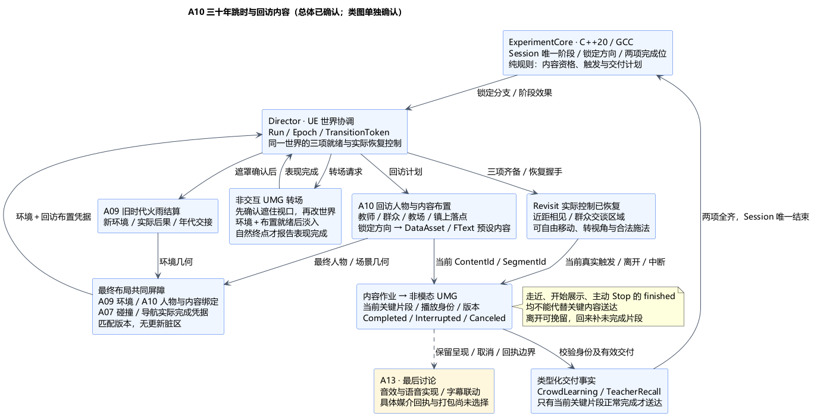
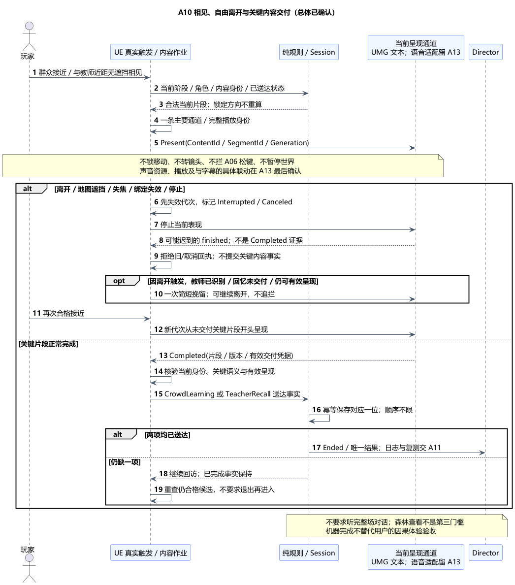

# A10：三十年跳时、教师方向、群众闲聊、揭示与挽留

后续维护：A11 总体与类图现已确认；依[最新用户调整](../../requirements/001-causal-prototype/sources/2026-11-06-audio-voice-order-change.md)，[A13 音效与语音](A13-audio-and-voice.md)提前至 A12 前。以下 A10 确认时的顺序描述保留为阶段语境；A13 最终媒体政策及[具体类接口](A13-class-design.md)均已确认，当前进度见[本轮汇总](ARCHITECTURE-SUMMARY.md)。

状态：**总体方案与类图均已确认**。日期：2026-11-06。[总体确认原文](../../requirements/001-causal-prototype/sources/2026-11-06-a10-confirmation.md)确认技术栈、数据流、原因、两份 PUML 及六组明确取舍；[A10 类图](A10-class-design.md)随后获[单独确认](../../requirements/001-causal-prototype/sources/2026-11-06-a10-class-confirmation.md)。尚未实现或正式冻结架构。

依据：[需求 §3、§4、§7、§9](../../requirements/001-causal-prototype/REQUIREMENTS.md)、[教师与科目](../../requirements/001-causal-prototype/sources/2026-10-30-rescued-teacher.md)、[学习风气](../../requirements/001-causal-prototype/sources/2026-10-30-learning-culture.md)、[不干预意味着看不见变化](../../requirements/001-causal-prototype/sources/2026-10-30-nonintervention-visibility.md)、[三十年回访原文](../../requirements/001-causal-prototype/sources/2026-10-31-revisit-and-learning-scope.md)、[快速原型边界](../../requirements/001-causal-prototype/sources/2026-10-31-rapid-prototype-analysis-boundary.md)。

**最新安排：**[音效和语音](../../requirements/001-causal-prototype/sources/2026-11-06-audio-voice-last-architecture.md)纳入最后的 A13。本项只约定剧情内容、文本呈现、触发和内容交付接口；不提前选择录音/TTS、音频插件、声音资源、空间播放、混音或语音与字幕的具体同步方案。A13 完成后回填相应验证项，不能把灰盒文本展示记为语音已经完成。

## 1. 已确认边界与本次提案

已确认：仅救援成功进入跳时；剧情增加三十年，玩家年龄与剩余寿命不变；玩家看不见中间成长过程，从镇子恢复行动。Session 在救援结束时锁定教师方向，群众闲聊呈现相应学习风气，教师本人相见后提起当年救援，离开会被挽留。成功结束仅需两类关键内容已送达，顺序不限，不要求听完整场对话或参与学习，不锁定玩家移动。

本次已确认取舍：同一 UWorld 内遮罩转场与预设回访布置；群众接近自动触发、教师近距无遮挡相见触发；关键片段可中断/补播；一条主要剧情呈现通道；教师与群众为不可受伤的剧情参与者，不引入教师被杀支线；通过场景布局呈现森林后果，不增加第三个完成条件。具体距离、停留时长、台词、人数及摆放数量仍留灰盒调参。

## 2. 技术栈、职责与原因

| 层次 | 方案 | 原因 |
| --- | --- | --- |
| 核心 | ExperimentCore 标准 C++20，沿用 Linux/GCC13；纯规则选择当前可用内容、触发/中断/补播计划，Session 唯一提交阶段和两项完成事实 | 剧情规则可独立核对，后续可由服务端核验，不依赖 UMG 或音频对象 |
| 世界适配 | UE5.6.1 C++；Director 协调已有 A09 环境作业、回访人物装配和三项就绪 | 同一实验世界转换，不另建三十年社会模拟或并行世界 |
| 内容配置 | UDataAsset、FText、稳定 ContentId/SegmentId、角色与场景资源引用 | 三个预设方向足够本轮实验；内容修改不重写流程，核心只处理 ID 与语义标签 |
| 转场表现 | 非交互 UMG 全屏遮罩、时间文字、简单淡出/淡入 | 遮住中间世界变化，不接管玩家相机，不需要额外剧情编辑器或演出框架 |
| 对话表现 | 非模态 UMG 文本与说话者标识；内容作业输出版本化呈现请求，接收 Completed/Interrupted/Canceled 回执 | 玩家仍能移动/转视角；开始展示与内容真正交付分开 |
| 音效与语音 | A13 最后单独确认，只保留内容请求/取消/完成适配边界 | 遵守最新讨论顺序，不把文本计时冒充最终声音完成条件 |

仍使用一个 UEgame Runtime 模块；不为三条教师路线引入通用任务树、对话插件、云端生成台词或完整教学模拟。Blueprint 可承载布局与表现资源，不单独决定成功、改教师方向或保存另一份完成进度。

## 3. 三条方向与因果表达

只读取 Session 已锁定的 Sword / Magic / Mixed。不得按最后击杀、伤害占比、火灾大小或回访中新施法重新选择方向；无合法锁定方向属于既有归类异常，不生成第四种教师。A09 森林后果是另一条实际环境证据，不替代学习风气或救援回忆。

| 锁定方向 | 群众关键片段必须表达 | 教师关键片段必须表达 |
| --- | --- | --- |
| 剑术 | 教师教授剑术，小镇有人开始学剑、谈论剑术 | 本人就是当年获救小孩；当年的剑术救助影响了自己的教学方向 |
| 魔法 | 教师教授魔法，小镇兴起相应学习风气 | 本人身份、当年魔法救助与现在教授魔法的关联 |
| 混用 | 群众讨论剑术与魔法配合的学习 | 当年同时见到剑术和魔法的救助，如今教授二者配合 |

这是内容语义要求，不是最终台词。教师不声称玩家每一击都命中，也不捏造未记录的动作顺序；“使用过即归类”与 A02 一致。课程只作背景：预设教场、少量群众与简单站立/授课表现，不模拟招生、技能成长或练习达标。

Rescue 不展示未来教师身份、三路线预告或因果提示。TimeSkip 只给中性时间变化信息，不提前用旁白或结果卡替教师揭示。回访内容按实际接近与交付顺序开放；普通 HUD 不直接显示内部 LockedBranch、完成位或“还差教师回忆”的实验检查清单。

建议群众交谈点、教师教场与可见林地分布在正常步行路线和林缘视野内，两个关键片段不堆在恢复点自动连续播放。森林继续可回访，存在火灾/砍伐后果的配置应验证普通路线能看见代表性变化。玩家可先去森林或先见教师；不强制打卡、不新增森林观察完成位，也不保证玩家一定主动观看。实际因果理解仍由本人体验验收。

## 4. 跳时数据流与三项就绪

1. A02 在稳定批次后锁定结果与方向，提交 TimeSkip，发出带 RunId/TransitionToken 的世界操作。Director 关闭旧阶段接纳并保持 A09 已确认的实体/支撑交接。
2. 保留旧画面，先完成全屏遮罩并确认当前视口已被遮住，再允许旧时代补推进、人物换代和场景替换。地图/旧对话停止显示，不能从地图捕获、镜头切换或漏出的 HUD 看到中间变化。遮罩尚未生效时不先改世界。
3. A09 使用已确认规则结算旧火雨并准备环境；A10 根据锁定方向准备教师、群众、教场、内容绑定及镇上玩家落点。小孩与教师是同一剧情身份的不同年代，使用新的实体绑定；不复制小孩生命值、不把旧小孩 Actor 地址当作老师身份。旧救援人物和在途攻击按已有阶段清理退役，不生成第二套救援。
4. A10 的最终静态障碍/人物碰撞与 A09 环境布局共同提交给 A07 导航屏障。绑定同一 Token/布局版本，相关碰撞与导航实际就绪、无更新脏版本后，才报告环境完成和回访布置完成。角色站位及移动/相机就绪检查完成，不能以“Spawn 成功”代替整项完成。
5. 过渡表现先处于遮罩保持状态。只在环境与回访布置两个就绪凭据均有效、最终布局已经封闭后，才淡入三十年后的完整场景；仍不接纳玩法输入。时间文字和淡入到达有效正常终点后，才报告第三项“过渡表现完成”。约两分钟是调试目标，不是倒计时到零就跳过未就绪工作，也不新增必须等满 120 秒的硬门槛。
6. Session 收齐三项就绪后请求恢复控制。按 A09 握手，Director 先启用新年代实时驱动、保持执行门关闭，核对实际占有、球面移动/相机/输入绑定，回报实际 ControlRestored；Session 接受后提交 Revisit，再开放当前合法动作。不会等待首次移动、松开旧按键或地图捕获；按键重武装继续沿用 A05/A06。

环境、回访布置、过渡表现仍是 A02 原有三项，不增加第四个核心阶段或就绪位。用于隐藏世界变更的遮罩就绪只是表现内部步骤。最终淡入等两个世界就绪，不等待尚未发送的恢复控制请求，避免循环等待。计时继续区分真实耗时、世界秒与剧情三十年，不通过全局 TimeDilation 演算三十年。

就绪回执带当前 Token、年代/布局/内容版本。报告后若有必需布局变化，Director 必须撤销本地可恢复凭据、保持执行门关闭，重新验证到最新版本；不能因 Session 已收到过 Ready 就实际开放旧布局。旧批次、旧年代、旧 Token 的完成消息均不得满足新请求。技术错误维持诊断与未完成状态，恢复/手动重试由 A11 细化，不能伪造成功。

## 5. 群众、教师与自由离开

提议不增加“交互键打开对话框”：玩家在当前年代、有效控制绑定下进入群众交谈区域，自动成为内容候选；近距且有无遮挡视线与教师相见，触发教师回忆候选。距离与视线由 UE 根据当前真实位置查询，球面与局部坐标沿 A04，不用过期位置或地图点击代替相见。

同一时刻只安排一个主要剧情片段。未交付的教师回忆优先于群众片段的下一次启动；已经进行的关键片段不被另一个普通候选随意截断。当前片段结束后重新核查所有仍合格候选，不能要求玩家必须退出再进入才有下一次机会。群众关键内容已完成后，不用重复闲聊挤占尚未完成的教师回忆。

对话不获取输入焦点，不设置移动/视角锁，不暂停世界，也不吞掉发射物魔法的松键。移动与施法仍由 A05/A06 接纳；仅发动攻击不自动取消对话，是否中断取决于实际接近/呈现条件。打开地图、失焦、离开当前片段有效范围、人物/年代绑定失效或本轮结束，使该播放实例中断或取消；这些操作只影响内容作业，不停止森林演算。

教师已识别玩家但回忆关键片段还未送达时，玩家离开内圈会触发一次简短挽留；保持可离开，不追赶堵路、不传送玩家、不替玩家转镜头。提示范围比关键叙述范围略宽，完全离开后不继续远距离追播。每次有效接近/离开形成一次机会，使用迟滞范围与可调重试间隔，避免在边缘来回抖动刷提示。挽留同样要求当前呈现有效，地图遮挡/失焦/重置造成的取消不自动播放挽留。没有相见依据时不从全地图自动喊出玩家的救援往事。

玩家回来时，从尚未交付关键片段的开头重新呈现；已成功交付的类别保留，不必重听全部对话。挽留、普通铺垫、课程背景本身都不替代教师回忆。可选后续台词不成为成功门槛，两项关键内容齐备时可按 A02 结束本轮，无需等完整长对话。

## 6. 内容交付事实与声音边界

内容包为群众学习风气、教师救援回忆各指定一个足以独立表达语义的短关键片段；片段可以包含数句，但不能把一句未表达因果的开场白标记为完整回忆。关键 ContentId/SegmentId、角色、方向、版本在准备期校验，缺失或方向串错时不报告回访布置就绪。

内容作业区分 Offered / Presenting / Completed / Interrupted / Canceled。呈现回执至少携带 RunId、EnvironmentEpoch、SpeakerEntity、ContentId、SegmentId、PlaybackGeneration、ContentRevision 和结果。只有当前有效关键片段的正常 Completed 回执，经适配层校验后才生成 A02 的 `CrowdLearning` 或 `TeacherRecall` 内容事实。开始展示、进入区域、普通片段结束、取消产生的动画 finished，都不算完成。

UMG 文本灰盒核对要求：完整关键文本实际进入当前玩家视口的可读区域，未被地图/遮罩覆盖、窗口有焦点，并在这些条件持续成立时完成配置的可读停留；无效区间不累计，离开后按上一节中断重播。不得只用 IsVisible/IsRendered 或任意计时器到点证明交付，更不能据此宣称玩家已阅读理解。可读时长和字体布局由真实呈现校准，不逐项固定数值。

**A13 尚待确认音效与语音方案。** 本项不把上述文本完成直接等同于“声音已播放完”，也不预定最终采用字幕、语音或两者怎样共同形成 Completed。A13 的适配实现必须遵守当前片段身份、取消代次、有效交付和不锁移动的契约；若需要调整媒介完成政策，明确补充该接口及相应验证，不能悄悄将“开始播放”改成送达。最终音频资源、回执和打包就绪在 A13 完成前保持未定。

Session 继续唯一保存 CrowdContentDelivered / TeacherRecallDelivered 两位及其去重事实；UE 内容作业只存当前播放请求/游标，不维护另一套可写实验完成状态。已送达位由 Session 查询，提示不能直接置位。两项顺序不限、重复完成幂等；两项全真后由 Session 唯一提交成功结果，日志与复位交 A11。此机器条件不替代用户本人对“理解因果、感到世界改变”的验收。

## 7. 回访角色与生命周期取舍

已确认教师和群众是**不可受伤的剧情参与者**：不加入可受伤 Combatant 集合、不新增生命值、死亡支线、教师被杀失败或复活逻辑。它们保留正常实体接触与玩家通行约束，不能因为不可伤而让弹体穿过：火球按首接触正常爆炸，岩炮弹首接触结束，环境效果继续结算；挥砍保留 A06 多目标规则，剧情人物不把剑变成硬阻挡，只拒绝角色伤害。具体登记与查询接口在类图单独确认。

玩家保留既有移动、视角、闪避、砍树和施法；不通过剧情系统重新填满玩家生命值或撤销已有事实，不增加新的追杀/惩罚系统。教师在配置教场活动，群众在简化交谈点活动，不新增完整城镇作息或追逐挽留。实体/资源失效属于技术诊断，不解释为剧情人物已死，也不自动补造回忆送达。

停止、地图切换、中断或重启时，先使当前 PlaybackGeneration/Token 失效并标记 Interrupted/Canceled，再停止动画或其他表现；随后到达的 finished 不可补成 Completed。手动复测按 A11/A09 唯一复位入口退役本轮回访人物、清内容绑定/播放作业/提示资格，恢复初始救援场景；旧内容回执不能写新轮，日志保留。

## 8. 本机证据与待验证内容

本机 UE5.6.1 源码只读核对，以下路径相对 `G:/Epic Games/UE_5.6/Engine/Source/Runtime/`：

| 证据 | 对方案的约束 |
| --- | --- |
| `Engine/Classes/Engine/DataAsset.h:20`、`UMG/Public/Components/TextBlock.h:103`、`Core/Public/Internationalization/Text.h:483、645` | 支持配置资源、FText 与文本格式化；不代表三条内容已经编写或打包 |
| `UMG/Public/Blueprint/UserWidget.h:350、1103` | 可添加当前玩家界面并控制焦点；对话仍须实际验证不拦输入 |
| `UMG/Public/Components/Widget.h:570–576` | IsRendered 只检查可见性/透明度，不证明窗口焦点、无遮挡或文本可读 |
| `UMG/Private/UserWidget.cpp:867–873、1007–1021` 与 `UMG/Private/Animation/WidgetAnimationState.cpp:570–601、311–361` | 主动 Stop 也可走到 finished 广播；必须先取消身份再停止，不能直接把动画完成事件接到 Ready/内容送达 |

后续核对：三方向内容与已锁分支一致；黑屏生效前不改世界；180/300 雨程与三十年映射隔离；三 Ready 任意顺序/重复/旧回调；最后导航脏版本；淡入尚未完成时不恢复；教师先/群众先均可成功；在关键片段末尾离开/地图覆盖/失焦/主动 Stop 不假完成；回来补未完成片段；挽留不阻移动、不吞施法松键；剧情 NPC 首接触与挥砍多目标；受烧森林普通路线可感知；音效/语音最终核对由 A13 补齐。

当前仅文档与本机接口核对，未进行 UE/GCC 编译或运行验证。内容交付可信性、视觉遮罩与就绪时序、真实触发/取消边界、剧情人物接触策略和因果体验均保留待验证风险。

| 本次确认组 | 提议与代价 |
| --- | --- |
| 技术路线 | 纯 C++20 规则＋UE 适配＋DataAsset/FText＋非模态 UMG；音效/语音留 A13，需要最终补齐媒介适配 |
| 跳时 | 同一世界先遮住再结算/布置；两世界项就绪后淡入，三项全齐才恢复；不模拟三十年，需严格校验完成回执 |
| 因果内容 | 锁定方向映射三套预设内容，课程仅背景；不靠泛用社会模拟产生结果 |
| 触发与挽留 | 接近/相见自动触发，单主要通道，自由离开、简短挽留、回来补未交付关键片段；需要布局及范围迟滞调试 |
| 交付与结束 | 关键片段正常交付才登记两项事实；顺序不限、不要求全对话或森林打卡；机器完成不替代体验验收 |
| 角色与能力 | 教师/群众不可受伤，保留真实接触及既有玩家能力；不增加杀死教师支线，作为本轮简化 |

[总体 PUML](A10-revisit-and-narrative.puml) · [交付 PUML](A10-content-delivery.puml)。本项总体及 [A10 类图](A10-class-design.md)均已确认，继续 [A11 快照保存/恢复与复测](A11-checkpoint-save-and-recovery.md)，再到 A12 验收/交付、最后 A13 音效与语音。
