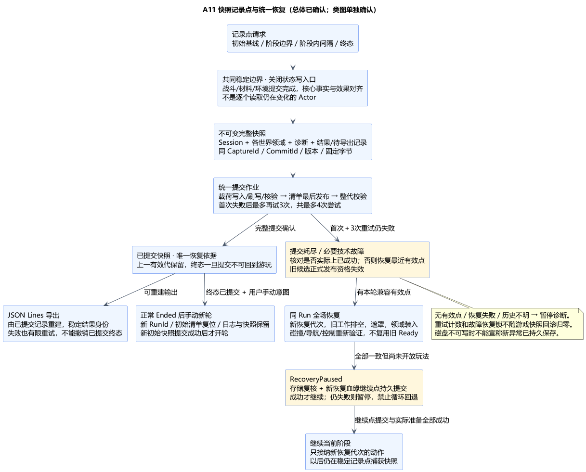
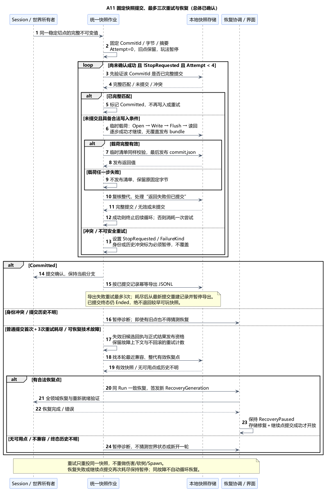
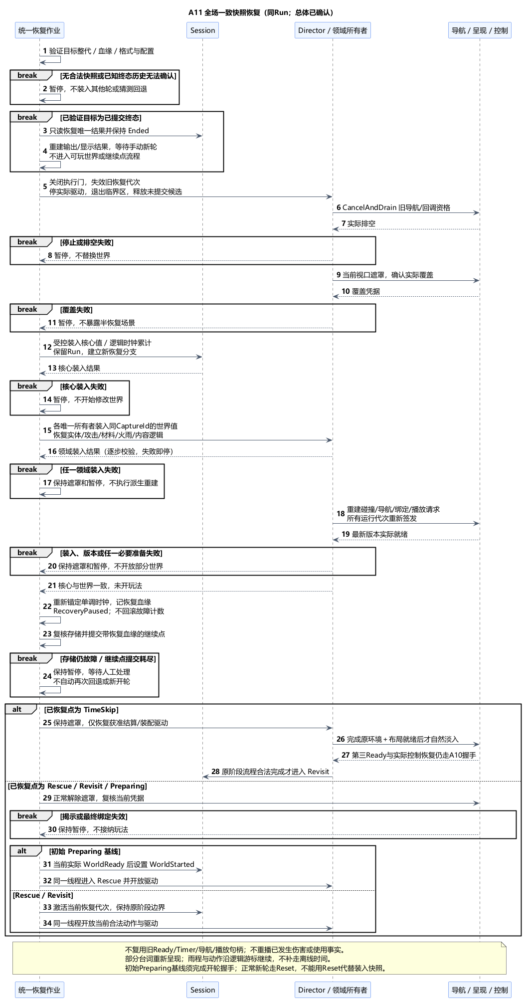

# A11 修订：快照记录点、三次重试与一致恢复

状态：**修订总体与类图均已确认**。日期：2026-11-06。[最初补充](../../requirements/001-causal-prototype/sources/2026-11-06-a11-checkpoint-recovery.md)要求先重试提交，失败从最近快照恢复，最大重试次数为 3；[总体确认](../../requirements/001-causal-prototype/sources/2026-11-06-a11-overall-confirmation.md)接受本文完整总体，[类图确认](../../requirements/001-causal-prototype/sources/2026-11-06-a11-class-confirmation.md)接受[具体类设计](A11-class-design.md)。本文替代[上一版 A11](A11-results-reset-and-errors.md)的仅终态保存与直接技术中断方案。尚未实现或正式冻结；依最新用户调整，音效语音 A13 提前至 A12 前。

## 1. 确认方向与当前提案

执行口径：**首次提交失败后，最多再重试 3 次；同一提交最多 4 次尝试。仍失败则恢复本轮最近有效、已完整提交的快照。** 不在重试过程中重新采样、重新伤害目标、重复切树或重复 Spawn。恢复后存储故障仍存在则暂停，不自动进入下一轮重试/回退循环。

用户已确认上述机制及以下快照时机、载荷格式、恢复协议和计时政策；具体类接口已在单独类图步骤确认。正常结束后的手动初始复测仍保留；技术恢复是在同一 Run 内恢复快照，是新增加的异常恢复例外。

## 2. 技术栈、数据边界与原因

| 层次 | 本次方案 | 原因 |
| --- | --- | --- |
| 核心 | 标准 C++20 / Linux GCC13；Session 提供受校验的纯值导出/恢复，仍唯一写入规则状态 | 核心不依赖文件、UE 或容器宿主，不能由快照管理器直接改 RunState |
| 世界适配 | UE5.6.1 C++；Director 协调各领域唯一所有者捕获和恢复 | 世界、核心、待提交记录必须来自同一切点；避免只恢复 HP 却漏掉火雨、切面或内容进度 |
| 统一协调 | 一个快照/恢复作业入口，串行管理捕获、提交重试、恢复、异常汇总、输出重建 | 管理操作流程，不再复制一套持续可写世界状态，也不建立第二个实验 Phase 状态机 |
| 序列化 | 一个版本化 bundle 载荷；UE 适配层以 FMemoryWriter/FMemoryReader 显式编码各领域值，Json 编码提交清单 | 初版用完整快照，避免增量链、完整事件重放和第三方依赖；不直接内存转储 UObject |
| 存储 | ProjectSavedDir 下的不可变代目录，IPlatformFile/IFileHandle 写入、Flush、校验及清单最后发布 | 完整代才可恢复，上一有效代不会被部分写入破坏 |
| 日志 | JSON Lines 继续保留，但由已提交快照中的记录生成，可重新导出 | 日志导出失败不再丢失唯一结果，也不反向改变已提交游戏状态 |

初版同步捕获和串行提交，提交期间暂停实际玩法推进并显示简短保存状态；UI 仍可更新。大几何快照的大小、暂停时间和内存峰值需实测，本项不再声称“只有终态小文件写一次”。后续若需要后台 IO，只能对冻结字节工作，不能让后台读取活 Actor。核心仍无 UE、Win32/POSIX 文件 API、异常控制流或 RTTI 依赖；未来 Linux/Docker 只运行核心仍不能独自重建 UE 碰撞/世界。

## 3. 三种提交与恢复点

| 名称 | 意义 |
| --- | --- |
| 领域提交 | A06/A08/A09 当前分支的一次战斗、几何或环境事务生效；普通事务失败仍不能撤销此前已提交子段 |
| 快照提交 | 同一切点的核心、世界和记录载荷及提交清单全部有效，才成为可恢复点 |
| 终态快照提交 | Ended 与唯一最终结果一起持久提交；此后本轮不能恢复为可玩状态 |

技术恢复是明确的新例外：允许整体回到最近持久快照，放弃该点之后未持久保存的运行分支，不能挑选角色、森林或日志单独回滚。已经正式提交的结果记录不删除、不重写。未成功提交的旧终态候选不能在恢复游玩后继续当“待保存正式结果”发布；它只作为失败上下文保留。

建议记录点：

- **初始基线**：同一 Run 预留身份、初始世界准备完成、尚未 WorldStarted 时提交；成功后才开轮。没有初始有效快照时保持 Preparing，不能拿其他轮快照兜底。
- **稳定阶段切点**：救援结果/方向锁定、进入回访、实验 Ended。切点所属阶段与世界作业进度必须匹配，不用过去的世界配新阶段。
- **阶段内记录点**：可配置间隔提出保存请求，在下一个共同稳定边界执行；跳时长作业也可在已提交前缀/装配步骤后记录。间隔与保留量待实测，不逐帧保存。

无需等所有弹体、挥砍、倒木或火焰自然结束；它们的已提交运行状态进入快照。不能为了满足保存请求提交未结算攻击或伪造世界就绪。

## 4. 同一稳定切点与完整载荷

捕获屏障要求：本批实际接触、爆炸、落地及共同运动/材料/环境前缀已提交；对应核心事实、同步效果和即时回调处理到稳定边界；不存在半发布几何或待提交 Prepared 候选。长作业保存逻辑阶段和已经完成的步骤，不保存线程、导航句柄或裸指针。关新输入接纳及所有实际状态写入口后，各所有者提供同一 CaptureId 的不可变值，核验领域版本再序列化。捕获期间不能继续积分角色或环境。

| 所有者 | 必须保存 | 恢复时重建或失效 |
| --- | --- | --- |
| Session | Phase、三个起点及累计时长、方式、救援结果/锁定分支、两项送达位、去重/逻辑请求、可选终态 | 仅由 Session 受控装入，不重播历史使用/伤害事实；旧现实时间锚点不复用 |
| A05/A06 | 角色姿态/速度/接地支撑、HP/硬直/击飞和首次落地消费、闪避保护；挥动进度/已命中集合/切削预算、装备/掉棒、弹道冻结参数/累计路程/EndOnce | 角色/查询/输入绑定；取消未执行输入与瞄准手势，按旧键重武装规则接纳新输入，不能恢复即发射 |
| A07 | 共同目标、行为/攻击节奏、拾取尝试及无进展/重试进度 | 导航与路径重新构建；重算路线不能刷新行为计时或变造目标 |
| A08 | 实体清单、权威材料外形/切口/谱系、裁分关系、实际姿态、倒落和受阻进度 | 网格、碰撞、导航派生几何；不能只存“砍掉百分比”或渲染外观 |
| A09 | 年代/逻辑游标、雨程/输入消费、燃料/火湿/炭化、材料绑定、受烧空间历史、旧年代后果和转换步骤 | 运行驱动、效果和导航凭据；不重复下雨/补算、重复扣燃料或加三十年 |
| A10 | 人物/教场/剧情身份、内容版本、相见/挽留游标、当前片段逻辑状态 | Widget/可读连续区间/视口/播放代次重新建立；未送达片段从头重播，已送达位只读 Session |
| 统一记录 | 截止切点的诊断、恢复血缘、结果记录及待导出记录身份 | JSONL 可重建；失败记录不能递归触发新的保存失败记录提交 |

载荷使用稳定 EntityId/ActionId/材料谱系与显式字段，禁止保存 Actor 地址、委托、线程、TimerHandle、NavData 内存、播放设备句柄或派生 Ready=true。文件头固定 Schema/Build/Rules/Config/Content/SpatialRevision 与单位；字段使用固定整数宽度/字节序、显式长度及数量上限，不直接保存原生结构体内存。本轮只支持匹配版本加载，未知格式/不兼容时暂停，不能偷偷用最新配置迁移。FMemoryWriter 是编码容器，不会自动获得可移植、可恢复的业务格式；显式字段布局和版本在类图细化。

## 5. 不可变代与完整提交判据

建议保存到 `ProjectSavedDir()/Experiment/001/Runs/<RunId>/Checkpoints/<CheckpointId>/`。一代包含 `bundle.bin` 和最后发布的 `commit.json`；清单含 RunId、CheckpointId、CommitId、父点/恢复血缘、提交序号、格式和版本、终态标记、载荷长度/摘要与记录身份。原 JSONL 输出位于独立 Results 目录。初版保留全部有效代及历史结果，不引入自动清理；容量策略后续实测。

1. 捕获一次，固定身份、序列化字节与校验摘要。重试不能换身份、更新时间戳或重新取场景。
2. 先检查本 CommitId 是否已经完整提交；发布返回不明也先核查，全部匹配就按成功处理。
3. 写唯一临时载荷：OpenWrite 成功才 Write，完整写入后才 Flush(true)，释放句柄并读回比对，再无覆盖发布为 bundle。已有同内容可复用，不同内容视为冲突，不覆盖。
4. 载荷有效后，按相同写入/刷写/核验程序准备清单，**最后**无覆盖发布 commit.json，再读取清单及载荷验证整代。只有此时产生 Committed 回执。
5. 没有有效清单的载荷、部分临时文件、目录存在或文件名最大，都不能证明已提交。若使用 CURRENT，只作索引提示，不能凌驾于提交清单和载荷验证。

以上是应用层完整提交协议，不宣称 UE MoveFile 自动提供断电原子事务。全代成功前上一有效代保持不动；重启通过提交序号、父链/恢复血缘和整代校验寻找最新合法点，不混合不同代文件。若发现提交历史无法判定、同身份冲突，或已知终态提交记录受损，暂停诊断，不猜测回退到更早可玩状态。

## 6. 最多三次重试与统一错误处理

同一 CommitId 的 `RetryCount` 依次为 0（首次）、1、2、3；失败后先确认是否已实际提交，未提交且还有额度才重试。计数、当前故障事件及恢复/暂停锁属于协调作业，**不随游戏快照回滚归零**。重新启动时先核对提交历史，未完成故障进入恢复/暂停入口，不暗中开启无限新预算。

第三次重试仍失败：停止该提交，失效其迟到回执，进入恢复本轮最近有效点的流程。快照捕获失败、世界已不一致或不可安全重放的领域操作，不盲目把伤害/切削/Spawn 重做四遍；停止执行，使用已提交快照恢复。正常无路、受阻、合法拒绝和旧回调不属于需要快照回退的技术故障。

错误详情先进入有界内存诊断和界面状态，下一次成功快照将其与恢复血缘一起持久化；UE_LOG 只是辅助。诊断缓冲满时停止继续接纳新故障循环并提示容量问题，不无声丢弃。磁盘不可写时快照不能保证新错误已经落盘，不能靠“记录保存失败”递归调用同一失败存储路径。

完成一次恢复后维持 RecoveryPaused。重新核对存储、快照兼容性和必要世界就绪；再持久提交一个带新恢复血缘的继续点，成功后才开放玩法。恢复本身失败、继续点提交耗尽或故障仍在，则保持暂停等待人工处理；同一故障事件不会再次自动回退。用户明确重试恢复才建立新的操作尝试，不自动新建 Run 或重置原失败提交预算。

## 7. 全场恢复与旧回调隔离

恢复沿同一 RunId，创建跨进程唯一 RecoveryGeneration/ContinuationId；快照中已有逻辑 EntityId、ActionId 和材料谱系保留，新动作身份带新执行分支避免与废弃分支复用。所有效果、事实入口、Timer/导航/动画/输入回执在既有身份之外核对当前恢复代次，不能在迟到时重盖新代次。

恢复顺序：验证目标整代及兼容性 → 关接纳和实际驱动、失效旧代次 → 等同步临界区退出、清候选、A07 CancelAndDrain → 当前视口遮罩实际覆盖 → 各唯一所有者装入该代值并重建完整实体/材料/碰撞 → 核验新绑定和导航 → Session/世界一致激活。任何步骤失败都停止后续操作，保持遮罩/暂停，不开放半恢复世界。跨进程恢复只在当前唯一实验 UWorld 重建，不创建并行世界。

不使用 ResetForRun 代替装入快照；它是正常新轮初始复测入口。技术恢复需要各所有者独立的验证/装入契约。没有本轮兼容有效快照则保持准备/恢复失败，不用初始默认值冒充“最近快照”。重新启动发现可恢复轮时提示用户继续；已保存 Ended 只显示结果，不启动玩法。

TimeSkip 的已完成结算/布局步骤照快照恢复；旧 TransitionToken、三 Ready 的实际凭据和已发控制请求不能原样当作新世界已就绪。重新签发运行请求，把“已发送但未完成”转为可重建的待完成意图，重新验证后完成握手；不能卡在“已经发过一次所以不再处理”。Revisit 恢复不再次设置 RevisitStartedAt，不重复加三十年。可读连续时长重新开始，恢复不直接补造内容送达。

恢复切点的世界完整性不等于最终回访布局已完成。TimeSkip 恢复后继续保持遮罩，只开放获准的结算/装配驱动；随后仍按 A10 的环境＋布置就绪、自然淡入、第三 Ready 和实际控制恢复顺序进入 Revisit。Rescue/Revisit 在恢复凭据和继续点有效后解除遮罩并开放对应动作；Preparing 基线另经 WorldReady→WorldStarted 开轮。已持久终态走只读结果恢复/导出，不进入可玩世界恢复或继续点流程。

## 8. 日志重建与终态保护

核心正常结束先形成运行内不可变结果和 Ended，随后捕获终态快照。**终态快照提交前**仍属于未持久候选：耗尽三次重试可以按用户要求恢复到先前有效点，废弃旧候选的正式发布资格。**终态快照提交后**结果唯一，Run 永久保持结束；只允许重建日志或用户手动开始新轮。

JSONL 是快照中的已提交记录的导出：固定 ResultId/RunId/CommitId 和规范字节，每轮一条正式最终结果，包含方式、真实救援事实、最终分支、成败原因、阶段耗时及恢复标记。同身份同内容幂等，不同内容报告冲突，不覆盖历史。

输出沿用每轮独立 `Results/<RunId>.jsonl`，只含一条完整结果和结尾换行，**不向共享文件追加**。导出前先读已有正式目标：完整且与权威记录字节匹配则已完成；损坏、同身份内容冲突或不可读则保留文件并暂停诊断，不盲目覆盖。没有目标才按临时文件 Open/Write/Flush/释放/读回、无覆盖发布、最终读回的顺序生成。发布返回不明时先复核目标，匹配即成功，不重复追加；临时半行不算正式结果。明确解决损坏/冲突输出后，再从已提交快照重建该轮文件，其他轮历史保持不动。导出确认丢失只会重新核对同一文件，不产生第二个最终结果。

导出也按首次加最多三次重试处理。耗尽后从最新已提交快照重新加载记录并暂停导出，**不把世界退回更早状态**；若最新为终态就仍是 Ended。存储恢复后重建输出，无需重玩或重新算结果。终态快照已提交是保住结果的权威门槛，未导出记录跨正常手动复测保留，因此 JSONL 单独导出失败不再必须阻止新轮；新轮自身的初始快照仍必须成功提交。

不可恢复故障不会自动变成玩家失败。用户可在诊断界面明确结束受影响轮并手动新开；技术终止记录同样先形成终态快照，不修改已存在正常终态。不能持久提交技术终止时保持待处理，不承诺结果已保存。

## 9. 恢复后的计时提案

无恢复的轮次继续严格按 A02：救援从首次朝哥布林实际攻击开始；跳时和回访沿真实边界；阶段内普通等待/暂停/失焦计入，未攻击/未进入阶段为 null，剧情年数不参与耗时。

恢复轮次新增明确政策，**已随本总体确认**：持久化逻辑世界/环境游标、阶段累计时长和历史边界的相对值；加载后用新进程单调时钟重新锚定，不直接相减两个进程的 RealSeconds/GetTimeSeconds，也不补走离线雨程、闪避或 AI 计时。

主结果统计最终有效快照分支的阶段实际耗时；被放弃分支耗时、提交失败重试与恢复停顿单独进入 RecoveryHistory，标注 RecoveryUsed、来源点和 TimingPolicy。这样回到救援时不会把已废弃的回访时长算进救援。普通成功保存的阶段内等待仍沿 A02 计入。跨进程丢失且未持久记录的时间标 Unknown/不完整，不用系统日历差冒充精确秒数；已知耗时可另给 knownElapsedSeconds。恢复轮不能与无恢复轮无标识混算，也不能假定玩家没见过被回退的内容；A12 单独说明其体验分析口径，不增加固定试玩次数。

## 10. 正常手动复测与影响范围

正常 Ended 后仍由用户手动开始下一轮，取得新 RunId，沿领域唯一 Reset 入口恢复初始清单；旧记录/快照保留，旧工作实际排空，全部准备和新初始快照成功后才 WorldStarted。世界卸载只清理；启动恢复和手动新轮是不同用户入口。界面用“正在保存 / 正在恢复 / 已恢复但需处理存储问题 / 结果已保存”等状态，不用技术计数替代玩法内容。

| 已确认基线 | 本次显式扩展 / 待复核接口 |
| --- | --- |
| A02/A03 阶段、唯一 Session、原始时刻 | 增加受控导出/装入、恢复分支和相对时钟；不直接赋写核心 State；恢复计时政策与类接口均已确认 |
| A05/A06 输入、攻击、命中与落地消费 | 新恢复代次与持久运行状态，不重放旧使用、已命中或首次落地伤害 |
| A07 导航与 AI | 持久行为，重建实际路径/导航；旧工作必须排空 |
| A08/A09 普通事务不回滚 | 普通失败规则不变；本次技术恢复新增全场持久点回退例外，材料、预算、火湿和历史一起回退 |
| A10 取消、完成事实与 Ready | 重新建立播放/视口/控制凭据，部分片段重播；已持久终态不能因导出失败复活 |
| 原 A11 候选 | “仅终态文件、保存失败只手动重试、关键错误直接 TechnicalAbort、不恢复本轮”不再采用 |

## 11. 本机依据、验证与确认范围

本机 UE5.6.1 `Core/Public/Serialization/MemoryWriter.h:38、99`、`MemoryReader.h:16、35、52` 提供显式内存编码/解码容器；Json、IFileHandle 的 Write/Flush、无覆盖 MoveFile 及平台限制沿[旧 A11 的接口证据 §7](A11-results-reset-and-errors.md#7-本机证据与待验证内容)。这些接口不自动捕获世界、排空领域或保证完整代，项目契约仍须实现。

当前仅文档与本机接口核对，未进行 UE/GCC 编译、文件故障注入或游戏运行验证。重点验证：每个载荷/清单写入阶段中断；返回失败但实际上已提交；同一固定字节最多四次尝试；恢复后计数不归零循环；无初始点/版本冲突；同刀预算、弹体 EndOnce、首次落地、179.9 秒雨程、材料燃料/历史、TimeSkip 中途、第二项内容与终态；旧回调隔离；JSONL 删除重建；已提交终态永不回到可玩点；跨进程时钟及恢复样本标记。

[总体 PUML](A11-checkpoint-overview.puml) · [提交与重试 PUML](A11-checkpoint-commit-recovery.puml) · [恢复 PUML](A11-snapshot-restore.puml)。记录点/完整载荷、清单提交、恢复代次及终态保护、JSONL 重建、恢复后计时及 [A11 类图](A11-class-design.md)已获确认；当前先进入 [A13](A13-audio-and-voice.md)，随后 A12。
