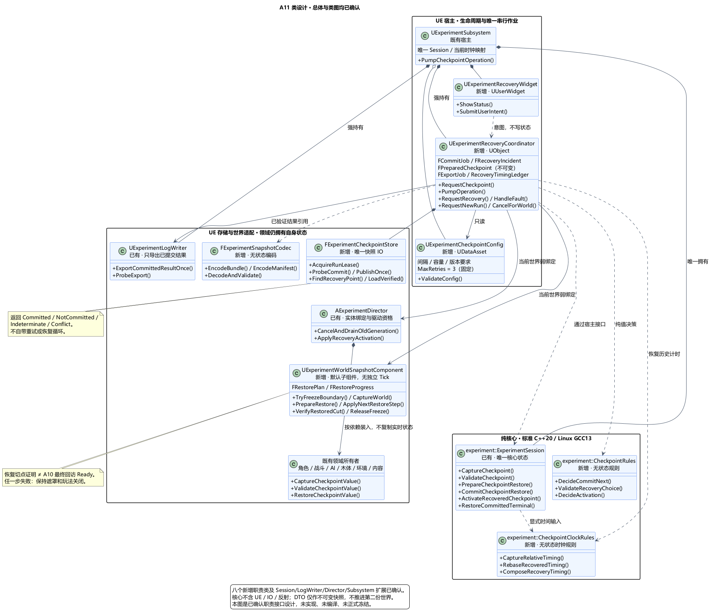
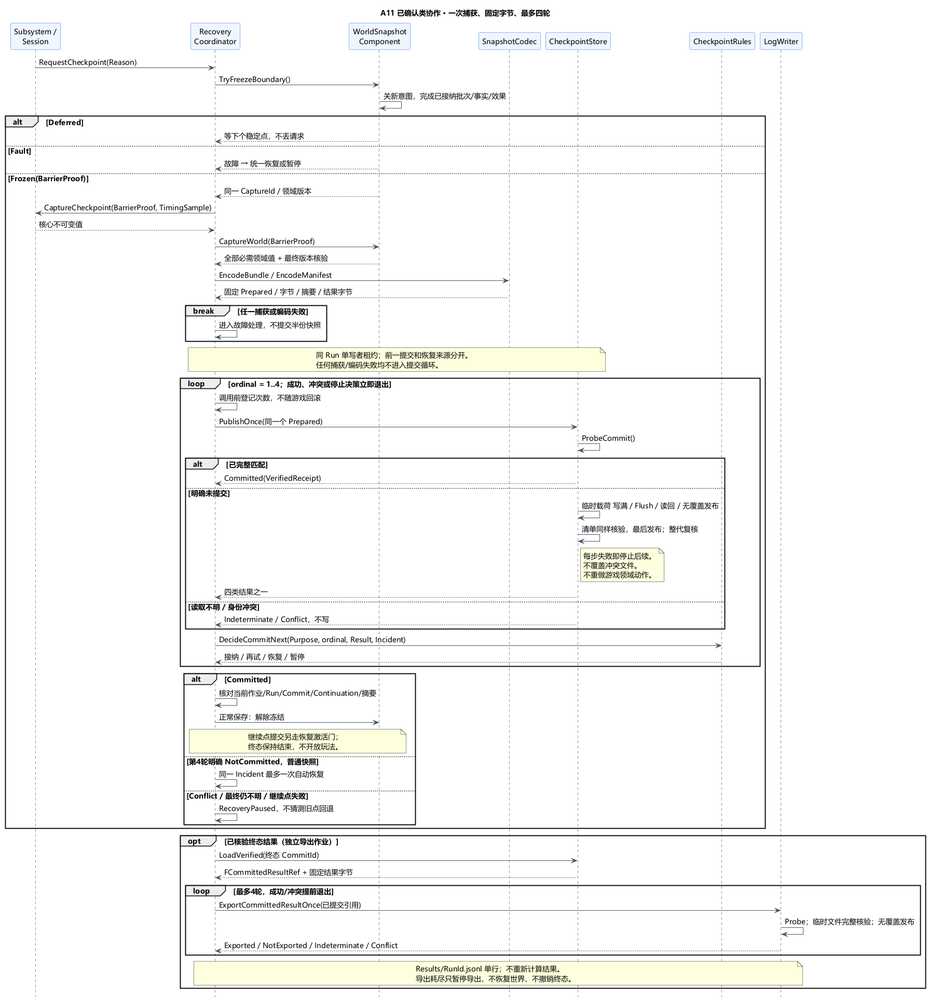
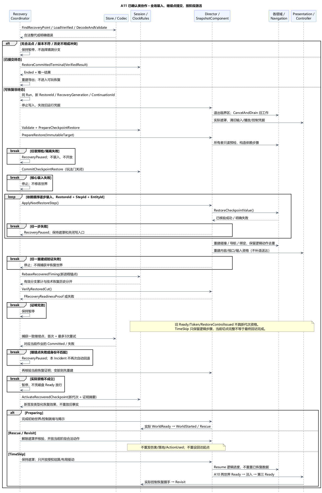

# A11 类图：快照协调、持久提交与全场恢复

状态：**总体与类图均已确认**。日期：2026-11-06。依据：[总体确认](../../requirements/001-causal-prototype/sources/2026-11-06-a11-overall-confirmation.md)、[类图确认](../../requirements/001-causal-prototype/sources/2026-11-06-a11-class-confirmation.md)。本项确定八个新增职责类、已有类扩展、值契约和三份 PUML，尚未实现或正式冻结。首次加最多三次重试、完整快照恢复、终态保护与恢复计时沿已确认[总体](A11-checkpoint-save-and-recovery.md)。

## 1. 技术栈与职责

沿用 ExperimentCore 标准 C++20 / Linux GCC13，UE5.6.1 C++、FMemoryWriter/FMemoryReader、Json、IPlatformFile 和 UMG。一个 Runtime 模块；核心无 UE/文件/反射依赖。

| 类 | 所属层 / 生命周期 | 职责与主要接口 |
| --- | --- | --- |
| `UExperimentCheckpointConfig` | UDataAsset，新增 | 保存间隔、大小/对象数量/诊断容量限制、格式与版本要求；`ValidateConfig`。MaxRetries 固定为 3，不能作为普通调参改变 |
| `UExperimentRecoveryCoordinator` | UObject，新增，Subsystem 强持有 | 唯一快照/恢复/导出作业、故障上下文和非回滚重试计数；`RequestCheckpoint`、`PumpOperation`、`HandleFault`、`RequestRecovery`、`RequestNewRun`、`CancelForWorld` |
| `UExperimentWorldSnapshotComponent` | Director 默认 UActorComponent，新增、无独立 Tick | 组织各领域唯一所有者；`TryFreezeBoundary`、`CaptureWorld`、`PrepareRestore`、`ApplyNextRestoreStep`、`VerifyRestoredCut`、`ReleaseFreeze` |
| `FExperimentSnapshotCodec` | UE 原生无状态工具，新增 | `EncodeBundle`、`DecodeAndValidate`、`EncodeManifest`；固定格式和边界检查，不访问活世界、不做恢复决定 |
| `FExperimentCheckpointStore` | UE 原生对象，新增，由 Coordinator 持有 | 唯一快照文件 IO 和整代证据；`AcquireRunLease`、`ProbeCommit`、`PublishOnce`、`FindRecoveryPoint`、`LoadVerified`；不自带重试循环 |
| `experiment::CheckpointRules` | 纯 C++20 无状态，新增 | `DecideCommitNext`、`ValidateRecoveryChoice`、`DecideActivation`；把已验证操作结果映射为接纳/重试/恢复/暂停，不读文件或 Actor |
| `experiment::CheckpointClockRules` | 纯 C++20 无状态，新增 | `CaptureRelativeTiming`、`RebaseRecoveredTiming`、`ComposeRecoveryTiming`；逻辑游标与阶段累计时长映射，不读取系统时钟 |
| `UExperimentRecoveryWidget` | UUserWidget，新增 | 只显示保存/恢复/暂停/结果状态，发送继续、重试或手动新轮意图；不写 Session、不直接调用文件 IO |
| `UExperimentLogWriter` | 已有 UObject，职责扩展 | `ExportCommittedResultOnce`、`ProbeExport`；只接受已验证提交中的结果，输出独立单行 JSONL，不再接受任意运行内终态直接发布 |

Subsystem 继续拥有唯一 Session、已有 LogWriter、Config，并强持有 Coordinator 和当前 UI；Coordinator 只弱绑定当前 Director/SnapshotComponent。Director 继续签发世界驱动和实体绑定，SnapshotComponent 是它的装配助手，不越过角色、CombatWorld、TreeWorld、EnvironmentWorld 或 Narrative 直接写领域状态。

此拆分把“什么时候保存/恢复”“怎么编码”“文件是否真的完整”“世界如何重建”分开；IO 不决定游戏结果，规则不依赖引擎，领域类不各自创建存档管理器。代价是新增显式快照值和恢复接口，换取一次捕获、一次统一提交及可核对的恢复边界。

## 2. 唯一状态和值类型

| 值 / 句柄 | 所有者与约束 |
| --- | --- |
| `ExperimentSessionCheckpoint` | Session 导出的不可变纯值，含核心状态、计时、去重和逻辑待办；不含世界几何，不提供可写 RunState 引用 |
| `FWorldCheckpoint` | SnapshotComponent 捕获的不可变领域聚合：初始/现存/退役实体清单、角色/攻击/AI/材料/环境/内容值；仅用于保存/装入，不持续推进第二个世界 |
| `FCaptureBarrierProof` | 当前冻结作业：Run/RecoveryGeneration/CaptureId、稳定批次和各领域版本、逻辑时钟游标；冻结解除或版本变化即失效 |
| `FCheckpointEnvelope` | 同一 CaptureId 的核心、世界、诊断、恢复历史、结果/待导出记录及配置/空间版本；所有交叉引用必须闭合 |
| `FPreparedCheckpoint` | Coordinator 原生不可变对象：CheckpointId/CommitId、固定 bundle/清单字节、摘要、前一已提交点、恢复来源点及预留提交序号；四次尝试共用 |
| `FCommitJob` | Coordinator：OperationId、CommitId、Purpose、AttemptOrdinal=1..4、最后 Probe 结果；RetryUsed=AttemptOrdinal-1，退回游戏快照不重置它 |
| `FRecoveryIncident` | Coordinator：IncidentId、失败操作、是否已自动恢复、用户显式重试代次、有界诊断和废弃分支耗时；不从被恢复的游戏状态覆盖此现场 |
| `FRestorePlan / FRestoreProgress` | SnapshotComponent：不可变目标、RestoreId、新运行代次与步骤依赖；进度按 RestoreId＋StepId＋EntityId 幂等，不用当前半恢复世界重新推导目标 |
| `FVerifiedCommittedCheckpoint` | 只能由 Store 完整验证后产生的只读句柄，含清单/载荷摘要与逻辑版本；代码层限制调用入口，不是网络客户端可信证明 |
| `FRecoveryReadinessProof` | 当前 RestoreId/恢复代次/实际领域版本、导航构建键、输入/视口资格；只证明恢复切点安全，不能冒充 TimeSkip 最终回访三 Ready |
| `FCommittedResultRef / FExportJob` | 记录来源提交、ResultId 与固定输出字节；导出回执是派生状态，丢失可复核文件，不改变正式结果 |
| `RecoveryTimingLedger / ClockMapping` | Ledger 由 Coordinator 持有技术恢复历史；有效分支时间由 Session 唯一持有，Subsystem 只持当前进程时钟映射，两者职责不同 |

Config/Widget/Coordinator/LogWriter 使用反射强引用；普通值和固定字节用 C++ 生命周期管理，不伪装成 UObject。跨实体引用持稳定 ID，运行时使用弱引用和代次校验。卸载取消世界相关作业并解绑，已经持久提交的结果仍可从 Store 重新读取。

## 3. 核心和世界接口扩展

Session 提议增加：`CaptureCheckpoint(BarrierContext, TimingSample)`、`ValidateCheckpoint(Value, RestoreContext)`、`PrepareCheckpointRestore`、`CommitCheckpointRestore`、`ActivateRecoveredCheckpoint`、`RestoreCommittedTerminal`。验证不修改当前状态；Prepare 产生核心私有待装入值；Commit 只在恢复接纳关闭时替换内部状态；Activate 才允许当前代次事实/效果继续。外部不能通过赋值 DTO 绕过这些入口。

准备并完整解码整代后，先完成各领域只读预检，再逐步装入。核心装入失败立即停止，不开始改世界；世界装入任一步失败也停止，不进入导航/揭示/开放动作。某些运行资源仍可能在预检后构建失败，此时保持暂停/遮罩，不能宣称已安全回到旧世界。人工重试沿同一目标计划复核已完成步骤，不能对成功步骤再次扣预算或生成实体。

各所有者提供职责级三件套：`CaptureCheckpointValue`、`ValidateCheckpointValue`、`RestoreCheckpointValue`。方法不机械暴露为通用 Blueprint 接口；SnapshotComponent 使用明确的领域适配清单，避免任意 Actor 插件式写入。恢复已有对象和重建已销毁对象都通过原唯一装配者；不先 ResetForRun 清零再猜测补回状态。

| 原所有者 | 该类需要扩展的状态契约 |
| --- | --- |
| Character/Movement/Combatant、Weapon/Projectile | 支撑身份、位置/速度/闪避/HP/落地消费；攻击阶段、已命中集合、切刀预算、掉棒、弹道参数和 EndOnce 一起保存；不重新发 ActionUsed 或再次伤害 |
| Encounter/Behavior | 目标、行为节奏、拾取进度与重试游标保存，路径只保存目标意图并重新求解；不能借恢复清零无进展计时 |
| TreeWorld/TreeActor/Geometry/Motion | 权威材料、CutId/谱系和裁分、实体清单、实际姿态/倒落进度；重建网格和碰撞，切口与刀预算必须对齐 |
| EnvironmentWorld/Transition | 火湿/燃料/雨程/消费位/受烧历史、封存后果与年代装配步骤；驱动租约重新签发，不重复 BeginEpoch 清掉载荷或重做已完成前缀 |
| Revisit Layout/Narrative/Presentation | 人物/内容绑定与访问机会持久化；已送达只归 Session；旧播放/可读证据丢弃，未送达片段从头再播，不补造 Completed |
| Root/Navigation/Controller | 保存配置/空间身份和逻辑目标；实际导航后端、Pawn/相机/输入和地图绑定重建，不持久化指针/路径句柄/Ready=true |

## 4. 捕获屏障与调度

Subsystem 在既有游戏线程稳定处理点调用 `PumpOperation`。Coordinator 只提出 Capture 请求；SnapshotComponent 返回 Deferred / Frozen / Fault。Deferred 等当前整批结束，不强制清除已接纳动作、不把未完成事实当已完成，也不要求弹体和火焰全部自然消失。

冻结顺序为：关闭新意图接纳 → 完成当前 A06/A08/A09 已接纳共同前缀/批次 → 排空对应同步事实/效果和即时回调 → 取得冻结资格并停止实际变换/环境写入口 → 采样共同版本。异步导航派生任务可以有明确“待完成”逻辑描述，但不得在捕获时修改权威几何；其回调排队，不进入本次核心快照。捕获失败进入恢复/暂停处理，不序列化一半状态。

Session 和全部必需领域均通过同一 BarrierProof 后才能形成 Envelope。角色名单少一个、材料来源悬空、版本不一致或关键状态缺失均为 Fault，不能用默认值凑齐。核心的 EncounterSnapshot 仍只是判定值，不能冒充完整世界快照。

正常提交期间保持冻结，不接纳新玩法；UI 可以在作业步骤之间更新。Store 不自发后台读 Actor。配置的快照请求可合并到同一稳定点，初始/阶段/终态请求不能被普通间隔请求覆盖或静默丢弃。冻结/恢复期间未消费的输入意图失效；恢复后取消旧瞄准手势并按 A05/A06 释放重武装，不触发松键发射。

## 5. 编码、文件所有权与完整提交

Codec 明确编码宽度、字节序、单位、枚举、长度与数组上限，载荷逐段带版本和长度；读入前后检查溢出、截断、未知必需段、重复实体、计时非有限值和跨领域引用。仅整体校验成功才返回 RestoreCandidate。它不加载资源或调用恢复方法；文件匹配版本后，资源可用性仍由世界预检核验。

Store 的每轮发布使用单写者租约。当前 Windows UE 宿主拟保持一个专用非数据锁文件的独占写句柄，租约存活期间另一进程不能接管同 Run；锁文件存在本身不是占用证据，进程结束后系统释放句柄。只用于锁的文件可以重开，不能用截断方式打开 bundle/commit/正式结果。未来 Linux 宿主必须实现等价排他锁，不能把当前 Windows 共享标志当跨平台保证。读取历史不可变代不要求改变它们。

提交序号由持有租约的 Store 基于已验证提交历史预留，不随游戏快照倒退；CheckpointId/CommitId 仍为全局唯一值。父点区分当前发布链的前一提交与本次恢复来源点，恢复继续点要保存两者，不能简单按最大文件名猜分支。发现分叉、同身份不同字节或无法解释的提交历史时暂停，不能任意选较大序号。

`PublishOnce(Prepared)` 只执行一次有序尝试：先 Probe → 临时 bundle 打开/写满/Flush/释放/读回 → 无覆盖发布载荷 → 同样处理清单并最后发布 → 整代复核。每步失败立即停止后续写入；已经匹配的固定文件可以复用，冲突不覆盖。清单与 bundle 要全部匹配，CURRENT 仅作提示。

Probe/Publish 的结果必须是以下四类，不能用 bool 混合：

| 结果 | 含义与下一步 |
| --- | --- |
| Committed | 已核验完整同身份同内容；即使底层曾报错也接纳成功，不重复恢复 |
| NotCommitted | 能确认没有有效提交清单，已有载荷只是未提交候选；额度内可重投同字节，耗尽可恢复旧点 |
| Indeterminate | IO/历史不明，不能证明已提交也不能证明未提交；下一轮先安全核查，仍不明则不得继续写，耗尽暂停，禁止可能撤销已提交终态的猜测回退 |
| Conflict | 同身份不同内容、分叉、已知终态损坏等；立即暂停，不覆盖、不因存在旧点而恢复 |

无覆盖发布、完整 Flush 和读回构成本应用的成功判据；不扩大为任意文件系统/硬断电的绝对事务保证。保留旧代，不自动清理。孤立临时文件不计提交；重启优先核对已有正式清单，未知故障预算进入恢复/暂停，不给旧 CommitId 自动补四次新机会。

## 6. 重试规则、故障锁与导出

每次有资格的单次尝试**调用前**登记 AttemptOrdinal；初次为 1，后续为 2、3、4。一轮先 Probe，只有确认未提交才最多写一次；Probe 仍不明即结束该轮，消耗该轮额度而不写文件，避免核查自身形成无限循环。有效返回后 `CheckpointRules.DecideCommitNext` 只决定下一操作：Committed 接纳；NotCommitted 且 ordinal<4 重试；ordinal=4 转恢复；Conflict 暂停；Indeterminate 最终仍不明则暂停。同身份 Probe 已证明成功时不额外写一次。整个 Prepared 字节固定，Store、LogWriter、领域内部不得再隐藏各自三次循环。

一份 Incident 可以自动进入恢复一次。恢复成功后并不清计数或开玩法；先提交 `Purpose=RecoveryContinuation` 的新继续点。它是独立 CommitId，仍有首次加三次上限，但失败只能留在 RecoveryPaused，不能再触发本事件第二次自动恢复。人工明确重试恢复是新的操作身份，保留原失败历史，不恢复旧提交预算。没有最近合法点、版本不兼容或历史不明均暂停。

故障记录先进入 `FRecoveryIncident` 和有界诊断值，发布到下一成功快照；“保存失败”不会直接调用自己保存另一条失败日志。容量耗尽暂停接纳新的故障循环，界面保留当前错误，UE_LOG 辅助但不作为持久成功证明。已恢复快照的旧诊断可并入历史，不能覆盖本次尚未提交的故障现场。

LogWriter 只接收 `FVerifiedCommittedCheckpoint + ResultId`；bundle 已包含 ResultId/RunId/CommitId 和正式结果的规范 UTF-8 输出字节。读取并核验来源后逐字节导出到 `Results/<RunId>.jsonl` 单行文件，不能在重试或重启时补当前时间、重算结果或改变格式。只复用 Store 的低层无覆盖发布原语，不把输出 JSONL 当快照的 commit.json。已有同内容返回 AlreadyExported；半临时文件不算完成；正式目标损坏/冲突保留并暂停。返回不明先读回，不向共享文件追加。

导出重试也由 Coordinator 统一计数，同一记录最多四次尝试。耗尽后重新加载已提交记录并保持 ExportPaused；不调用 WorldSnapshotComponent、不修改 Session 或重新计算结果。未导出引用跨手动新轮保留，可从有效终态清单扫描重建；JSONL 确认丢失仅重新核验同文件。已提交终态永不进入可玩恢复，也不要求重新提交继续点才能显示结果。

## 7. 恢复装入、运行代次与重新开放

`RequestRecovery` 首先取得合法 VerifiedCheckpoint。已提交终态直接经 Session 的终态恢复入口装入结果/Ended，并重建导出，不进入世界恢复。可运行/Preparing 点建立 RestoreId 和新 RecoveryGeneration/ContinuationId，保留同 RunId；旧回调资格立即失效，已有逻辑实体/动作 ID 保留，新实体/动作分配携带新分支身份。

SnapshotComponent 依序执行停止实际写入口、等待临界区退出、释放候选、A07 CancelAndDrain、实际遮罩、所有者装入、碰撞/导航/控制/内容重建与验证。每个步骤都有明确结果，失败立即停止后续。Coordinator 不在部分装入后提交运行效果，读出的 RunState 可以已替换但一切动作接纳仍关闭；同一次 RestorePlan 重试复核已完成步骤，不能以部分世界当作新保存点。

恢复代次要进入 A03 事实/效果包络、A06 接触/攻击请求、导航、驱动、Timer、输入、地图、播放和控制恢复回执。逻辑历史身份不重盖章；运行绑定重签发。Session 和宿主均拒绝旧 RecoveryGeneration，不能只靠同 RunId/Sequence。重建动作只恢复进度与去重集合，不重发历史 ActionUsed、伤害、落地或内容完成事实。

在 TimeSkip，Session 恢复的是逻辑待办；旧 Token、已收三 Ready、ControlRestoreRequested 等运行凭据归一化为新代次的待重建状态。为该代次重新发出类型化 Resume 效果，不重复初始化已恢复环境或装配对象；“只发一次恢复控制请求”限定当前代次与 Token。环境/布局/呈现实际完成后才能重新满足握手。

全部恢复切点验证后，由 Coordinator 提交带恢复血缘的继续点。提交回执必须匹配当前 RunId/OperationId/CommitId/ContinuationId 和载荷摘要，迟到回执不能开放当前世界；同时仍需核对旧作业是否实际提交，不能用丢弃回调掩盖持久状态。只有当前继续点 Committed、最新本地证明仍有效，才按以下方式开放：

| 恢复阶段 | 激活规则 |
| --- | --- |
| Preparing 初始基线 | 真实初始世界/控制就绪、遮罩正常结束后，Session 设置 WorldStarted，进入 Rescue；不把预留 Run 当已开始 |
| Rescue / Revisit | 正常解除遮罩并再次验证，Session 接纳当前恢复代次，开放当前合法动作；Revisit 不重设原阶段起点 |
| TimeSkip | 保持遮罩和玩家执行门关闭，只开放获准的旧时代结算/装配驱动；沿 A10 两世界项→自然淡入→第三 Ready→实际控制恢复进入 Revisit |
| 已提交 Ended | 在恢复入口已分流，保持结束与唯一结果，仅显示/导出和手动新轮 |

继续点提交后若必要绑定变脏，保留恢复作业但撤销本地激活证明，重新验证；不得凭“磁盘上已保存过 Ready”开放。恢复过程不用修改全局 UWorld 时间，也不创建并行世界。

## 8. 时钟、终态与手动新轮

CheckpointClockRules 只计算纯值。Session 持有效分支阶段累计和可选起点，Subsystem 持当前进程的单调时钟映射；Coordinator 的恢复 Ledger 保存被废弃分支、提交失败等待与恢复停顿。捕获保存逻辑世界游标/环境游标、相对阶段边界和累计值，跨进程以新锚点重建，不相减旧 RealSeconds 或 GetTimeSeconds。

玩法逻辑时钟只在对应实际驱动获准时推进；保存/恢复冻结期间不能靠 UE 时钟继续触发雨、闪避结束或 AI 重试。普通成功保存期间的真实等待仍计入有效阶段实际耗时，恢复导致废弃的区间和技术停顿转入 Ledger；初始准备/终态保存不启动或延长阶段。终态候选保存的结束时刻固定，不能重试时更新。

恢复后的最终记录由 Session 生成有效分支结果，Coordinator 附加纯恢复历史视图；两者通过只读拼装形成新的不可变 Envelope，不反写结果。未攻击/未进入/已完成的语义沿 A02；跨进程无法知道的未持久时段标 Unknown，已知累计单列，不用 UTC 差填充。恢复到比故障早的阶段不会把废弃回访时间塞入救援。

运行内 Ended 与待提交终态是当前分支不可变值；持久提交失败并被技术恢复取代时，旧候选正式发布资格失效，不能稍后再次导出。Store 检查终态提交历史；一旦已有合法终态，任何非终态恢复/新终态内容都被拒绝。技术终止仅在用户明确结束受影响轮时由 Session 生成，不能覆盖既有正常终态。

`RequestNewRun` 仅在上一轮终态快照已 Committed 且收到手动意图时转到原 Director 复位链，取得新 RunId；旧快照与未导出记录保留，新初始快照成功才开始世界。日志导出失败本身不销毁已保存结果，不阻止一个具备完整初始快照的新轮。世界卸载先关闭代次和任务，再释放引用，不自动创建新轮；重新启动发现未结束快照由用户选择继续，不自动消耗新重试预算。

## 9. 本机证据与验证范围

内存编码、Json、Write/Flush/Move 的本机证据沿 [总体 §11](A11-checkpoint-save-and-recovery.md#11-本机依据验证与确认范围)及其旧 A11 接口表。本机 `Core/Private/Windows/WindowsPlatformFile.cpp:1504–1510` 的 OpenWrite 在 bAllowRead=false 时使用零共享标志调用 CreateFileW，可作为当前 Windows 非数据锁文件的独占句柄基础；必须实际验证错误返回与文件层包装，不能据此声称 Linux 已有等价锁实现。这里路径相对本机 UE Runtime 目录。

当前仅文档与本机接口核对，未进行 UE/GCC 编译、文件故障注入或游戏运行验证。重点核对：共同切点/完整领域清单；冻结时异步回调；同刀预算/首次落地/弹体 EndOnce；火雨/材料/历史一致；TimeSkip 恢复握手；最大四次且继续点失败不再回退；写成但返回不明；冲突/Indeterminate 禁止猜测恢复；同 Run 多进程排他；逐步骤恢复失败；终态导出与新轮并存；恢复时钟及样本标记。具体性能阈值和 UI 等待体验留实测。

[类图 PUML](A11-class-design.puml) · [提交协作 PUML](A11-class-commit-protocol.puml) · [恢复协作 PUML](A11-class-restore-protocol.puml)。八个新增职责类、已有 Session/LogWriter/Director/Subsystem 扩展、唯一状态和值契约、捕获/提交/恢复/激活顺序及故障分流已确认；依[最新顺序调整](../../requirements/001-causal-prototype/sources/2026-11-06-audio-voice-order-change.md)，当前先进入 [A13 音效与语音](A13-audio-and-voice.md)，再回到 A12 验收与交付。
