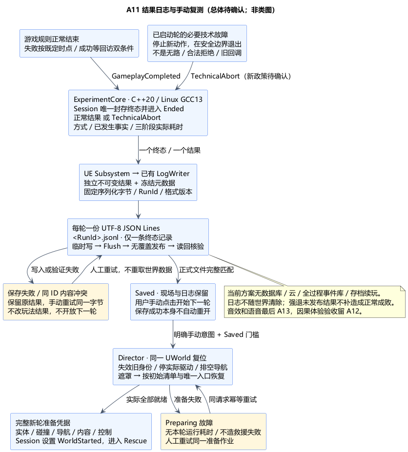
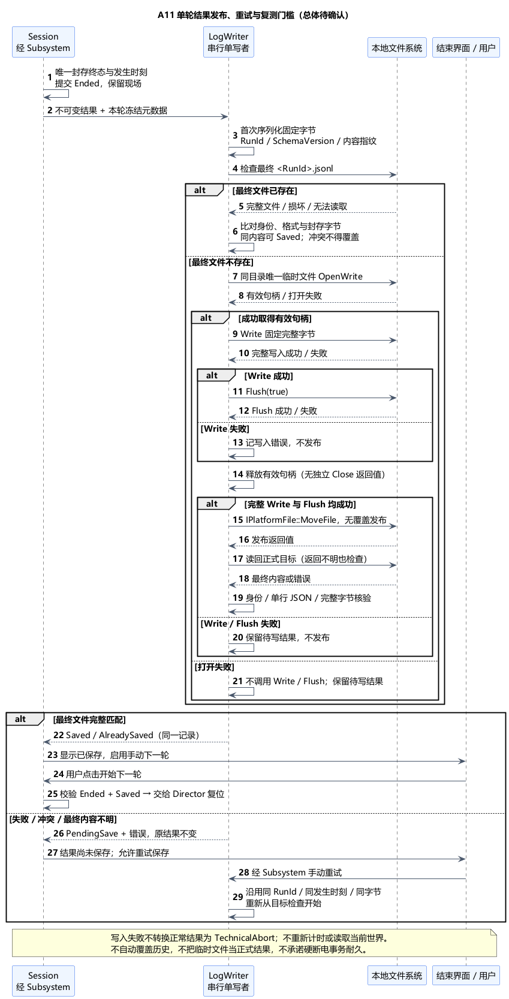
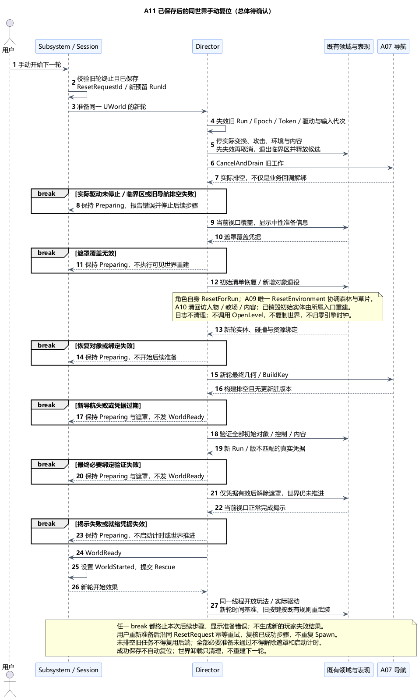

# A11 历史提案：仅终态保存与手动复测

状态：**未获总体确认，已被快照修订方案替代**。日期：2026-11-06。用户要求采用快照记录点、先重试提交后恢复最近快照，重试上限为 3，见[原文](../../requirements/001-causal-prototype/sources/2026-11-06-a11-checkpoint-recovery.md)。当前方案为 [A11 快照保存与恢复](A11-checkpoint-save-and-recovery.md)。下文与配图仅保留上一提案及接口证据，不是当前确认对象；其中“不恢复本轮、仅终态保存”等取舍不再采用。

依据：[需求 §3、§8、§9](../../requirements/001-causal-prototype/REQUIREMENTS.md)、[日志内容原文](../../requirements/001-causal-prototype/sources/2026-10-30-source-consolidation-and-logs.md)、[原世界重启](../../requirements/001-causal-prototype/sources/2026-10-30-experiment-restart.md)、[初始状态恢复](../../requirements/001-causal-prototype/sources/2026-10-30-experiment-reset-confirmation.md)、[不论成败均手动重启](../../requirements/001-causal-prototype/sources/2026-10-30-manual-restart.md)、[A01 类职责](A01-class-design.md)、[A02 计时/结果](A02-experiment-flow.md)、[A03 核心分层](A03-core-class-design.md)。音效与语音按既定顺序留最后 A13。

## 1. 已确认边界与本次选择

已确认：结果同时记录救助方式、最终分支、成败原因、救援/跳时/回访实际耗时；成功要等回访双条件完成才形成最终结果，失败按既定结束时点记录。日志持久保存且不随世界复位清除；成功失败均由用户手动恢复同一个实验世界，不创建每轮永久世界副本。JSON Lines、UE LogWriter 和纯值结果已经确认，不重新引入数据库或远端存储。

本次新增提案：每轮一份单行结果文件；临时写入、显式刷写、发布及读回核对；同一记录重试幂等；保存成功才开放手动复测；关键技术故障单独封存为 TechnicalAbort，不作为剧情失败；准备失败不启动计时；明确同 UWorld 的复位顺序与结束界面。正文所有这些新增政策仍待本项确认。

## 2. 技术栈与原因

| 层次 | 方案 | 原因 |
| --- | --- | --- |
| 结果权威 | ExperimentCore，标准 C++20 / Linux GCC13；Session 唯一封存不可变结果值 | 文件写入不参与成败判定，同一规则可在未来 Linux/Docker 宿主使用 |
| UE 适配 | UE5.6.1 C++；Subsystem 接收核心终态结果，已有 LogWriter 持有独立待写副本 | 世界实体退役不影响结果，日志失败不反写玩法 |
| 序列化 | UE Json 模块，紧凑 JSON Lines，UTF-8 无 BOM，一条记录一行 | 便于人工查看和后续汇总；不为原型引入第三方 JSON 库或数据库 |
| 本地存储 | FPaths::ProjectSavedDir + IPlatformFile/IFileHandle；每轮独立文件，检查 Write/Flush(true)、释放句柄、发布后读回 | 避免共享追加文件的半行修复及跨轮覆盖；小记录只在终态写一次 |
| 世界复位 | 已有 Director 与领域唯一 Reset 入口，重用同一 UWorld 和初始配置清单 | 可以补回已销毁初始实体、清掉新增对象，不依赖只遍历存活 Actor |
| 用户入口 | 简单 UMG 结束/准备错误界面：保存状态、重试保存、手动开始下一轮 | 明确保存与准备进度，不自动重开，不在正常游玩中加中途回档功能 |

本轮保持游戏线程串行的少量同步文件操作；结果已结束才写最终文件，写入耗时不进入三阶段计时。准备期做目录可写性检查。若实测单条写入导致不可接受的界面阻塞，再明确调整 IO 调度，不预先增加线程池、后台上传或可靠消息框架。Linux 核心不包含 UE Json、FPaths 或文件对象；未来宿主负责同语义序列化/持久化，Docker 镜像和挂载在本项不提前实施。

## 3. 结果内容与计时

每个已结束且可正常运行到封存点的尝试生成一份记录；同轮只允许一个终态。以下为字段语义提案，精确结构和接口在类图细化。

| 内容 | 必须表达的语义 |
| --- | --- |
| SchemaVersion / RunId | 格式版本与跨进程唯一轮次身份；RunId 在准备时预留，不因保存重试变化；标识序列化为无损字符串 |
| Build / Config / ContentRevision | 本轮实际使用的构建标识、冻结配置及内容版本，便于比较；不能写入未使用的最新配置 |
| CompletionKind | 正常 GameplayCompleted 或技术 TechnicalAbort；这是记录类型，不是第五种教师或剧情分支 |
| GameplayOutcome / FinalBranch | 正常成功/失败；成功对应已锁剑术/魔法/混用，失败对应未获救；技术中断无正常整轮结果和最终体验分支，不塞入“失败”统计 |
| RescueOutcome / LockedTeacherBranch | 分别保留救援已提交结果和已锁方向；跳时/回访发生技术故障也不抹去已经救援成功的事实 |
| SwordUsed / MagicUsed | 保留统计窗内真实使用；岩炮弹计魔法，失败不清空，未命中不撤销；不按最终伤害重算 |
| EndReasons / EntityFacts | 保留所有同时成立的结束原因；生命/死亡只能来自最后可信已提交事实，未知不填死亡，玩家死不补写小孩死 |
| 阶段耗时与状态 | 每阶段含状态和可选 elapsedSeconds，采用真实单调时间差；未开始/未发生不是 0 秒 |
| 回访进度与边界 | 两项实际送达位和已有真实阶段边界；不把播放开始/普通提示当完成，不写未来时间点 |
| 技术诊断（仅适用时） | 出错阶段、模块、稳定错误码、原请求身份与最后可信进度；不输出未经提交的候选状态为事实 |

UTC 日期时间可作为文件定位元数据，不能参与耗时计算。所有时长为有限非负数；时钟/字段不一致属于诊断，不截成零来掩盖错误。长整数/身份用字符串避免 JSON 数值精度损失，台词换行由 JSON 转义，不破坏“一条一行”。结果不含 Actor 地址、UObject 引用或全世界存档。

计时继承 A02：

- 救援：FirstAttackDirectedAtGoblin → RescueClosed。始终没有攻击则 NotStarted、秒数 null，不能从 WorldStarted 补起点。
- 跳时：RescueClosed → 实际 ControlRestored。未进入则 NotOccurred、秒数 null，不能把环境补算到第 300 秒当作真实耗时。
- 回访：实际 ControlRestored → 回访双条件完成。未进入同样 NotOccurred。
- 正常结束的已发生阶段标 Completed；技术中断时，已完成阶段保留，当前已有起点的阶段标 Interrupted，计算到技术故障实际发生时刻；缺失起点不补造。
- 阶段内暂停、等待及失焦耗时仍计入；初始准备、结果保存、结束后等用户点击及下一轮复位不计入三阶段。剧情三十年独立，玩家寿命不变。

“阶段是 Completed”表示该阶段已结束，不等同救援成功；玩法成败看独立结果字段。日志是实验证据，不替代用户本人对因果理解和世界改变的验收。

## 4. 保存数据流、幂等与失败

建议目录为运行时实际解析的 `ProjectSavedDir()/Experiment/001/Results/`，每轮最终文件 `<RunId>.jsonl`，文件只有一条封存结果和结尾换行。目录保留旧轮次，不自动覆盖或清理历史；打包后显示实际输出位置，不假定程序安装目录可写。每次启动/准备验证目标目录，检查失败保持 Preparing，修复后用户重新准备。

正常保存顺序：

1. Session 在正确终点先封存结果并提交 Ended，关闭该轮玩法接纳；Subsystem 消费一次结果效果，把独立值交给 LogWriter。现场保留，不自动复位。
2. LogWriter 首次将不可变结果与本轮已冻结的构建/配置元数据序列化为固定 UTF-8 字节，绑定 RunId、格式版本和内容指纹；所有重试复用相同字节，不能在重试时重取当前生命、更新时间戳或重新算耗时。
3. 若最终文件已经存在，先读回比对：身份和规范内容相同即返回 Saved；不同、截断或不可读则报告冲突/错误，不覆盖已有文件、不谎报成功。写入同进程串行，跨进程使用独立 RunId，禁止两个写者共享同一个正在写的文件。
4. 新结果写入同目录唯一临时文件，检查 OpenWrite、完整 Write 与 Flush(true)，释放写句柄，再用 `IPlatformFile::MoveFile` 的无覆盖语义发布到最终路径。不能用默认可替换目标的 `IFileManager::Move` 覆盖旧轮；OpenWrite 的截断方式只用于临时文件。具体平台发布能力以实际实现/测试为准。
5. 发布后读回最终文件并核验完整字节/身份/格式，才将此记录的持久化状态改为 Saved。即使发布返回错误，也重新检查目标：若实际已出现同一完整结果，可幂等认定；不能盲写第二行或换 RunId。

Write/Flush、发布、读回任一失败：保留同一待写结果和错误，显示“结果尚未保存”，允许**手动重试保存**；普通手动复测入口保持不可用。GameplayOutcome 与 EndReasons 不变，保存失败不能把已成功结果改成 TechnicalAbort，也不能反向延长 AttemptEnded 时间。

Saved 是本应用检查通过的持久化结果，不等于对硬断电或文件系统故障作绝对保证。UE 通用移动接口本身也不证明跨平台的原子目录事务；最终文件完整性仍以读回验证为准。校验失败不删除已有历史，临时文件不被汇总工具当正式结果。

本轮不增加存档/断点续玩、每帧事件流水或崩溃自动续跑。程序被强制终止且尚未完成正式发布时，不能承诺内存结果已保存；重新启动不伪造未知成败。遗留临时文件保留供诊断，默认不自动晋升为正式结果、不覆盖已有文件。正常结束与手动复测路径必须完成上述保存确认。

## 5. 技术异常与正常失败分开

本项提议为 Session 增加**技术中断终止语义**，这是对 A02 的明确待确认扩展：保留原五个 Phase，不添加剧情分支；关键错误通过类型化事实使当前已启动尝试封存为 TechnicalAbort 并进入 Ended。它不能由 UI 或 LogWriter 随意改写。

| 情况 | 处理与记录 |
| --- | --- |
| 未启动时资源、目录、绑定或导航准备失败 | 保持 Preparing，世界计时未开始；显示准备失败，允许人工重新准备。诊断包含预留请求身份，不伪造一轮救援结果 |
| 合法规则拒绝，如不能引燃、无可用施法资格、正常无路/受阻、旧回调 | 按所属规则正常拒绝/丢弃；不是技术中断，也不新增失败结局 |
| 导航、几何/环境事务、必要人物/内容或核心不变量出现不可继续错误 | 先关执行门并在安全提交边界停止，提交技术故障；Session 封存 TechnicalAbort。使用最后可信状态，不因空注册表/失效引用推断死亡或成功 |
| 结束后的结果保存失败 | 原终态与结果保持，等待手动重试保存；不生成第二份结果或 TechnicalAbort |
| 非关键装饰故障 | 仅在既有规则/碰撞/必要呈现仍有效时记录诊断并继续；不得把关键台词、遮罩或物理缺失降级为装饰错误 |
| 进程崩溃/强退 | 无法通过本地运行逻辑可靠封存时不造正常结果；不声称自动恢复。已正式保存文件继续保留 |

关键故障停止不能在不可重入事务发布段中途拆毁对象。世界端先阻止新动作，等待当前可结束的同步临界区退出；已提交事实保留，未提交候选不当作已发生。故障发生上下文与时刻先捕获，稍后按 A03 队列提交，不用处理延迟替换发生时刻。若内存/进程已不可运行，本方案不保证能继续写结果。

正常终态已经提交时，后续清理/文件故障只是额外诊断，不能覆盖它；技术故障先封存后，迟到的普通成功也不能改写 TechnicalAbort。未完成稳定批次而不能信任成功条件时，不抢先提交正常成功。具体同批次顺序和去重在 A11 类图细化。

技术中断后不在原轮中“从出错处继续”。保存记录后由用户手动恢复初始实验；未知部分明确未知、当前阶段标中断，不把人工复测当玩家复活或当次剧情回档。发现“成功但方式为空”也走技术诊断/中断，不虚构第四种教师。

准备/保存错误通过适配层状态和既有 UE_LOG 输出诊断，不递归调用结果保存来记录“保存失败”。运行中的必要技术诊断随 TechnicalAbort 结果携带；若磁盘不可写，界面仍能显示待处理错误，但不能声称诊断已落盘。记录错误不泄漏未发生的剧情，不替代最终结果。

## 6. 同一世界的手动复位

Ended 后界面显示简短结果与保存状态，允许已保存后手动“开始下一轮”；保存失败提供“重试保存”。Preparing 失败提供“重新准备”。不展示原始 LockedBranch/内容完成清单来提前解释剧情，不把实验元数据当玩法 HUD。界面只提交用户意图，不能直接销毁角色或改 Session。

一次手动复位流程：

1. 协调器确认旧轮已终止且记录 Saved，锁住重复点击，建立一个 ResetRequestId，并为新轮预留独立 RunId。保存结果和旧历史不属于世界清理范围。
2. Director 撤销旧 Run/Epoch/Token/驱动和玩家输入/地图/播放代次，关闭执行入口，停止 Movement、重力/物理、动画根运动、木体运动和环境驱动等实际变换写入口。禁止新事务、等待当前同步临界区退出并释放未提交 Prepared 候选。停止旧定时器、AI/攻击/内容作业；先失效再 Stop，沿 A07 取消并实际排空旧导航工作。不能只关输入或清回调数组就当世界已停止。
3. 用既有遮罩隐藏恢复过程，仅显示中性的准备信息、不显示三十年时间文字；确认覆盖后才能可见重建。遮罩本身失败则停在准备诊断，不暴露半复位世界。取消/卸载路径不要求等待一个已不存在视口的遮罩。
4. 按不可变初始配置与初始实体清单恢复：复用仍合法的初始对象，已销毁者由 Director/所属领域重建；移除新增投射物、木段、回访人物/教场等。每个对象只有一个装配和复位所有者，不能仅遍历存活对象遗漏已经死亡/销毁的初始参与者。
5. 恢复并校验当前轮实体登记、碰撞、球面导航、玩家占有/移动/相机/输入及初始内容；没有待清理旧工作或新脏版本后才解除遮罩，确认初始控制可用。WorldReady 必须来自真实完整证据，不能从空名单或超时推断。
6. Session 接受新轮准备就绪，才设置 WorldStarted 并进入 Rescue；同一游戏线程交接后开放新轮玩法和实际世界推进，启动相对时间轴。准备期不提前启动遇险/雨程或偷偷积分角色运动。仍复用同一 UWorld，不调用 OpenLevel 或复制世界来替代领域复位；不修改引擎全局 GetTimeSeconds，把新轮起点保存为新的基准。按键重武装沿 A05/A06，不因等待玩家松开旧键而延迟开轮。

| 恢复对象 | 唯一入口与边界 |
| --- | --- |
| 玩家、小孩、初始五只哥布林及装备 | Director 根据初始清单装配；各角色唯一 ResetForRun 内部复位其 Movement/Combatant 等，Controller 只重绑输入，不重复复位 Movement |
| 森林、草片、树桩、切面、倒木、火雨和后果历史 | Director 只调用 A09 ResetEnvironment，由其协调 TreeWorld/草片/自身登记；不另从 Director 再调用一遍 ResetForest |
| 教师、群众、教场、台词、挽留机会 | A10 唯一 Layout/Narrative/Presentation 清理各自对象；不存在把教师 HP 复制回小孩的路径 |
| Root、空气墙、小镇固定布景 | 复用并复核初始配置和绑定；不扩大建模范围，不重建非活动区 |
| 日志和结果记录 | 不清理、不重写；独立于 World/Pawn 生命周期 |

复位中失败保持 Preparing 和执行门关闭，记录具体失败模块，用户修复后可重新准备。重复请求返回当前进度或同一次结果；不得重复生成初始人物/草片，未能实际排空的旧导航禁止进入新轮。成功保存的上轮记录继续有效，不生成新的玩家失败。具体准备重试和局部已成功步骤的幂等键在类图确认。

## 7. 本机证据与待验证内容

本机 UE5.6.1 源码只读核对，路径相对 `G:/Epic Games/UE_5.6/Engine/Source/Runtime/`：

| 本机证据 | 对方案的约束 |
| --- | --- |
| `Json/Public/Policies/CondensedJsonPrintPolicy.h:17–19`、`Serialization/JsonWriter.h:334–339、606–612`（后者亦在 Json/Public 下） | 紧凑输出和转义；JsonWriter.Close 是语法结构完成，不是磁盘写完 |
| `Core/Private/Misc/FileHelper.cpp:669–722` | UTF-8 转换可用；SaveStringToFile 不能单独代替本方案显式 Flush(true) 检查 |
| `Core/Public/GenericPlatform/GenericPlatformFile.h:119–120、151–164、451–452` | 句柄析构关闭，无独立 Close 返回值；Write/Flush 返回状态，MoveFile 不覆盖目标 |
| `Core/Private/Windows/WindowsPlatformFile.cpp:695–711、905–908、1188–1190、1504–1510` | Windows 释放句柄、FlushFileBuffers、MoveFileW 和 OpenWrite 截断语义；不提供本方案整体的断电事务保证 |
| `Core/Public/HAL/FileManager.h:113`、`Core/Public/Misc/Paths.h:275–279` | IFileManager::Move 默认 Replace=true，应避免误用；ProjectSavedDir 为实际运行 Saved 目录入口 |
| `Core/Private/Misc/Guid.cpp:233–238`、`Core/Private/Windows/WindowsPlatformMisc.cpp:1419–1433` | 平台 GUID 创建；新轮预留一次并校验有效，核心无损持有值，不在保存重试时重建 |
| `NavigationSystem/Private/NavMesh/RecastNavMeshGenerator.cpp:5608–5610、6327–6343` | 旧构建需要实际取消/排空，运行中工作有 EnsureCompletion 路径，不能仅丢弃业务回调 |

这些证据只说明所需底层接口及限制，项目的串行写者、完整性核验、幂等和同世界复位协议仍需实现验证。

准备后重点验证：成功/失败字段与原始事实一致、同批多原因、未攻击/未进入阶段为 null、真实耗时不混剧情年数；重复结束/保存/重启不重复结果；中文/换行/大 ID 不损坏；目录不可写、磁盘满、部分写入、Flush/发布/读回失败与相同/冲突目标；技术中断保留此前救援事实；旧 Timer/动画/导航回调不影响新轮；已销毁实体重建、砍伐火雨与内容清空、同 UWorld 多轮对象数量稳定；输入按住跨轮不误发射；历史日志跨轮/进程保留。强退与文件系统实际行为在真实运行中验证，不能靠文档推断。

当前仅文档与本机接口核对，未进行 UE/GCC 编译、文件故障注入或游戏运行验证。每轮日志不保存全过程，也不提供中断轮恢复；这是本次保持原型范围的取舍。

| 本次确认组 | 提议与代价 |
| --- | --- |
| 技术与格式 | 延续独立 C++20 核心/UE Json、本地 JSON Lines；每轮单行文件，后续汇总需扫描目录 |
| 结果与时长 | 方式/救援/最终结果分开，缺失/未发生/中断明确；不记录全过程动作录像 |
| 可靠保存 | 临时写、显式刷写、无覆盖发布、读回确认；同记录幂等重试，失败需修复后重试 |
| 手动复测门槛 | 只有已终止且结果保存成功才开始下一轮，原现场保留，不自动丢弃未保存记录 |
| 技术故障 | 增加 TechnicalAbort 记录与核心终止语义，正常结果为空且不计剧情失败；准备错误不启动计时 |
| 复位与范围 | 同 UWorld、初始清单、领域唯一复位、旧任务实际排空、真实 WorldReady；不提供存档续玩或自动重开 |

[总体 PUML](A11-results-reset-and-errors.puml) · [保存 PUML](A11-result-publication.puml) · [复位 PUML](A11-world-reset.puml)。确认总体与上述六组取舍后，再提交 A11 类图；之后 A12 验收/交付，最后 A13 音效与语音。
