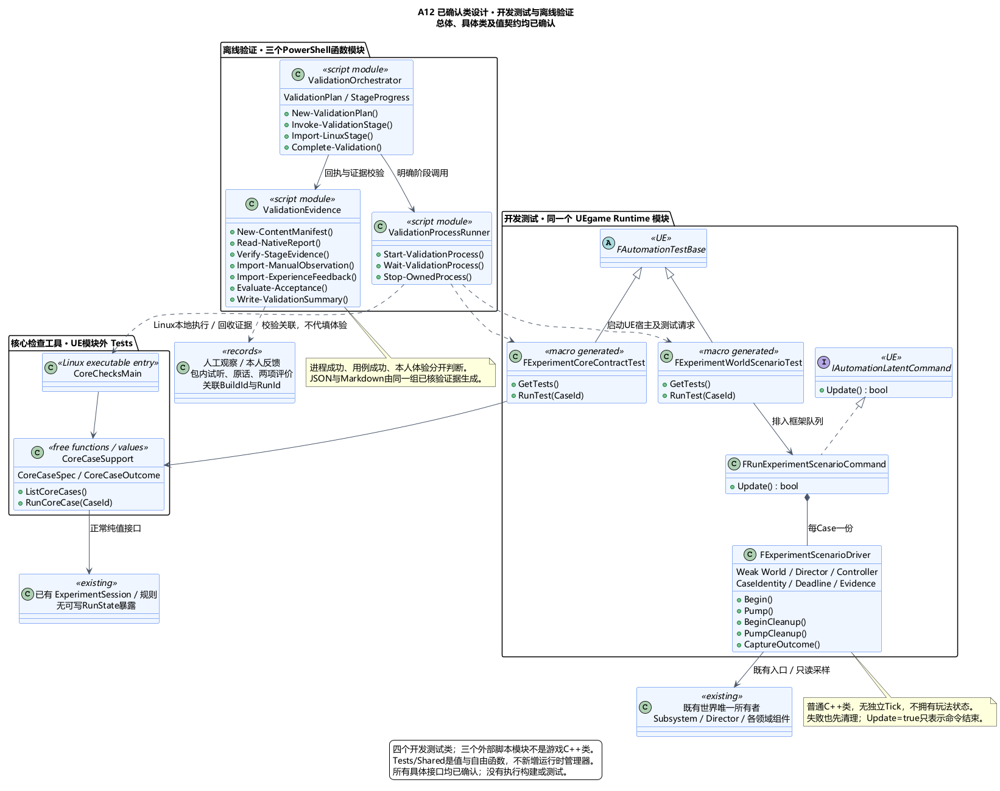
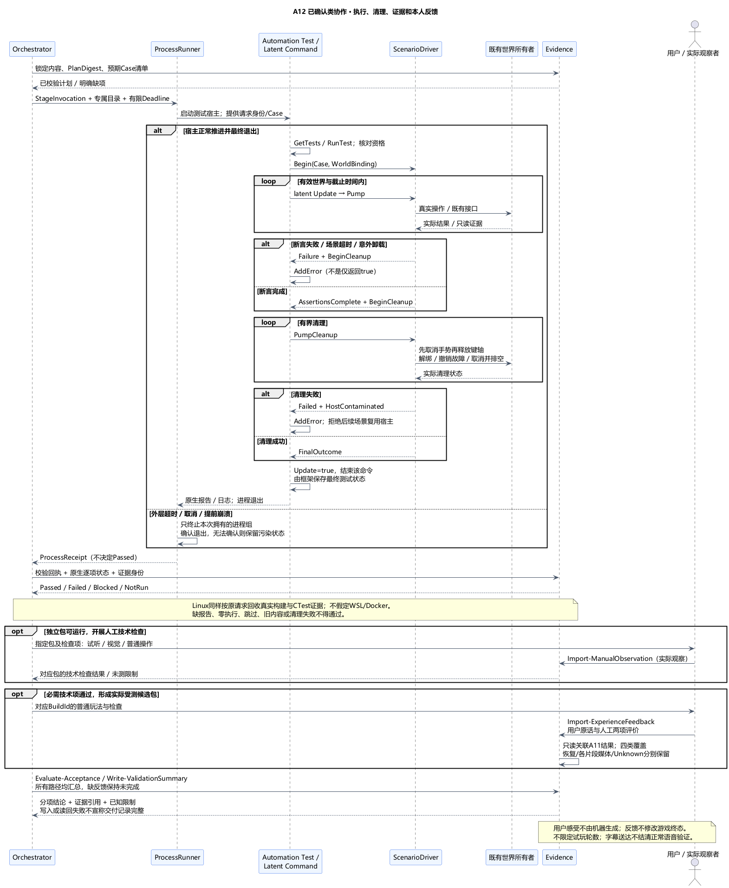

# A12 类图：测试驱动、验证编排与验收记录

状态：**类图已确认**。日期：2026-11-06。[本次类图确认](../../requirements/001-causal-prototype/sources/2026-11-06-a12-class-confirmation.md)接受四个开发测试类、三个本地脚本职责模块、共享检查入口及证据值契约。[A12 总体](A12-validation-and-delivery.md)此前已获[用户确认](../../requirements/001-causal-prototype/sources/2026-11-06-a12-overall-confirmation.md)。以下名称、目录和接口为设计，不代表已创建工程或执行测试；本轮进入[架构汇总核对](ARCHITECTURE-SUMMARY.md)。

## 1. 技术栈、职责与原因

沿用标准C++20 / Linux GCC13 / CMake3.28 / CTest、UE5.6.1 Automation Framework、UBT/UHT/MSVC、UAT Win64 Development。Windows验证入口使用PowerShell7与.NET进程API；本机当前PowerShell为7.6.9。Linux侧只需已选CMake/CTest和核心工具链，不要求安装PowerShell或默认存在WSL/Docker。

### 1.1 UE 开发测试类

| 类 | 类型与所有权 | 主要接口和职责 |
| --- | --- | --- |
| `FExperimentCoreContractTest` | Automation复杂测试宏生成，继承`FAutomationTestBase`，框架注册持有 | `GetTests`列出规则CaseId；`RunTest`调用共享纯C++检查入口，将显式失败写入框架。使用Editor/Client适用标志；不创建游戏世界 |
| `FExperimentWorldScenarioTest` | Automation复杂测试宏生成，继承`FAutomationTestBase` | `GetTests`列出真实世界场景；`RunTest`验证请求资格并排入单个潜伏命令。使用Client适用标志，在实际游戏世界宿主运行，不依赖PIE编辑器辅助API |
| `FRunExperimentScenarioCommand` | 显式C++类，实现`IAutomationLatentCommand`；框架共享队列持有，命令以`TUniquePtr`独占Driver | `Update`逐帧推进Driver，失败写入当前测试；完成清理后才返回true。返回true只表示命令结束，不能冒充用例成功 |
| `FExperimentScenarioDriver` | 普通UE C++类，无UObject/Actor/独立Tick；每个场景一份 | `Begin`、`Pump`、`BeginCleanup`、`PumpCleanup`、`CaptureOutcome`；拥有场景步骤、截止时间、证据、清理进度；弱绑定World/Director/Controller及运行代次，不拥有Session或玩法状态 |

宏生成的测试类与显式声明的命令/驱动类在图中区分。四者均只在`WITH_DEV_AUTOMATION_TESTS`条件下编译，仍位于一个UEgame Runtime模块；`WITH_AUTOMATION_WORKER`注册结果须实际核对。普通启动不安装测试驱动，不新增测试Subsystem、Editor模块或UnrealEd依赖。

两个测试族分别使用`UEgame.CoreContract.*`和`UEgame.WorldScenario.*`，均用ProductFilter。核心族可在Editor或Client宿主运行；世界族使用ClientContext与NonNullRHI，由`UnrealEditor.exe -game`或受测Development游戏进程的真实游戏世界运行，沿A03的Game Target即可，不新增Client Target。具体目标必须实际发现测试，不能将两个宿主结果无条件互换；被无渲染过滤的用例不得算通过。渲染/字幕/音频检查保持相应设备路径，实际听辨另有人工证据。

### 1.2 外部验证模块

| 模块 / 入口 | 形式 | 接口与唯一职责 |
| --- | --- | --- |
| `ValidationOrchestrator` | PowerShell函数模块；`Invoke-Validation.ps1`为薄入口 | `New-ValidationPlan`、`Invoke-ValidationStage`、`Import-LinuxStage`、`Complete-Validation`；唯一拥有本次计划、阶段顺序和完成状态，只从验证后的结果推进 |
| `ValidationProcessRunner` | PowerShell函数模块 | `Start-ValidationProcess`、`Wait-ValidationProcess`、`Stop-OwnedProcess`；结构化程序/参数、工作目录、输出、超时和所创建进程的生命周期；只产生进程回执，不判断技术或体验通过 |
| `ValidationEvidence` | PowerShell函数模块 | `New-ContentManifest`、`Read-NativeReport`、`Verify-StageEvidence`、`Import-ManualObservation`、`Import-ExperienceFeedback`、`Evaluate-Acceptance`、`Write-ValidationSummary`；身份/报告/反馈校验及报告投影，不启动进程或修改游戏结果 |

三个模块是开发工具中的函数集合，不画成游戏C++类，也不强制实现成PowerShell class。JSON记录是唯一机器可读验收记录，Markdown由相同已核对记录生成，不另维护一份人工改写的成功状态。原生报告和原始反馈保留作证据，不因生成摘要被替换。

此拆分使进程退出、技术用例成功、本人主观体验各有自己的证据和判定入口。代价是维护小量显式计划与适配代码；不新增通用任务平台、远程执行服务或运行时验收状态机。

## 2. 共享纯核心检查与编译边界

新增共享检查支持放在`Tests/Shared/`，提供标准C++值`CoreCaseSpec / CoreCaseOutcome`及自由函数`ListCoreCases`、`RunCoreCase`。每个CaseId对应明确场景函数，通过Session正常类型化入口及规则函数驱动，返回显式断言结果；不依赖UE、异常、RTTI、系统时钟或可写RunState，也不建立第二套完整规则实现。

- Linux的`experiment_core_checks`主程序按CaseId调用共享检查；未知ID、空场景、断言失败返回非零。CTest显式注册每个场景，并传入本次ValidationRunId/StageId用于报告关联。检查日志包含CaseId及开始/结束标记，不能只输出统一“OK”。
- UE的CoreContract宏生成类枚举同一目录、调用同一`RunCoreCase`，将失败交给`AddError`，不是启动Linux二进制。两端必须实际执行并核对同一规则清单。
- 共享检查头实现采用明确的header-only检查支持，Linux main和UE测试翻译单元各自编译；不将模块外测试`.cpp`临时包含进生产核心。生产核心显式源码清单与UBT核心`.cpp`集合仍按A03比对，公开头各自独立翻译单元编译。
- `UEgame.Build.cs`只在开发测试启用时增加项目相对的`Tests/Shared`私有include路径；不加入核心的生产Public API，不在构建规则里启动任何检查。是否启用开发测试与实际Worker注册由构建和发现记录证实。

核心规则检查允许合成事实；WorldScenario以真实操作和接触链取证。共享CaseId只是可追踪映射，不表示合成命中能够替代真实碰撞或声音送达。

## 3. 身份、计划与结果值

| 值 | 最小字段及语义 |
| --- | --- |
| `ContentManifest` | SchemaVersion、SourceIdentity、核心源/规则/配置/用例清单摘要、素材绑定和音文版本；规范化相对路径、原始字节大小及SHA-256。排除运行数据和构建输出，清单不自哈希 |
| `BuildArtifact` | BuildId、SourceIdentity、平台/配置、实际工具链/SDK/UE版本、产物清单与摘要；源码身份先有，包生成后才有最终产物摘要 |
| `ValidationPlan` | ValidationRunId、PlanDigest、清单版本、所需Stage/Case及依赖、期望内容身份、独立输出根、每阶段有限超时、人工证据需求；StageKind区分构建/发现/执行/归档核对，TargetRef区分SourceTarget与PackageTarget；执行前锁定，不从实际报告反推预期清单 |
| `StageInvocation` | StageId、AttemptId、宿主/目标、程序与参数数组、工作目录、测试根、输入内容摘要、预期CaseId、输出位置和Deadline；Discovery与Execution为不同阶段 |
| `ProcessReceipt` | 本次身份、真实程序/参数、PID与启动身份、开始/结束、ExitCode或启动错误、TimedOut、退出确认、日志/原生报告引用；启动失败没有伪造的退出码 |
| `CaseResult / EvidenceRef` | Stage/Case/Attempt、原生状态、规范状态、断言/警告、Cleanup结果、关联内容/Build、证据相对路径/摘要；引用必须落在本次或显式导入的不可变证据目录 |
| `ManualObservation` | ObservationId、BuildId/产物摘要、检查项、实际观察者/方式/时间、Observed/Failed/NotObserved、描述及证据；包内试听、视觉、普通输入和实物限制不自动推断 |
| `ExperienceFeedback` | FeedbackId/修订来源、BuildId、RunId及已提交结果引用、实际类别、用户原话、两项人工评价、恢复/音频/耗时/输入标记；未知字段显式Unknown |
| `AcceptanceSummary` | SummaryId、ValidationRunId及导入记录摘要、逐项Passed/Failed/Blocked/NotRun；分列TechnicalGate、PlayerExperienceCoverage和DeliveryReadiness，记录候选/未完成/验收满足及已知限制；引用到具体证据，不持第二份可改游戏结果 |

ValidationRunId标识一次验证，TestRunId标识绑定父阶段及专属数据根的受控会话，游戏RunId标识一轮玩法，三者不可混用；手动新轮测试可在一个TestRunId下产生多个游戏RunId。StageId与CaseId在计划中稳定，AttemptId标识实际执行；修正后新验证保留前次关联，不能在原记录中把失败覆写成成功。测试目标和产物身份共同限定结果，旧Linux报告或另一包的音频试听不能补到本次通过项。

源码/素材清单与归档包分别做字节核验；不把Git提交号当成资产或二进制的摘要。构建前后核对输入未变化，产物在首次包内检查前完成清单，检查后及交付前再核对；运行产生的数据放独立目录不计入包内容。内容变化则新BuildId/验证记录，不复用旧成功结论。

## 4. 本地编排与跨平台证据回收

Orchestrator按计划验证实际工具链、内容和前置阶段，交给ProcessRunner执行；Evidence读取原生报告，结合预期清单和进程回执判定，Orchestrator再推进。计划缺少超时、预期非空用例或输出隔离时拒绝启动该自动测试阶段。核心库构建/头编译等非测试阶段有各自明确产物和编译记录条件，不强行套用CTest用例数量。

ProcessRunner使用明确程序路径和参数数组，日志异步排出避免管道阻塞；不拼字符串执行任意Shell表达式，不以窗口出现判为启动完成。`RunUAT.bat`等必须经过命令解释器的入口采用固定模板和专用参数转义；传入路径先检查，不能把JSON序列化当作Shell转义。进程启动与本次输出根绑定，取消/超时只终止本次创建并核验身份的进程组；不得按进程名批量关闭用户编辑器或其他任务。

超时或取消后等待实际退出并释放日志句柄；无法确认子进程已退出则记录失败、污染该执行环境，停止后续依赖步骤并保留目录，不用“已发终止命令”冒充已清理。每次输出目录新建且不复用；默认保留成功及失败证据，不自动递归删除历史目录。

Windows没有可用Linux执行环境时，Orchestrator产生`LinuxStageRequest`，含请求身份、源码副本/清单、明确Case清单和预期目标。之后在实际Linux环境通过项目`CMake/CTest`入口执行并返回`LinuxStageBundle`，包含真实版本、构建/头检查记录、测试发现、JUnit、原始输出及响应清单。导入必须匹配原请求、逐文件核对摘要、执行身份和规则用例；实际环境不符、内容变化、缺报告均不能通过。未执行/未返回保持Blocked或NotRun，不默认安装WSL、Docker或远程服务。

本设计只定义本地执行与外部证据导入边界；采用何种已准备好的Linux宿主由实施环境决定，仍必须满足A03固定基线。CMake参考/发现输出、旧压缩包、Windows MinGW输出都不能冒充Linux执行证据。

## 5. UE 场景驱动与清理

WorldScenario的RunTest先核对本次请求文件、TestRunId、CaseId、测试数据根和目标世界。资格不符就AddError结束，不安装驱动。请求由外部入口明确提供，普通启动没有请求，不能因Development配置默认注入故障或自动操作。测试身份用于本地隔离和关联，不宣称是抵抗恶意本机用户的安全机制。

Driver流程为`Validate → Prepare → Drive/Observe → Cleanup → Done`。Prepare只通过既有Director/Subsystem及领域公开生命周期装配；不直接赋写生命、阶段、送达位或可写RunState来完成断言。受控场景的初始对象和故障设置必须在计划中说明；真实集成证据从实际碰撞、导航、回执或文件结果产生。对最终结果之外的内部不变量，只增加开发条件下的最小只读诊断采样，不向UI公开未来分支或创建另一份运行状态。

Driver在游戏线程随latent Update推进，不阻塞主线程等导航/音频/文件结果。拥有基于单调时间的场景截止时间，测试推进不得把游戏计时器当测试超时；每次取World/对象都验证弱引用、绑定身份和预期Run/RecoveryGeneration。发生预期恢复时仅在实际恢复凭据成立后更新测试绑定；意外世界切换/卸载则失败并清理，不能静默追随新World。

完整模拟输入由Driver的`SendKey / SendAxis`使用`FInputKeyEventArgs::CreateSimulated`构造，经过有效运行时视口的`UGameViewportClient::InputKey / InputAxis`、目标Controller及既有映射上下文；设备身份须匹配目标LocalPlayer。轴以正常帧节奏提供轴值、DeltaTime/NumSamples，结束归零。只调用Controller新`InputKey(EventArgs)`的用例明确为Controller起点覆盖；“直接注入InputAction”的结果单列为后半链检查。处理返回值不能代替实际行为断言，也不证明硬件/操作系统输入链。

Driver记录自己持有的键轴；清理先沿A05/A06取消手势、失效未消费意图和设置AwaitRelease，再释放键并归零轴，避免清理松键发射一次魔法。随后恢复测试设置、解绑本次委托、撤销故障开关，并经已有取消/排空入口确认异步任务和保存作业不再写入。测试操作不能额外重启游戏轮次来伪装原场景通过。

断言失败、超时或取消都进入同一清理流程。潜伏命令先AddError，再有界等待清理；清理失败也AddError并标记宿主污染，后续场景不得在该宿主继续。测试宿主进程退出为最终隔离边界；外部Runner仍验证其退出。本次只清理拥有的测试资源，测试目录保留。

框架直接移除latent队列时不保证调用异步清理。Driver析构只做安全同步的撤销/解绑兜底，不阻塞等待、不补发成功；外层取消/崩溃路径必记未完成/失败并结束专用宿主。Driver只在游戏线程采样/处理自己的世界通知，异步工作由既有所有者持有，不能捕获Driver裸指针到会晚到的后台回调。宏生成测试对象不持跨Case世界状态，GetTests仅枚举不做装配副作用。

A11故障检查分两种：纯规则可输入操作结果；真实IO使用隔离数据根与明确失败点，在真实文件操作边界注入打开/写入/发布失败，并检查实际磁盘与恢复。发布成功而响应不明的测试必须先有真实提交再丢回执；跨进程恢复由外部编排保留同一测试目录并启动新的专用进程取证，不在一个Driver里假装重启。该测试扩展不改变正常Store写顺序、统一三次重试或终态保护。

## 6. 原生报告与通过判断

| 输入 | Evidence模块的必要核对 |
| --- | --- |
| CTest | 发现清单匹配预期；JUnit及本次检查输出可解析；预期Case全部实际执行、完成并成功；未知/重复/缺失/跳过/零用例或非零退出均失败。发现记录本身不算执行 |
| UE Automation | 实际测试名映射到固定CaseId，按每项最终状态判断，含Skipped/NotRun/InProcess；检查本次请求身份、报告日志、Driver清理结果和进程回执，不能只读汇总数量 |
| UBT/UAT与包 | 真实退出/日志、目标与工具链、输入身份、实际产物清单；正确实验地图与声音等Cook后加载、独立启动及普通路径检查另外取证 |
| 人工观察/反馈 | 导入格式和关联身份可自动校验；实际听感、视觉和两项因果评价必须来自对应观察及用户原意，不由哈希/日志/算法填为通过 |

原生报告格式按实际固定工具版本解析，未知结构或无法识别的状态拒绝判通过。单个计划Case若需要多项断言，必须全部完成；不能择取某次成功覆盖同Case先前失败。警告保留，是否影响判定说明理由。缺工具/前置条件为Blocked；计划中未启动为NotRun；启动后崩溃、超时、缺报告或证据不合格为Failed。

仅对当前明确检查范围形成Passed；必要技术项全满足且产物身份一致才形成试玩候选。手柄实物未测按已接受限制列出，不虚构Passed，也不自动阻塞原型候选；其他必需项不能用“已知限制”自行豁免。测试不设自动尝试四次取最好成绩，A11提交重试仅在游戏被测路径内发生。

## 7. 本人反馈及验收汇总

ExperienceFeedback单独存于验证材料目录，不写回A11快照、终态或JSONL。Import仅接收已有用户原话和人工评价：`CausalChain`与`ChoiceImpact`各为Met/NotMet/Unknown，记录评价者和引用原话；助手可以整理原意，但不能代填用户感受。反馈修订使用新FeedbackId与Supersedes引用，保留旧版；矛盾尚未澄清时保持Unknown，不挑选有利片段自动通过。

四类覆盖按真实结果核对，未获救须呈现小孩遇难；TechnicalAbort或玩家死亡而小孩存活不结清该剧情类别。本人评价可跨若干轮比较，记录关联的RunId集合，不要求每轮单独满足两个指标；三条成功方向的比较和对应内容仍须实际经历。四类覆盖及用户对比较体验的两项标准全部具备，才形成体验满足结论，不固定轮数/顺序。

恢复、字幕模式及未知耗时是独立字段，不因某项为正常而推断其余正常。反馈记录RecoveryUsed、恢复来源、是否见过已回退内容、TimingCompleteness；媒体可能逐片段不同，记录各关键Segment的实际DeliveryMode与声音健康，不用一个正常片段覆盖另一个字幕降级。资料不足记Unknown并保留待验证原因，不要求预设重玩次数。

Evaluate-Acceptance只合并已核对的技术记录和人工结论：恢复样本不混入无标记正常样本；TextOnlyChosen/TextFallback不结清正常有声验收；技术标准和因果体验互不替代。无论技术检查成功、失败、Blocked或尚无候选包，都调用汇总入口；缺反馈保持Unknown/NotRun，保留待完成原因。最终摘要仍列出各维度结果和已接受限制，不把包已存在或用户说“流程跑通”转换成全部通过。

JSON摘要写入/读回失败时，Complete-Validation不得宣布交付记录完整；保留原始证据并返回失败。重建摘要可读取相同不可变证据生成新SummaryId，不能重新执行游戏或消除原失败。此处是开发验证材料写入，不新增第二套游戏恢复器，也不套用A11的三次重试预算。

## 8. 目录、生命周期与后续步骤

以下为未来布局，均按项目根定位：

```text
Tests/Shared/                       # 标准C++检查目录和值/自由函数
Tests/ExperimentCore/               # A03已有检查程序main
Source/UEgame/Private/Tests/         # 四个开发测试类与必要只读/故障测试适配
Scripts/Validation/                 # 薄入口、三个PowerShell模块、Linux CMake执行入口
Validation/                         # 版本化用例清单、报告格式、人工记录模板
.build/validation/<ValidationRunId>/ # 计划、阶段输出、日志、原生报告、测试数据
Deliverables/<BuildId>/             # 受测归档包及独立交付材料
```

版本化清单不保存个人绝对工具路径，实际路径只进入本机调用记录。产物和测试数据在工程初始化时加入对应忽略规则；没有Git也能生成内容清单。测试根须解析为已创建专属目录并校验范围，拒绝越界/链接重定向；不把普通用户保存目录设成测试根。

本项类图已确认。后续已授权目录、模块分工和本地仓库初始化，并明确[输入→核心处理→渲染反馈小于50ms](../../performance/001-input-to-render.md)。性能目标新增到验证计划和证据要求，现有类职责不变；实际性能、工期/投入和受测配置并未因此得到证明或补齐，也不自动运行游戏测试、制作素材或正式冻结。实施和正式版本生成另按后续指示推进。

## 9. 本机依据与待执行验证

沿用[A12总体本机依据](A12-validation-and-delivery.md#8-本机依据替代方案与当前局限)，补充以下本机UE5.6.1源码，路径相对`G:/Epic Games/UE_5.6/Engine/Source/`；接口存在不代表场景执行成功。

| 源码位置 | 设计依据 |
| --- | --- |
| Runtime/Core/Public/Misc/AutomationTest.h:4021–4045、4160–4172、4230–4234 | Complex宏生成完整类及GetTests/RunTest声明，不能再手写同名类；Worker条件才注册实例 |
| Runtime/Core/Public/Misc/AutomationTest.h:518–558；Runtime/Core/Private/Misc/AutomationTest.cpp:616–644、674–685、1080–1102 | Update真假仅为等待/结束；超时需自管；移除队列不承诺异步清理；最终成功还要求没有AddError等失败 |
| Runtime/Core/Private/Misc/AutomationTest.cpp:742–801 | Context依据宿主状态，ClientContext不要求新Client Target；NonNullRHI过滤用例需纳入缺项判断 |
| Runtime/Engine/Public/InputKeyEventArgs.h:143–151；Runtime/Engine/Private/InputKeyEventArgs.cpp:30–58 | CreateSimulated构造带实际时间戳的模拟键轴事件 |
| Runtime/Engine/Classes/Engine/GameViewportClient.h:172–173；Runtime/Engine/Private/GameViewportClient.cpp:767–770、831–852 | 视口键轴入口按设备转Controller；轴转发需要有效视口 |
| Runtime/Engine/Classes/GameFramework/PlayerController.h:1770–1776；Runtime/Engine/Private/PlayerController.cpp:2366–2378、2395–2397 | 新InputKey(EventArgs)入口与设备/本地玩家校验；旧InputKeyParams重载弃用且final |
| Runtime/Engine/Classes/Engine/World.h:4397–4401、4451–4452 | 世界拆卸/清理委托可用于弱绑定失效，须移除自己的handle |

当前仅文档和本机接口核对，未执行UE/GCC构建、测试驱动、文件故障、素材准备、独立包或本人试玩。后续必须核对共享用例确实双端执行、宏/Worker发现、latent错误与清理语义、真实输入/存储路径、Linux导入身份、包字节与素材版本、完整原生报告及独立人工反馈。





[类图 PUML](A12-class-design.puml) · [协作 PUML](A12-class-validation-protocol.puml)。四个开发测试类、三个脚本职责模块、共享检查入口、身份/证据/反馈值、执行与清理生命周期及两份PUML均已确认。参见[本轮汇总](ARCHITECTURE-SUMMARY.md)。
