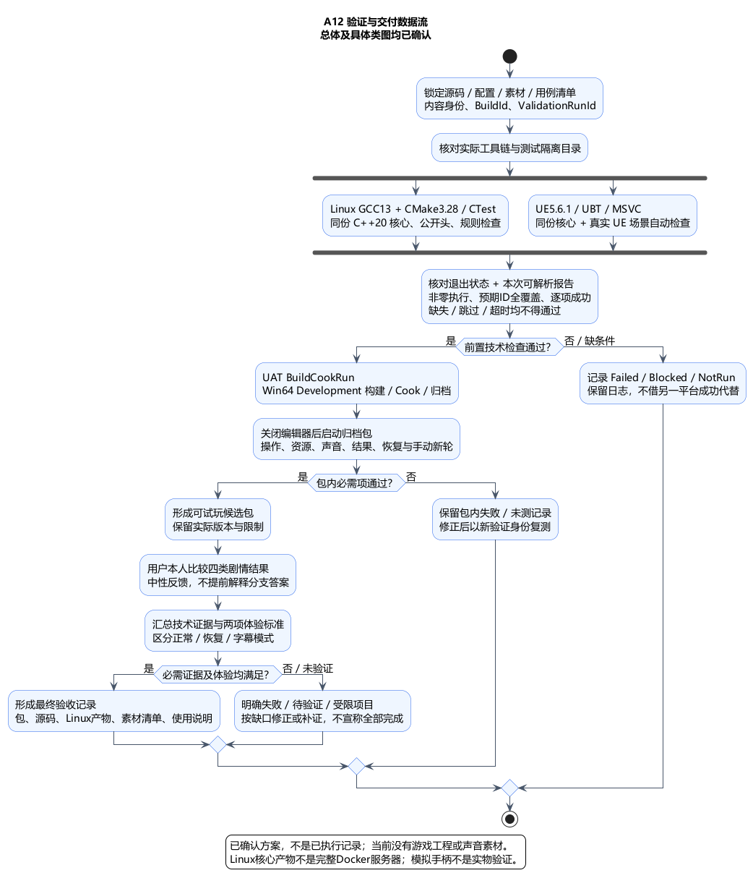
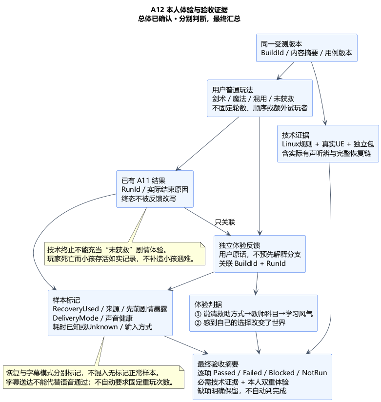

# A12：分层验收、证据与原型交付

状态：**总体方案与类图均已确认**。日期：2026-11-06。A01–A11 与提前讨论的 A13 总体及类图已确认；[最新 A13 类图确认](../../requirements/001-causal-prototype/sources/2026-11-06-a13-class-confirmation.md)后进入本项。[总体确认](../../requirements/001-causal-prototype/sources/2026-11-06-a12-overall-confirmation.md)接受验收技术栈、数据流、证据、交付内容和六组取舍；[A12类图](A12-class-design.md)现已获[用户确认](../../requirements/001-causal-prototype/sources/2026-11-06-a12-class-confirmation.md)，进入[本轮汇总](ARCHITECTURE-SUMMARY.md)。当前没有游戏工程或声音素材，不执行构建/测试，也不把方案确认当作验收通过。

依据：[需求 §8–10](../../requirements/001-causal-prototype/REQUIREMENTS.md#9-验收标准)、[唯一试玩者与双重体验标准](../../requirements/001-causal-prototype/sources/2026-10-30-causal-acceptance-and-tester.md)、[四类结果覆盖](../../requirements/001-causal-prototype/sources/2026-10-30-acceptance-outcome-coverage.md)、[A03 构建类](A03-build-class-design.md)、[A11 快照恢复](A11-class-design.md)与 [A13 声音和素材契约](A13-class-design.md)。既有行为与判定保持不变。

## 1. 验收分层、技术栈与原因

维护补充（2026-11-06）：后续用户已授权本地仓库初始化和模块分工，并明确输入→核心处理→渲染反馈端到端小于50ms；以[性能契约](../../performance/001-input-to-render.md)及[当前进度](../../progress/CURRENT.md)为准。四层验收与类职责保持不变；仓库文档检查不冒充游戏验收。

| 层次 | 技术栈与入口提案 | 能证明的范围与原因 |
| --- | --- | --- |
| 纯核心 | 已确认 Ubuntu24.04/x86_64、GCC13、CMake3.28/CTest；experiment_core 与 experiment_core_checks | 同一标准 C++20 源码的规则、身份、计时及错误决策；无 UE include/PCH/Unity，独立公开头编译检查，尽早发现移植依赖 |
| UE 规则与场景 | UE5.6.1 原生 Automation Framework、项目开发测试与明确的测试场景；UBT/UHT/MSVC | 同一规则场景的 Windows 语义与实际输入/碰撞/导航/几何/媒体/文件适配；自动测试只通过既有入口，不能以直接置完成位代替集成 |
| 独立包 | UAT BuildCookRun → Win64 Development 包 → 独立启动及场景检查 | 确认代码、资源、配置和运行目录实际可用；编辑器运行/Live Coding 不能代替 Cook 后的游戏 |
| 本人体验 | 同一受测包、普通玩法路径、已有 A11 结果＋单独反馈记录 | 用户亲自比较四类结果，并说明因果链与主观改变感；机器完成和日志不能替代此项 |
| 编排与证据 | 小型本地 PowerShell 编排入口、核心侧 CMake/CTest；结构化 JSON 检查摘要＋Markdown 报告 | 保留每项命令/用例/版本/产物和结论；不新建在线测试平台，未来 CI 可调用同一已验证入口 |

继续使用一个 UEgame Runtime 模块；项目开发测试按开发测试编译条件隔离，不因测试默认新增 Runtime/Editor 模块或引入 UnrealEd 依赖。测试场景和开发驱动是否编入相应目标、如何触发及依赖关系在本项类图细化；不能假设安装版任意配置都包含相同自动测试。

纯核心检查和 UE 规则适配复用同一组输入/预期数据，预期由已确认行为定义，不另写第二套完整规则来“互相验证”。整数、枚举、事件和身份按精确语义核对；几何浮点按场景明确误差范围，不承诺两个平台的物理过程或每一位浮点完全相同。模型正确性、真实接触和玩家感受分别取证。

## 2. 构建与检查数据流

准备目标版本、源码/配置/素材清单及检查目录 → 核对真实工具链 → 两条同源构建路径 → 规则与 UE 场景检查 → 构建独立包 → 对该包运行操作/声音/持久化核对 → 形成可试玩候选包 → 用户实际体验与反馈 → 汇总最终验收状态。

Linux 与 Windows 构建可独立运行，但最终摘要须绑定同一源码内容身份和一致规则/配置版本。未准备好的某一路记 Blocked/NotRun，不能借另一路成功合并成通过。Linux 检查产物不链接进 Windows UE；未来 Docker 正式宿主仍未设计，本项不把静态库或检查程序称作游戏服务器交付。

每次检查使用唯一 ValidationRunId；每个候选包有 BuildId 和产物摘要。先锁定受测内容身份，再执行检查并关联结果。没有 Git 时记录内容清单及摘要；以后有 Git 可增加 commit/dirty 标记，但提交号单独不能证明实际资产或运行包一致。受测包、源码/配置/音文/检查清单发生实质变化即形成新身份，旧结果保留而不改成新版本已通过。

编排入口只做运行检查、收集结果与退出状态，不在 Build.cs/Target.cs 构造中启动 CMake、安装工具或生成素材。工具版本缺失须报告缺项；不能静默用现有其他 MSVC 或 Windows MinGW 冒充 A03 固定基线。后续已建立本地仓库和RepositoryBaseline文档检查，GitHub工作流文件已准备；托管CI运行、实际工具安装与正式发布未执行。

## 3. 最小验证矩阵

以下是对既有范围的证据覆盖提案，不增加玩法、试玩次数或各类细节参数。自动核心测试可以注入合成事实核对规则，真实场景测试必须从对应真实入口取得结果；两者分别标识。

| 范围 | 重点场景与断言 | 主要证据层 |
| --- | --- | --- |
| A02/A03 流程 | 世界启动/发现/首次攻击三起点；统计窗及空方式缺口；同批死亡优先；未开始为 null；旧事实拒绝；实际恢复控制才进回访 | 核心双编译＋UE稳定批次场景 |
| A04/A05 空间与输入 | 局部球面与空气墙覆盖合法移动；非活动区不建模；地图不泄露分支；双视角、径向移动、接地闪避、失焦/地图/释放重武装 | 真实UE＋独立包操作；模拟Key/Axis路径 |
| A06 战斗 | 任意已支持航向/俯仰纬度弹道与射程边界；松开发射一次、取消不发射；多目标/防反/误伤；EndOnce、首次落地消费、掉棒 | 核心几何边界＋实际运动接触链 |
| A07 行为与导航 | 五敌目标/脱战/原棒拾取和无进展转换；绕倒木、动态更新、完整World/Nav转换、旧导航任务实际排空 | 真实UE导航/行为场景＋包内路径 |
| A08 木体 | 多口联合断桥/严格阈值、单刀预算与裁分、共同前缀、碰撞准备失败不发布新状态；受控倒落/支撑/分段通行 | 纯几何规则＋真实几何/碰撞事务 |
| A09 环境 | 火雨边界、雨中新火/残火差异、雨后潮湿、材料裁分守恒/历史、早晚救援旧雨结算、恢复雨程不重复消费 | 核心规则＋真实环境/木体集成 |
| A10 回访 | 三方向音文、两类关键内容、自由离开/挽留/补播、Optional不计完成、三Ready和实际控制恢复、剧情实体真实接触 | 核心回执场景＋实际视口/人物/包内流程 |
| A11 保存恢复 | 同切点完整载荷、首次＋3次、发布成功但回执不明、冲突不覆盖、继续点失败不循环、逐步装入失败关闭、终态不可复活、导出重建、跨进程时间 | 规则故障表＋隔离目录真实文件IO＋全场恢复 |
| A13 素材 | agent合成对白；开放音效候选/匹配/无匹配再合成记录；准确全文/说话者/分支、版本、循环与实际听辨 | 素材准备记录＋实际声音检查，不以哈希代替听辨 |
| A13 运行 | 先绑后播、旧回调/duck、Master静音、字幕降级新代次、完整媒体收尾后提交、保存暂停/恢复重播、声音Cook | UE场景＋有画面有声的独立包 |
| 多轮与交付 | 正常成败后手动新轮、同UWorld实体/任务/音量/混音清理、旧记录保留；新包正常启动、恢复入口和诊断可用 | 独立包人工/自动检查及结果核验 |
| 因果体验 | 剑术、魔法、混用、未获救实际比较；不借外部解释理解因果链并感到选择改变世界 | 用户本人的原始反馈与对应Run/Build |

核心与集成场景围绕上述高风险不变量组织，不追求为每个 getter 或文件路径补镜像测试。关键边界/错误分流须有可判定预期，正常状态的期望可通过公开只读投影检查，不能直接访问或赋写私有 RunState。

## 4. 测试隔离与通过判据

验证会话使用专用测试启动资格、TestRunId 和独立数据根。故障注入、合成事实、时钟推进或自动输入均只存在于对应测试会话；普通试玩不加载这些入口或覆盖。测试可以通过既有生命周期准备一个受控场景，但不能修改正式规则、放宽阈值或直接发“已命中/已听到/已就绪”来声称真实链通过。

文件故障场景仅操作该测试建立的目录和进程。先按 A11 的纯结果表核对决策，再检查真实临时文件/载荷/清单/读回/重启发现；模拟 Store 返回成功不算实际持久化证据。进程终止、部分写入或目录冲突都要绑定本次测试身份，保留失败样本，不能清除用户试玩快照来制造案例。

检查结果区分 Passed、Failed、Blocked、NotRun。缺工具/资源或前置条件为 Blocked，未执行为 NotRun；缺报告、零用例、缺预期 CaseId、跳过、用例中途退出/超时、阶段失败均不得判 Passed。一次有效通过需要成功退出状态、本次独立目录内可解析的完整报告、非零执行数、预期用例ID全覆盖且逐项最终成功，以及相应证据一致。警告保留并核对影响。日志里的“启动成功”“Exported report”或队列清空不代表完整测试成功，自动化进程退出码和汇总数量也不是唯一依据。

Linux先发现并核对测试清单，再实际执行；`ctest --show-only=json-v1`仅发现，执行使用`--no-tests=error --output-on-failure --output-junit`并核对本次报告。UE检查还须核对实际开发测试/Worker编译条件与测试发现结果，按场景选择Editor或Client宿主；每项跳过/未运行状态都要纳入判断。具体命令参数和启动适配留类图阶段，不能把不存在的脚本写成已运行。

失败后修复并有针对性复测；新结果用新的 ValidationRunId，保留原失败及修复关联，不覆盖成未发生。A11 的三次重试是游戏提交策略，不是所有测试失败自动尝试四次取最好结果。通过后只因新修改、失败或未解决风险扩大检查，不重复无关全量流程。

不能用无渲染/无音频的执行方式证明字幕覆盖、相机、声音或实际听感。自动状态采样只证明软件行为，最终素材与有声包仍须实际听辨。模拟手柄要经过 Key/Axis→既有输入映射→上下文/取消/动作链；直接注入 InputAction 只能证明后半段，不能替代完整模拟路径，更不代表实物设备兼容性。

## 5. 本人体验、样本与反馈

用户本人比较剑术、魔法、混用和未获救四类结果；不规定恰好四轮、固定顺序或额外试玩者，不要求亲自覆盖所有失败原因。第四类体验须实际呈现小孩遇难及对应结束；技术终止不能充当该剧情类别。玩家死亡而小孩存活时如实记录，不补写小孩死亡，也不直接据此结清第四类体验覆盖。成功但方式为空属于应修正的归类/布局缺口，不能临时生成第四种教师。

使用普通受测包体验，操作说明只给控制和必要技术恢复操作，不在试玩前提示三条分支答案或后续教师身份。反馈先记录用户自己的话，建议使用中性问题：

- “这次你观察到哪些变化？你认为原因是什么？”
- “你的行动对后续经历有什么影响（如果有）？请举例。”

记录后再依据已确认标准区分“能否说明救助方式→教师科目→小镇学习风气”和“是否感到选择改变世界”。两项都满足才符合本轮因果体验标准；单纯复述剧情或正确输出日志不够。助手不替用户填写主观感受，不以系统送达位自动判定体验通过，结论只代表本轮唯一试玩者。

反馈记录与 A11 游戏结果分开保存，通过 BuildId/RunId 关联；不修改已提交终态或 JSONL 来补采访内容。建议最少记录结果类别、输入方式、RecoveryUsed/恢复来源、是否见过废弃分支内容、DeliveryMode/声音健康、耗时完整性、用户原话和两项评价/待确认原因。技术测试和本人体验记录明确区分。

恢复轮保留反馈，但标记可能已看过废弃内容及已知/未知耗时；不与正常轮无标识混算。TextOnlyChosen/TextFallback 轮可提供字幕路径与因果反馈，不能冒充正常语音播放验证。两种标记互不替代：没有恢复不等于声音正常。证据不足时记待验证，由实际缺口决定后续补充，不擅自规定必须重玩几轮。

当前没有真实手柄设备，报告保持“模拟信号路径结果；实物测试未进行”。这是已接受的验证条件，不能伪造通过，也不因设备缺席扩成新采购或多人测试要求。

## 6. 交付组成、版本与就绪状态

提议交付一个可独立启动的 Win64 Development 原型包，以及可复查的项目和验证材料。Development 便于本轮诊断，不等于运行时自动启用测试驾驶/跳阶段/故障注入；正常启动进入正式实验路径。

| 交付项 | 内容与边界 |
| --- | --- |
| Windows 原型包 | 实际受测的可执行程序、Cook资产、运行配置及必要运行依赖说明；归档后的内容与被测包核验一致 |
| 项目与源码 | UE工程/Source/Content/Config、同一份ExperimentCore、CMake/检查输入/验证入口；不把个人安装路径或已有用户运行数据混入源码交付 |
| Linux核心产物与证据 | 已确认目标的静态库、检查程序及真实构建/执行记录；标明平台/运行库版本，不能称为完整游戏或Docker服务端 |
| 素材清单 | A13请求、来源/合成/加工、导入与音文版本记录及实际需要的署名材料；不得用字幕降级掩盖未完成素材 |
| 验证与反馈 | 用例清单、各层摘要和失败/未测项、包/配置/内容身份、正常与恢复/字幕降级样本的明确标记；用户反馈保持原意 |
| 使用说明 | 启动条件、操作、手动新轮、保存/恢复入口、结果位置和已知限制；不预先解释因果分支答案 |

先形成“技术检查满足既定范围、可提交本人试玩的候选包”；本人体验尚未完成时只能标候选。最终验收同时汇总功能/持久化/声音证据及本人双重体验标准，任何必需项未通过都明确列出，不能把下载包存在视作全部完成。已明确的实物手柄未测限制单列，不伪装通过。

BuildId、源码/配置/资产与声音版本、UE补丁/Changelist、实际编译器/SDK/目标配置、核心Linux编译器/标准库、用例清单版本共同进入交付记录。没有执行的命令或缺失报告不写成成功记录。A11运行快照和用户结果保留在各自数据根；技术测试数据不覆盖也不混入用户新轮。

## 7. 实施顺序、性能与未固定约束

后续具备实施条件时，建议先完成 A03 双路径最小构建与独立包启动，再贯通救援→分支→跳时→回访→结果/手动新轮的最小可运行链，随后补齐全部已确认空间、战斗、导航、木体、环境、声音和恢复场景，最后在对应版本包上开展本人比较。中间可运行链是开发检查点，不以它代替最终已确认范围。

性能检查记录实际机器、分辨率/画质、构建配置与场景条件；关注五敌/多弹体/火雨/切树组合下的帧时间、明显卡顿、导航更新、保存冻结时长、恢复耗时和多轮资源增长。先形成可复现测量与问题清单，不凭平均帧率掩盖切树或保存停顿。

后续已确定性能硬目标：输入→核心处理→对应渲染反馈端到端小于50ms，依[测量契约](../../performance/001-input-to-render.md)验证实际呈现，不能用核心耗时、单帧或平均帧率替代。完成期限、投入上限及受测配置仍未固定，不自行承诺工期或写成“60 FPS 已达标”；约5/2/3分钟是既有体验目标，不是倒计时失败条件。

确认本项总体和后续类图本身不等于实际实现或正式冻结；后续仓库初始化已获授权。实现、验收报告和正式架构版本仍分别以实际工作及明确后续指示推进。

## 8. 本机依据、替代方案与当前局限

当前工作区仍是架构/需求文档与相关工具资料；未发现游戏工程、实际游戏 CMake 入口或游戏 CI。已有架构技能运行器不是游戏构建流程。A03 的[环境核对](A03-environment-evidence.md)记录当时 MSVC14.38 未发现、Linux环境未验证；不能把那些历史选型当作现已安装且通过。

本机 `G:/Epic Games/UE_5.6/Engine/Build/Build.version` 为 UE5.6.1 / CL44394996。下列路径相对于该引擎的 `Engine/Source/`，行号来自本机源码；用于确认入口与限制，不代表这些检查已执行。

| 本机依据 | 对本提案的约束 |
| --- | --- |
| Runtime/Core/Public/Misc/AutomationTest.h:90–126、4160；Runtime/Core/Public/Misc/Build.h:124；Programs/UnrealBuildTool/Configuration/UEBuildTarget.cs:5606–5616 | 测试有宿主标志、Worker注册及开发测试编译条件；EditorContext不等于项目依赖UnrealEd，不能只看测试类已编译 |
| Runtime/Launch/Private/LaunchEngineLoop.cpp:4650–4658；Developer/AutomationController/AutomationController.Build.cs:33 | 非Editor也有本地Worker/Controller入口，项目继续使用Runtime接口；需按实际目标发现测试 |
| Developer/AutomationController/Private/AutomationCommandline.cpp:323–343、465–474、552、580、696 | 无匹配记录错误，Automation Quit汇总错误；支持分号排队RunTests/Quit，仍需进程超时和报告核验 |
| Developer/AutomationController/Private/AutomationControllerManager.cpp:146–148、672–687、1052–1054 | Skipped不计入汇总数量；JSON报告写失败可仅警告，仍可能输出Exported report，须检查实际报告及逐项状态 |
| Programs/AutomationTool/Scripts/BuildCookRun.Automation.cs:16–17、26、252起；Engine/Build/BatchFiles/RunUAT.bat:19、85（此路径相对UE根） | Build/Cook/Stage/Package/Archive由参数控制；缺地图可能回退Entry，必须核对真实实验地图和归档后启动 |

本地VS2026随附CMake4.3帮助文档`Help/manual/ctest.1.rst:179–209、485–493`说明JUnit自3.21加入、发现不执行及普通CTest零用例不一定失败，支持上述选项用途；不证明已选Linux CMake3.28环境存在。后续记录实际工具版本后才能采用相应执行结果。

当前仅文档与本机接口核对，未执行 UE/GCC 编译、自动化用例、Cook、打包、声音试听或本人试玩。A13素材任务也尚未执行。

不采用“只有核心单元检查”，因为无法覆盖真实碰撞/导航/呈现；不采用“只有人工从头玩”，因为故障分流与旧回调很难稳定覆盖；不在本轮建立新在线测试平台或把 CI/GitHub 当作已存在条件。四层证据各有明确范围，代价是维护少量共同场景和版本化结果。

## 9. 本次确认组

| 确认组 | 提案 |
| --- | --- |
| 分层技术栈 | CMake/CTest核心＋UE原生自动化/真实场景＋UAT独立包＋本人体验；本地入口和结构化报告 |
| 用例与隔离 | 同源共同规则场景，覆盖A01–A11/A13高风险边界；测试资格/数据根独立，普通玩法不注入假完成 |
| 通过判据 | 完整报告、预期Case覆盖、实际证据与版本一致；零用例/缺报告/未执行不算通过，保留失败历史 |
| 体验与标记 | 本人四类比较、两项体验标准；恢复/字幕降级分别标记，模拟手柄与实物未测分开，不增加固定轮数 |
| 交付 | Win64 Development受测包、项目源码、Linux核心产物/证据、素材来源、验证/反馈及使用说明；候选与最终验收分开 |
| 顺序与约束 | 先最小双路径构建/打包再完整范围；输入→核心→渲染反馈小于50ms，待实测；工期/投入/受测配置未定；总体之后单独类图 |

[验证流 PUML](A12-validation-flow.puml) · [验收证据 PUML](A12-acceptance-evidence.puml)。总体选择与[A12类图](A12-class-design.md)均已确认；本轮进入[架构汇总核对](ARCHITECTURE-SUMMARY.md)。
