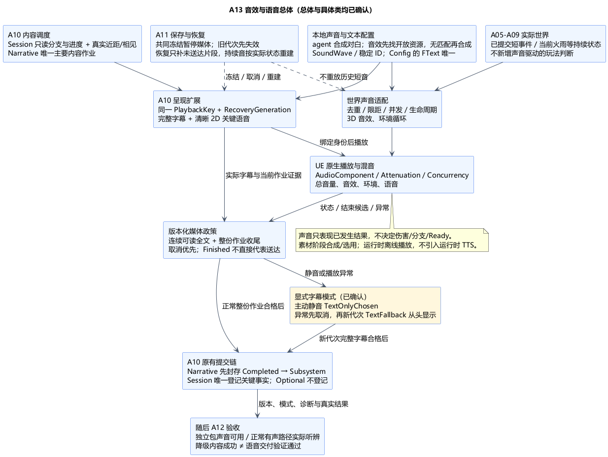
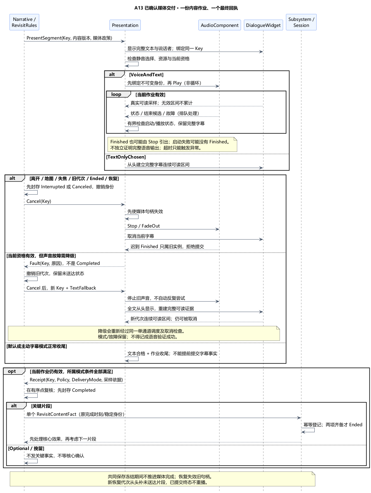

# A13：音效、语音、字幕与内容交付

状态：**总体方案与类图均已确认**。日期：2026-11-06。依[最新顺序调整](../../requirements/001-causal-prototype/sources/2026-11-06-audio-voice-order-change.md)，本项提前到 A12 之前，沿用 A13 编号。[总体确认及素材修订](../../requirements/001-causal-prototype/sources/2026-11-06-a13-confirmation-and-audio-sourcing.md)已接受本方案，并指定 agent 合成对白、音效先匹配开放资源再按需合成。[类图](A13-class-design.md)及素材准备契约现获[用户确认](../../requirements/001-causal-prototype/sources/2026-11-06-a13-class-confirmation.md)，继续 [A12](A12-validation-and-delivery.md)。没有实现或制作声音素材。

本项按此前“音效与语音”范围处理，先提供单一中文语音和中文文本，不扩成多语言工程。下列总体与最终媒体政策、具体类接口和素材准备值契约均已确认。

## 1. 技术栈、边界与原因

| 层次 | 已确认方案 | 原因与代价 |
| --- | --- | --- |
| 核心 | 既有标准 C++20 / Linux GCC13；Session 唯一拥有阶段和送达事实，RevisitRules 校验版本化纯值回执 | 保留未来宿主边界，不让声音对象决定结果；需由 UE 提供真实呈现采样 |
| 播放 | UE5.6.1 原生 AudioComponent / SoundWave；短语音非循环，每片段独立可取消实例 | 复用引擎播放和生命周期，不引入音频中间件、联网 TTS 或新 Runtime 模块 |
| 声音资源 | 素材准备 agent 合成中文对白；音效先查找匹配开放资源，无匹配再合成，随后导入本地资产；对白与三条方向内容绑定 | 按用户指定来源顺序准备，运行时离线可用；具体资源与生成工具在素材任务执行时选择 |
| 配置 | UDataAsset 绑定 CueId、事件类别、声音、音量/并发/衰减，以及 SegmentId/ContentRevision/语音时长元数据 | 稳定身份连接逻辑与素材，资源修改可检查；不靠文件名猜剧情分支 |
| 空间与混音 | SoundAttenuation、SoundConcurrency；SoundClass / SoundMix 区分音效、环境和语音 | 使用现有距离衰减、并发和压低背景能力，参数留灰盒调试；关键语音独立并发组 |
| 字幕 | 既有 URevisitDialogueWidget / FText，完整片段、说话者标识、非模态呈现 | 沿 A10 可读证据和自由操作；不另建字幕真源或独立对话系统 |
| 保存恢复 | 沿 A11 逻辑状态快照、恢复代次和统一故障处理 | 不保存音频设备/组件指针，不把声音播放秒数当剧情完成凭据 |

所有播放都是世界或内容已接受结果的表现消费者。AudioComponent 的暂停、结束或失败不能产生伤害、火灾传播、AI 仇恨、教师方向或跳时 Ready。核心不持 UE 资产、设备、文件路径和音频线程对象。Blueprint 可以指定素材、表现曲线和界面，不自行写 Session。

## 2. 声音范围与触发来源

| 类别 | 来源与表现 | 关键约束 |
| --- | --- | --- |
| 移动 | 实际移动/接地采样驱动脚步、起跳和落地短音 | 脚步可由已确认移动配合动画采样，但声音不证明移动或落地伤害；倒地首次伤害仍归 A06 |
| 战斗 | 已执行挥砍/施法、已提交接触/防反/受击/死亡结果驱动短音；在途弹体可挂循环音 | 按 ActionId/接触事件/实体及当前代次去重；失败输入和魔法取消不发射施法成功音；声源退役即停循环 |
| 木体 | 成功切削、实际断裂、受控倒落/碰撞驱动声音 | 不在准备失败时播“已砍断”；连续碰撞合并限频，不从声音回调推进材料事务 |
| 火雨与区域 | A09 实际火势/雨程、当前时代的森林/城镇环境，驱动有界循环和参数 | 循环随真实状态更新，不再跑一套雨计时或火势模拟；同类声源可限距/合并 |
| 关键语音 | A10 群众学习风气、教师救援回忆，三条方向的固定短片段 | 只接收 Narrative 当前作业；不从玩家当前武器、最后一击或文件名重新选分支 |
| 可选语音 | 已有铺垫、课程背景和教师短挽留 | 与关键片段共用一个主要内容通道，Optional 永不替代两项关键事实；不新增长对话树 |
| 界面与转场 | 小地图开关、已有操作反馈、简单中性转场音 | 不发未来分支/救援方式提示；声音失败不阻塞三 Ready，不新增配乐系统或旁白剧情 |

音效预算按类别限制，低优先级重复音可丢弃，不能拖慢领域提交或改变玩法。一次性事件在当前代次已处理即消费；因声源预算丢弃不重试回放旧攻击。持续音按当前状态重建，区别于一次性事件重放。

世界音效和环境使用活动区内的真实 UE 位置与衰减，不补建非活动区。听者沿当前实际游戏相机，第一/第三视角切换跟随 A05；小地图的 SceneCapture/Rig 不建立第二听者。相对方向来自最终相机和球面世界实际姿态，不使用固定世界 Z 推断当地上下。

## 3. 关键语音与字幕政策（本次重要新选择）

已确认默认使用**由素材准备 agent 合成的中文语音＋完整中文字幕**。合成在素材准备阶段完成，运行时只播放导入资产。关键语音作为近距内容作业的清晰 2D 播放，不再叠加空间衰减/遮挡，以免合法交谈范围内听不清；是否能开始和继续仍由 A10 真实人物距离、相见、视口和焦点资格控制。世界短音和火雨仍是 3D/环境声。代价是剧情声音的空间感较弱，换取原型关键内容清晰、可稳定核验。

同一时刻一个主要语音/字幕片段。语音开始时适度压低环境与普通音效，结束或取消时恢复，只修改本项混音状态，不停世界。并发配置不能替代 Narrative 的优先级与单通道规则；已播放的关键片段不被普通提示抢断。声音不能独立吸收地图/施法松键或获取输入焦点。

**内容完成以完整字幕的连续可读证据为基础，语音属于同一作业的呈现部分；不以音频结束直接证明“听到”。** 本项将 A10 的临时 TextGraybox 明确扩展为一个版本化媒体政策，包含以下模式：

| 模式 | 已确认的完成与异常规则 |
| --- | --- |
| VoiceAndText（默认） | 先显示完整字幕，再启动已绑定身份的语音。连续有效字幕须满足校准的可读门槛；本作业还须完成视听收尾，不能字幕刚达标就提前提交第二项事实、导致 Ended 切断语音 |
| TextOnlyChosen（用户主动关闭语音） | 完整字幕从头建立同样的可读证据后完成，记录该模式；不宣称本轮播放过语音 |
| TextFallback（播放故障降级） | 声音缺失/启动失败/异常提前结束/无法核验收尾等，先取消旧作业代次，再以同一未送达内容的新代次从头显示完整字幕；达标才提交，记录故障和降级模式，不能将此前半段补成完成 |

默认模式中，字幕保持覆盖整个语音呈现窗口，最短时长取可读门槛与经过资源校验的语音时长所需窗口；运行时仍需实际连续可读采样。音频结束只提交候选，经当前身份、无取消和内容版本核对后供收尾处理；明显提前结束/暂停不明/声音虚拟化或失去实例等转异常。启动/播放等待有界，超时仅触发 TextFallback 或诊断，绝不直接 Completed。具体等待边界在类图中定接口、实现时按资源与设备校准，不逐项询问毫秒参数。

**允许静音或音频异常后通过完整字幕继续，已随本次总体确认。** 声音播放是否完整/实际可听单列状态，不能由“字幕交付成功”改成“语音验证通过”。完整声音交付验收仍必须在正常有声路径中实际听辨，字幕降级不能替代。

可读条件沿 A10：全文不裁切、不省略、当前玩家视口可见且无遮挡、有焦点、有效近距和人物绑定持续成立；采样缺口不凭端点推断。字幕不按音节逐字隐藏全文，首版无需口型同步、逐字高亮或对话编辑器。能证明呈现并不等于玩家已阅读或理解，因果体验仍由 A12 本人反馈判定。

## 4. 数据流、身份与一次性提交

普通音效链：领域已提交事件/当前循环状态 → UE 声音适配按身份去重 → 配置选择素材和预算 → AudioComponent 播放/更新/停止。反向回执只管理表现资源与诊断，不回写领域结果。

剧情链：Session 只读分支/送达投影＋实际人物/玩家采样 → RevisitRules/Narrative 选择当前片段 → Presentation 建立一个字幕与语音媒体作业 → 有序采样、结束候选/异常/取消 → 当前媒体政策评估 → 作业先封存 Completed → Subsystem 送一个 RevisitContentFact → Session 幂等登记。Optional 只结束播放并重新调度，不等待不存在的核心完成事实。

沿用 FRevisitPlaybackKey，并补 A11 RecoveryGeneration/ContinuationId、MediaPolicyVersion、DeliveryMode、AudioInstanceGeneration、资源版本和设备/视口绑定代次。UE 证明可带声音状态和失败原因，核心只接收必要纯值，不信任 Widget 或 AudioComponent 自报类别。ContentId/SegmentId/KeyKind 和三方向来自已校验内容清单。

音频线程回调先转游戏线程，再排队到 A10 有序处理点。离开、地图、失焦、绑定失效、取消与恢复先应用，随后才评估 Finished 候选；**先撤销旧身份再 Stop/FadeOut**。回调带创建时身份，不能到达后补盖当前新代次。两项完成时先处理核心 Ended 和停止效果，不抢播下一句。TextFallback 的新作业不得越过已有其他关键作业，所有重播仍由同一 Narrative 调度。

## 5. 配置、音量与资源完整性

已确认提供总音量、音效、环境、语音四项本地音量设置，字幕在本轮保持开启。主动把语音设为零进入 TextOnlyChosen；中途改变媒体模式先取消当前未完成实例，新代次从头显示，不能拼接两种模式的计时。调整普通音效或环境音量不改变剧情进度。系统音量/声卡外部静音并非项目能可靠证明的条件，不推断玩家实际听到。

每个内容片段只有 Config 的 FText 一份文本真源；导入声音资产不另维护一套可漂移的字幕。资源校验包括非空全文、说话者/分支一致、单段非循环语音、内容版本与音频版本对应、有效有限时长、采样布局与独立包资源可访问。需要替换合成语音时更新对应内容/音频版本并使旧作业失效；不会让旧快照跨不兼容版本默默继续。

本轮素材数量有限，优先配置资产的显式反射引用；准备期间预加载关键语音并保持需要的资源引用，不在片段第一帧同步读磁盘。Cook/Package 清单纳入实际素材及配置，单纯编辑器试听不算独立包可用。关键文本/分支配置错误仍阻止对应 A10 布置就绪；只有音频不可用且文本完整时，按本次降级政策可进入 TextFallback，同时报告声音健康降级。实现验收时不能借此把遗漏全部语音的包判为完整声音交付。

音效失败做有界诊断，不为每次丢音生成一轮快照重试。剧情音频失败按单个内容作业一次降级处理，禁止反复 Play/失败/再 Play 无限循环；其诊断进入 A11 既有有界记录。记录写入本身失败仍由 A11 协调器统一处理，声音系统不增加文件重试器。

## 6. 快照、跳时与生命周期

| 场景 | 声音与字幕处理 |
| --- | --- |
| 普通快照保存冻结 | 在共同屏障前关闭新播放接纳，排空本批呈现回执，暂停当前语音/字幕有效时间；不能世界冻结而音频继续触发完成。保存成功后恢复尚有效实例并重新建立连续可读区间；暂停或实例状态无法核对则取消并重播/降级 |
| 快照恢复 | 失效旧 RecoveryGeneration，停止旧声源与回调；一次性历史声音不重放。持续火雨等按恢复后的领域状态重建；未送达内容以新播放代次从头呈现，已送达内容不重复登记 |
| TimeSkip | 停止救援瞬态声源；黑屏下 A09 加速结算不输出成批“30 年声音”。新年代循环只随实际揭示/驱动启用，剧情候选直到 Revisit 才启动；中性转场音不参与三 Ready |
| 地图/失焦/空间离开 | 关键内容沿 A10 中断，不累计字幕时间；地图或失焦不冒充空间离开触发挽留。普通环境是否压低按本地混音，世界演算不随声音停止 |
| Ended / 手动新轮 / 卸载 | 先失效播放资格再停止/解绑；Ended 可保留现场静态环境但不接受新关键内容。新轮使用新 RunId，旧组件/混音覆盖不能泄漏到新轮，卸载不自动开轮 |

普通保存暂停保留的只是当前内存媒体实例，不把其句柄/播放位置写成可恢复权威值；A11 快照只记逻辑片段状态、已送达事实、配置版本和必要诊断。保存等待的阶段真实耗时与内容可读计时分别处理，沿 A11/A02，不因音频暂停改实验计时政策。实际设备或音频后端是否支持可靠暂停/恢复须在 Windows 包验证。

为避免周期保存反复打断到片段永远无法完成，已确认配置校验要求普通周期间隔容纳最长短片段的完整媒体窗口及恢复裕量；一次保存结束后重新安排下一普通周期，积压的普通请求合并而不紧接着追赶触发。初始、阶段、终态与故障处理仍优先，不能被语音无限拖延。这是 A11 调度在媒体接入后的显式补充，已随本项总体确认。

## 7. 本机依据与后续验收

以下为本机 UE5.6.1 只读源码依据，路径相对 `G:/Epic Games/UE_5.6/Engine/Source/`：

| 文件与位置 | 对方案的约束 |
| --- | --- |
| Runtime/Engine/Classes/Components/AudioComponent.h:60、449；Private/Components/AudioComponent.cpp:1130–1183 | Stop 也可引出 Finished；启动失败可能不广播 Finished；回调需跨线程转交，不能直接等同内容送达 |
| Runtime/Engine/Classes/Components/AudioComponent.h:81、442、584–600 | 播放百分比并非所有平台实现；虚拟化与暂停应明确处理，IsPlaying 不区分暂停等状态 |
| Runtime/Engine/Classes/Sound/SoundConcurrency.h:34–53、77–97；SoundBase.h:62–71 | 并发可拒播/抢断，静音继续或虚拟化重启不证明完整可听 |
| Runtime/Engine/Classes/Sound/SoundAttenuation.h:138–164 | 引擎提供衰减/空间化/遮挡；使用真实空间，关键剧情采用本提案单独的清晰播放政策 |
| Runtime/Engine/Classes/Kismet/GameplayStatics.h:969、983、989；Sound/SoundClass.h:208、SoundMix.h:172 | 可设置声音类别覆盖并成对压入/移出混音；项目必须清理自身覆盖，不能把其他播放状态一并重置 |
| Runtime/Engine/Classes/Kismet/GameplayStatics.h:733、755、779 | PlaySoundAtLocation 不返回组件；关键语音需先建立可取消实例并绑定身份，再启动 |
| Runtime/Engine/Classes/Sound/SoundWave.h:744、814；UMG/Public/Components/TextBlock.h:103、186、208 | 声音自带字幕可能形成第二真源；本方案保留 Config/FText 与既有 UMG 的唯一全文 |
| Developer/DeveloperToolSettings/Classes/Settings/ProjectPackagingSettings.h:577–595 | Cook 引用与排除会影响打包资源，必须在独立包核对 |

当前仅文档与本机接口核对，未制作音频资产、编译、试听、设备验证或独立打包。后续 A12 至少纳入：真实事件去重/持续音重建；三个方向音文一致；默认有声路径；提前 Stop/拒播/抢断/超时；零音量与降级新代次；末帧离开/失焦/地图；Optional 不提交；第二项完成不截断当前语音；保存冻结和恢复重播；第一/第三视角与地图听者；声音资源 Cook；有声路径的实际听辨与用户因果体验。

## 8. 本次确认范围与取舍

| 确认组 | 已确认取舍 |
| --- | --- |
| 技术栈与素材 | UE 原生音频，素材准备 agent 合成对白，音效优先匹配开放资源、无匹配再合成；纯 C++20 核心不依赖音频，不引入运行时 TTS 或音频中间件 |
| 世界声音 | 已提交事件驱动短音、实际领域状态驱动循环，3D 衰减/并发控制，不反写玩法 |
| 剧情呈现 | 一个主要内容通道，关键语音清晰 2D＋完整字幕，仍按真实近距与自由离开规则触发/取消 |
| 最终交付政策 | 完整字幕连续有效＋本作业收尾后统一提交；静音允许 TextOnlyChosen，音频故障允许新代次 TextFallback；声音通过与内容交付分开记录 |
| 配置与恢复 | 四项本地音量、字幕常开；文本真源、资源版本、Cook 检查；保存暂停、恢复从头补未送达片段 |
| 验收与顺序 | 本项总体后单独类图；然后 A12 纳入完整声音验证与实际因果体验，不把降级当声音交付通过 |

[总体 PUML](A13-audio-overview.puml) · [媒体交付 PUML](A13-media-delivery.puml)。总体、素材准备顺序及 [A13 类图](A13-class-design.md)已确认；进入 [A12 验收与交付总体](A12-validation-and-delivery.md)。
