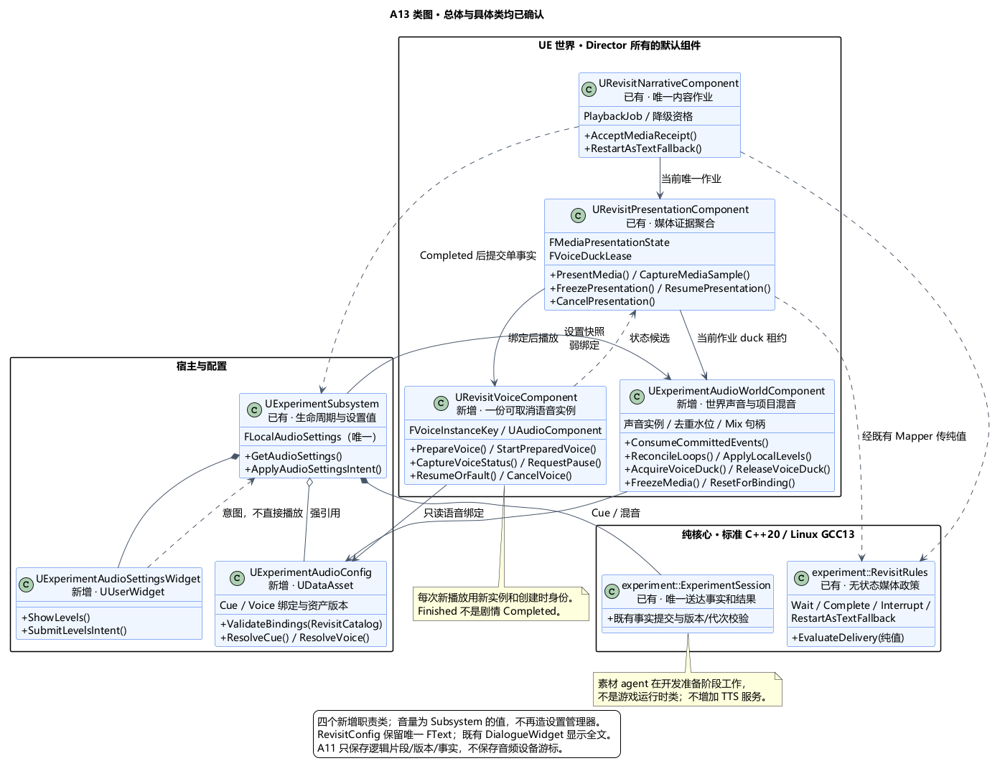
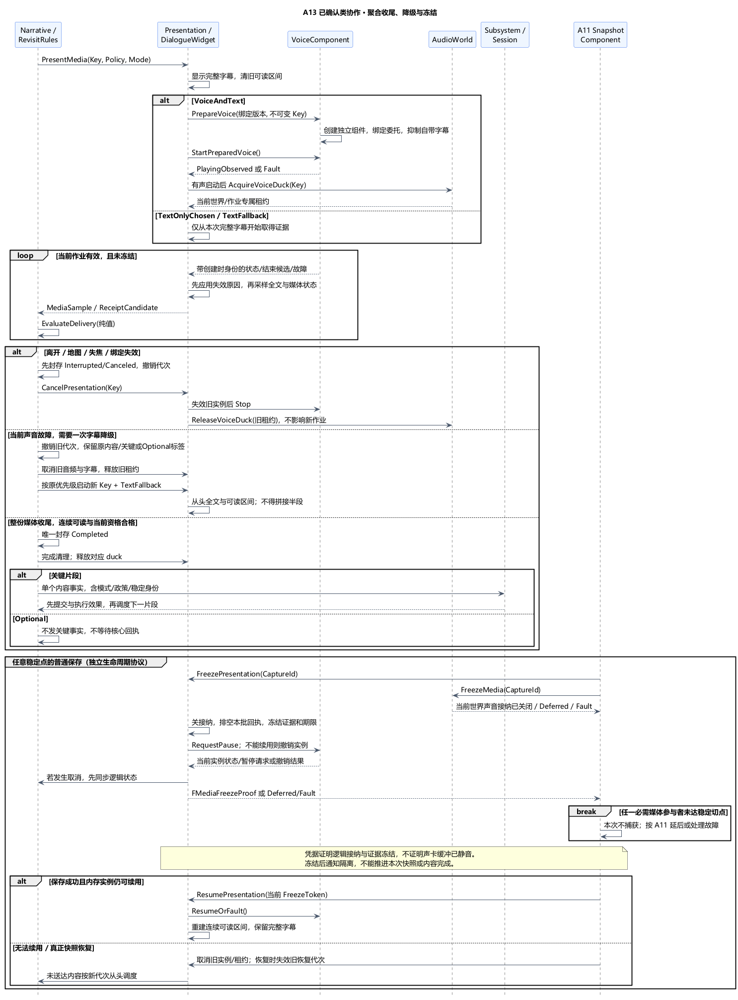
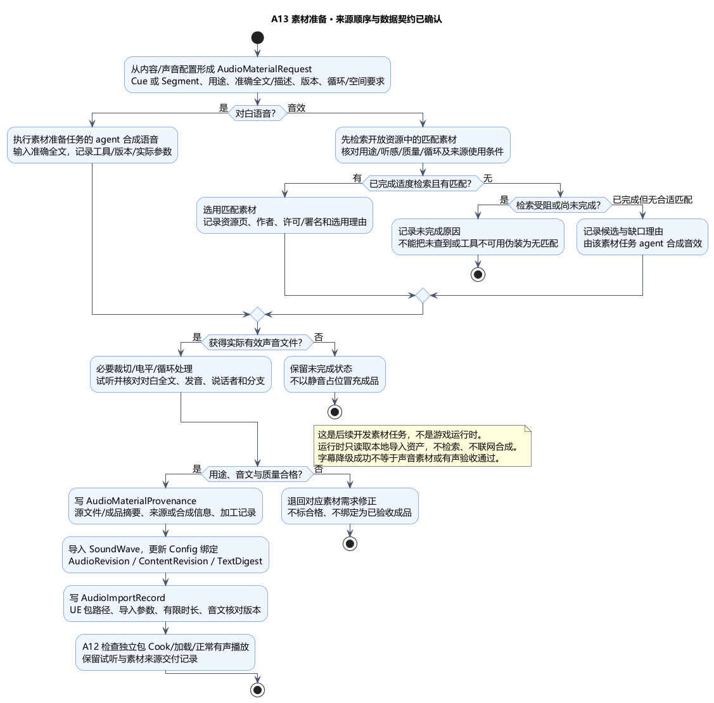

# A13 类图：声音实例、媒体收尾与素材准备

状态：**类图已确认**。日期：2026-11-06。[本次类图确认](../../requirements/001-causal-prototype/sources/2026-11-06-a13-class-confirmation.md)接受四个新增运行时职责类、既有 A10/A11 接口扩展和素材准备数据契约。[总体及素材来源](../../requirements/001-causal-prototype/sources/2026-11-06-a13-confirmation-and-audio-sourcing.md)此前已确认：agent 合成对白、音效优先匹配开放资源再按需合成。尚未制作或导入素材；继续 [A12 验收与交付总体](A12-validation-and-delivery.md)。

## 1. 技术栈、类与唯一所有权

沿用标准 C++20 / Linux GCC13 核心、UE5.6.1 C++、原生 AudioComponent/SoundWave、SoundAttenuation/SoundConcurrency、SoundClass/SoundMix、UMG/FText；仍为一个 UEgame Runtime 模块。素材 agent 与其合成工具位于开发准备流程，不进入游戏运行时。

| 类 | 类型与生命周期 | 本次职责及主要接口 |
| --- | --- | --- |
| `UExperimentAudioConfig` | 新增 UDataAsset，Subsystem/既有配置强引用 | `ValidateBindings(RevisitCatalog)`、`ResolveCue`、`ResolveVoice`；资产引用、版本、预算、混音与等待窗口；不复制对白全文 |
| `UExperimentAudioWorldComponent` | 新增，Director 默认 UActorComponent，无独立玩法 Tick | `ConsumeCommittedEvents`、`ReconcileLoops`、`ApplyLocalLevels`、`AcquireVoiceDuck`、`ReleaseVoiceDuck`、`FreezeMedia`、`ResetForBinding`；世界声音实例和项目混音覆盖的唯一管理者 |
| `URevisitVoiceComponent` | 新增，Director 默认 UActorComponent，由 Presentation 唯一驱动 | `PrepareVoice`、`StartPreparedVoice`、`CaptureVoiceStatus`、`RequestPause`、`ResumeOrFault`、`CancelVoice`；管理一个当前语音实例，输出状态/结束候选/故障，不输出剧情完成事实 |
| `UExperimentAudioSettingsWidget` | 新增 UUserWidget，Subsystem 强持有当前视图，绑定本地玩家 | 显示四项音量、`SubmitLevelsIntent`；不持另一份权威音量、不直接调用音频或 Session |

四项当前音量用 `FLocalAudioSettings` 值由既有 Subsystem 唯一持有，不再增加设置管理类。设置跨手动新轮和世界重绑保留，在当前应用进程内有效；本次不新增偏好存档文件或第二文件保存机制。WorldAudio 读取设置快照并负责当前世界的混音应用，不拥有另一套可改设置。以后若需要关闭程序后记忆音量，单独扩展偏好持久化。

Director 强持默认组件；组件以反射强引用保活自身创建且尚未释放的 AudioComponent 和所需声音资产。跨 Director/玩家/实体持弱绑定及代次。Subsystem 仍独占 Session；Narrative 独占内容作业；Presentation 只聚合显示和声音证据。声音类别、并发和混音均用引擎资产，不为它们再造项目管理类。

此拆分让世界短音/循环与关键语音分别管理实例，保持一个剧情完成入口；准备素材不依赖游戏运行，替换声音可通过绑定版本检查。代价是显式维护播放身份、媒体冻结和素材来源记录，换取可取消、可恢复和可核对的行为。

## 2. 既有类扩展与纯值

| 既有所有者 | 扩展接口或值 | 不可转移的职责 |
| --- | --- | --- |
| Subsystem | `GetAudioSettings`、`ApplyAudioSettingsIntent`、世界音量重绑；持 `FLocalAudioSettings` | Session 生命周期、事实串行提交；声音设置不改实验阶段 |
| `URevisitPresentationComponent` | `PresentMedia`、`CaptureMediaSample`、`FreezePresentation`、`ResumePresentation`、`CancelPresentation` | 一个 `FMediaPresentationState`：字幕连续可读区间、当前声音状态、模式/窗口和候选；没有送达位，不自行封存 Narrative 的 Completed |
| `URevisitNarrativeComponent` | 现有作业增加媒体政策/模式与有限降级资格；`AcceptMediaReceipt`、`RestartAsTextFallback` | 唯一单通道排程与作业终态，先封存 Completed，再交 Subsystem；Optional 不发关键事实 |
| `experiment::RevisitRules` | 扩展 `EvaluateDelivery` 返回 Wait / Complete / Interrupt / RestartAsTextFallback | 纯值校验身份、可读证据和模式条件；无音频 API、设备、素材路径 |
| `FRevisitDataMapper` | 把媒体采样、原因及模式映射成纯值 | 只转换，不选择分支或伪造自然完成 |
| Session | 事实/结果附必要 MediaPolicyVersion、DeliveryMode、恢复代次及幂等校验 | 唯一两项关键送达位与 Ended；设备健康不是第三项完成条件 |
| A11 Coordinator / SnapshotComponent | 纳入媒体接纳屏障、配置版本与逻辑片段状态；校验周期窗口 | 统一保存/恢复与故障记录；不保存音频句柄或发音游标，不给声音系统复制三次重试循环 |

主要值契约：

| 值 | 最少字段与约束 |
| --- | --- |
| `FAudioCueBinding` | CueId、AudioRevision、SoundWave、Category、LoopPolicy、Gain、Attenuation、Concurrency；普通声音可按预算丢弃，不改变事件是否发生 |
| `FVoiceAssetBinding` | SegmentId、ContentRevision、TextDigest、AudioRevision、SoundWave、ValidatedDuration、AudioTextValidationRevision；文本始终引用 RevisitConfig 的 FText 真源 |
| `FWorldAudioKey` | Run/Epoch/RecoveryGeneration、Entity/BindingRevision、Cue/LoopSlot 或 EventId；事件去重与循环绑定不同，不能用播放次数当玩法次数 |
| `FVoiceInstanceKey` | 嵌套当前 FRevisitPlaybackKey（含 A11 恢复身份），加 AudioInstanceGeneration、资源与设备绑定版本；组件 ID 不能替代播放代次 |
| `FVoiceNotice` | 创建时完整实例身份、NoticeSerial、ObservedAt、类型和原因；声音结束只是候选，不携带可直接提交的 Completed |
| `FMediaPresentationState` | 当前 Key、政策/模式、语音软件状态、字幕采样序列、连续有效时长、等待期限、是否冻结；这些是呈现值，不是另一份核心进度 |
| `FMediaFreezeProof` | CaptureId/FreezeToken、当前媒体身份、接纳已关/稳定回执序号/证据时钟冻结/已请求暂停或已撤销实例；只在本地当前捕获有效 |
| `FLocalAudioSettings / FVoiceDuckLease` | 前者四项音量和 SettingsRevision 属 Subsystem；后者当前 WorldBinding＋PlaybackKey＋MixGeneration 属 WorldAudio，旧释放不能影响新作业 |

核心只接收纯值摘要，不接收 UObject、FText 或来源调查资料。完成事实的 OccurredAt 是聚合条件真实成立的时刻；音频回调只能记录实际观察时刻，不伪造无法知道的声卡结束时间。

## 3. 世界音效、循环与混音

Director 在原有世界稳定处理点交付已提交事件批和当前可听驱动资格。WorldAudio 先核对 Run/Epoch/RecoveryGeneration/实体绑定，再按事件身份消费一次；播放被预算拒绝也算该表现请求已处理，不能后来补播旧爆炸。去重采用生产者序号水位与有界同批集合，实体退役/代次失效时释放，避免无界历史集合。

移动短音可使用真实移动/接地与动画采样的表现事件序号，不由声音组件生成 ActionUsed、伤害或首次落地事实。木体/火球声音只来自成功提交结果，不消费尚未提交的几何候选。A09 遮罩下结算使用不可听驱动资格，不能把补推进事件变成密集音效。

`ReconcileLoops` 读取当前领域状态形成期望循环集合，按 FWorldAudioKey 创建、更新或停止。它不独立递增雨程、火势或弹体寿命。跟随移动实体使用有效弱绑定；缺失、退役或换代立即停止，不留漂浮声源。冻结和恢复后重建循环，历史短音不重放。实际听者沿 A05 游戏相机，小地图捕获不注册听者。

WorldAudio 持两个项目专用 SoundMix 覆盖：本地音量与语音压低背景。用户音量只在三个叶子分类上各作用一次，目标增益为 Master×各分类音量，避免根类与子类重复乘 Master；临时 duck 只作用音效/环境，语音不被自身压低。Mix 压入计数由本地句柄显式管理，滑块变化更新覆盖而不反复 Push。只清理自身压入/覆盖，不能清空整个引擎混音。

`AcquireVoiceDuck(Key)` 返回有代次的租约，正常收尾、取消、故障、冻结取消和卸载均按同一租约幂等释放。旧 Finished 的 Release 不得解除新语音的 duck；真实有声启动失败时不长期压低背景。SettingsRevision 改变时重新应用用户音量，duck 幅度另算。

`ProjectVoiceMuted = Master == 0 || Voice == 0`。仅项目内有效语音静音变化触发 Narrative 取消/新代次 TextOnlyChosen 或恢复 VoiceAndText；非零音量调整不重播，音效/环境滑块不改变对白模式。外部系统静音不作推断。设置界面通过既有 Controller 的受控 UI/输入路径打开；若取得焦点或遮挡字幕即沿 A10 中断，关闭后遵守 A05 释放重武装，不因操作滑块触发松键施法、不改全局世界时间。

## 4. 语音实例、聚合收尾与字幕降级

`PrepareVoice` 先校验单段非循环素材、绑定版本与有限时长，再用先建后播方式创建独立 AudioComponent，强持并绑定创建时 FVoiceInstanceKey，随后 `StartPreparedVoice` 才 Play。每个新语音实例使用新组件，关闭多实例播放和自动销毁，抑制引擎自带字幕；字幕只有既有 UMG 全文。不能在活实例上 SetSound 改成另一句，也不能把旧组件指针查出的“当前 Key”盖到旧回调上。

VoiceComponent 的本地状态仅为 Prepared / StartRequested / PlayingObserved / PauseRequested / EndObserved / Fault / Canceled，描述软件播放生命周期；不出现剧情 Delivered。创建失败立即报 Fault；启动失败不依赖 Finished，按有界启动窗口核对。GetPlayState、虚拟化、结束候选、资源窗口等是软件状态，不能独立证明实际听见。通知有界排队；无法保留必要终态/取消通知时按故障处理，不默认成功。

Presentation 在 A10 有序点先应用已经发生的离开、地图、失焦、设置模式变化、旧代次和取消，再采样全文可读性及当前语音。RevisitRules 只对该不可变采样求值：

- VoiceAndText：全文连续有效达到门槛，覆盖经校验语音窗口，当前媒体实例收尾候选合法且无取消/已知故障，才返回 Complete。明显提前结束、未知丢实例、虚拟化、启动或播放超时返回故障/降级计划。计时器到期不直接 Complete。
- TextOnlyChosen / TextFallback：从该新作业的全文实际显示起重新建立完整连续可读区间；没有虚构的声音完成事件。
- 普通保存暂停不推进字幕、启动/播放等待期限或媒体有效时间；恢复后重新建立字幕连续区间。语音先收尾时仍保留全文，直到新可读区间合格。

Presentation 仅返回带证据的候选 Receipt；Narrative 再核对当前作业，先封存 Completed，随后才经 Subsystem 产生唯一事实。第二项成立时先执行核心 Ended/停止效果，不在语音还待收尾时提前发字幕事实。合法 Optional 完成只封存并释放通道，不提交核心关键事实、不等待其回执。

声音故障的路径是 VoiceNotice → Presentation 的故障候选 → Narrative 撤销旧 PlaybackGeneration → 取消音频/字幕、释放 duck → 按原有优先级建立同一内容的新 TextFallback 作业。保留原 ContentId/SegmentId/KeyKind/分支，不将 Optional 重新推断为关键。VoiceComponent 不自行重播、不决定降级作业，不存在内部重试循环；旧字幕时长不迁移。Optional 降级候选仍受关键内容优先级和当前资格约束，不能滞留到玩家走远后补播挽留。

同一逻辑尝试的故障降级只发生一次；TextFallback 的字幕本身不可用时返回内容故障，交 A11 既有诊断与恢复处理，不再“降级到空内容”。音频健康与 DeliveryMode 进入记录，不因字幕完成改成音频通过。重复/迟到回执对已封存作业无效。

## 5. 媒体冻结、恢复与清理

SnapshotComponent 协调 Presentation/WorldAudio：关新媒体接纳 → 消费冻结前已发生的本批回执至稳定切点 → 冻结媒体证据及等待期限 → 请求暂停仍有效实例，或撤销无法暂停的实例 → 返回当前 FMediaFreezeProof。暂停/撤销导致的逻辑片段变化须同步回 Narrative 后重新采样；不能先捕获旧 Presenting 再把已取消状态留到另一切点。

**FMediaFreezeProof 是逻辑接纳与证据冻结凭据，不是音频设备静音完成凭据。** SetPaused 的本地状态改变不证明声卡线程已处理所有缓冲；此类设备游标不进入权威快照。冻结后才到达的音频通知隔离排队，不推动核心事实、不混入已封闭切点。需要的同步回执无法稳定排空时返回 Deferred 或 Fault，由 A11 决定，不能伪造 Frozen。

普通保存成功后，复核 FreezeToken、作业/资源/设备绑定和实例。冻结期间出现结束/故障不能直接补 Complete；无法证明实例仍可续用时取消并以新代次重播或降级。可续用时显式解除暂停，重新建立可读区间；保存墙钟等待仍按 A02/A11 计阶段时间，不能算内容可读时间。Coordinator 合并普通周期请求，从本次保存结束重新安排下一周期，校验最长媒体窗口与裕量；初始/阶段/终态/故障保存不被语音延迟。

真正快照恢复先使旧 RecoveryGeneration 和所有句柄失效，再停止/释放声音、混音租约与回调。载荷只含逻辑片段状态、已送达事实、必要版本及诊断；未送达片段由 Narrative 新代次从头调度，既有已送达位不清零。用户当前音量保留，不从旧玩法快照倒退偏好；配置/音文版本仍按 A11 兼容性校验，不默默混用旧正文和新声音。已提交终态只恢复结果，不开始新关键播放。

Director EndPlay/解绑显式调用取消与清理；不依赖 2D AudioComponent 的默认 Owner 销毁行为。Ended、手动新轮、世界卸载沿 A10/A11 三条路径，均先失效身份再 Stop/FadeOut；新轮可保留用户音量，但不能保留旧世界实例或 duck。

## 6. 素材准备的数据契约与 agent 分工

素材准备是开发任务链，不是游戏运行时类。执行该任务的 agent 对每个 Cue/Segment 完成以下步骤；不把此图解释成当前已经有合成工具、音源或结果。

1. 从 Config/内容目录形成需求清单：CueId 或 SegmentId、用途/说话者、文本或声音描述、版本、空间与循环要求。对白准确全文从 FText 真源导出，导出副本只用于制作与校验。
2. **对白：由该素材任务 agent 合成。音效：先查找匹配开放资源；没有合适匹配，再由该任务 agent 合成。** 匹配同时检查声音语义、听感、时长/循环用途、质量及来源使用条件；不能因为网页上可下载就直接判为可采用。
3. 记录已查看候选和简短选用/不匹配原因。检索受阻或工具不可用应如实记录未完成，不能捏造成“无匹配”。不要求穷尽所有资源库；完成与该声音需求相称的候选检索后作明确决定。
4. 按需要裁切、调电平与处理循环，核对白全文、发音、说话者一致性和分支，检查噪声/削波/循环接缝。哈希和时长只作一致性依据，不能替代实际听辨。
5. 导入 SoundWave，生成绑定版本、完成资源引用/Cook 清单，交 A12 核对独立包有声路径。素材来源或工具记录只附必要信息，不保存凭据、密钥或账户配置。

| 数据记录（非运行时行为类） | 主要字段 |
| --- | --- |
| `AudioMaterialRequest` | AssetId、CueId/SegmentId、Speaker/用途、文本来源与 TextDigest/ContentRevision、空间/循环/时长约束 |
| `AudioMaterialProvenance` | SourceKind=open-resource/synthesized-voice/synthesized-sfx；任务标识；资源页/源文件、作者、许可及署名信息、候选匹配理由；或生成工具/版本/实际参数、准确文本摘要/音效描述；原始与成品摘要、必要加工记录 |
| `AudioImportRecord` | AssetId、成品摘要、UE 包路径、导入设置、声道/采样率/有效时长/循环属性、AudioRevision、音文校验版本、Cook 构建标识、包内存在与试听结果 |

没有匹配音效时，合成来源关联检索记录与缺口理由。运行时只带绑定所需的版本、ID 和校验摘要，完整来源记录留开发素材清单；必要署名随交付材料，不在游戏声音流程里展示制作细节。合成工具及开放资源站点在实际任务时按可用能力和目标选择，本次不指定未验证的服务。没有完成合成/试听时明确为未完成，不能用占位静音标成成品。

替换声音更新 AudioRevision；改台词同时更新 ContentRevision/TextDigest 并重新合成核对。不得运行时联网下载或合成以绕过 Cook 缺项。缺声音可按已确认 TextFallback 继续内容，但不因此完成该声音素材或 A12 有声交付验收。

## 7. 本机依据与本次验证范围

已确认总体的接口依据继续有效；补充本机 `G:/Epic Games/UE_5.6/Engine/Source/Runtime/Engine/`：

| 证据 | 类设计约束 |
| --- | --- |
| Private/GameplayStatics.cpp:1642–1690 | CreateSound2D 先建后播，SpawnSound2D 返回前 Play；默认 bIsUISound=true、bStopWhenOwnerDestroyed=false，需显式暂停和清理 |
| Classes/Components/AudioComponent.h:60–79、238–246、857 | Finished 原生仅给组件指针，动态无参数；自带字幕可抑制；多实例/组件ID不替代项目播放身份 |
| Private/Components/AudioComponent.cpp:322–345、1104–1183 | 活实例 SetSound 可 Stop/再 Play；暂停异步发往音频线程；结束回调转游戏线程且启动失败可能无 Finished |
| Classes/Kismet/GameplayStatics.h:969–989；Private/AudioDevice.cpp:3172–3225、3860–3869、4020–4033 | Mix 覆盖与 Push/Pop 必须成对、只管本项目；重复 Push 有引用计数影响 |

当前仅文档与本机接口核对，未检索/下载/合成/导入/试听素材，未进行 UE/GCC 编译或游戏运行验证。后续重点：先绑后播/旧实例回调、总静音与音量模式变化、duck 所有权、完整媒体收尾及 Optional、字幕降级身份、异步暂停与逻辑冻结、周期保存连续可读窗口、恢复新代次、声音来源和音文版本、实际 Cook 及有声听辨。

[类图 PUML](A13-class-design.puml) · [媒体协作 PUML](A13-class-media-protocol.puml) · [素材准备 PUML](A13-material-preparation.puml)。四个新增职责类、既有类扩展、唯一状态和值契约、媒体收尾/降级/冻结/恢复接口及素材准备数据契约均已确认；进入 [A12 验收与交付总体](A12-validation-and-delivery.md)。
